# Checks

The checks that can refuse a commit. Other parts of the product determine how
work moves; these determine what may be committed.

The appliance can run without these checks, with fewer protections. When the
checks are installed, they apply to every commit.

The invariant register owns every cross-document label; local statements are
identified by their language and enclosing section.

---

## The gate

### What it is

A fixed, compiled universe of canonical arms. The ordinary commit gate captures
the staged source once, maps every changed path to the affected arms and Cargo
targets, and runs only that deterministic selection. The selection policy,
settings, tests, and report all bind the same immutable source digest.

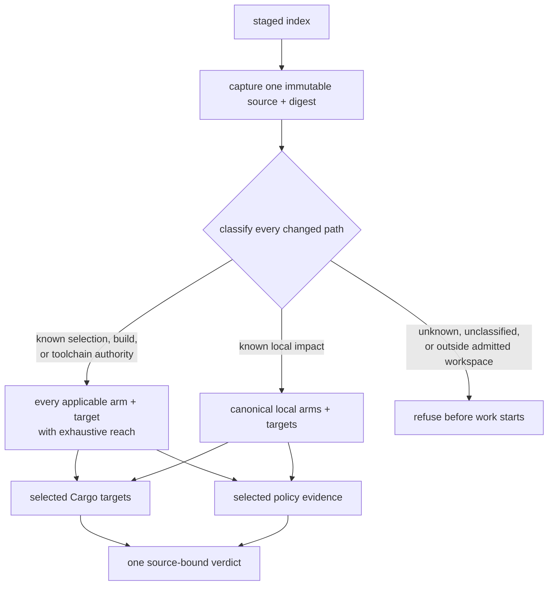

**Invariant —** Ordinary known paths select exact local arms and Cargo targets.
A known compiled selection, policy, build, or toolchain authority selects every
applicable arm and target with explicit repository-exhaustive reach. An unknown
or unclassified path, or a Rust or manifest path outside the admitted workspace,
refuses before selected work begins; uncertainty never impersonates exhaustive
authority.

**Invariant —** The unscoped repository verifier is not an ordinary completion
surface. Package verification, explicitly named studies, and the staged selector
are separate bounded commands; none silently escalates into another.

**Invariant —** Canonical manifest order owns report order. Dependency order is
preserved, while independent selected arms may execute concurrently. Scheduling
must not change evidence identity or presentation order.

### The verdict is collected, not short-circuited

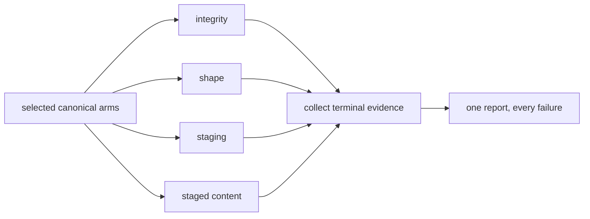

**Invariant —** Every captured selected arm reaches a terminal evidence state.
An inability or prerequisite failure becomes that arm's named refusal rather
than removing its row. Independent failures are collected, so one commit attempt
reports the complete selected picture.

**Invariant —** A clean installed hook emits no terminal diagnostic. A direct
selection command returns the complete typed report and may expose bounded
progress. Silence and evidence are properties of different surfaces, never two
interpretations of the same output.

### Terminal evidence is never conflated

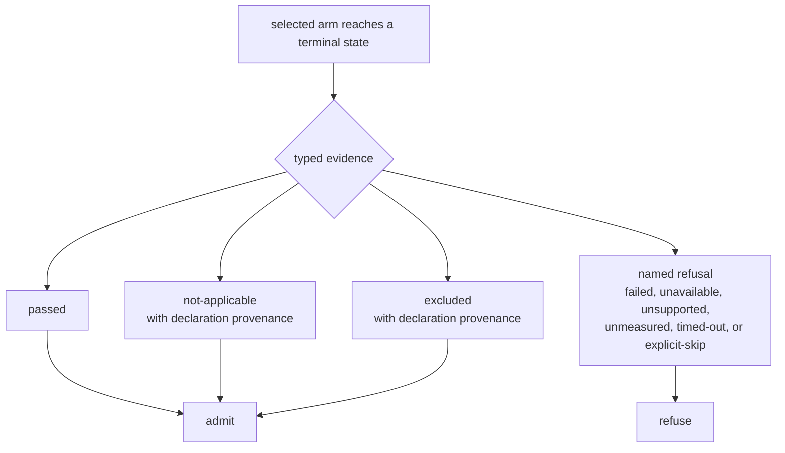

**Invariant —** An arm that cannot execute returns a named refusal state and
the evidence that explains it. It never impersonates a pass or an admitted
absence. *Unknown is not clear* — the same rule that governs the rewind guard
governs every instrument here.

**Invariant —** A measured pass retains the limits it actually applied, so it
is evidence about which thresholds were in force rather than a bare assertion.

**Invariant —** A focused arm with no applicable input records explicit
not-applicable evidence. It may contribute no terminal hook text after the whole
gate accepts, but it is not interchangeable with unknown selection or a missing
capability.

**Invariant —** Direct reports preserve passed, not-applicable, excluded, and
every named refusal state. The commit decision admits only passed and
contract-owned absence or exclusion; it never erases the evidence distinctions.

### The ledger follows the verdict

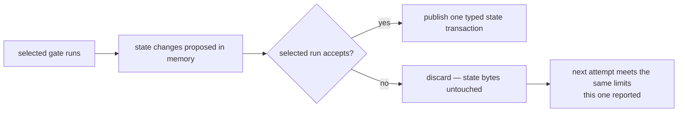

**Invariant —** Latch creation, hold, healing, rename transfer, and peer-claim
changes remain proposals until the enclosing selected run accepts. A refused run
is byte-preserving, so the author's next attempt meets the same durable state.

**Invariant —** A selected run reconciles only the state keys it observed.
Accepting a partial run cannot prune an unrelated latch or claim.

**Invariant —** A configured repository command runs only after staging accepts,
and receives paths and bytes from the same staged capture. Configuration cannot
make that command observe a half-staged or different tree.

---

## Pressure

The mechanism shared by every measure that has a limit rather than a rule.

### Base, elastic headroom, latch

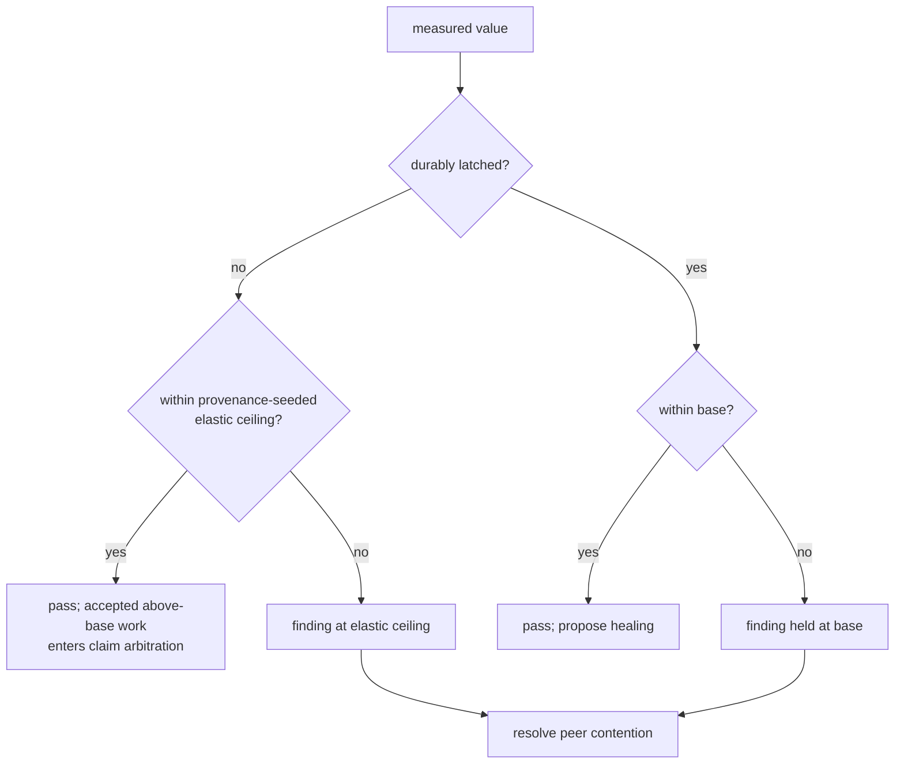

**Invariant —** Elastic headroom is temporary capacity above base, not a second
normal limit. A durable latch spends that capacity and holds the subject to base
until an accepted run measures it at or below base.

**Invariant —** Policy compilation resolves every finite multiplier, minimum,
maximum, and explicit ratchet into one checked integer ceiling. Non-finite input,
an invalid range, or an unrepresentable result refuses instead of selecting a
fallback.

**Invariant —** A refusal that is due to a latch rather than to the value says
so, and names the ledger holding it. "Over the limit" and "held at base" are
different diagnoses.

### State changes are accepted as one transaction

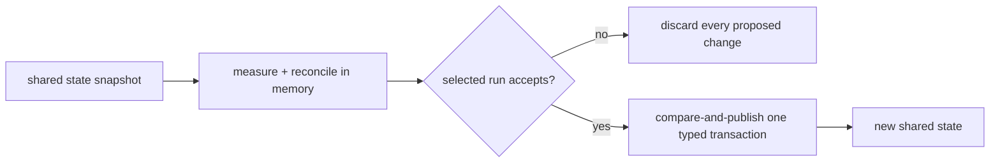

**Invariant —** Healing is evidence, not a side effect of inspection. It becomes
durable only with the accepted run that observed it. A run refused for any other
reason leaves the prior latch intact.

**Invariant —** An emptied ledger is deleted rather than left as an empty file,
so a fully healed subject leaves no trace.

**Invariant —** At run start, the complete staged rename map moves every prior
latch and live claim to its canonical destination before liveness pruning.
Ambiguous destinations refuse.

**Invariant —** Partial selected runs reconcile only observed sticky keys.
Unrelated live state survives; absence from a selected slice is not evidence of
global absence.

### Jitter retains its provenance

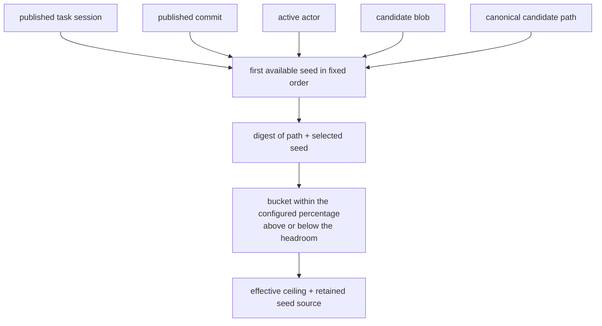

**Invariant —** Variation applies to headroom, never to base. No seed can lower
the effective ceiling below the normal limit.

**Invariant —** Seed resolution has one order: published task session, published
commit, active actor, candidate blob, then canonical candidate path. The report
retains both the selected value and its source; it never relabels provenance-only
fallback material as a human actor.

**Invariant —** Variation is deterministic for the captured path, seed, and
policy. Replaying the same evidence resolves the same integer ceiling.

### Contested pressure informs rather than blocks

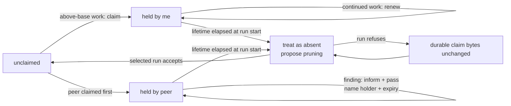

**Invariant —** Latches and claims share one repository authority below the Git
common directory, so every linked worktree sees the same pressure state.

**Invariant —** Claims are time-boxed. A run treats an elapsed claim as absent
and proposes pruning it, but only an accepted run publishes that removal. A
refusal leaves the durable claim bytes unchanged for the same reconciliation on
the next attempt.

**Invariant —** The earliest claimant owns a contested subject, with a
deterministic tie-break, so ownership never depends on scan order.

**Invariant —** A finding whose subject is held by a peer **informs and passes**.
Only unclaimed findings block. The redirect names the holder and the expiry, so
the reader knows whether to wait or to move to another seam.

**Invariant —** Every run binds one named actor and the run-start claims into
its verdict semantics. A revision-selected run may observe those claims, but it
rejects its reconciled proposal before durable publication, so investigation
never creates, renews, expires, prunes, transfers, heals, or latches shared
state.

---

## The instruments

The compiled manifest is the exact authority for instrument membership, stable
identity, and report order. This document owns the common semantics; it does not
duplicate that executable inventory. Current instruments fall into these
families:

| family | contract | representative evidence |
| --- | --- | --- |
| repository integrity | refuse a candidate whose merge, phase, staging, path, document, link, or configuration facts violate a binary or equality rule | tree and index identities, canonical paths, declared versus observed sets |
| source and toolchain | run the selected formatter, compiler, static-analysis, environment, and prose arms over the captured source | exact tool identity, examined inputs, diagnostics, terminal outcome |
| structural pressure | measure bounded source and document properties without allowing them to regress invisibly | measured subjects, base and effective ceilings, durable latch transaction |
| differential quality | compare the selected candidate with admitted baseline or ratchet evidence | baseline identity, candidate identity, additions and removals |
| test evidence | join executed tests, source reach, mutation disposition, suite seams, and subsumption by one source identity | executed test identities, covered sources, mutation identities, retained comparisons |

The ordinary commit selector runs the arms locally reached by the staged change
plus its always-on integrity arms. A known compiled authority change is the
deliberate exception: it selects every applicable arm and target with exhaustive
reach. Explicit long-running studies consume their own complete test-evidence
graph; they are not silently folded into an ordinary commit attempt.

**Invariant —** A limit is either a **threshold** (a number a subject must stay
under), a **set equality** (declared versus observed), a **differential** (this
change versus a baseline), or **binary** (any occurrence). Nothing else is a
limit, and a study says which kind it is.

**Invariant —** A differential measure fails only on regression. A repository is
permitted to be imperfect; it is not permitted to get worse.

**Invariant —** A binary integrity rule and an explicitly zero ceiling stay
zero. Where one occurrence is already the whole defect, a policy value cannot
quietly turn the rule into an allowance.

**Invariant —** A measure whose baseline cannot be read must not read as clean.
This is the one place where the *unknown is not clear* rule is most easily lost,
because a missing baseline and an empty baseline produce the same set.

Every instrument declares exactly one kind of limit and returns typed terminal
evidence. The compiled declaration owns that instrument-to-kind mapping; this
diagram owns the shared type structure.

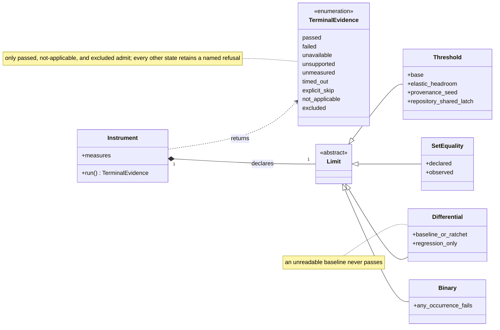

A waiver is independent of the limit taxonomy. It is tracked and enumerable,
and an instrument may admit none or many.

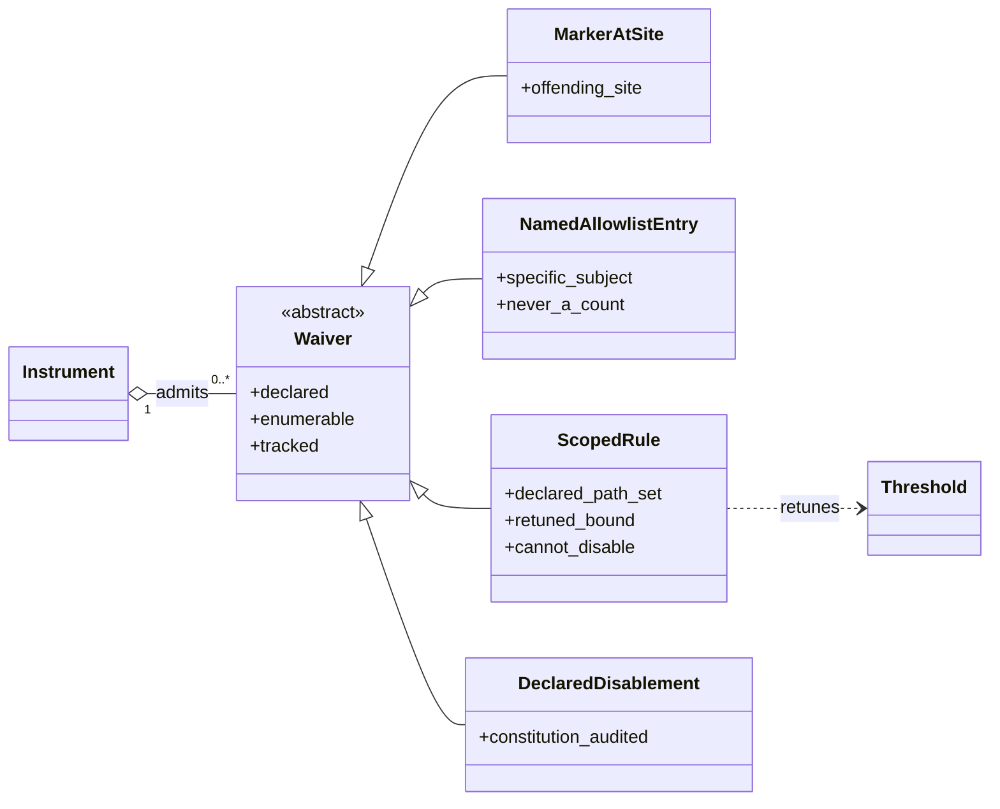

---

## Scope and waivers

### What a study sees

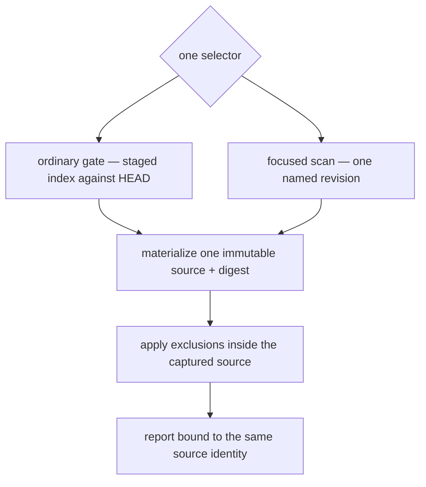

**Invariant —** Selection and content have one authority. The ordinary gate
reads staged bytes only; a focused selector materializes one named revision. No
result combines names from one source with bytes from another.

**Invariant —** One run has exactly one selector. Staged and revision sources
cannot be combined or resolved by precedence.

**Invariant —** The captured source cannot move under a run. A digest mismatch,
missing selected object, or source change refuses instead of producing evidence
for a hybrid tree.

**Invariant —** Exclusions are applied inside every captured source, and runtime
state remains outside the scanned authority. A study can never take the
appliance's own bookkeeping as repository evidence.

**Invariant —** The fully-staged rule is the intersection of staged and unstaged
names: a file partly staged is refused, because every other measure would
otherwise judge a tree that is not the one being committed.

### The forms an exception may take

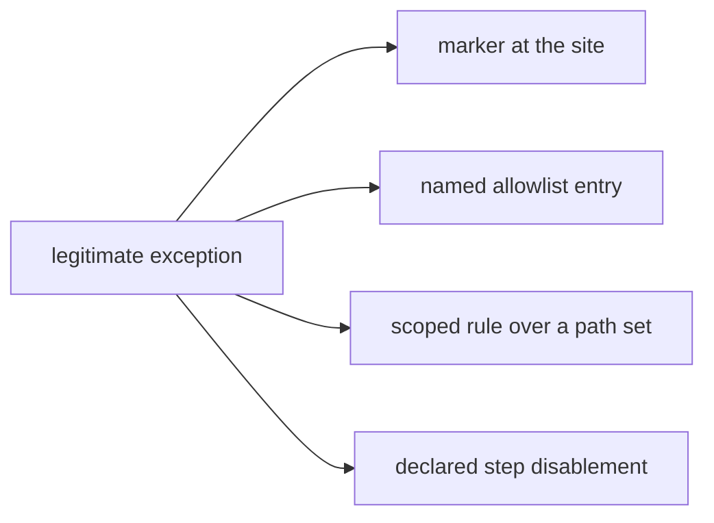

**Invariant —** Every waiver is **declared and enumerable**. There is no silent
suppression: each form leaves a record that can be listed, reviewed, and
attributed.

**Invariant —** A named allowlist names the specific thing it permits. A count
is never a waiver; permitting "three of these" permits the wrong three.

**Invariant —** A scoped rule retunes a bound over a declared path set. It
changes the limit, and it cannot disable the measure.

**Invariant —** A step may be disabled by configuration, and that disablement is
itself bounded: the check system audits its own disablements, so turning a gate
off is a visible act rather than an absence.

**Invariant —** Waivers are tracked, so every clone sees the same exceptions. An
exception that lives only on one machine is not an exception, it is a local
divergence.

---

## Findings become work

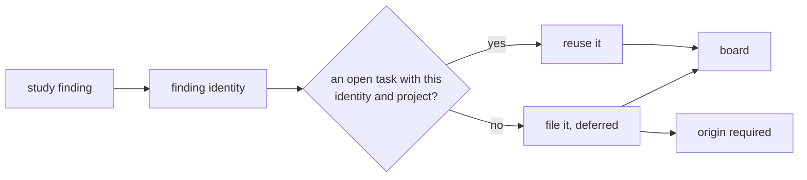

**Invariant —** Only registered instruments may file work, and only when asked.
A study cannot decide on its own to put something on the board.

**Invariant —** Filing is idempotent against a finding's identity within its
project. Re-running an instrument reuses the open task rather than filing a
second one.

**Invariant —** A finding's identity survives the board's own normalization, which
is what makes it usable as a key rather than a label.

**Invariant —** A completed task with the same finding identity never blocks
re-filing. Recurrence files a fresh task carrying an annotation that names the
resolved one, so the link to its prior fix is recorded rather than inferred.

**Invariant —** Study work is filed **deferred**, and a deferred row carries no
due date, so time spent parked does not consume the priority clock.

**Invariant —** A study task carries the same required origin as any other task,
inheriting the acting claim when none is given. Findings enter the board on the
same terms as everything else and compete for attention honestly.

**Invariant —** Findings and filed work are coextensive: an instrument reports
what it found, and dispatch decides what becomes a task. An instrument cannot
pre-seed or suppress its own filing.

---

## Isolation

The one private immutable tree retained by the run is the sole selected-source
authority. An arm consumes that tree directly or derives a verified exact sealed
mirror with separate outputs; the caller's checkout is never an execution
workspace.

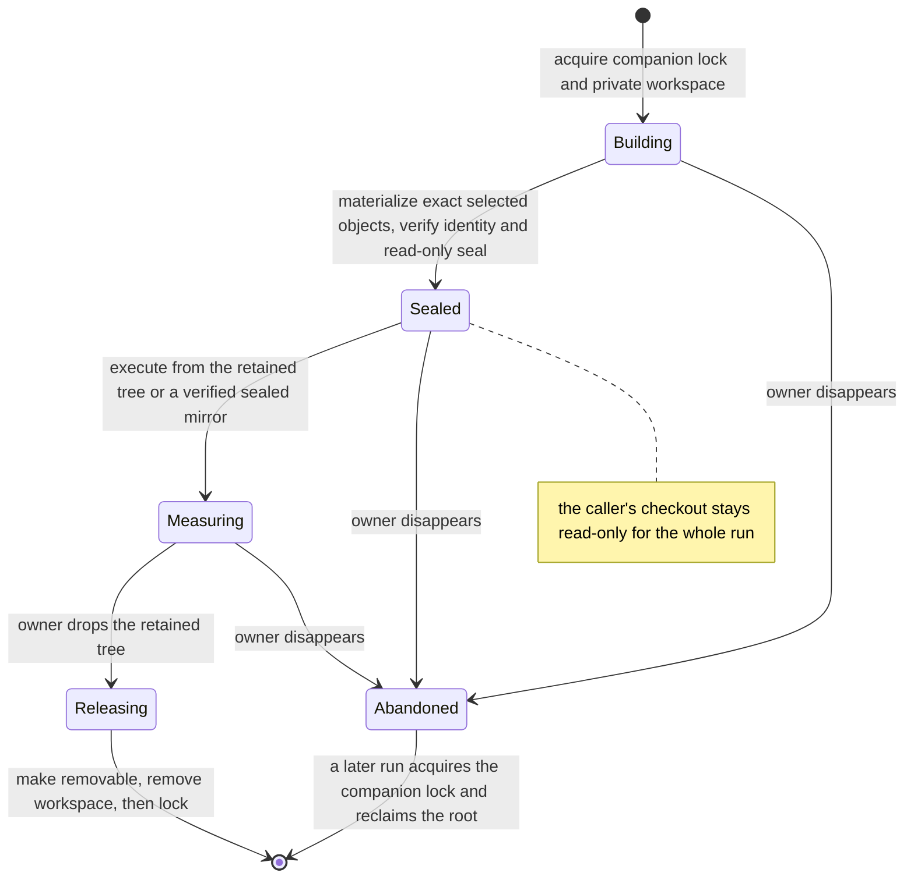

**Invariant —** Isolation preserves selection rather than widening it. The
private tree contains the exact staged-index or named-revision objects already
bound to the run's source identity. Every selected arm consumes that authority
directly or through a verified exact sealed mirror; a mirror cannot add or
replace selected source.

**Invariant —** The caller's checkout is read-only for the whole run, so
concurrent control-plane commands and supervisor probes keep observing reality.

**Invariant —** A companion lock is the liveness authority for a private root.
Cleanup reclaims a root only after acquiring that exact lock; a directory name or
process-shaped suffix is never enough evidence that the root is abandoned.

**Invariant —** Cleanup lifts the read-only seal only while holding the lock,
removes the workspace first, and unlinks the companion lock only after removal
succeeds. An interrupted cleanup therefore retains the evidence required for a
later safe reclamation.

---

## What is policy and what is shape

**Shape** — exact staged-path selection, one immutable source identity, canonical
report order, collect-all typed terminal evidence, accepted transactional state,
base-headroom-latch pressure, provenance-retaining variation, claim-based
redirection, partial reconciliation, the four kinds of limit, the four forms of
waiver, idempotent filing, and one retained immutable selected-source authority
with verified exact sealed execution mirrors.

**Policy** — the compiled instrument manifest and the declared values each
instrument consumes: thresholds, headroom and variation, claim lifetime,
recognized literals and prose, admitted paths, ratchets, and tracked waivers.
Policy can select and tune a known mechanism; it cannot create a new executable
arm or weaken the shape that admits its evidence.

**The test:** if changing it would make a *different* kind of thing enforceable,
it is shape. If it only moves where the line sits for the same kind of thing, it
is policy.

**Invariant —** Configuration fails loudly. Unknown keys are rejected at load in
every layer, and a bound that is not a valid number is an error rather than a
fallback to the default.

**Invariant —** A gate is never closed by weakening it. The remedy for a blocked
commit is the source, or a declared waiver — never a quietly lowered limit.
