# Product model — documents, wire, extension, media

Task documents, the wire seam, extension surfaces, diagnostics, and the media
pipeline.

The invariant register owns every cross-document label; local statements are
identified by their language and enclosing section.

---

## Task documents — prose and board

### The Rust surface

An authored task document is a digest-bound batch input, not a lossless
serialization of the board. `spice doc PATH` (or `spice doc -` for standard
input) classifies ordinary Markdown, emits the one canonical dialect spelling,
previews the tasks that spelling would touch, and applies only that exact digest
against the board snapshot captured by the apply invocation.
`spice doc ledger HANDLE` travels the other direction only as a narrow
single-task document containing the current title, description, acceptance,
flow, authored tags, priority, and append-only task notes when those values are
representable in the dialect. The terminal receives an 8 KiB preview by
default, may request at most 128 KiB with `--max-bytes`, and uses
`--output FILE` for the complete canonical bytes plus an export receipt. It is
not the inverse of document apply and does not export a family or dependency
graph.

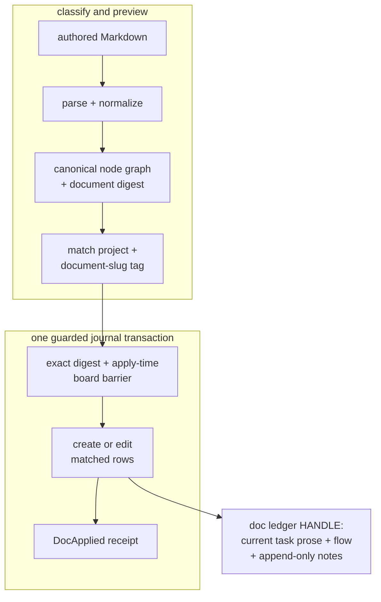

### Behavioral properties

**Invariant —** **Determinism.** The same document produces the same graph,
every time, on any machine.

**Invariant —** **Never-raise.** The parser does not crash on hostile input. BOM,
CRLF, deep nesting, and pathological structures produce *refusals*, not stack
traces.

**Invariant —** **Canonical emission is a fixed point.** The dialect emitter has
one escape rule that its reader reverses exactly; classifying emitted text and
emitting it again changes no byte.

**Invariant —** **Cycles are refused, not resolved.** A graph that cannot be a
DAG is rejected with the cycle named.

**Invariant —** Preview is consequence-free. Apply reclassifies the supplied
document and requires the canonical digest the operator named. In that apply
invocation the client reads the current board and binds its exact head barrier;
movement after that read refuses before mutation. Movement between an earlier
preview invocation and apply is admitted through the apply-time read rather than
mistaken for a race inside one transaction.

**Invariant —** Apply is one guarded journal transaction. An interruption is
all-or-nothing, and retrying a digest that already has a `DocApplied` fact
returns that committed receipt without appending a second path.

**Invariant —** Apply is **idempotent against project-plus-slug identity**. A
changed document digest may edit an existing matching row; origin records why
the row was created and does not namespace later document matching.

### The board projection is intentionally narrower than the dialect

| Authored value | New matching row | Existing matching row |
| --- | --- | --- |
| title | stored | replaced |
| project | Rust `doc` supplies `task.document` | same matching project |
| acceptance | stored; absence is empty | replaced; absence clears it |
| tags and priority | stored with the internal `document-slug:<slug>` tag; priority is a tag | replaced from the document while retaining the internal slug tag; absence removes prior authored values |
| dependency graph | stored from the complete parsed graph | replaced from the complete parsed graph; an omitted explicit edge is removed |
| flow | explicit flow, or the ordinary acceptance-sensitive default | unchanged by document edits |
| description | stored; absence is empty | replaced; absence clears it |
| annotations | appended as task notes; exact duplicates are not appended again | new annotations are appended; omission does not erase prior notes |
| due | normalized by the Markdown dialect but not projected into board heads | no board effect |

These are replacement semantics, not patch semantics. In particular, an absent
description, acceptance, tag, priority, or explicit dependency in an edited
document does not mean “leave the old value alone.” Notes are deliberately the
exception: they are append-only evidence, and omitted annotations leave them
intact. The narrow `doc ledger` output is therefore a readable current-task
recovery view, not a safe lossless export-and-reapply format. A task whose
current heads cannot be expressed by the closed dialect reports
`doc::ledger-unrepresentable` rather than fabricating a document.

The dialect's `Flow:` field deliberately has its own closed input vocabulary:
`design`, `plan`, `todo`, `verify`, and `review`. That parser grammar is not the
board's phase vocabulary; ordinary board tasks may use any admitted lowercase
ASCII phase word.

### Identity within a document

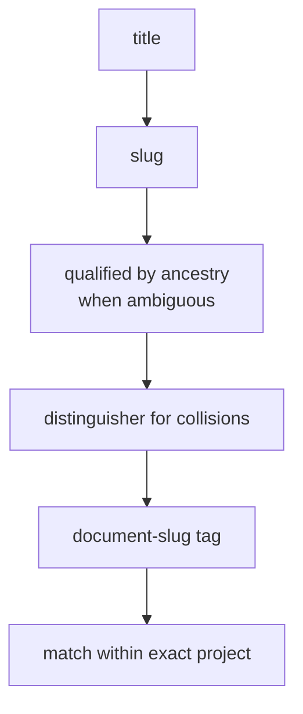

**Invariant —** Matching is scoped to a project and the exact
`document-slug:<slug>` tag. The same slug in the same project converges on one
task even when another document digest supplied it; the same slug in another
project is distinct. In the Rust command surface, context-free classification
places authored documents in `task.document`.

### Refusals and warnings as tables

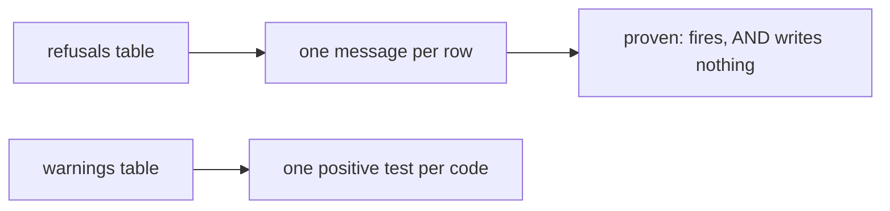

**Invariant —** A classification, preview, barrier, admission, or settled-task
refusal writes no task or document fact. A refusal that half-applies is worse
than no refusal.

**Invariant —** Author text is never parsed as attributes. The argument boundary
is explicit, so a task titled `priority: high` is a title.

---

## The wire seam

### One schema, every consumer

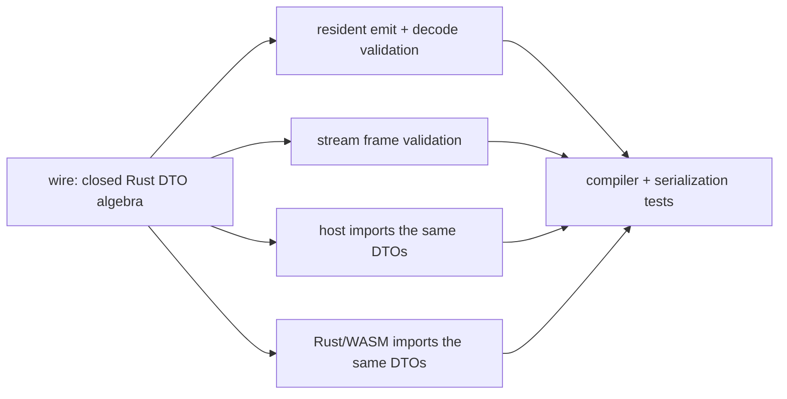

**Invariant —** The `wire` algebra is the single source. Resident, native host,
and Rust/WASM browser code compile against the same closed DTOs and validate the
same canonical serialization; no parallel artifact is another schema authority.

**Invariant —** Payloads are validated at their **emitters**, not only at their
readers. A producer that breaks the contract is caught where it lies.

### Unions discriminate on outcome

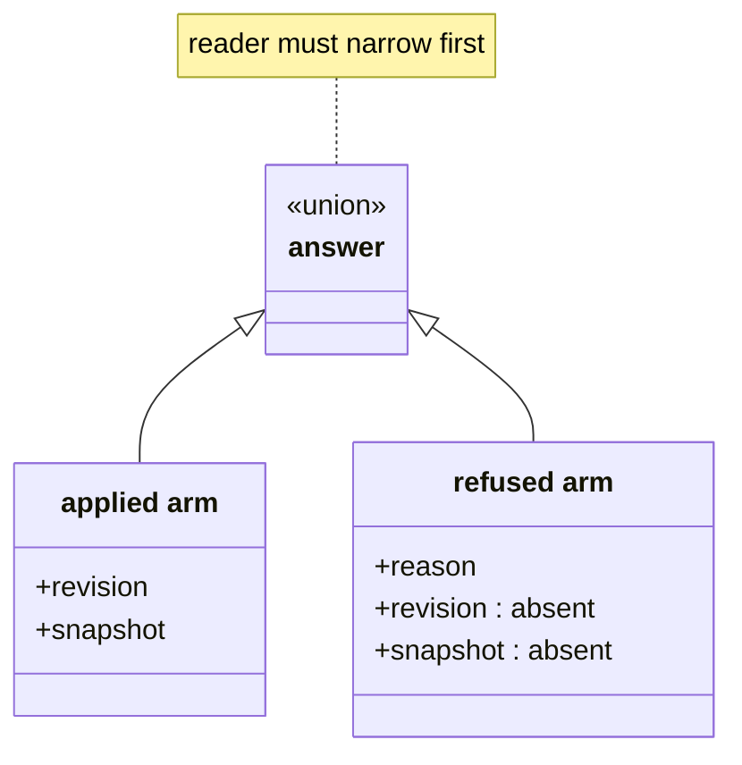

**Invariant —** An answer with two shapes is **two types**, not one type with
optional fields. Held as one object, a reader can take a revision off a refusal
that never had one.

**Invariant —** The discriminant is chosen by *meaning*, not convenience: an
agent-launch answer splits on **whether an agent is now running**, not on `ok` —
because a skip answers ok and starts nothing.

**Invariant —** A field one arm never carries is **declared as absent**, so the
reader is allowed to ask about it. A name missing from one arm is an error on the
union rather than a question.

### Absence has one spelling

**Invariant —** Omission and null are not two ways to say nothing. One spelling
is chosen and enforced mechanically, not by convention.

### One JSON outcome envelope

Every finite `spice --json` invocation emits one newline-terminated `Outcome`
document. A successful daemonless command is
`{"kind":"reply","body":...}`; a read adds its snapshot `cursor`, and a mutation
adds its committed `seq` range. The absence of both coordinates is the one
spelling of a daemonless reply—there is no empty `direct` marker. Refusals and
faults use the same envelope with their respective `kind`. A long-running
stream emits one stream document per wake because it has no finite command
reply; finite `retro` returns its `StreamOutcome` inside the ordinary reply
envelope.

### Bounded reads

**Invariant —** A read shows current, relevant state by default; history and
detail are explicit flags, and no flag makes terminal output unbounded. Every
output-bearing surface admits through the one contract in `wire::output`:

- **Limits.** A surface declares small interactive defaults and its own
  maxima for rows (`--limit`), aggregate encoded bytes (`--max-bytes`), and
  per-field text (`--max-text`). Both sit under the repository `CEILING`
  (1000 rows, 256 KiB, 16 KiB text); the shared `INTERACTIVE` surface
  defaults to 20 rows, 8 KiB, and 240-byte text with maxima of 500 rows,
  128 KiB, and 4 KiB. A request above the surface maximum is refused, not
  silently clamped. Zero rows is a count-only read.
- **Relevance-first admission.** Records are offered current/actionable first.
  Every record is charged its encoded JSON length, the first included, so one
  oversized record cannot bypass the byte limit. The first record that does
  not fit closes admission; a smaller later record never leapfrogs it, so a
  page boundary is a single cursor.
- **No hidden omission.** A partial answer carries an `omission`: population,
  shown, withheld, admitted bytes, the limit that closed admission, the size of
  the next record, and the exact `continuation` command that resumes at it
  (`--after CURSOR`). When the next record alone needs more bytes, the command
  raises `--max-bytes` to what it needs; past the surface maximum, it names a
  file export instead. Text form prints one line stating the same facts and
  the shell-quoted command. Clipped text keeps a UTF-8 boundary and reports
  its withheld bytes.
- **Exact export.** Complete canonical documents and evidence are written to
  an explicitly named file, atomically, with a receipt naming the resolved
  path, byte length, and `spice.cli.export.v1` digest. `-` is refused.

The task surfaces apply that contract directly. Bare `spice task show HANDLE`
prints only the current execution contract: identity, title, project, phase,
status, active claim, requirements, acceptance, dependencies, artifacts, phase
guidance, and next command. `--context` adds origin, acknowledgment, hydration,
Git, parked-commit, and authored metadata; `--history` adds newest-first notes
under the interactive row, byte, and text limits. `spice task list` always
orders current/actionable rows before waiting and terminal rows, then newest
first, and applies the 20-row interactive default even with `--all` or
`--project`. Both surfaces emit an exact `--after` continuation when rows remain.

Mutation replies are outside this contract: they stay complete and concise.

---

## Extension surfaces

### Mounted commands

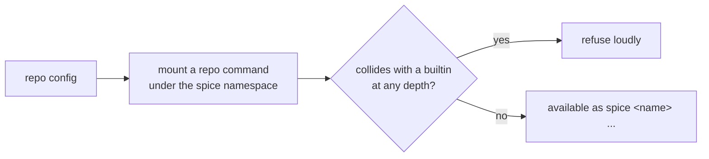

**Invariant —** Built-in verbs and registered actions win at **every depth**.
Shadowing fails loudly rather than silently overriding.

**Invariant —** Dotted mounts may extend a built-in verb only with a **novel**
action name.

### Compiled extensions

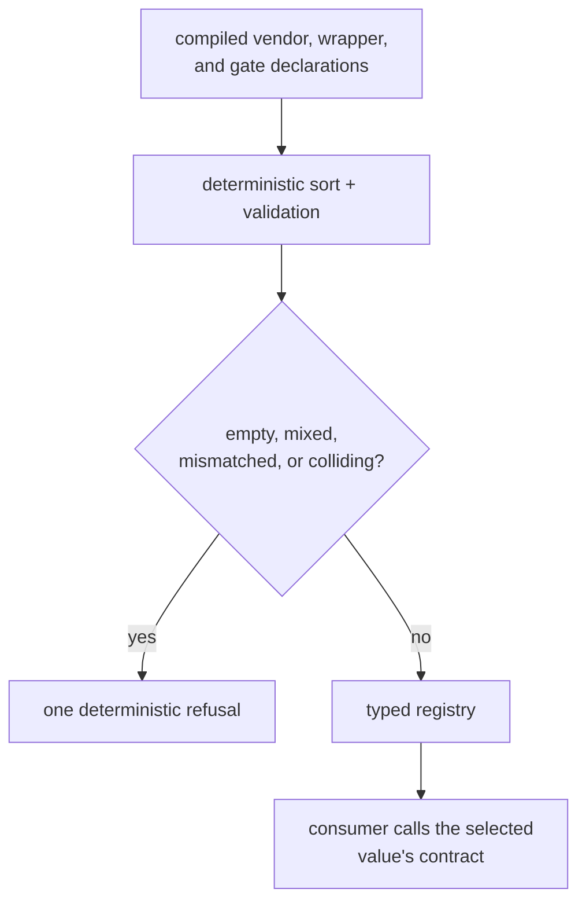

**Invariant —** A new vendor, wrapper, or gate is a **declared typed value**,
never a patch to a dispatcher.

**Invariant —** The compiled registry is the only executable extension
authority. Repository configuration can mount a command, but it cannot discover
or load executable values into the vendor, wrapper, or gate namespaces.

### Shared gate-and-taste scopes

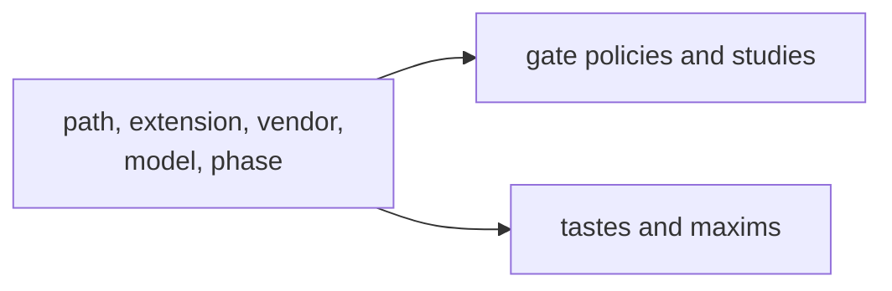

**Invariant —** Applicability is expressed once, in one selector language, and
reused by gate policies and studies and by tastes and maxims. Path, extension,
vendor, model, and phase are the exact selector axes. Shell wrappers and
configured pre-commit commands have separate contracts; the latter's scopes
are path-only.

---

## Diagnostics and discoverability

### Doctor

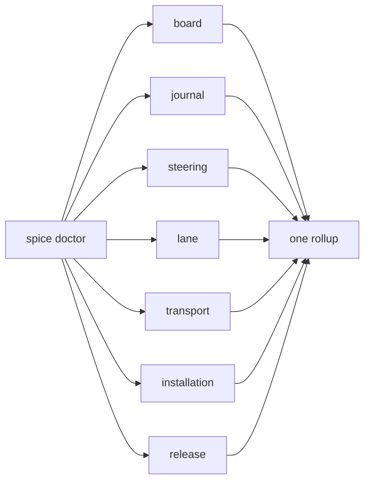

**Invariant —** One top-level rollup aggregates the closed subsystem roster:
board, journal, steering, lane, transport, installation, and release.
"Check everything" is a command, not a checklist in a document.

**Invariant —** Host-probing checks stay **out of hook verdicts**. Diagnosing the
environment and refusing a commit are different jobs.

### Demo

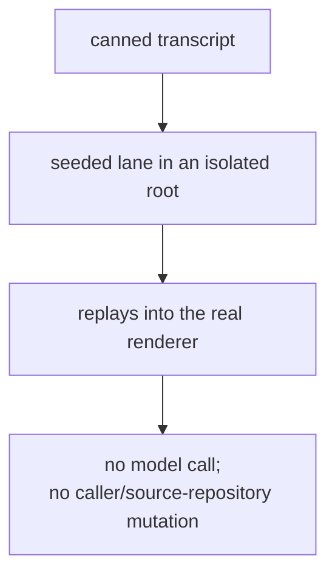

**Invariant —** The demo exercises the **real** rendering path with static data.
A demo that runs a different code path proves nothing.

**Invariant —** Nothing opens on the operator's display without an explicit
request. A demo or a test run that takes over the display disrupts the one
surface the operator is using to supervise everything else.

---

## Media pipeline

### Attachments

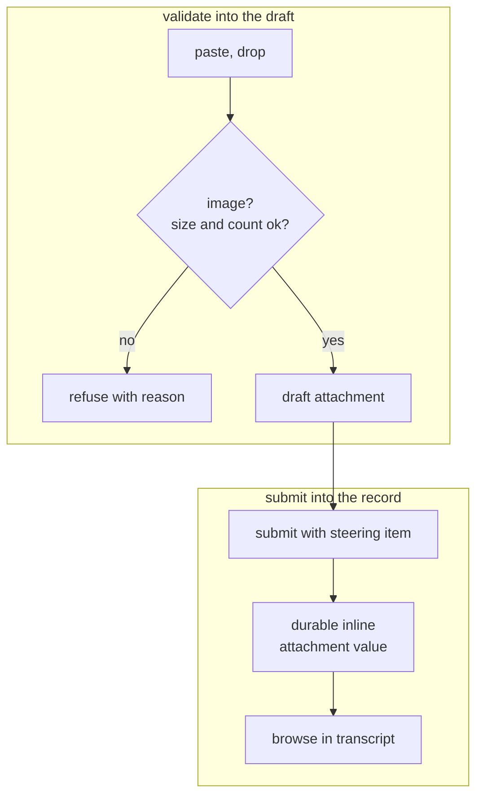

**Invariant —** An attachment becomes part of the **operating record**, not a
transient upload. Screenshots and captures stay browsable beside the message
they arrived with.

**Invariant —** A steering directive retains image bytes only in its attachment
values. Its prose uses bounded, digest-bound `attachment:` Markdown markers to
preserve placement beside quoted replies and body text. Display projections
expand those markers from the same record's attachments; they are not fetch
authority. Agent delivery continues to use lane-authenticated
`AgentMediaReference` values. New sends duplicating attachment data URLs in
prose are refused before journal mutation; historical inline images remain
browsable without rewriting the record.

**Invariant —** Paired view-image tool output collapses to one rendered image
rather than duplicating.

### Speech

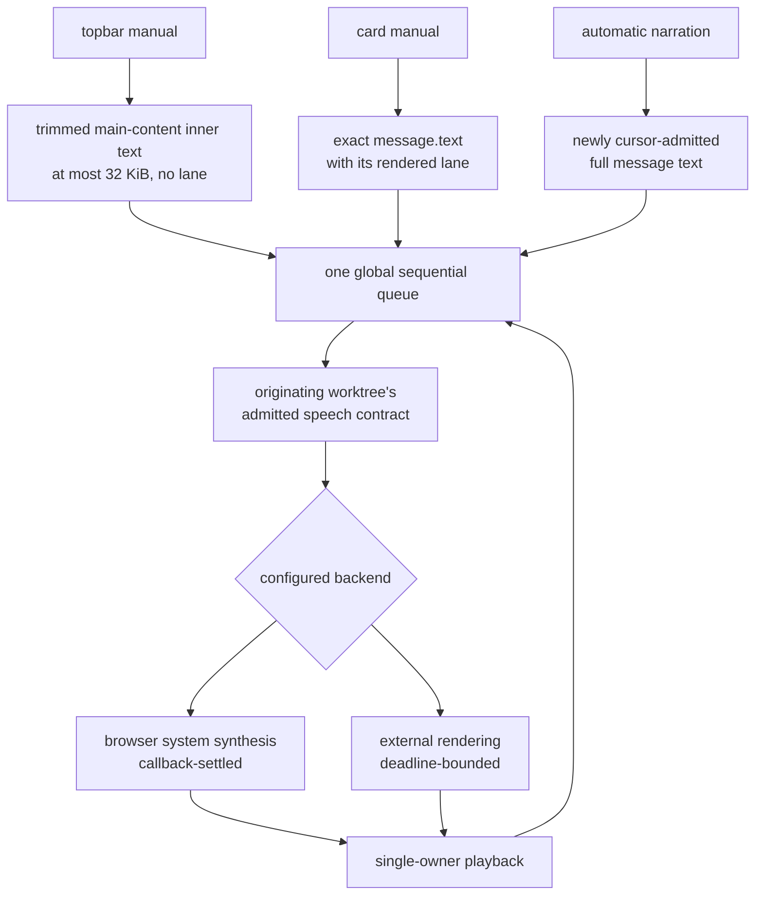

**Invariant —** Card speech uses that card's exact complete `message.text` and
retains its rendered lane. The topbar instead speaks the trimmed visible
`main.content` inner text, refuses more than 32 KiB, and carries no lane.
Automatic narration admits each newly cursor-admitted message's complete text;
it does not reinterpret ACKs or paragraph edges.

**Invariant —** Every queued card or narration entry carries the admitted speech
contract of the agent worktree that produced it. Worktree-scoped `say.voice`
therefore changes voices between agents without creating another playback
owner: the one global queue remains sequential and never overlaps utterances.

**Invariant —** Speech is **best-effort ear candy**. A detected failure is
reported as nonblocking `Speech unavailable` state and never blocks the visible
stream — the transcript remains the record.

**Invariant —** External rendering is deadline-bounded. Browser system
synthesis instead settles on `onend` or `onerror`; if the browser emits neither,
the active queue head remains until the operator uses the global stop.

**Invariant —** A browser publishes its voice list asynchronously, so an empty
list is a pre-publication state rather than a missing voice. A system request
waits for `voiceschanged` under its own bound and then speaks once with the
configured voice; a published list that omits that voice refuses while naming
the voices the browser does offer, and no other voice is ever substituted.
While system synthesis plays, Canvas names the voice the browser reported and
a failed utterance carries the browser's own error code.

**Invariant —** The clip is played back under the media type the backend
declared, never a guessed one.

---

## The shape in one diagram

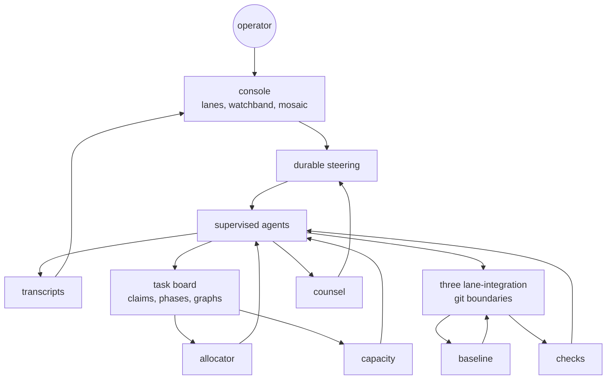

Six closed loops appear in one picture: **read** (the transcript feeds the
console, which informs the operator), **steer** (the operator creates steering,
which reaches the agent), **work** (the board feeds the allocator, which assigns
the agent, which updates the board), **land** (the agent writes git, which
advances the baseline, which refreshes the agent), **counsel** (the agent
produces authored prose, enabled counsel recognizes it, and admitted reminders
return as ordinary steering), and
**staff** (the board exposes capacity, which wakes the agent, which updates the
board).

Every one of them closes. That is the product.
