# Operating loops

The loops Spice runs and the state machines they keep. Contracts with a home in
the [invariant register](invariants.md) are linked, not restated.

---

## L-TASK — the unit of work

**Intent.** A task moves through named phases, and every accepted advance is a
journal fact. [Claims and allocation](invariants/identity.md#work-claims-and-allocation)
govern who holds it.

Stored workflow status is one small machine:

```mermaid
stateDiagram-v2
  direction LR
  [*] --> pending: task&#58;&#58;added
  pending --> completed: accepted final phase
  pending --> deleted: task&#58;&#58;deleted
  completed --> [*]
  deleted --> [*]
```

Claim disposition is a second, independent machine:

```mermaid
stateDiagram-v2
  direction LR
  [*] --> active: claim&#58;&#58;won
  active --> freed: claim&#58;&#58;freed
  active --> lapsed: claim&#58;&#58;lapsed
  freed --> [*]
  lapsed --> [*]
```

Renewal, carry, rebound, and steal add no disposition:

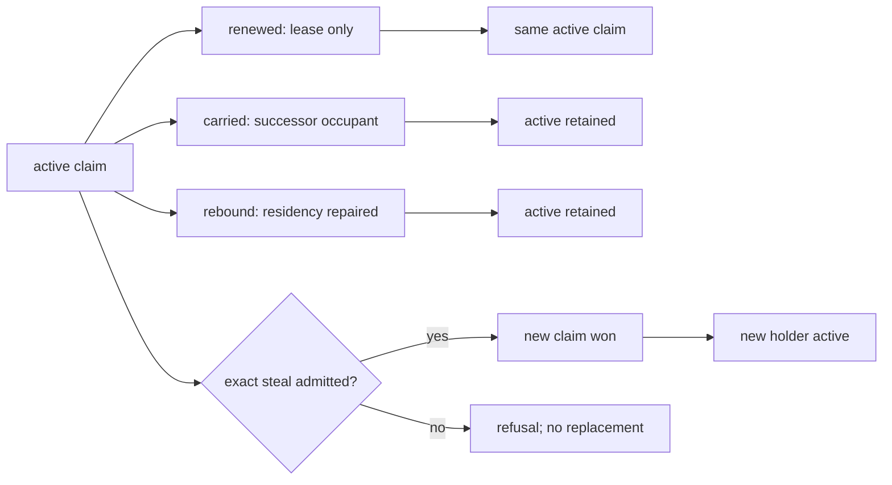

Readiness and possession are projections over those heads, not extra states in
either machine:

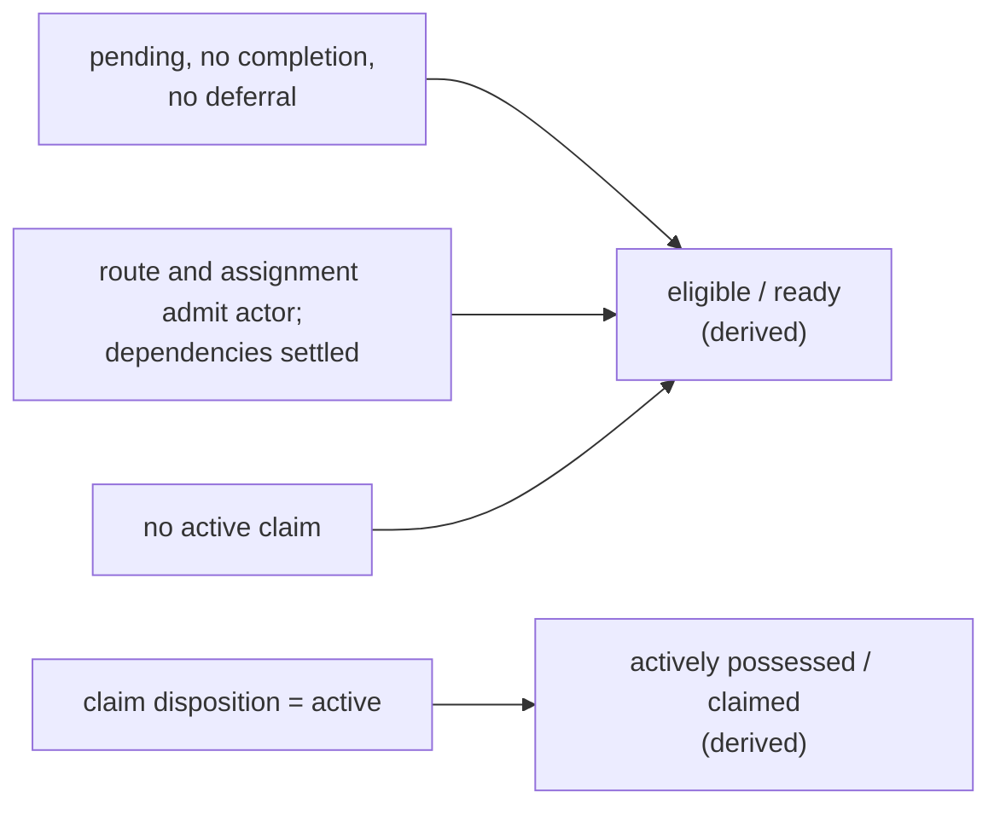

Landing is the Git consequence of one class of accepted advance, never a stored
workflow or claim state; the [integration boundaries](model/boundaries.md#the-three-lane-integration-git-boundaries)
govern it:

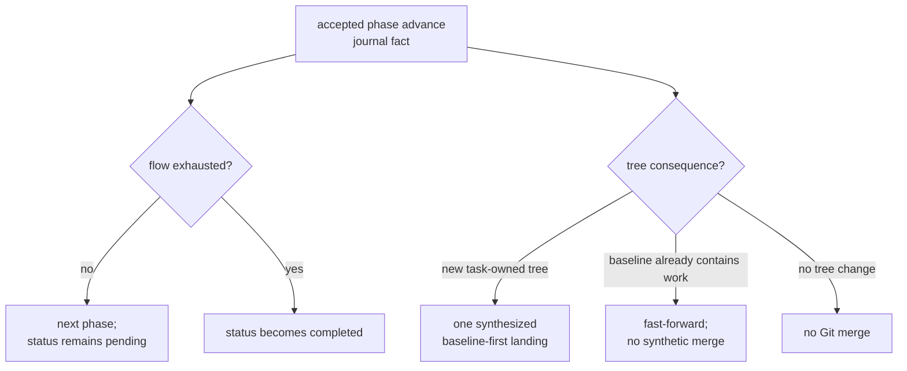

Voluntary release is one guarded Git-and-journal transition:

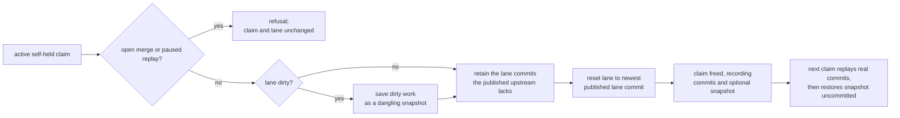

**Invariants**

- `pending`, `completed`, and `deleted` are the only workflow statuses, and
  `active`, `freed`, and `lapsed` the only claim dispositions. Deferral,
  dependency blocking, readiness, possession, and landing are projections.
- Release never strands unfinished work on a lane. The parked commits are
  exactly the lane commits the published upstream lacks, or, without an
  upstream, those after the claim-time head; a dirty lane also parks its
  tracked, staged, and non-ignored untracked content as a snapshot. Parked
  objects are intentionally unreachable: Spice creates no stash or preservation
  ref, and a pruned object refuses the next claim without changing the board or
  the lane.
- The next claim replays real commits oldest first, then applies the snapshot
  as ordinary unstaged work without committing it or leaving Git operation
  state, so restored work still passes the ordinary pre-commit gate. A
  conflicting commit leaves the replay paused for the claimant with the
  snapshot waiting behind it until task completion is retried.
- `task free`, the holder's own deferral, and plan completion all park this way.
  A peer's deferral never takes possession: it changes scheduling only, except
  that deferring an open Design another lane holds
  [asks that holder to free it](invariants/identity.md#work-deferral-stops-an-open-design).
- A failed guarded write is an atomic refusal: the claim and lane return to
  their prior state, including the staged and worktree split.
- `task capture` is the single adoption boundary. With `HANDLE` it claims that
  ready execution task; with `--title TITLE --project PROJECT` it creates and
  claims one execution/review task. The existing-task form can adopt no local
  work; either form adopts loose commits, dirty paths, or both. A new-task
  capture requires work to adopt and otherwise directs the caller to `task add
  TITLE --project PROJECT --claim`; its title defaults to the newest loose
  commit subject when one exists.
- Dirty paths are sealed and quarantined before the guarded claim. The
  synchronized boundary retains any loose commits, and a successful claim
  replays the exact staged, unstaged, and non-ignored untracked generation.
  An interrupted adoption resumes only through `task capture` for its sealed
  target. `task capture --restore` never rewinds history: on the sealed HEAD
  it restores the exact pre-claim generation; on any lane HEAD descending from
  the sealed head and any synchronized boundary, it replays the sealed
  generation onto that HEAD as ordinary unowned dirty work, resuming only onto
  the HEAD it began on. When that HEAD already carries every sealed edit,
  nothing is replayed and the sealed objects are retained outside the pending
  slot; a replay conflict retains them the same way. A divergent HEAD or
  mismatched generation refuses without deleting quarantine.
- Every unowned-path or loose-commit refusal names the same two choices:
  `task capture HANDLE` for an existing ready execution task or `task capture
  --title TITLE --project PROJECT` for new execution work. Planning and Design
  claims refuse implementation adoption before quarantine or claim.
- Every phase transition is a journal fact visible on the board, including one
  that changes no tree. A landing commit carries the task's key, project, phase,
  and session trailers; first-parent history records mutating landings, not
  every transition.
- `task add`, `task plan`, and `task design` share one manual-project
  admission: authors name the project as one lowercase word of `[0-9a-z_]`,
  and no configured root list exists. A project is one opaque label compared
  whole, never a scope over others that share its leading text, and
  `task list --project` matches the complete value only; a retained label
  admitted with dots compares whole the same way. A refused project names that
  spelling, so the author can repair it without probing. Only handle rendering
  abbreviates a filed project, to its last dot-separated run.
  Hidden leading-dot projects and the `[tasks]` configuration table were last
  admitted by release `8aaba9962`: a retained `[tasks]` table refuses
  configuration as retired with that release, and a journal whose task or
  claim heads, facts, command receipts, or landings still name a leading-dot
  project refuses its schema 98 crossing atomically with that release.
  Default reads (`task list`, `task status`, dry `task next` counts) cover every
  filed row plus the reader's own origin-thread rows, so an authored project is
  never invisible to a lane that may be allocated it.
- Work controls project these same current tasks into durable `#/work...` deep
  links over Chat, never into a separate page. Project routes retain the exact
  project label; team and working-group routes retain only stable identity and
  re-resolve current membership after topology or partition changes. All-open
  and all-planning scopes survive emptiness. A hydrated missing identity
  refuses to Chat, while project-wide, single-task, relationship, and composed
  overview selections stay browser-local.
- `task oops` files one ordinary Plan directly beneath the repository-owned
  opportunistic OOPS Design. The command uses `--project` or derives the one
  public project held by the actor; zero or multiple eligible claims refuse
  without mutation. The first report after the prior OOPS Design settles
  atomically opens a fresh generation, and concurrent first reports cannot
  open two. Each line retains its exact report, origin, and public project,
  stays gated by the Design until its holder's proposal is decided, and
  carries the contract to record an explicit disposition, through `task done
  --disposition` when no change is warranted, and to construct child work when
  it is.
  An ordinary claimed duplicate is not a Plan disposition; remove it through
  `task delete HANDLE REASON --force-claimed`.
- Every task statement stores a pitch: one plain, unlabeled, accessible
  sentence saying why the task matters, required on `task add`, `task plan`,
  and `task design` and refused when missing, blank, multi-line, or over 160
  characters; a Design's pitch is its problem sentence. The description is the
  how: durable need, mechanism, and invariants, with no opener to carry. A
  filing with no author to ask derives its pitch once and never asks again: a
  retained task at the schema crossing and a review follow-up from the first
  substantive description sentence or else the title, a `task oops` report
  from its title. The appliance never rewrites an existing description. The
  Design request prints the stored pitch.
- Text surfaces lead with title, then pitch, and prose collapses behind one
  line per block naming its count and the `spice://` resource that expands
  exactly it; nothing is cut with an ellipsis. `task show` prints
  `description: N lines spice://task/HANDLE/description`, `acceptance: N items
  spice://task/HANDLE/acceptance` (`questions` for a Design), and `history: N
  steps spice://task/HANDLE/history`; `task show --full` prints every block
  whole. Where the holder works nothing collapses: the held-claim briefing and a
  fresh claim's answer carry the whole description and acceptance, and every
  assignment points at `task show HANDLE --full`. Task list and board rows print
  title and pitch; a room catch-up names each room's title, pitch, and
  description count line; a Design request opens with its `Pitch:` line and
  quotes each matched question whole.
- `task add --draft` (and `task plan --draft`, `task design --draft`) records a
  typed Draft: prospective work under an admitted public project, distinct from
  Filed work. Default reads show it only to the operator and its origin thread,
  and complete operator reads retain it. Its author revises title, description,
  acceptance, intent, flow (`task modify --flow`), dependencies,
  and project; an edit that would leave a Design any route but its one `design`
  phase refuses. It never allocates, claims, captures, completes, defers,
  satisfies another task's dependency, or enters team strips and execution
  summaries.
  An operator Draft records `operator:draft` provenance when no `--origin` is
  named; a lane Draft still names its directive or held parent. Each refusal
  names `task file` or the Draft field to repair. `task file`
  validates it as a complete ordinary Task, Plan, or Design under current
  project, flow, acceptance, dependency, preparation, environment, and taste
  policy, then atomically turns it into Filed work and can claim it. A failed
  filing writes nothing.

---

## L-STEER — intent made durable

**Intent.** After journal acceptance returns a live durable key, operator intent
survives failures until the agent answers it. Before that boundary, the
browser-local queued or sent prediction remains ephemeral. The
[steering register](invariants/identity.md#steering) states delivery,
answering, escalation, and recovery.

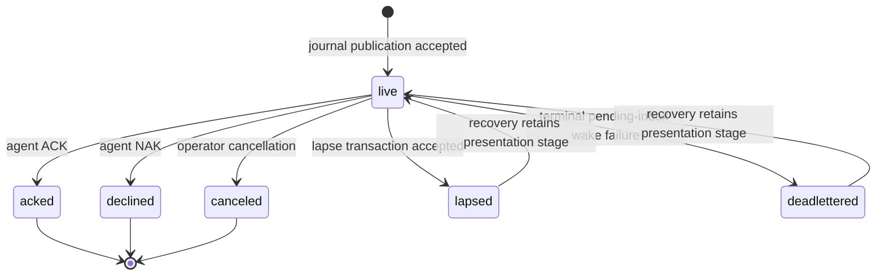

---

## L-AGENT — the work-availability loop

**Intent.** Capacity follows work. Lifecycle authority may seat one new occupant
in a vacant lane when derived eligible work warrants it. Every occupant turn
ends by vacating its lane; only a later serialized lifecycle decision may launch
another. Ordinary capacity needs no hand-managed agent count; the
operator-authorized lane wake remains available, including for a Drain lane.

The detached supervisor records the phase of one process turn:

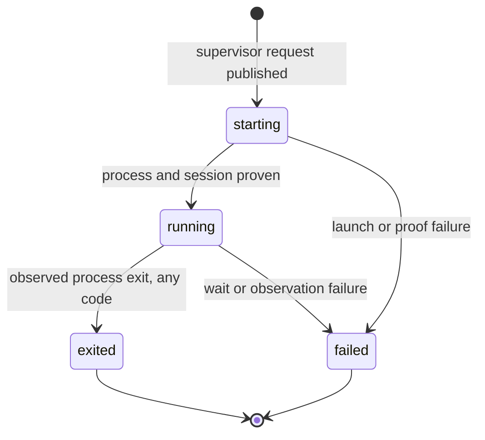

The UI derives lane status independently; pending direction that can wake the
lane outranks liveness:

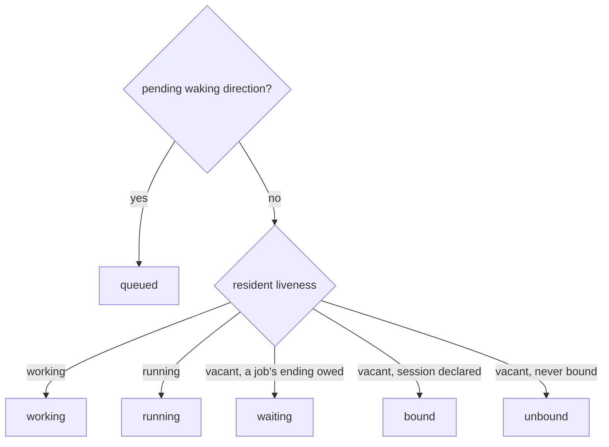

Resident lifecycle is a third vocabulary; resident replacement may move directly
to `dark` while detached supervisors remain live:

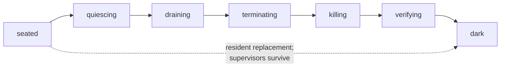

The wake decision:

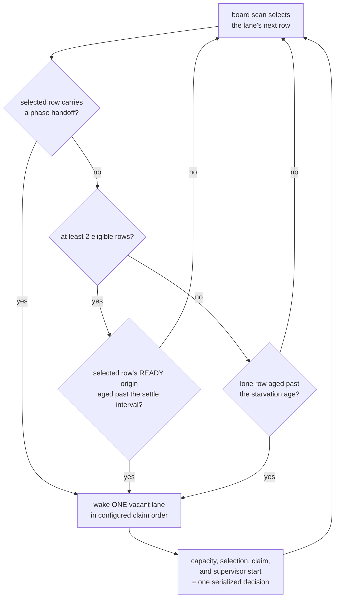

**Invariants**

- Supervisor phase, UI lane status, and resident lifecycle are separate
  vocabularies and do not form one machine.
- Every turn or process exit, including code zero, ends that occupant and
  vacates the lane. [Kept jobs](planes/hooks.md#cadence-is-reachability) deliver
  their endings to a later occupant.
- No supervisor request is published until the lane's worktree is admitted as a
  root inside the resident's own Git common directory. A lane naming another
  repository's worktree parks with a refusal; the resident and its other lanes
  continue.
- Two ready tasks are the normal trigger: one for the new occupant to claim, one
  left on the board. READY excludes active claims, so occupied lanes do not
  inflate the count. A single ordinary task is never stranded: after the
  starvation age, one is enough. That is an age, not a retry interval.
- A lane wakes and allocates under its current team's policy alone. `lane add
  --life` seeds only the policy of the team it forms when no `--team` is given;
  a lane joining an existing team takes that team's policy, so its effective
  life can differ from the `--life` named. A lane seated alone on its own team
  therefore follows that life: a lone Drain lane is started by this loop and
  draws work through `task next`. No wake or allocation path reads the
  lane row's own life.
- Lifecycle first selects the row allocation would give the lane, then times
  the wake from that row's own READY transition, not the newest row on the
  board. A Drain team with no occupied member settles its first wake even for a
  lone row. A selected phase handoff wakes at once; a handoff that reserves the
  lane's only candidate for another actor re-arms the wake at its deadline. A
  completion that enters a continuing phase without publishing never reaches
  this wake: it carries its claim, so the completing occupant already holds the
  new phase when `task done` answers, and the row is not READY for anyone else.
- Proving a new occupant's session does not hold the resident writer, so
  unrelated controls continue while proof is pending. Going dark first settles
  every pending proof, because a successor generation adopts only committed
  occupants.
- Rendering never launches. The snapshot, the live bus, and the UI project
  settled decisions; no read path can start or renew an occupant. Otherwise
  opening a browser tab becomes a side effect and a refresh a fleet-wide launch
  storm.

---

## L-LANE — the place

**Intent.** A lane is an independently steerable worktree seat, not the agent.
It is the stable address for attention, drafts, and history; a team groups one
or more lanes into one console and owns their shared task policy.

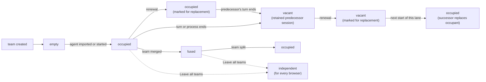

**Invariants**

- Lane is not agent. Renewal replaces the occupant; history, drafts, scroll
  position, team, and team policy survive because the lane does not move.
  Moving a lane to another team subjects it to that team's policy.
- Renewal is intent, never a start. The mark stands until the lane's next start
  consumes it, and the operator can withdraw it until then. A live predecessor
  receives a private preparation notice, never a steering message, and is never
  forcibly terminated; a vacant lane's predecessor is neither started nor
  notified. The successor's briefing names its predecessor's thread. The
  agent's action menu shows a standing mark.
- Model, effort, and fast mode are seat authority that every future launch
  reads; omitting model or effort restores vendor configuration. Fast mode is
  additive: a launch runs fast when the seat, its team, or the global setting
  enables it. Lane rows report running values separately from seat values. A
  running OMP occupant is retuned only after the seat, team, or global change
  commits, and for fast mode only when that change flips its effective value.
  Its running value changes only when the provider confirms; a bare model, a
  clear, an unsupported occupant, a refusal, or an interrupted request leaves it
  unchanged. A launch applies the seat's effort before the first turn, and a
  refused opening effort fails the launch. A running OMP turn the provider fails
  only because it refuses fast mode's priority service tier is not a vendor
  failure: the occupant turns fast mode off, resumes the same session, and the
  lane row carries the provider's words, which the console toasts once. A
  second such refusal before fast mode is turned back on ends the turn as any
  vendor failure does. Seat flags stay as set, but the seat remembers the
  refusal: its later launches of the same model run without fast mode until the
  operator turns fast mode on for the lane, its team, a working group whose
  Design it claims, or globally, a live fast-on is confirmed, or the model
  changes.
- A lane names exactly one worktree. A team holds one or many lanes; the
  singular team is the degenerate topology, not a different type.
- Topology is server truth. The client never mounts a lane from local storage,
  which holds only browser preferences and narration cursors.
- A fused team renders one merged stream on one host; every member remains its
  own concrete send address.
- Canonical member order runs from the right control edge: member zero is the
  main agent. Position controls composer order and accent; a member that
  momentarily fails to resolve keeps its seat, and a joining member enters at
  the tail, so only an explicit arrangement reorders. Message order is a pure
  function of the messages, never of member order.
- `Leave all teams` removes a member through the resident, making it
  independent in every browser; a team whose last member leaves leaves the lane
  table. No browser hides a team locally.
- Forming or growing a team stops at six agents, enforced by the resident on
  member moves, complete arrangements, and new seats. A full team can still
  shed members or change policy. Pre-existing larger teams can be restated,
  reordered, or reduced, never enlarged.
- Team membership is one instance of the shared grouping partition
  (`wire::grouping`): one group per member, no empty group, member-zero
  labels, the six-member limit, faithful whole arrangements, and one
  revision guard. Teams supply only their admission (a seated lane), their
  ungrouped encoding (a singleton team under the lane's own identity), and
  the identity a host's remaining members take when it leaves.

---

## L-DRAFT — the watchband

**Intent.** One strip is both the status face of every agent in the team and
the writing surface for all of them.

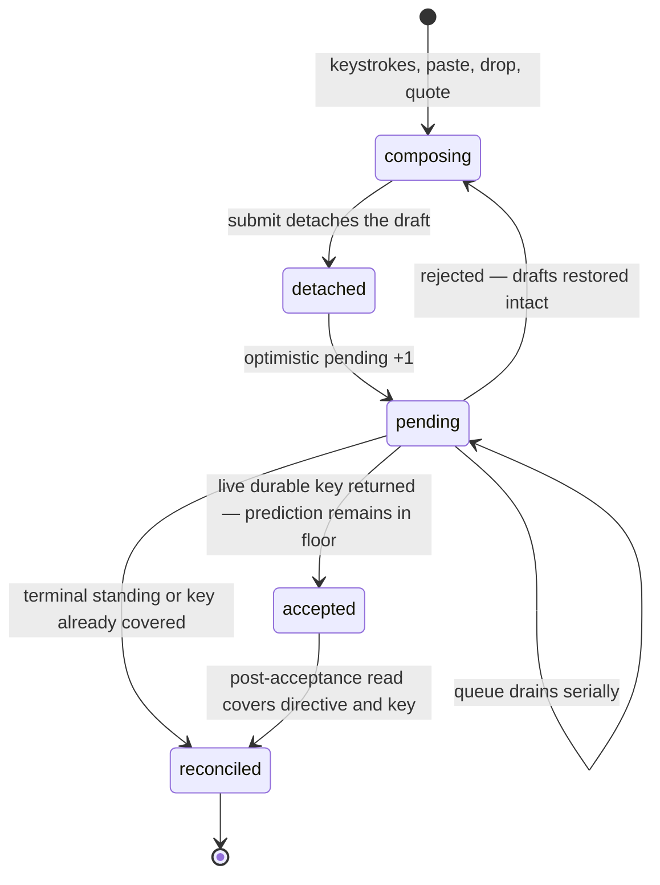

**Invariants**

- One composer column per member, in member order. Each shard is a concrete
  send address; nothing is ever broadcast to a team, so a fused submit enqueues
  one submission per nonempty shard.
- A draft is detached at submit. A typed wake, residency, or write refusal or
  fault restores it intact, including attachments and quote drafts,
  concatenated newest-last. Transport loss requeues in memory instead.
- Sends drain serially per lane. A rejection stops the queue and returns every
  undelivered draft.
- The pending count is a floor over backend truth. A live acceptance keeps its
  prediction in that floor until a post-acceptance read covers the same
  directive and key; only captured identity retires it, never a decrement or a
  timeout.
- An unsafe draft or queued submission guards page exit with the browser's
  unload confirmation.
- A late completion never steals focus the operator has since moved.
- Image annotations stay browser-local draft state; the resident receives only
  the rendered raster.

---

## L-MESSAGE — the mosaic

**Intent.** Many concurrent agents produce messages continuously; the reader
must be able to hold their place. The lattice latches each card's horizontal
placement, while same-frame scroll compensation preserves an off-top reader's
viewport as vertical growth settles.

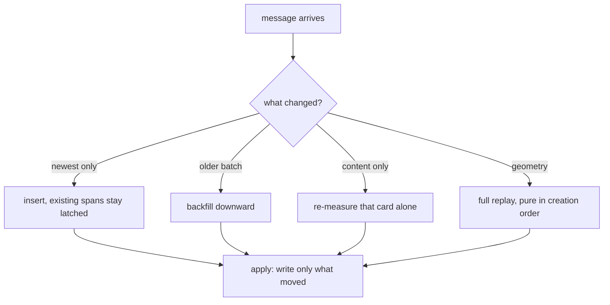

**Invariants**

- A card whose position did not change receives no style write, by skipping
  the write rather than relying on idempotence.
- New content places by insert. Existing cards are never re-decided,
  re-measured, or re-spanned.
- Each reader pages retained member history from its own cursor. Exhausting the
  shared durable source or its retention budget closes further source reads, not
  access to cached older cards; reload does not reopen a closed source.
- A card's column and span stay latched between full geometry replays; during
  incremental changes only its vertical position may settle.
- Growth pushes down transitively along the original layout. A frozen card's
  shrink keeps its reserved rows; a liquid card adopts the smaller height and
  replays the liquid region.
- Layout is a pure function of committed creation order, measured content, and
  geometry, so replaying the same input produces the same layout on any machine.
- A pending image uses a placeholder; load or error remeasures the whole card at
  its latched span.
- A reader scrolled away from the top is compensated in the same frame; near the
  top, the push-down shows, because there it is the signal.
- Nothing transitions until the board first settles.
- A tall card takes the wide tier only when the wider measurement is genuinely
  shorter, so a card whose height does not depend on width keeps its base lane.

---

## L-ROOM — conversation at a task

The room loop, its delivery and attention rules, and its deliberate
non-capabilities live in [rooms.md](rooms.md).

---

## The Jitter Contract

Cross-cutting: a property every loop must preserve, and the appliance's most
distinctive quality.

- **Movement means change.** Any motion the reader sees corresponds to something
  that actually changed. Re-render is not change.
- **Affordances open out of flow.** Every revealed menu, picker, overlay, and
  drag ghost opens out of the document flow, so revealing one cannot reflow the
  board.
- **Live text lives in fixed slots.** Every live label renders into a fixed-width
  single-line slot, so an update never changes a box.
- **Task counts show one open total.** Every global and team roll-up tab shows
  one badge counting open tasks; a global tab's title and accessible name carry
  the ready, active, blocked, and waiting-or-set-aside breakdown. A global tab
  whose partition contains immediate human-actionable blocked or
  environment-held work, or an unclaimed, undeferred Design awaiting the
  operator's decision, also carries an out-of-flow alert dot on its count
  badge's top inline-end corner, and its title and accessible name lead with
  that actionable count. One holding only deferred work carries the same dot
  in the warning tone, so a set-aside project reads as deferred rather than
  attention-free. Any other badge is content-sized, so a digit-width change
  may resize its tab; the total tabs reserve one minimum badge footprint.
- **Presentation changes do not touch card identity or style.** Recolouring and
  attribution toggles force no re-measure. A member-count change that alters the
  settled host width earns one full geometry replay.
- **Programmatic scroll is not a gesture.** Compensation and restore are
  excluded from anything that reads user intent, or the surface competes with
  itself.
- **Publish each changed frame.** Every admitted stream frame that changes the
  runtime immediately updates the browser surface.
- **Unmeasurable means uncommitted.** While the surface is too narrow to
  measure, cards stay readable in ordinary flow and no lattice geometry is
  committed; a measurable reveal establishes the plane.

---

## The spice surface hierarchy

- **The console is the unit of tiling.** Consoles sit side by side as peer
  tiles: one per live team, and one per open working group.
  Membership widens a console but never adds another peer console. A working
  group's console mounts no lane topology. A newly created group opens its
  console once, beside the other teams and groups, as a new team shows its
  own; after that only an explicit view action mounts, reorders, or closes
  one, and shared group edits, room traffic, and automation never do.
- **The mosaic is the evidence layer.** Every agent and compaction card names its
  author lane and worktree explicitly; accent is redundant continuity, never the
  sole identity.

The [console](../../app/CONSOLE.md) and [browser](../../app/BROWSER.md)
contracts own concrete layout.
