# Operating loops

The loops Spice runs and the state machines they keep. Contracts with a home in
the [invariant register](invariants.md) are linked, not restated.

---

## L-TASK — the unit of work

**Intent.** A task moves through named phases, and every accepted advance is a
journal fact. [Claims and allocation](invariants/identity.md#work-claims-and-allocation)
govern who holds it.

Stored workflow status is one small machine:

```mermaid
stateDiagram-v2
  direction LR
  [*] --> pending: task&#58;&#58;added
  pending --> completed: accepted final phase
  pending --> deleted: task&#58;&#58;deleted
  completed --> [*]
  deleted --> [*]
```

Claim disposition is a second, independent machine:

```mermaid
stateDiagram-v2
  direction LR
  [*] --> active: claim&#58;&#58;won
  active --> freed: claim&#58;&#58;freed
  active --> lapsed: claim&#58;&#58;lapsed
  freed --> [*]
  lapsed --> [*]
```

Renewal, carry, rebound, and steal add no disposition:

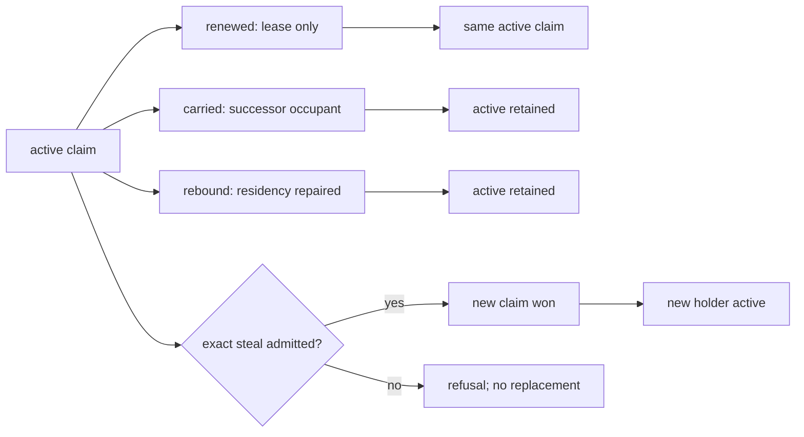

Readiness and possession are projections over those heads, not extra states in
either machine:

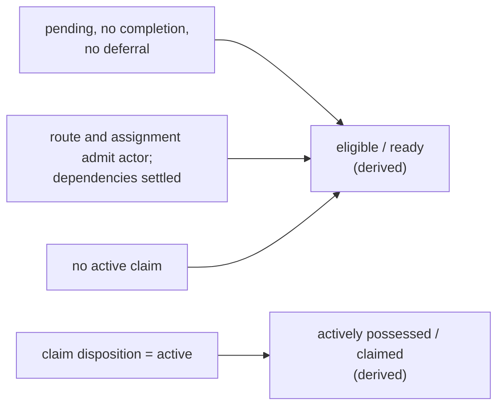

Landing is the Git consequence of one class of accepted advance, never a stored
workflow or claim state; the [integration boundaries](model/boundaries.md#the-three-lane-integration-git-boundaries)
govern it:

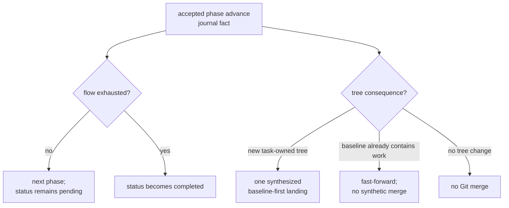

Voluntary release is one guarded Git-and-journal transition:

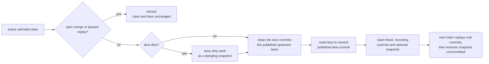

**Invariants**

- `pending`, `completed`, and `deleted` are the only workflow statuses, and
  `active`, `freed`, and `lapsed` the only claim dispositions. Deferral,
  dependency blocking, readiness, possession, and landing are projections.
- Release never strands unfinished work on a lane. The parked commits are
  exactly the lane commits the published upstream lacks, or, without an
  upstream, those after the claim-time head; a dirty lane also parks its
  tracked, staged, and non-ignored untracked content as a snapshot. Parked
  objects are intentionally unreachable: Spice creates no stash or preservation
  ref, and a pruned object refuses the next claim without changing the board or
  the lane.
- The next claim replays real commits oldest first, then applies the snapshot
  without committing it, so restored work still passes the ordinary pre-commit
  gate. A conflicting commit leaves the replay paused for the claimant with the
  snapshot waiting behind it until task completion is retried.
- `task free`, the holder's own deferral, and plan completion all park this way.
  A peer's deferral changes scheduling only and never takes possession.
- A failed guarded write is an atomic refusal: the claim and lane return to
  their prior state, including the staged and worktree split.
- Dirty-handoff recovery has two ownership boundaries. `task recover HANDLE`
  seals a dirty generation before claiming an existing ready task; `task add
  --recover` creates the target and its recovery claim in one transaction, so no
  board read can select the row between creation and possession. After a
  restart the exact recovery claim replays once; if another claim moved the
  target first, `task recover --restore` restores the sealed generation and
  leaves the task unchanged, refusing rather than deleting the quarantine on any
  mismatch.
- Every phase transition is a journal fact visible on the board, including one
  that changes no tree. A landing commit carries the task's key, project, phase,
  and session trailers; first-parent history records mutating landings, not
  every transition.
- `task oops` parks a row in plan through the hidden `.oops` filing filter; only an explicit
  `task wake` promotes it, and every destination passes manual admission.

---

## L-STEER — intent made durable

**Intent.** After journal acceptance returns a live durable key, operator intent
survives failures until the agent answers it. Before that boundary, the
browser-local queued or sent prediction remains ephemeral. The
[steering register](invariants/identity.md#steering) states delivery,
answering, escalation, and recovery.

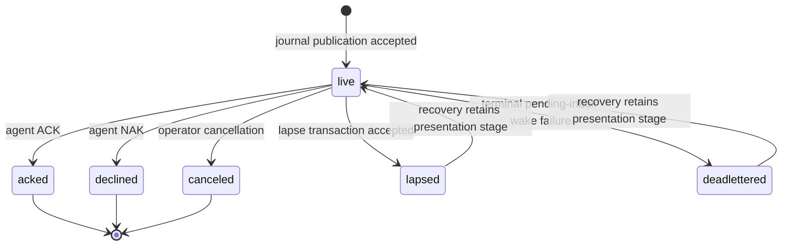

---

## L-AGENT — the work-availability loop

**Intent.** Capacity follows work. Lifecycle authority may seat one new occupant
in a vacant lane when derived eligible work warrants it. Every occupant turn
ends by vacating its lane; only a later serialized lifecycle decision may launch
another. Ordinary capacity needs no hand-managed agent count; the
operator-authorized lane wake remains available, including for a Drain lane.

The detached supervisor records the phase of one process turn:

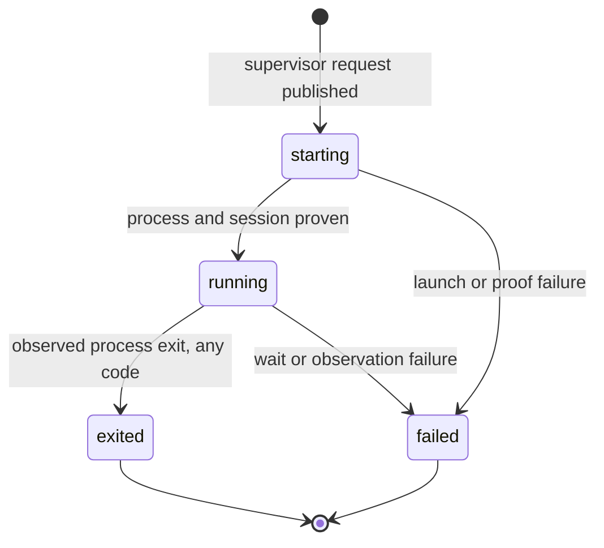

The UI derives lane status independently; pending direction that can wake the
lane outranks liveness:

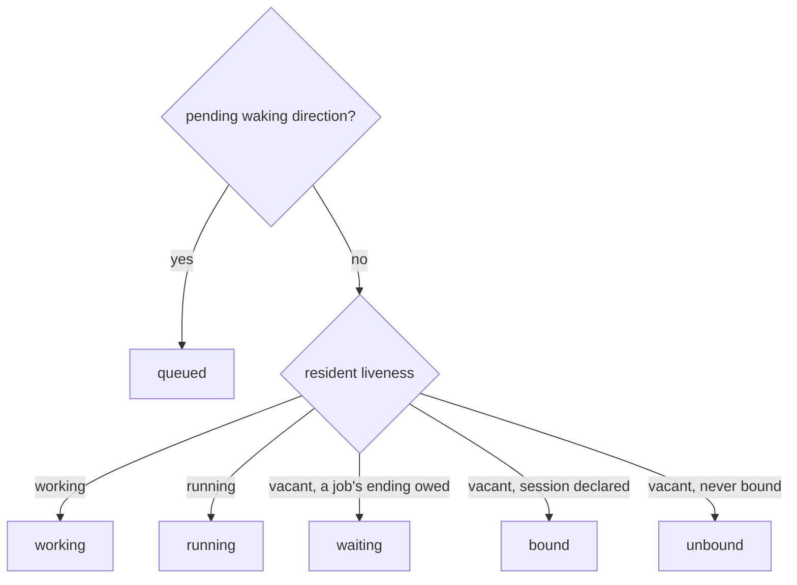

Resident lifecycle is a third vocabulary; resident replacement may move directly
to `dark` while detached supervisors remain live:

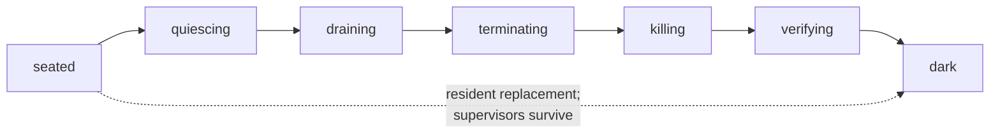

The wake decision:

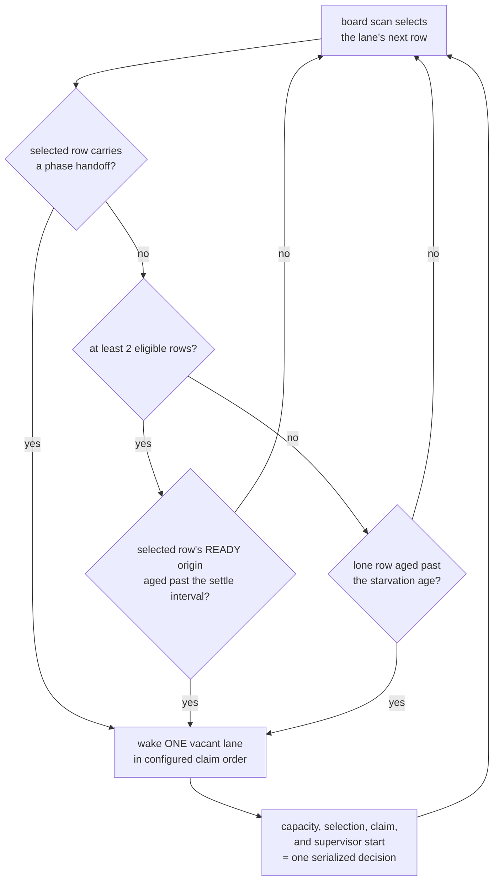

**Invariants**

- Supervisor phase, UI lane status, and resident lifecycle are separate
  vocabularies and do not form one machine.
- Every turn or process exit, including code zero, ends that occupant and
  vacates the lane. [Kept jobs](planes/hooks.md#cadence-is-reachability) deliver
  their endings to a later occupant.
- No supervisor request is published until the lane's worktree is admitted as a
  root inside the resident's own Git common directory. A lane naming another
  repository's worktree parks with a refusal; the resident and its other lanes
  continue.
- Two ready tasks are the normal trigger: one for the new occupant to claim, one
  left on the board. READY excludes active claims, so occupied lanes do not
  inflate the count. A single ordinary task is never stranded: after the
  starvation age, one is enough. That is an age, not a retry interval.
- Lifecycle first selects the row allocation would give the lane, then times
  the wake from that row's own READY transition, not the newest row on the
  board. A Drain team with no occupied member settles its first wake even for a
  lone row. A selected phase handoff wakes at once; a handoff that reserves the
  lane's only candidate for another actor re-arms the wake at its deadline.
- Proving a new occupant's session does not hold the resident writer, so
  unrelated controls continue while proof is pending. Going dark first settles
  every pending proof, because a successor generation adopts only committed
  occupants.
- Rendering never launches. The snapshot, the live bus, and the UI project
  settled decisions; no read path can start or renew an occupant. Otherwise
  opening a browser tab becomes a side effect and a refresh a fleet-wide launch
  storm.

---

## L-LANE — the place

**Intent.** A lane is an independently steerable worktree seat, not the agent.
It is the stable address for attention, drafts, and history; a team groups one
or more lanes into one console and owns their shared task policy.

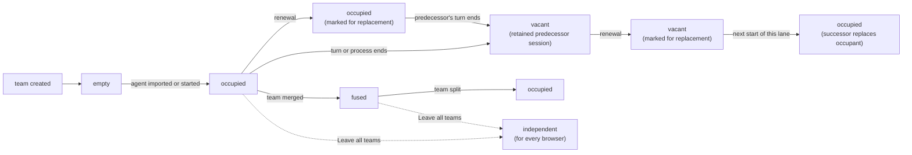

**Invariants**

- Lane is not agent. Renewal replaces the occupant; history, drafts, scroll
  position, team, and team policy survive because the lane does not move.
  Moving a lane to another team subjects it to that team's policy.
- Renewal is intent, never a start. The mark stands until the lane's next start
  consumes it, and the operator can withdraw it until then. A live predecessor
  receives a private preparation notice, never a steering message, and is never
  forcibly terminated; a vacant lane's predecessor is neither started nor
  notified. The successor's briefing names its predecessor's thread. The
  agent's action menu shows a standing mark.
- Model, effort, and fast mode are seat authority that every future launch
  reads; omitting model or effort restores vendor configuration. Fast mode is
  additive: a launch runs fast when the seat, its team, or the global setting
  enables it. Lane rows report running values separately from seat values. A
  running OMP occupant is retuned only after the seat or team change commits,
  and its running value changes only when the provider confirms; a bare model, a
  clear, an unsupported occupant, a refusal, or an interrupted request leaves it
  unchanged. A launch applies the seat's effort before the first turn, and a
  refused opening effort fails the launch.
- A lane names exactly one worktree. A team holds one or many lanes; the
  singular team is the degenerate topology, not a different type.
- Topology is server truth. The client never mounts a lane from local storage,
  which holds only browser preferences and narration cursors.
- A fused team renders one merged stream on one host; every member remains its
  own concrete send address.
- Canonical member order runs from the right control edge: member zero is the
  main agent. Position controls composer order and accent; a member that
  momentarily fails to resolve keeps its seat, and a joining member enters at
  the tail, so only an explicit arrangement reorders. Message order is a pure
  function of the messages, never of member order.
- `Leave all teams` removes a member through the resident, making it
  independent in every browser; a team whose last member leaves leaves the lane
  table. No browser hides a team locally.
- Forming or growing a team stops at six agents, enforced by the resident on
  member moves, complete arrangements, and new seats. A full team can still
  shed members or change policy. Pre-existing larger teams can be restated,
  reordered, or reduced, never enlarged.
- Team membership is one instance of the shared grouping partition
  (`wire::grouping`): one group per member, no empty group, member-zero
  labels, the six-member limit, faithful whole arrangements, and one
  revision guard. Teams supply only their admission (a seated lane), their
  ungrouped encoding (a singleton team under the lane's own identity), and
  the identity a host's remaining members take when it leaves.

---

## L-DRAFT — the watchband

**Intent.** One strip is both the status face of every agent in the team and
the writing surface for all of them.

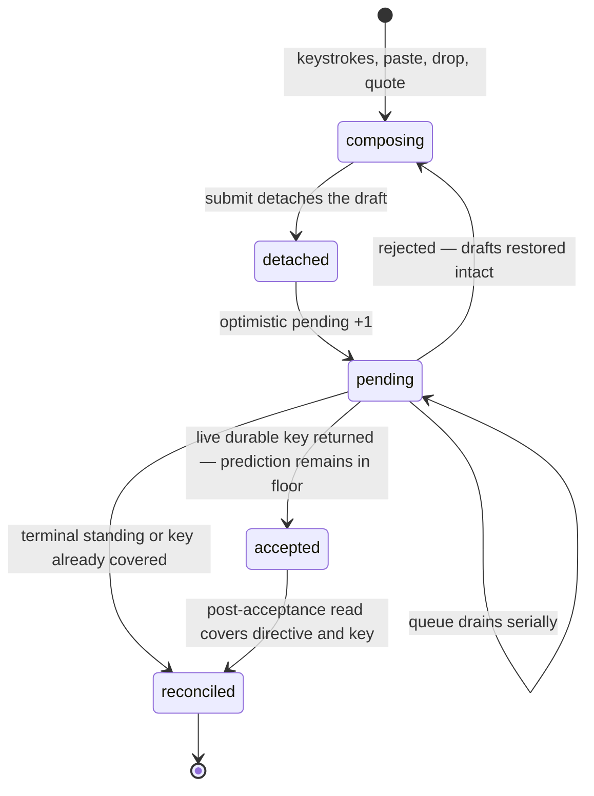

**Invariants**

- One composer column per member, in member order. Each shard is a concrete
  send address; nothing is ever broadcast to a team, so a fused submit enqueues
  one submission per nonempty shard.
- A draft is detached at submit. A typed wake, residency, or write refusal or
  fault restores it intact, including attachments and quote drafts,
  concatenated newest-last. Transport loss requeues in memory instead.
- Sends drain serially per lane. A rejection stops the queue and returns every
  undelivered draft.
- The pending count is a floor over backend truth. A live acceptance keeps its
  prediction in that floor until a post-acceptance read covers the same
  directive and key; only captured identity retires it, never a decrement or a
  timeout.
- An unsafe draft or queued submission guards page exit with the browser's
  unload confirmation.
- A late completion never steals focus the operator has since moved.
- Image annotations stay browser-local draft state; the resident receives only
  the rendered raster.

---

## L-MESSAGE — the mosaic

**Intent.** Many concurrent agents produce messages continuously; the reader
must be able to hold their place. The lattice latches each card's horizontal
placement, while same-frame scroll compensation preserves an off-top reader's
viewport as vertical growth settles.

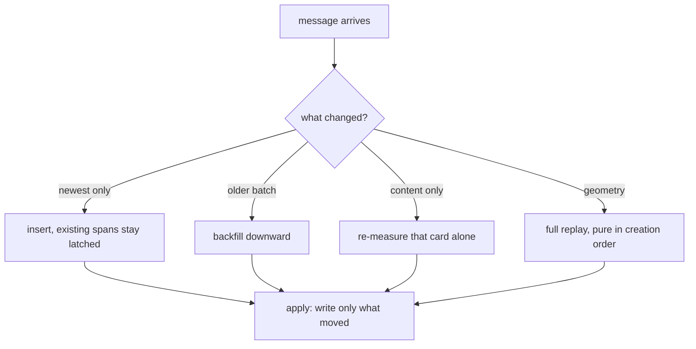

**Invariants**

- A card whose position did not change receives no style write, by skipping
  the write rather than relying on idempotence.
- New content places by insert. Existing cards are never re-decided,
  re-measured, or re-spanned.
- Each reader pages retained member history from its own cursor. Exhausting the
  shared durable source or its retention budget closes further source reads, not
  access to cached older cards; reload does not reopen a closed source.
- A card's column and span stay latched between full geometry replays; during
  incremental changes only its vertical position may settle.
- Growth pushes down transitively along the original layout. A frozen card's
  shrink keeps its reserved rows; a liquid card adopts the smaller height and
  replays the liquid region.
- Layout is a pure function of committed creation order, measured content, and
  geometry, so replaying the same input produces the same layout on any machine.
- A pending image uses a placeholder; load or error remeasures the whole card at
  its latched span.
- A reader scrolled away from the top is compensated in the same frame; near the
  top, the push-down shows, because there it is the signal.
- Nothing transitions until the board first settles.
- A tall card takes the wide tier only when the wider measurement is genuinely
  shorter, so a card whose height does not depend on width keeps its base lane.

---

## L-ROOM — conversation at a task

A room lets the operator talk at a task while agents challenge the need,
gather evidence, and construct the smallest justified commitment. An evidenced
negative conclusion is a result; activity alone is not. Each room is the
conversation attached to one [anchor](model/failures.md#ontology) task: it
indexes admitted publications whose bytes stay with their owning source, and it
is neither a filing filter nor a roster. The
[register](invariants/identity.md#identity-a-room-reads-back-from-its-owning-sources)
owns each rule summarized here.

- **Publishing.** A lane publishes only in authored assistant prose:
  `MSG #TASK` records in a room, `MSG ADDRESS#TASK` also directs a lane,
  `ASK AUDIENCE[#TASK]` opens a question result, and `ANS RESULT[#TASK]`
  answers one ([grammar](invariants/identity.md#steering-an-msg-packet-owns-exactly-its-body-hunk)).
  The operator publishes with `spice room post` and `spice room answer`. A
  tool call's intent may retire a key, but publishes only as the narrow
  fallback for a message with no text block.
- **Delivery.** A directed route is a native steering directive bound to the
  logical lane: vacancy, resume, and renewal keep its key, body, and expiry for
  whichever occupant sits there next, while a replacement lane inherits
  nothing. An operator route opens an operator item in `spice room inbox`.
  Room-only traffic reaches current listeners as one bounded catch-up aside at
  a safe boundary. Recording is not receipt.
- **Receipt, answer, and authorization stay apart.** ACK/NAK settles a
  delivery. A question result has one immutable deadline and ends answered,
  declined, cancelled, or timed out; recovery of a lapsed delivery or item
  never reopens or extends it. Answered means available for assessment: a task
  that requires a result names it with `spice task require --evidence`, and
  only `preparation` records carry review coverage and execution
  authorization.
- **Coordination.** `spice room start|resume HANDLE ADDRESS` sends one scoped
  operator direction naming the criterion, contribution, and stop condition;
  the recipient acquires the anchor through ordinary native possession.
  `spice room put-aside` cancels unanswered coordination and asks any holder to
  checkpoint or free, without freeing it. `spice room status` reads the
  standing.
- **Attention.** Participation is derived from contribution, recent activity,
  invitation by a lane-addressed packet, native work, a live request, an owed
  receipt or result, and a stop request. Aging removes only activity and
  invitation. Relevance is
  [shadow evidence](invariants/identity.md#identity-room-relevance-is-shadow-evidence-before-automation)
  the operator assesses with `spice room assess`.
- **Preparation.** `task plan` and `task design` declare intent with
  `plan,review` and `design,review` flows; an associated preparation runs
  while its controller is open, and active plan and design claims refuse
  implementation commits. A controlled output waits, gated, until
  [execution authorization](invariants/identity.md#work-execution-authorization-is-the-controllers-positive-completion):
  a Design engaged by a working-group move authorizes its outputs, and
  `spice preparation authorize` admits an exact accepted selection. Operator
  close concludes negatively and authorizes nothing.
- **Organization and foreground.** The
  [working-group partition](invariants/identity.md#identity-working-groups-are-one-guarded-partition-of-designs)
  is shared repository organization read by `spice group list` and changed only
  by `spice group move` and `spice group arrange`. Open consoles, their order,
  drafts, and focus are this browser's foreground and are never shared.
- **OOPS grooming.** `spice room post DESIGN --report REPORT... --disposition
  duplicate|no-work|deferred-for-later|covered|proposed-work --cause TEXT
  [--exceptions TEXT] [--uncertainty TEXT]` records, in an open Design's room,
  a disposition over parked `.oops` reports. A disposition is evidence, never
  authority: it changes no report workflow, `deferred-for-later` carries no
  wake time, and only `spice task wake REPORT --preparation DESIGN` promotes a
  report, as a controlled output that is not yet authorized.

Every read — `spice room history|inbox|result|relevance|status`,
`spice preparation show`, `spice group list`, and their `spice://` resources —
joins, acknowledges, delivers, settles, and wakes nothing.

### Limits and their repairs

| Bound | Value | Refusal and repair |
| --- | --- | --- |
| Designs per working group | 6, as lanes per team | `group::design-limit`: move one out or choose another group |
| Group membership | Design tasks only | `group::design-only`: choose a Design or declare its Design intent |
| Partition revision | the one read | `group::partition-moved`: read the groups and retry |
| Automated resumes per rule | 1 through 8 | `room::auto-resume-out-of-range` |
| Scoped request field | 2048 bytes | `room::coordination-scope-too-large` |
| Live coordination per room | one request | `room::coordination-live`: retire or put aside the unanswered request |
| Activity-only attention | one day | aging drops the reason, never history or duties |
| Route fanout per publication | 32 | the packet refuses whole |
| Publication content | 64 KiB; 80 KiB with 1 KiB reserved per route for its ACK/NAK return | the packet refuses whole; an operator answer refuses `room::answer-too-large` |
| Pending question results per requester | 128 | further ASKs refuse; MSG, controls, and other requesters still admit |
| Relevance sources per observation | 8 | an observation never cites more |
| Reports per OOPS grooming record | 100 parked reports, in an open Design room | `room::oops-batch-too-large`; `room::oops-batch-not-open`: groom under a Design room |
| Post to a settled room | an unresolved anchor only | `room::anchor-settled`, naming the standing: a completed, closed, or deleted anchor's room stays readable, and its open receipts and results still settle |
| Late answer | the immutable deadline | `room::deadline-passed`: close with `spice room cancel RESULT --clause TEXT --override` |
| Answer or close by a non-party | stored parties only | `room::not-respondent` or `room::override-required`, naming the `--override` command |
| Required evidence | each result answered | `task::evidence-unsatisfied`: ask again, or the operator replaces or waives it |
| Positive conclusion with gated outputs | none unauthorized | `preparation::controlled-outputs-pending`: engage the Design, authorize the exact selection, or close each unselected output |

### Rollout boundary

All four rollout stages are integrated: native hardening (the plan/design
commit deny-list, retained planning duties, and renewal continuity); the first
room loop (publication, reads, catch-up, the shared group partition, and
preparation records); operator receipt symmetry with correlated ASK/ANS; and
shadow relevance, explained invitations, and the operator-bounded resume rule.
Transitions remain explicit operator and agent actions. The one automated
transition runs the manual Resume's own operation, and final execution
authorization stays operator-owned.

### Deliberate non-capabilities

- No room event wakes a lane. Only operator-directed steering wakes its named
  lane; a peer packet, room post, invitation, relevance observation, or
  automated resume never does.
- No fallback respondent: a vacant respondent's delivery waits unheard for that
  lane's next start.
- Reads, invitations, ACK-only traffic, compaction, and renewal make no
  participant and grant no claim, read permission, team membership, or wake.
- No automation beyond the `--auto-resume` rule: nothing else starts work,
  claims, decides, or authorizes.
- Agreement, silence, message count, elapsed time, ACK, and ANS never count as
  progress or approval.
- No timed deferral coordinates a room, and gating adds no task status.
- A working group has no name, is never empty, and is never removed as an
  object; it holds no lanes, claims, or read or work authority. A grouped
  design that is deleted or loses its Design intent stays in its group,
  rendered unavailable.
- Put aside never force-frees a claim or touches child claims and unrelated
  direction.

---

## The Jitter Contract

Cross-cutting: a property every loop must preserve, and the appliance's most
distinctive quality.

- **Movement means change.** Any motion the reader sees corresponds to something
  that actually changed. Re-render is not change.
- **Affordances open out of flow.** Every revealed menu, picker, overlay, and
  drag ghost opens out of the document flow, so revealing one cannot reflow the
  board.
- **Live text lives in fixed slots.** Every live label renders into a fixed-width
  single-line slot, so an update never changes a box.
- **Task counts show one open total.** Every global and team roll-up tab shows
  one badge counting open tasks; a global tab's title and accessible name carry
  the ready, active, and blocked-or-deferred breakdown. A stem badge is
  content-sized, so a digit-width change may resize its tab; the total tabs
  reserve one minimum badge footprint.
- **Presentation changes do not touch card identity or style.** Recolouring and
  attribution toggles force no re-measure. A member-count change that alters the
  settled host width earns one full geometry replay.
- **Programmatic scroll is not a gesture.** Compensation and restore are
  excluded from anything that reads user intent, or the surface competes with
  itself.
- **Publish each changed frame.** Every admitted stream frame that changes the
  runtime immediately updates the browser surface.
- **Unmeasurable means uncommitted.** While the surface is too narrow to
  measure, cards stay readable in ordinary flow and no lattice geometry is
  committed; a measurable reveal establishes the plane.

---

## The spice surface hierarchy

- **The console is the unit of tiling.** Consoles sit side by side as peer
  tiles: one per live team, and one per explicitly opened working group.
  Membership widens a console but never adds another peer console. A working
  group's console mounts no lane topology, and only an explicit view action
  mounts, reorders, or closes one; shared group edits, room traffic, and
  automation never do.
- **The mosaic is the evidence layer.** Every agent and compaction card names its
  author lane and worktree explicitly; accent is redundant continuity, never the
  sole identity.

The [console](../../app/CONSOLE.md) and [browser](../../app/BROWSER.md)
contracts own concrete layout.
