# Operating loops

The transformative loops this appliance runs, stated independently of the
language, framework, or visual spelling that realizes them.

---

## L-TASK — the unit of work

**Intent.** A task moves through named phases, and every accepted advance is an
attested journal fact. New task-owned work additionally publishes one
synthesized mutating landing; when the baseline already contains that work,
integration advances or fast-forwards without a synthetic merge.

Stored workflow status is one small machine:

```mermaid
stateDiagram-v2
  direction LR
  [*] --> pending: task&#58;&#58;added
  pending --> completed: accepted final phase
  pending --> deleted: task&#58;&#58;deleted
  completed --> [*]
  deleted --> [*]
```

Claim disposition is a second, independent machine:

```mermaid
stateDiagram-v2
  direction LR
  [*] --> active: claim&#58;&#58;won
  active --> freed: claim&#58;&#58;freed
  active --> lapsed: claim&#58;&#58;lapsed
  freed --> [*]
  lapsed --> [*]
```

Voluntary release is one guarded Git-and-journal transition:

```mermaid
flowchart LR
  A["active self-held claim"] --> M{"open merge or paused replay?"}
  M -- yes --> X["refusal;<br/>claim and lane unchanged"]
  M -- no --> C{"lane dirty?"}
  C -- yes --> S["commit-tree saves dirty work<br/>as a dangling snapshot"]
  C -- no --> P["retain exact SHAs of lane commits<br/>the published upstream lacks"]
  S --> P
  P --> R["reset lane to newest<br/>published lane commit"]
  R --> F["claim&#58;&#58;freed records<br/>commits and optional snapshot"]
  F --> N["next claim replays real commits,<br/>then restores snapshot uncommitted"]
```

Release needs no claim-time baseline. However far a relaunch fast-forwarded the
lane, the parked commits are exactly the lane commits the published upstream
does not contain. Without an upstream, the claim-time head stands in for
published history. A dirty lane additionally saves its tracked, staged, and
non-ignored untracked worktree content through a temporary index and
`commit-tree -p HEAD`; its original index remains available for guarded rollback.

Saved commits and snapshots are intentionally unreachable: Spice creates no
stash or preservation ref. Before moving a claimant's lane, every parked object
must exist; a pruned object refuses `git::parked-object-missing` without changing
the board or lane. The next claim replays real commits oldest first onto its
fast-forwarded HEAD. Its answer's `transplant` names the commits applied or
already present, and the separate worktree snapshot. That snapshot is applied
with no commit, so restored work must still pass the ordinary pre-commit gate.

A real-commit conflict leaves Git's cherry-pick paused for the claimant, with
later commits queued behind it. A snapshot waits behind that sequence in the
durable task Git marker; after resolving the committed replay, retry task
completion to restore the snapshot uncommitted. Snapshot conflicts are resolved
and staged as ordinary unfinished work, not continued into a snapshot commit.
Open merges and paused replays cannot be parked as another snapshot.

Plan completion uses the same guarded parking before advancing to `todo`:
in-flight edits survive without authorizing implementation commits in `plan`.

Deferral by the holder uses that same release transaction before recording the
deferral. Deferral by another actor changes scheduling only; it does not take
possession from the holder or move that holder's lane.

The surrounding fact and command vocabulary does not add dispositions:

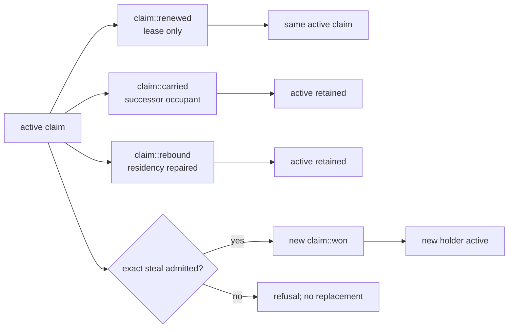

Readiness and possession are projections over those heads, not extra states in
either machine:

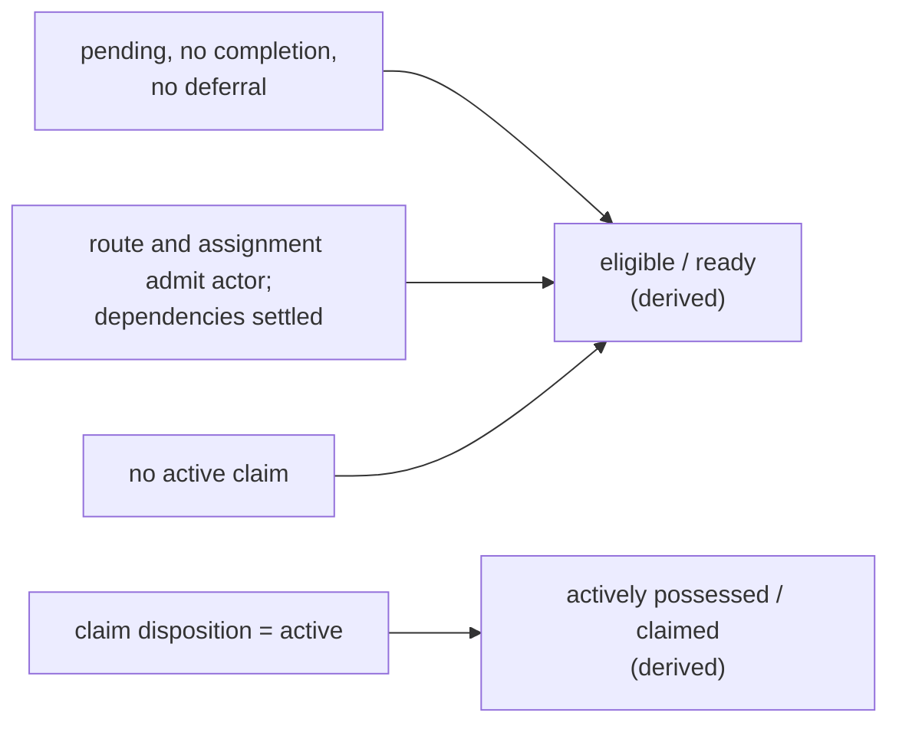

Landing is the Git consequence of one class of accepted advance, never a stored
workflow or claim state:

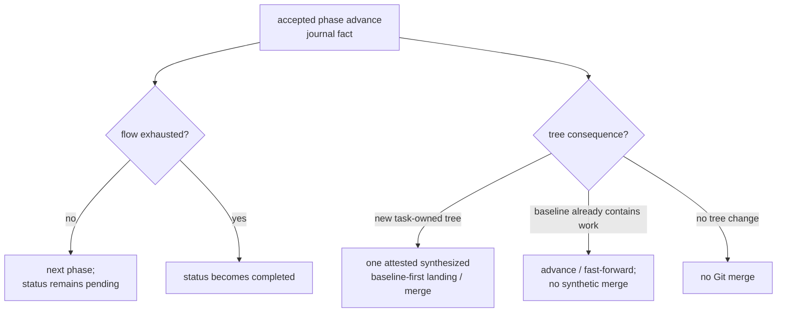

**Invariants**

- Every task names an origin realm with the open wire shape
   `<nonempty-class>:<nonempty-value>`. `ack:<key>` and
   `task:<born-stamp>` are ordinary conventions; typed system routes
   conventionally use proved `gate:<report-digest>` or
   `doc:<preview-digest>` causes. Other authored classes pass unchanged.
- `workflow.status` is exactly `pending`, `completed`, or `deleted`. Deferral,
   dependency blocking, readiness, active possession, and landing are not
   workflow statuses.
- At most one active claim per actor, at most one actor per claim.
- `claim::won` mints an `active` head; `claim::renewed`, `claim::carried`, and
   `claim::rebound` retain `active` while changing their named lease or residency
   fields. An exact steal is a guarded replacement that emits a new
   `claim::won`, not a `stolen` disposition.
- A live claim's lease rolls with its occupant: while the claim's lane still
   seats the occupant that holds it, the resident extends the lease on its own
   rolling horizon, so a lapse follows the occupant leaving rather than one long
   foreground command outliving a fixed lease. A lease iced on the canonical
   indefinite horizon is the one live lease that never rolls.
- `task free`, self-deferral, and plan-phase release never strand unfinished
  work on a lane. Release parks unpublished commit identities and an optional
  dangling worktree snapshot under the task, returns the lane to its newest
  shared published commit, and records the coordinates with `claim::freed`.
  The next claim restores real commits first and dirty content uncommitted.
- Failed guarded journal writes are atomic refusals: the claim and lane return
  to their pre-command state, including the original staged/worktree split on
  release and abandoning a paused or dirty replay on claim.
- A peer-authored deferral does not release another actor's claim.
- Every phase transition is accepted into the durable task journal and appears
   through the board projection, including a transition that changes no tree.
- When integration must synthesize a new mutating landing, it creates exactly one
   merge whose first parent is the baseline. A baseline that already contains the
   work instead fast-forwards with no synthetic merge. The tree is computed before
   the working tree is mutated, so the visible terminal state is either the
   untouched pre-merge tree or a recoverable merge. Never a half-installed
   conflict.
- The publication carries `Task-Key`, `Task-Project`, `Task-Phase`,
   `Task-Session`. First-parent history is the ledger of mutating landings, not
   the authority for every phase transition.
- An accepted lapse transition changes claim disposition to `lapsed` without
   losing work committed under the claim. Readers then recompute readiness from
   every current eligibility predicate.
- Self-authored review is the last-resort eligibility class, never a
   refusal. A peer wins whenever one exists; a solo agent still progresses.
- A review that changes nothing still advances the phase. Absence of a
   commit is not absence of review.

**Policy** — a manual claim opens with a 3600s lease and a 7200s renewal maximum
that the resident then rolls while the occupant holds the lane,
and records the lane's exact accounted source boundary. `task add --flow`
passes one explicit comma-separated route to the resident, which applies the
ordinary phase grammar. With no named flow, a task lacking acceptance receives
`plan` to `todo` to `review`; every other task receives `todo` to `review`,
independent of visibility. A hidden `.oops` row is parked in `plan` but retains
the complete `plan` to `todo` to `review`
flow and must be promoted explicitly. Self-authored review is a last-resort
eligibility class, not an urgency coefficient.

**Incidental** — the task store, the handle alphabet, concrete phase names, and
flow length beyond the nonempty, unique-name membership law. The three workflow
statuses and three claim dispositions are not incidental.

**Acceptance** — journal authority and the board reconstruct every accepted phase
transition; first-parent history of the explicitly resolved integrated baseline
or release commit reconstructs the mutating landing subset; after an accepted
lapse, the task becomes selectable if every other predicate admits it; a solo
agent completes a review phase.

---

## L-STEER — intent made durable

**Intent.** After journal acceptance returns a live durable key, operator intent
survives failures until the agent answers it. Before that boundary, the
browser-local queued or sent prediction remains ephemeral.

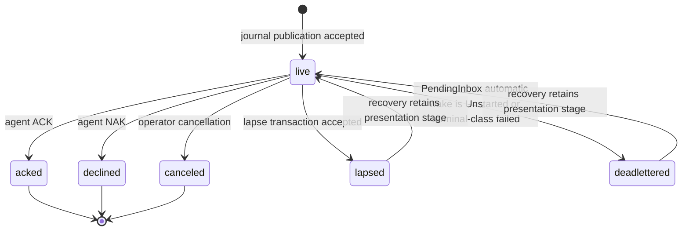

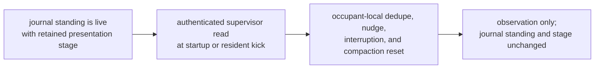

**Invariants**

- The journal fact and current pending head exist before any delivery reader is
  notified. Recovery preserves identity, lineage, presentation stage, and
  presentation history.
- A read changes neither disposition nor presentation stage. At every live
   stage, `acked`, `declined`, `canceled`, `lapsed`, and `deadlettered` are the
   same typed exits.
- A reasoned refusal retires the item as `declined`, just as acknowledgement
   retires it as `acked`. Decline must be as reachable as acknowledgement
   everywhere acknowledgement is taught.
- Unanswered intent escalates on a stable lineage key. A resend
   is the same intent insisting, not a new intent.
- Only a `PendingInbox` automatic wake that returns `Unstarted` or a
   terminal-class start failure moves every pending directive on that lane to
   `deadlettered` through an accepted transaction. Each retains its live
   presentation stage; prior delivery is not a prerequisite. Held-claim,
   capacity, operator-start, nonterminal-error, and arbitrary delivery-failure
   paths do not deadletter.
- Delivery runs through the command-driven supervisor, which queries the
  current authenticated journal inbox directly. It catches up at occupant start, reads again on resident kicks,
  deduplicates unchanged renderings, nudges repeated keys, interrupts active
  commands for unheard direction, and resets occupant-local telling state after
  compaction. Descendant shells remain unmodified.
- Submit cost is independent of backlog depth; the journal allocates identity
   without reading queued bodies.

**Policy** — 24h lapse threshold; every directive follows the same named
escalation cadence.

**Incidental** — the rendered interjection format and the key alphabet.

**Acceptance** — before the authority returns a live durable key, the
browser-local queued or sent prediction may be lost with the browser; durability
has not crossed. After the key returns, kill the browser or the agent: the item
survives and remains pending. Answer only that live key: the count drops by one.
A response that dispositions several live keys drops it by the number
dispositioned.

---

## L-AGENT — the work-availability loop

**Intent.** Capacity follows work. Lifecycle authority may seat one new occupant
in a vacant lane when derived eligible work warrants it. Every occupant turn
ends by vacating its lane; only a later serialized lifecycle decision may launch
another. Ordinary capacity therefore needs no hand-managed agent count; the
explicit operator-authorized lane-wake route remains available, including for a
Drain lane.

The detached supervisor records the phase of one process turn:

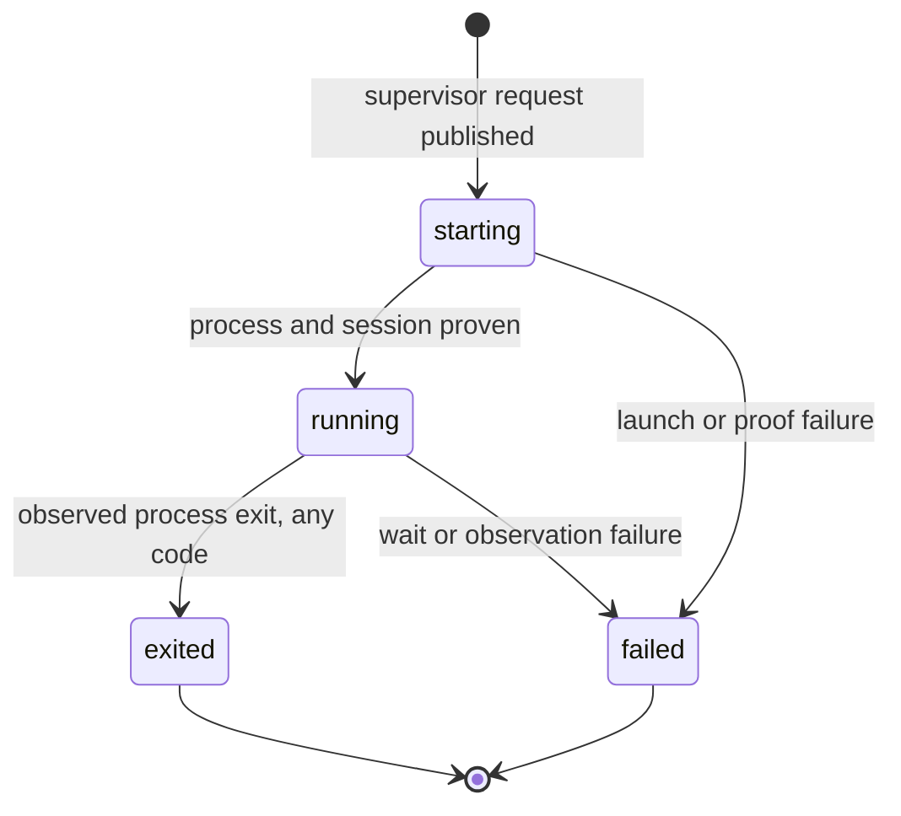

The UI independently derives lane presentation; pending steering outranks
liveness:

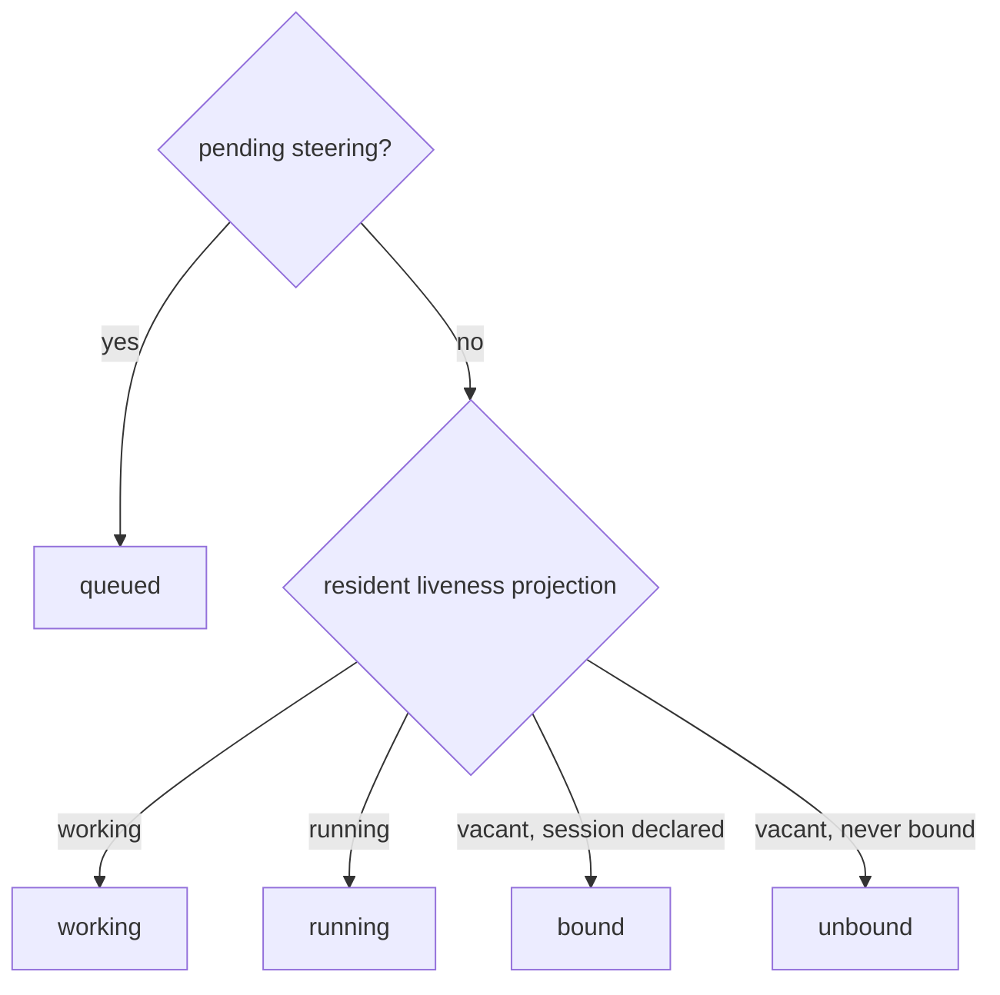

Durable resident lifecycle is a third layer. Its staged vocabulary is separate
from both supervisor phase and UI status; resident replacement may move directly
to `dark` while detached supervisors remain live:

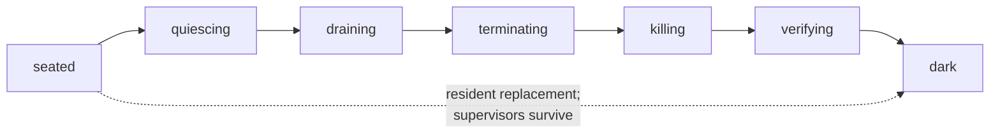

The wake decision itself is the hardened part:

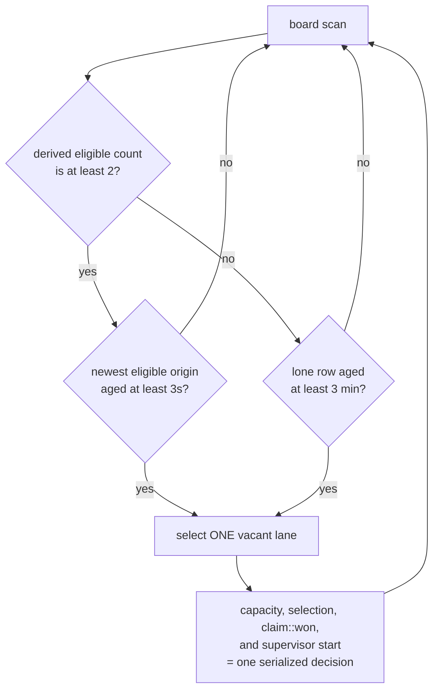

**Invariants**

- Supervisor phase is exactly `starting`, `running`, `exited`, or `failed`; UI
   lane presentation is exactly `queued`, `working`, `running`, `waiting`,
   `bound`, or `unbound`; resident lifecycle is exactly `seated`, `quiescing`,
   `draining`, `terminating`, `killing`, `verifying`, or `dark`. These
   vocabularies do not form one machine.
- Every agent turn or process exit, including code zero, ends that occupant and
   vacates the lane. `working` and `waiting` may describe activity inside one
   supervisor's `running` turn; neither persists after its exit. A detached job
   continues, and an ending left unheard through its delivery grace requests a
   lane wake so startup catch-up can deliver the completion.
- Wake launches **exactly one** occupant per decision. Capacity check, candidate
   selection, claim win, and startup are a single serialized decision; a later
   inventory refresh must observe the occupied lane before capacity can expand
   again.
- Two ready tasks are the normal trigger — one for the new occupant to claim,
   one left on the board. READY is a derived eligibility projection and
   excludes active claims, so occupied lanes do not inflate the backlog count.
- A single ready task is never stranded. After the starvation age, one is
   enough. This is an *age*, not a retry interval.
- No row is chosen before settling. With at least two eligible rows, the newest
   READY origin in the complete eligible set must age through the settle
   interval before selection; any newly eligible row extends that horizon. This
   keeps a burst from beating a running occupant's own done-to-next cycle. A
   lone row riding the starvation escape launches immediately once its own age
   passes.
- Rendering never launches. The snapshot, the live bus, and the UI
   project settled decisions; no read path can start or renew an occupant.
- Decisions for one worktree are serialized; sibling lanes proceed
   independently.

**Policy** — start threshold 2, starvation 180s, settle 3s, ensure retry 5s.

**Incidental** — the scan trigger, process primitive, and transport. The
supervisor-phase, UI-presentation, and resident-lifecycle vocabularies are not.

**Acceptance** — file two eligible tasks with every lane vacant: exactly one new
occupant starts. File one and wait: one starts after the starvation age, not
before. Let any turn exit, including code zero: its lane becomes vacant. File a
burst at once: occupants still come up one decision at a time.

> **Rendering never launches is the invariant most likely to be lost.** It is
> very natural to let a lane "ensure" an occupant while rendering. That makes
> opening a browser tab a
> side-effecting act and turns a refresh into a fleet-wide launch storm.

---

## L-LANE — the place

**Intent.** A lane is an independently steerable worktree seat, not the agent.
It is the stable address for attention, drafts, and history; a team
groups one or more lanes into one console and owns their shared task policy.

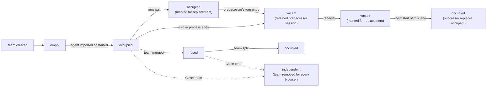

**Invariants**

- Lane is not agent. Renewal replaces the occupant; history, drafts, and scroll
   position survive. The team and its shared task policy also remain because
   renewal does not move the lane. Moving a lane to another team subjects it
   to that team's policy; policy never follows the lane across that move.
- Renewal is intent, never a start. A marked lane keeps its mark until the
   next start of that lane consumes it and launches a fresh successor; the
   operator can withdraw the mark until then. A live predecessor is
   additionally asked to hand off, and is never forcibly terminated; a vacant
   lane's predecessor is neither started nor notified. While the mark stands,
   the agent's action menu carries it, so the request stays visible after the
   drawer that placed it closes.
- Model and effort are seat authority. `lane model ID [MODEL]` and
  `lane effort ID [EFFORT]` topology-guard and journal the value every future
  launch reads; omission restores vendor configuration. Lane rows report the
  running `model`/`effort` separately from `seat_model`/`seat_effort`. A
  command-driven OMP occupant is asked only after the seat commits, and its
  running value changes only after the exact correlated `set_model` or
  `set_thinking_level` response succeeds, journaled against the then-current
  head while the same occupant still runs. Live model selection requires
  explicit `provider/model`; bare models, clears, unsupported occupants,
  refusals, and interrupted RPC retain the running value.
- A lane names exactly one worktree seat. A team may hold one or many lanes;
   the singular team is the degenerate topology, not a different type.
- Topology is server truth. The client never mounts a lane from local storage;
   local storage holds only bounded narration cursors, while in-memory reducers
   hold presentation preferences.
- A fused team renders one merged stream on one host; every member
   remains its own concrete send address.
- Canonical member order runs from the right control edge: member zero is the
   main agent and each later member sits one place farther left. Position controls
   composer order and accent slot, while message chronology and explicit lane
   attribution do not derive from position. A member that momentarily fails to
   resolve keeps its seat rather than re-entering at the tail. A member that
   joins an existing team enters at its tail, so current members keep their
   positions and accents; only an explicit arrangement reorders them.
- `Close team` removes every member from the team through the resident, so
   each member becomes an independent agent and the team leaves the lane table
   in every browser. A refusal leaves the team as it was. No browser hides a
   team locally.
- Message order is a pure function of the messages, never of member
   order. Reordering composers must not reorder the stream.

**Policy** — membership is not bounded by the finite accent palette.

**Incidental** — tiling, fuse gestures, menu placement, the accent palette
itself.

**Acceptance** — renew an agent mid-draft: the draft is still there. Retune a
running OMP lane with a named effort or exact `provider/model`: running and seat
values converge only after provider success. Retune an unsupported or
ambiguous lane: only its seat value changes. Reorder composers: no card moves.
Kill the server: the topology and seat selections return identically.

---

## L-DRAFT — the watchband

**Intent.** One strip that is simultaneously the *status face* of every agent in
the team and the *writing surface* for all of them. You read it like a watch and
you write into it without leaving it.

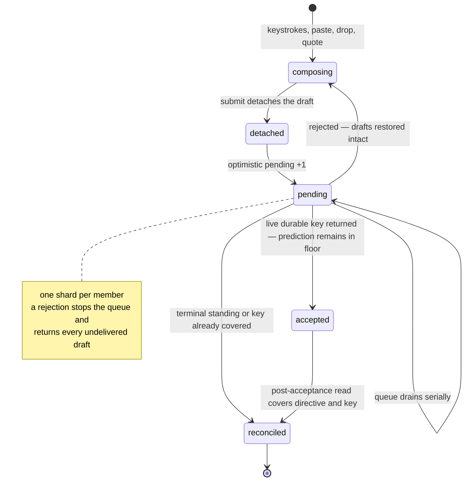

**Invariants**

- One horizontal composer column per member, in member order; the strip owns
   east/west overflow. Each shard is a concrete send address. Nothing is ever
   broadcast to a team.
- A draft is detached at submit. A typed wake, residency, or write refusal or
   fault restores it intact — including attachments and quote drafts,
   concatenated newest-last. Transport loss requeues in memory instead.
- Sends drain serially per lane. A rejection stops the queue and returns
   every undelivered draft.
- The pending count is a floor over backend truth. A live acceptance retains its
   prediction in that floor until a post-acceptance read covers the same directive
   and key; only then does captured identity retire it — never decrement, never
   timeout.
- Unsubmitted intent is protected on page exit: an unsafe draft or queued
   submission installs the browser's `beforeunload` confirmation guard.
- A late completion never steals focus the operator has since moved.
- Shard order runs right-to-left from canonical member zero, and accent advances
   with that position. Every card explicitly names the lane that would answer it.
- The band reports state the operator did not ask for: age, run state,
   pending, claimed task. It is a status surface first and a composer second.

**Policy** — up to 8 attachments per steering send, with at most 3,145,728
combined data-URL bytes (3 MiB, including base64 expansion and URL prefixes).
The complete durable envelope must fit within 4,194,304 bytes (4 MiB),
including escaped text, attachment metadata, and reserved journal cursor width.
Admission names the violated bound before commit; rejection restores the draft.
Existing directives and transcript media retain their canonical decoding
contract: up to 8 images, each at most 8 MiB decoded. Reading or presenting
those bytes is not a new steering send.

**Draft image annotations.** Open a pasted or dropped lane/quote attachment,
then choose **Annotate** in its full-size preview. **Rectangle** and **Arrow**
draw red marks in original-image coordinates; **Select** moves a mark and its
two handles adjust rectangle corners or arrow endpoints. Selected marks can
be moved with arrow keys (Shift moves ten pixels), removed with **Delete** or
Backspace, and undone/redone with the toolbar or Command/Control+Z and
Shift+Command/Control+Z. An interrupted pointer gesture is discarded.

**Apply** replaces that exact draft attachment with a native-resolution PNG.
The draft retains the original raster and editable shape list, so reopening
**Annotate** edits the marks without drawing over previously flattened marks.
**Cancel**, closing the preview, or leaving its owning composer discards
unapplied edits. Identical pasted images are separate edit targets; a removed,
submitted, or superseded attachment cannot receive a stale export.

Original pixels and marks survive optimistic-send refusal restoration, but
remain browser-local draft state: reloading the page does not persist them.
The resident receives only the rendered raster under the existing media and
send-size limits, not an SVG document or editable drawing state. Already-sent
media, Markdown images, and diagrams retain the read-only Copy/Download/Close
preview. SVG presentation and direct canvas PNG export require no drawing
dependency or relaxation of the application CSP.

OMP session records may replace inline image data with
`blob:sha256:<lowercase-hex>`. Session readers resolve that reference only
against the OMP state root's `blobs/` directory, require a regular
non-symbolic file, verify its SHA-256 and declared image signature, and then
present the same canonical media value as an inline record. A missing,
unreadable, oversized, mismatched, or invalid blob is an explicit transcript
residue; surrounding typed history remains available.

**Incidental** — visual styling, concrete column and track sizing, truncation,
and iconography. Horizontal ordered columns, strip-owned east/west overflow,
and the age, run-state, pending-count, and claimed-task field set are fixed.

**Acceptance** — after the browser accepts the submission action, a transport
loss requeues the submission for socket replay rather than returning it to the
composer. A typed wake, residency, or write refusal restores the affected text.
Submit a fused team with several nonempty shards: the gesture enqueues one
concrete-addressed submission per nonempty shard. Each resulting message
reaches exactly one worktree and is never broadcast. Reorder shards: neither
the stream nor existing accents change.

---

## L-MESSAGE — the mosaic

**Intent.** Many concurrent agents produce messages continuously; the reader
must be able to hold their place. The lattice latches each card's horizontal
placement, while same-frame scroll compensation preserves an off-top reader's
viewport as vertical growth settles.

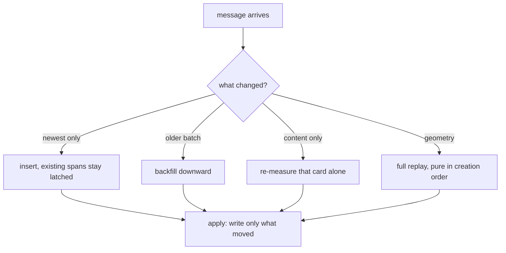

**Invariants**

- A card whose position did not change receives **no style write**.
   Enforced by skipping the write, not by relying on idempotence.
- New content places by insert. Existing cards are never re-decided,
   re-measured, or re-spanned.
- Each reader pages retained member history from its own cursor. Exhausting the
   shared durable source or reaching its retention budget closes further source
   reads, not access to cached older cards. Cache-backed pages precede new
   durable reads; reload does not reopen a closed source, even when compaction
   trimming subsequently frees cache space.
- A card's column and span stay latched between full geometry replays. During
   incremental content changes, only its vertical position may settle; nothing
   hops sideways.
- Growth pushes down transitively along the original layout. A frozen card's
   shrink keeps its reserved rows; a liquid card adopts the smaller height and
   replays the liquid region. Preserving a frozen card's reservation outranks
   reclaiming a row.
- Layout is a pure function of committed creation order, measured content, and
   geometry. Replays of that same ordered input produce the same layout on any
   machine; arrival order itself is an input, and later source-vector reorder
   does not rewrite it.
- A pending image uses a generic placeholder. Load or error increments the
   content revision and remeasures the whole card at its latched horizontal
   span; changed height may grow or shrink and settles vertically.
- A reader more than 80px from the top is compensated in the same frame.
   Positions from 0 through 80px use near-top behavior and show the push-down,
   because there it is the signal.
- Nothing transitions until the board first settles. An unmeasurable surface
   keeps cards readable in ordinary base flow but commits no lattice geometry
   or fingerprint until a measurable width arrives.

**Policy** — wide tier at twice the width when a card measures tall *and* the
wider measurement is genuinely shorter, freeze depth 2, resize debounce 200ms. A
tall card whose height does not depend on width, such as a letterboxed image,
keeps its base lane.

**Incidental** — track count, span ladder, the placement key's tie-breakers,
tween duration, the entire visual style.

**Acceptance** — replay a recorded event log: identical positions. Resolve two
pending cards in either order: identical layout. Let content arrive while more
than 80px from the top: the visible anchor keeps its viewport offset. Repeat
from 0 through 80px: the push-down appears without a position tween.

---

## The Jitter Contract

Cross-cutting. Not a loop — a property every loop must preserve. This is the
appliance's most distinctive quality and the hardest to recover once lost.

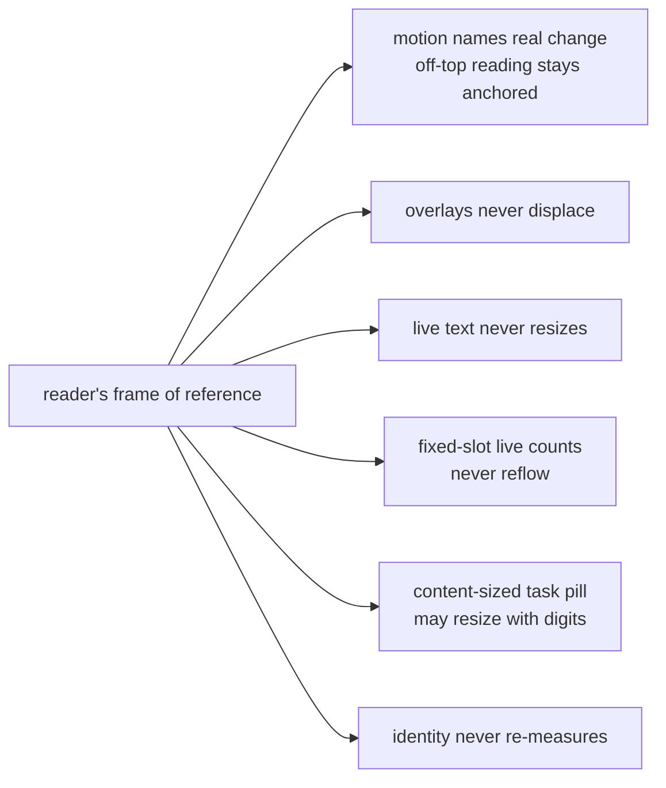

- **Movement means change.** Any motion the reader sees must correspond to
   something that actually changed. Re-render is not change.
- **Affordances open out of flow.** Every revealed menu, picker, overlay, and
   drag-ghost surface opens out of the document flow, so revealing one cannot
   reflow the board. This is why they read as *in-place*. The in-flow agent-menu
   `
` control remains bounded to its own shard and cannot disturb a
   sibling.
- **Live text lives in fixed slots.** Relative ages schedule only the next
   instant their visible spelling can change: each second while seconds-old,
   then at minute, hour, or day boundaries, and never after saturation. Every
   label renders into a padded, fixed-width single-line slot, so an update never
   changes a box.
- **Task counts spell all three slots.** A public pill renders one unpadded
   `ready · active · unavailable` string. Its width is content-driven, so a
   digit-width change may resize it.
- **Presentation changes do not directly touch card identity or style.**
   Recolouring and attribution toggles do not force a re-measure. Member count
   remains outside card identity and style, but it changes team weight; when
   that changes the settled host width, one full geometry replay is the
   legitimate correction.
- **Programmatic scroll is not a gesture.** Compensation and restore must
   be excluded from anything that reads user intent, or the surface competes
   with itself.
- **Publish each changed frame.** Every admitted stream frame that changes the
   runtime immediately sets the browser surface. There is no arrival batch or
   animation-frame coalescing guarantee.
- **Unmeasurable means uncommitted.** Cards remain readable in ordinary base
   flow while the surface is too narrow to measure. No lattice fingerprint is
   committed; a measurable reveal establishes the plane as a correction.

**Acceptance** — instrument style writes per frame. A no-op refresh must produce
zero. Insert new content: existing columns and spans remain latched. More than
80px from the top, the visible anchor retains its viewport offset; near the top,
the push-down is immediate and untweened.

---

## The Canvas surface hierarchy

What the operator actually manipulates, stated as a component contract.

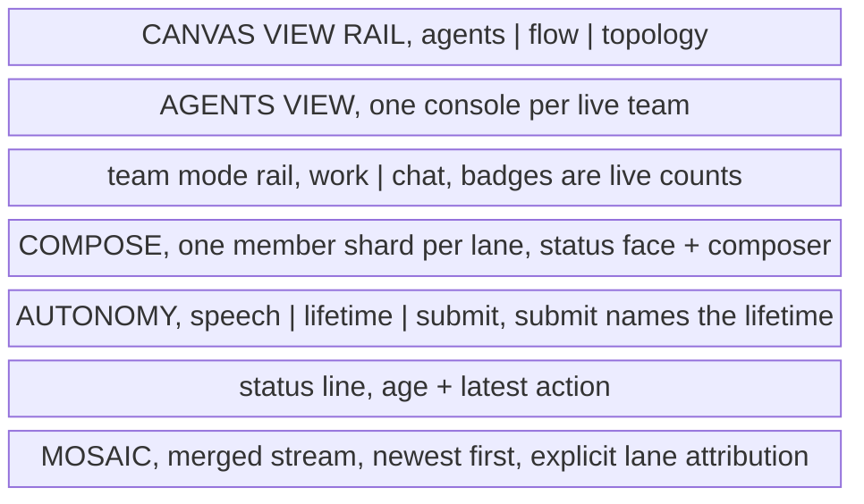

**Contract**

- **The Canvas rail is the global view vocabulary.** Agents is the conversation
   surface; Flow and Topology are the complete closed analytical axes. A pane
   belongs to one of those axes rather than inventing a third.
- **The team console is the unit of tiling in Agents.** Consoles sit side by
   side; each is the complete operator surface for one live team containing
   one or more member lanes. Adding an agent widens its team console through the
   six-share visual ceiling; later members retain that maximum rather than
   narrowing it. Membership never adds another peer console.
- **The team rail's badges are the summary.** Compose shows pending direction,
   Tasks shows active work, and Info shows member count. A badge is only present when its
   count is non-zero, so an empty rail means a quiet team.
- **The member shards are the identity and composer-address summary.** Across
  Compose and Info they expose the concrete lane/worktree address, agent label,
  vendor identity, one mutually exclusive presence state with its age, pending
  direction, and held task as applicable; no individual pane repeats the whole
  set. Presence is `working`, `idle in seat`, `starting`, or `vacant`; the
  lane menu's Task row names the held claim.
- **The mosaic is the evidence layer.** It answers *what happened*. Every agent
   and compaction card repeats explicit short author/lane plus worktree-leaf
   attribution, including unnamed members; accent is redundant continuity rather
   than sole identity.
- **Card controls are an island in the prose.** An agent card's badges and
   actions float as one group in the top inline-end corner of its message, so
   prose fills the lines beside them and regains the full width below. A column
   too narrow for the island and a readable line stacks it above the prose.
- **Autonomy is never implicit.** The submit control carries the lifetime's own
  name, so intent cannot be sent without its autonomy being visible in the same
  gesture.

**Incidental** — console tiling rules, iconography, colour, and concrete member
column sizing. The member shards remain horizontal ordered columns with
strip-owned east/west overflow.
