# Operating loops

The loops Spice runs and the state machines they keep. Contracts with a home in
the [invariant register](invariants.md) are linked, not restated.

---

## L-TASK — the unit of work

**Intent.** A task moves through named phases, and every accepted advance is a
journal fact. [Claims and allocation](invariants/identity.md#work-claims-and-allocation)
govern who holds it.

Stored workflow status is one small machine:

```mermaid
stateDiagram-v2
  direction LR
  [*] --> pending: task&#58;&#58;added
  pending --> completed: accepted final phase
  pending --> deleted: task&#58;&#58;deleted
  completed --> [*]
  deleted --> [*]
```

Claim disposition is a second, independent machine:

```mermaid
stateDiagram-v2
  direction LR
  [*] --> active: claim&#58;&#58;won
  active --> freed: claim&#58;&#58;freed
  active --> lapsed: claim&#58;&#58;lapsed
  freed --> [*]
  lapsed --> [*]
```

Renewal, carry, rebound, and steal add no disposition:

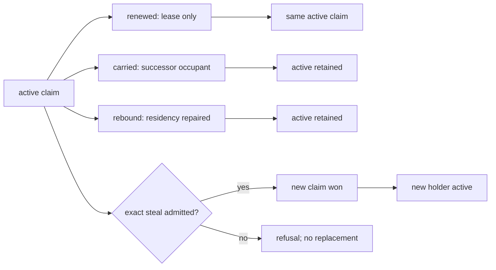

Readiness and possession are projections over those heads, not extra states in
either machine:

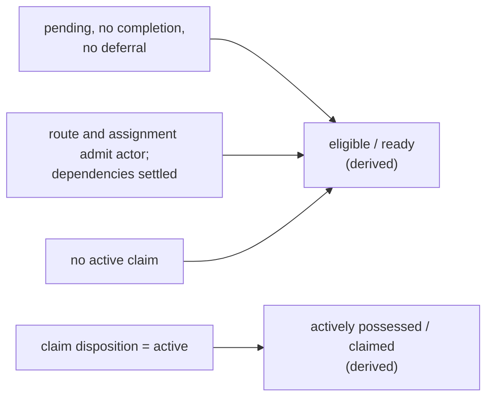

Landing is the Git consequence of one class of accepted advance, never a stored
workflow or claim state; the [integration boundaries](model/boundaries.md#the-three-lane-integration-git-boundaries)
govern it:

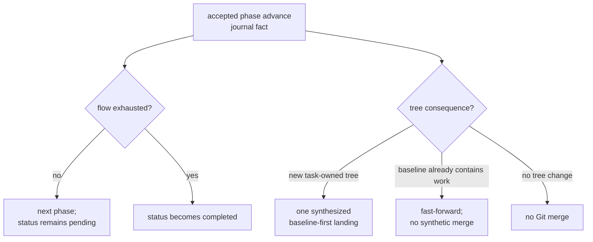

Voluntary release is one guarded Git-and-journal transition:

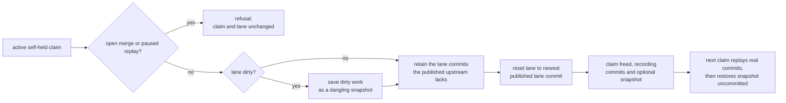

**Invariants**

- `pending`, `completed`, and `deleted` are the only workflow statuses, and
  `active`, `freed`, and `lapsed` the only claim dispositions. Deferral,
  dependency blocking, readiness, possession, and landing are projections.
- Release never strands unfinished work on a lane. The parked commits are
  exactly the lane commits the published upstream lacks, or, without an
  upstream, those after the claim-time head; a dirty lane also parks its
  tracked, staged, and non-ignored untracked content as a snapshot. Parked
  objects are intentionally unreachable: Spice creates no stash or preservation
  ref, and a pruned object refuses the next claim without changing the board or
  the lane.
- The next claim replays real commits oldest first, then applies the snapshot
  as ordinary unstaged work without committing it or leaving Git operation
  state, so restored work still passes the ordinary pre-commit gate. A
  conflicting commit leaves the replay paused for the claimant with the
  snapshot waiting behind it until task completion is retried.
- `task free`, the holder's own deferral, and plan completion all park this way.
  A peer's deferral changes scheduling only and never takes possession.
- A failed guarded write is an atomic refusal: the claim and lane return to
  their prior state, including the staged and worktree split.
- `task capture` is the single adoption boundary. With `HANDLE` it claims that
  ready execution task; with `--title TITLE --project PROJECT` it creates and
  claims one execution/review task. The existing-task form can adopt no local
  work; either form adopts loose commits, dirty paths, or both. A new-task
  capture requires work to adopt and otherwise directs the caller to `task add
  TITLE --project PROJECT --claim`; its title defaults to the newest loose
  commit subject when one exists.
- Dirty paths are sealed and quarantined before the guarded claim. The
  synchronized boundary retains any loose commits, and a successful claim
  replays the exact staged, unstaged, and non-ignored untracked generation.
  An interrupted adoption resumes only through `task capture` for its sealed
  target. `task capture --restore` never rewinds history: on the sealed HEAD
  it restores the exact pre-claim generation; on any lane HEAD descending from
  the sealed head and any synchronized boundary, it replays the sealed
  generation onto that HEAD as ordinary unowned dirty work, resuming only onto
  the HEAD it began on. When that HEAD already carries every sealed edit,
  nothing is replayed and the sealed objects are retained outside the pending
  slot; a replay conflict retains them the same way. A divergent HEAD or
  mismatched generation refuses without deleting quarantine.
- Every unowned-path or loose-commit refusal names the same two choices:
  `task capture HANDLE` for an existing ready execution task or `task capture
  --title TITLE --project PROJECT` for new execution work. Planning, Design,
  and gather claims refuse implementation adoption before quarantine or claim.
- Every phase transition is a journal fact visible on the board, including one
  that changes no tree. A landing commit carries the task's key, project, phase,
  and session trailers; first-parent history records mutating landings, not
  every transition.
- `task add`, `task plan`, and `task design` share one manual-project
  admission: any `[0-9a-z_]+` root within the configured dotted depth range, so
  authors name their own domains; no configured root list exists. A refused
  project names that spelling and depth range, so the author can repair it
  without probing. Default reads (`task list`, `task status`, dry `task next`
  counts) cover every public project plus the reader's own origin-thread rows,
  so an authored root is never invisible to a lane that may be allocated it.
  Hidden roots remain reserved for their typed system routes and stay out of
  other actors' default reads.
- `task oops` creates a typed OOPS row under a public project. The command uses
  `--project` or derives the one public project held by the actor; zero or
  multiple eligible claims refuse without mutation. OOPS is filing state, not
  project visibility: the allocator never offers it, default detail reads show
  only the origin thread's rows, and complete operator reads retain every row.
  `task file` changes it to ordinary Filed work and can atomically rehome it,
  attach a preparation controller, or claim an uncontrolled row. `task wake`
  remains only for ordinary deferred work.
- `task add --draft` (and `task plan --draft`, `task design --draft`) records a
  typed Draft: prospective work under an admitted public project, distinct from
  both OOPS and Filed. A Draft asserts no unexpected behavior and never joins
  OOPS grooming. Default reads show it only to the operator and its origin
  thread, and complete operator reads retain it. Its author revises title,
  description, acceptance, intent, flow (`task modify --flow`), dependencies,
  and project; an edit that would leave a Design any route but its one `design`
  phase refuses. It never allocates, claims, captures, completes, defers,
  satisfies another task's dependency, or enters team strips and execution
  summaries.
  An operator Draft records `operator:draft` provenance when no `--origin` is
  named; a lane Draft still names its directive or held parent. Each refusal
  names `task file` or the Draft field to repair. `task file`
  validates it as a complete ordinary Task, Plan, or Design under current
  project, flow, acceptance, dependency, preparation, environment, and taste
  policy, then atomically turns it into Filed work and can claim it. A failed
  filing writes nothing.

---

## L-STEER — intent made durable

**Intent.** After journal acceptance returns a live durable key, operator intent
survives failures until the agent answers it. Before that boundary, the
browser-local queued or sent prediction remains ephemeral. The
[steering register](invariants/identity.md#steering) states delivery,
answering, escalation, and recovery.

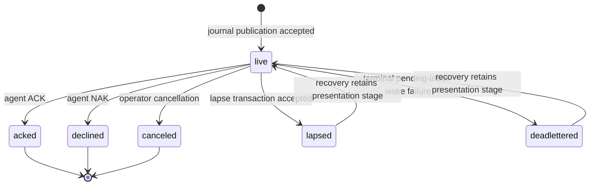

---

## L-AGENT — the work-availability loop

**Intent.** Capacity follows work. Lifecycle authority may seat one new occupant
in a vacant lane when derived eligible work warrants it. Every occupant turn
ends by vacating its lane; only a later serialized lifecycle decision may launch
another. Ordinary capacity needs no hand-managed agent count; the
operator-authorized lane wake remains available, including for a Drain lane.

The detached supervisor records the phase of one process turn:

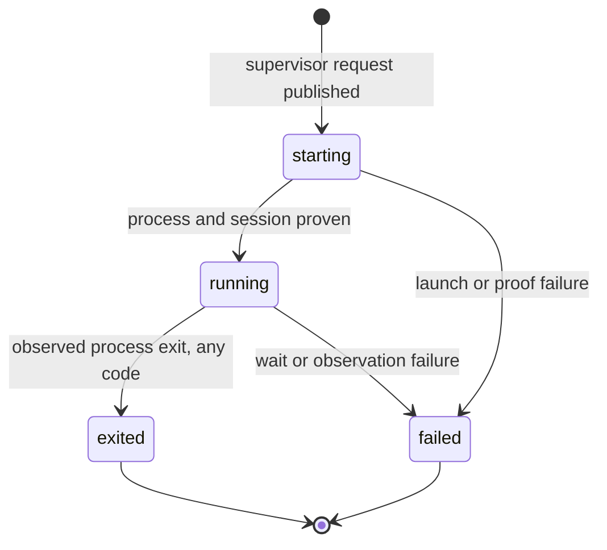

The UI derives lane status independently; pending direction that can wake the
lane outranks liveness:

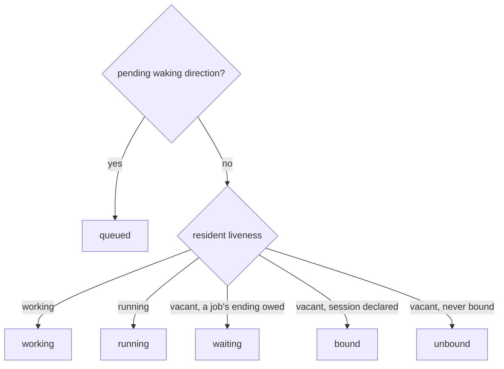

Resident lifecycle is a third vocabulary; resident replacement may move directly
to `dark` while detached supervisors remain live:

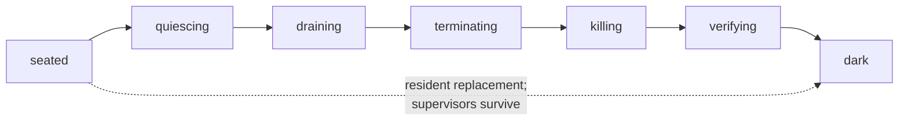

The wake decision:

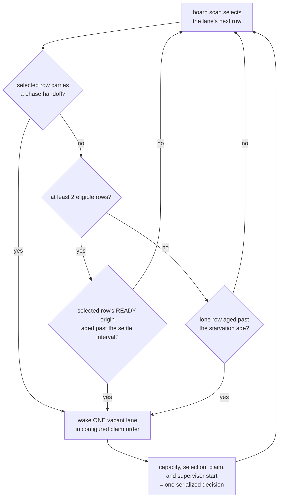

**Invariants**

- Supervisor phase, UI lane status, and resident lifecycle are separate
  vocabularies and do not form one machine.
- Every turn or process exit, including code zero, ends that occupant and
  vacates the lane. [Kept jobs](planes/hooks.md#cadence-is-reachability) deliver
  their endings to a later occupant.
- No supervisor request is published until the lane's worktree is admitted as a
  root inside the resident's own Git common directory. A lane naming another
  repository's worktree parks with a refusal; the resident and its other lanes
  continue.
- Two ready tasks are the normal trigger: one for the new occupant to claim, one
  left on the board. READY excludes active claims, so occupied lanes do not
  inflate the count. A single ordinary task is never stranded: after the
  starvation age, one is enough. That is an age, not a retry interval.
- Lifecycle first selects the row allocation would give the lane, then times
  the wake from that row's own READY transition, not the newest row on the
  board. A Drain team with no occupied member settles its first wake even for a
  lone row. A selected phase handoff wakes at once; a handoff that reserves the
  lane's only candidate for another actor re-arms the wake at its deadline.
- Proving a new occupant's session does not hold the resident writer, so
  unrelated controls continue while proof is pending. Going dark first settles
  every pending proof, because a successor generation adopts only committed
  occupants.
- Rendering never launches. The snapshot, the live bus, and the UI project
  settled decisions; no read path can start or renew an occupant. Otherwise
  opening a browser tab becomes a side effect and a refresh a fleet-wide launch
  storm.

---

## L-LANE — the place

**Intent.** A lane is an independently steerable worktree seat, not the agent.
It is the stable address for attention, drafts, and history; a team groups one
or more lanes into one console and owns their shared task policy.

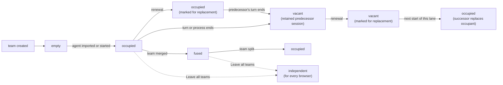

**Invariants**

- Lane is not agent. Renewal replaces the occupant; history, drafts, scroll
  position, team, and team policy survive because the lane does not move.
  Moving a lane to another team subjects it to that team's policy.
- Renewal is intent, never a start. The mark stands until the lane's next start
  consumes it, and the operator can withdraw it until then. A live predecessor
  receives a private preparation notice, never a steering message, and is never
  forcibly terminated; a vacant lane's predecessor is neither started nor
  notified. The successor's briefing names its predecessor's thread. The
  agent's action menu shows a standing mark.
- Model, effort, and fast mode are seat authority that every future launch
  reads; omitting model or effort restores vendor configuration. Fast mode is
  additive: a launch runs fast when the seat, its team, or the global setting
  enables it. Lane rows report running values separately from seat values. A
  running OMP occupant is retuned only after the seat, team, or global change
  commits, and for fast mode only when that change flips its effective value.
  Its running value changes only when the provider confirms; a bare model, a
  clear, an unsupported occupant, a refusal, or an interrupted request leaves it
  unchanged. A launch applies the seat's effort before the first turn, and a
  refused opening effort fails the launch.
- A lane names exactly one worktree. A team holds one or many lanes; the
  singular team is the degenerate topology, not a different type.
- Topology is server truth. The client never mounts a lane from local storage,
  which holds only browser preferences and narration cursors.
- A fused team renders one merged stream on one host; every member remains its
  own concrete send address.
- Canonical member order runs from the right control edge: member zero is the
  main agent. Position controls composer order and accent; a member that
  momentarily fails to resolve keeps its seat, and a joining member enters at
  the tail, so only an explicit arrangement reorders. Message order is a pure
  function of the messages, never of member order.
- `Leave all teams` removes a member through the resident, making it
  independent in every browser; a team whose last member leaves leaves the lane
  table. No browser hides a team locally.
- Forming or growing a team stops at six agents, enforced by the resident on
  member moves, complete arrangements, and new seats. A full team can still
  shed members or change policy. Pre-existing larger teams can be restated,
  reordered, or reduced, never enlarged.
- Team membership is one instance of the shared grouping partition
  (`wire::grouping`): one group per member, no empty group, member-zero
  labels, the six-member limit, faithful whole arrangements, and one
  revision guard. Teams supply only their admission (a seated lane), their
  ungrouped encoding (a singleton team under the lane's own identity), and
  the identity a host's remaining members take when it leaves.

---

## L-DRAFT — the watchband

**Intent.** One strip is both the status face of every agent in the team and
the writing surface for all of them.

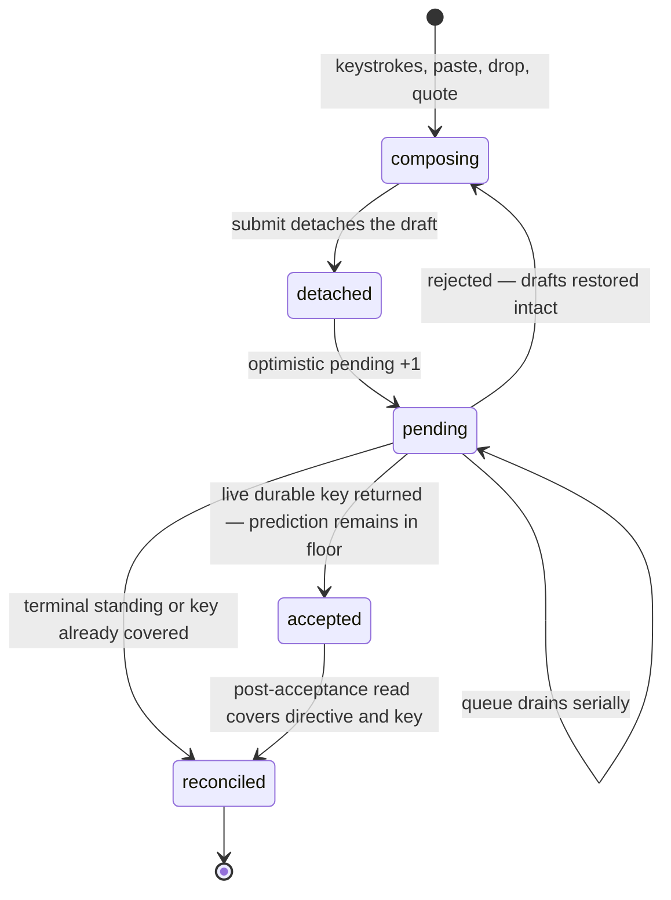

**Invariants**

- One composer column per member, in member order. Each shard is a concrete
  send address; nothing is ever broadcast to a team, so a fused submit enqueues
  one submission per nonempty shard.
- A draft is detached at submit. A typed wake, residency, or write refusal or
  fault restores it intact, including attachments and quote drafts,
  concatenated newest-last. Transport loss requeues in memory instead.
- Sends drain serially per lane. A rejection stops the queue and returns every
  undelivered draft.
- The pending count is a floor over backend truth. A live acceptance keeps its
  prediction in that floor until a post-acceptance read covers the same
  directive and key; only captured identity retires it, never a decrement or a
  timeout.
- An unsafe draft or queued submission guards page exit with the browser's
  unload confirmation.
- A late completion never steals focus the operator has since moved.
- Image annotations stay browser-local draft state; the resident receives only
  the rendered raster.

---

## L-MESSAGE — the mosaic

**Intent.** Many concurrent agents produce messages continuously; the reader
must be able to hold their place. The lattice latches each card's horizontal
placement, while same-frame scroll compensation preserves an off-top reader's
viewport as vertical growth settles.

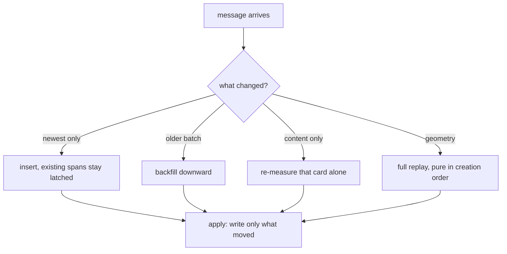

**Invariants**

- A card whose position did not change receives no style write, by skipping
  the write rather than relying on idempotence.
- New content places by insert. Existing cards are never re-decided,
  re-measured, or re-spanned.
- Each reader pages retained member history from its own cursor. Exhausting the
  shared durable source or its retention budget closes further source reads, not
  access to cached older cards; reload does not reopen a closed source.
- A card's column and span stay latched between full geometry replays; during
  incremental changes only its vertical position may settle.
- Growth pushes down transitively along the original layout. A frozen card's
  shrink keeps its reserved rows; a liquid card adopts the smaller height and
  replays the liquid region.
- Layout is a pure function of committed creation order, measured content, and
  geometry, so replaying the same input produces the same layout on any machine.
- A pending image uses a placeholder; load or error remeasures the whole card at
  its latched span.
- A reader scrolled away from the top is compensated in the same frame; near the
  top, the push-down shows, because there it is the signal.
- Nothing transitions until the board first settles.
- A tall card takes the wide tier only when the wider measurement is genuinely
  shorter, so a card whose height does not depend on width keeps its base lane.

---

## L-ROOM — conversation at a task

A room lets the operator talk at a task while agents challenge the need,
gather evidence, and construct the smallest justified commitment. An evidenced
negative conclusion is a result; activity alone is not. Each room is the
conversation attached to one [anchor](model/failures.md#ontology) task: it
indexes admitted publications whose bytes stay with their owning source, and it
is neither a filing filter nor a roster. The
[register](invariants/identity.md#identity-a-room-reads-back-from-its-owning-sources)
owns each rule summarized here.

- **Publishing.** A lane publishes only in authored assistant prose:
  `MSG #TASK` records in a room, `MSG ADDRESS#TASK` also directs a lane,
  `ASK AUDIENCE[#TASK]` opens a question result, and `ANS RESULT[#TASK]`
  answers one ([grammar](invariants/identity.md#steering-an-msg-packet-owns-exactly-its-body-hunk)).
  The operator publishes with `spice room post` and `spice room answer`. A
  tool call's intent may retire a key, but publishes only as the narrow
  fallback for a message with no text block.
- **Delivery.** A directed route is a native steering directive bound to the
  logical lane: vacancy, resume, and renewal keep its key, body, and expiry for
  whichever occupant sits there next, while a replacement lane inherits
  nothing. An operator route opens an operator item in the inbox of the
  principal it answers
  ([routing](invariants/identity.md#identity-an-operator-item-reaches-the-principal-it-answers)).
  Room-only traffic reaches current listeners as one bounded catch-up aside at
  a safe boundary. Recording is not receipt.
- **Receipt, answer, and authorization stay apart.** ACK/NAK settles a
  delivery. A question result has one immutable deadline and ends answered,
  declined, cancelled, or timed out; recovery of a lapsed delivery or item
  never reopens or extends it. Answered means available for assessment: a task
  that requires a result names it with `spice task require --evidence`, and
  only `preparation` records carry review coverage and execution
  authorization.
- **Coordination.** `spice room start|resume HANDLE ADDRESS` sends one scoped
  operator direction naming the criterion, contribution, and stop condition;
  the recipient acquires the anchor through ordinary native possession. A
  passive Design refuses coordination (`room::design-passive`).
  `spice room put-aside` cancels unanswered coordination and asks any holder to
  checkpoint or free, without freeing it. `spice room status` reads the
  standing.
- **Attention.** Participation is derived from contribution, recent activity,
  invitation by a lane-addressed packet, native work, a live request, an owed
  receipt or result, and a stop request. A recorded Design request also keeps
  the asked lane listening without making it a participant. Aging removes only
  activity and invitation. Each room catch-up names the lane's reasons and the
  leave command. `spice room leave HANDLE --clause TEXT` is an attributed lane
  act recorded once in room history and standing. It ends listening from
  contribution, activity, earlier invitation, and earlier Design requests
  until the lane contributes again or a later packet addresses it. It never
  frees a claim, settles a delivery, or answers a question, and its reply names
  each native duty that still holds the lane. Relevance is
  [shadow evidence](invariants/identity.md#identity-room-relevance-is-shadow-evidence-before-automation)
  the operator assesses with `spice room assess`.
- **Contribution.** A lane records its reasoning on an open Design with
  `spice room contribute HANDLE KIND TEXT [--source SOURCE...]`: a
  [typed](invariants/identity.md#identity-a-lane-contributes-typed-problem-space-records-to-an-open-design)
  reason for, reason against, evidence, or question citing exact journal,
  transcript, contribution, or retained-artifact sources. Its answer carries
  `source`, the exact JSON a candidate reference or later contribution cites
  it by. Room history groups contributions by kind beside the full
  chronology, and `--contributions` reads only them. A contribution is
  problem-space record, never a decision: it changes no task, claim, group,
  candidate, or authorization, and a concluded Design accepts none.
- **Design statements.** A Design description opens with a plain sentence that
  states the problem, not a one-word heading. Each unresolved question is its
  own item in the statement list; Design surfaces label that typed list
  Questions while ordinary tasks continue to present it as Acceptance.
- **Design awareness.** At a natural break after `task done`, a lane whose
  completed work has at least 0.15 recent-window TF-IDF cosine similarity to
  an open passive Design owes one private
  [request](invariants/identity.md#identity-a-completed-lane-owes-one-passive-design-request)
  before its next allocation. Both the resident pass and `task next` use the
  same 256-statement document-frequency profile, logarithmic term frequency,
  smooth inverse document frequency, L2 normalization, eligibility predicates,
  ranking, and durable-identity tie break. They compare the completed task's
  statement and bounded validation prefix with each Design's title,
  description, and every open question. Each record names the exact Design
  statement, completed task and claim, and at most six strongest weighted
  overlaps, stored in ascending term order so the request shows all of them;
  an occupant is never requested for a Design twice. The request quotes the
  first substantive description sentence and an in-order, bounded prefix of
  whole open questions. One contribution or `spice room leave --clause` in
  that room answers the request. A standing change away from open passive
  releases it. The request grants no claim, starts no work, and adds no
  workflow state; `spice room awareness HANDLE` shows its statement,
  recipient, completed task, and matched terms.
- **Design maturity.** One bounded projection per Design folds admitted
  requests and typed contributions in journal order. It reports contribution
  counts by kind, distinct contributing lanes, requested reach, and
  same-statement requested/contributing lane intersections. Fresh means no
  contribution; steeped requires reason-for, reason-against, evidence, and
  three distinct contributing lanes; every other contributed Design is
  steeping and names every missing dimension. Questions and requested reach
  are evidence but do not satisfy maturity. `spice room awareness HANDLE`,
  the browser room, and operator-attention input read that projection. The
  state is advisory: it never changes standing, possession, grouping,
  selection, or authorization.

- **Preparation.** `task plan` declares a Plan with a `plan,review` flow.
  `task design` defaults to a Design with one open `design` phase and also
  admits `plan,design` or `review,design` when a lane must first sharpen or
  judge the statement under a normal claim. Completing that intake phase
  releases its claim and enters the passive open Design; before then the row
  is ordinary claimed work, not a Design room or request target. Active
  Plan and Design claims refuse implementation commits. A Design plans Plans;
  a Plan plans executable tasks.

  Each claimed Design pass ends with exactly one `preparation propose
  PROPOSAL_JSON` or with the existing proposal-less free/lapse abandonment.
  The proposal witnesses the exact Design statement and active claim, records
  the completed pass horizon, and releases that claim in the same guarded
  transaction. A work recommendation names one or more acceptance-bearing
  output Plans the Design constructed directly, with source-backed
  justification. A conclude or collapse recommendation names no output or
  governed input and carries the same source-backed justification. A mistaken
  undecided proposal can be retracted by its author with `preparation withdraw
  WITHDRAWAL_JSON`; the version stays in history but leaves the operator's
  choices.
  When a predecessor proposal's immutable receipt does not prove an active
  claim, migration preserves that missing horizon as historical absence instead
  of fabricating a claim. New proposal commands still require the exact active
  claim and cannot create that historical shape.

  A Design
  [stays open until the operator concludes it](invariants/identity.md#work-a-design-stays-open-until-the-operator-concludes-it):
  ordinary lane `task done` refuses it. The operator accepts a conclude or
  collapse proposal through `preparation decide`; that decision stages the
  existing guarded `task conclude --done` or `--collapse` authority without
  fabricating an output. Direct `task conclude` remains available. `task close`
  refuses Designs.

  Each work output waits, gated, until one exact operator `preparation decide`
  decision assigns every output in its Design pass proposal an accepted or
  rejected verdict. The decision and execution authorization for exactly the
  accepted outputs record together; rejected outputs remain gated, and the Design
  remains open. Per-output comments and an optional overall comment explain
  the decision. Rejecting every output authorizes nothing. Returning any
  proposal records nonblank material feedback, authorizes and concludes
  nothing, and leaves the Design open for another claimed pass. Resolution
  belongs to the operator; Design holders do not infer it, review coverage
  never gates it, and working-group membership grants no authorization.
  Rejected-output, overall, and returned feedback is
  [told once to the active holder](invariants/identity.md#identity-a-designs-newest-return-is-told-once-to-its-active-holder)
  as its next input, and `room history` lists every verdict and comment.
  A collapse concludes negatively and, in that same journal write, operator-closes
  every still-unselected pending output and every pending task prepared beneath
  it; each closure validation names the Design and collapse reason. A prior exact
  acceptance remains authorized and live, and so does the work a selected Plan
  prepared: only that Plan's positive review releases it, and a selection never
  does. Operator close or delete of a Plan or Design, a selected Plan included,
  likewise closes every pending task it can no longer release, directly or
  through pending work prepared beneath it, but never closes a task already
  released by a positive Plan review. Any live claim in the closure set refuses
  the whole operation and names its holder; `task close` and `task delete` accept
  `--force-claimed` to free those claims atomically. CLI answers list every task
  closed, and browser collapse, close, and delete confirmations preview the same
  set. Historical pending work whose releasing Plan or Design had already
  collapsed, closed, or been deleted is not repaired on read: board, status, and
  detail call it `stranded` and print its explicit `spice task close` settlement
  command.

  A Plan is an ordinary reviewed task constructor. It creates its
  acceptance-bearing executable tasks under itself; those tasks wait for its
  positive review and their ordinary dependencies, with no Design proposal,
  selection, or execution authorization. A selected Plan therefore runs, and
  its own review releases its tasks. An open Design with an output it
  constructed that is still unselected
  [waits on the operator](invariants/identity.md#work-a-design-awaiting-selection-waits-on-the-operator-without-a-new-state):
  no lane is offered or woken for it, and status counts it under `selection`.

  A [gather task](invariants/identity.md#work-a-gather-task-collects-evidence-for-an-active-design)
  tries an idea for an open, active Design without the operator authorizing
  the experiment. It is an ordinary task walking the one `gather` phase,
  created directly under that Design: `spice task add TITLE --flow gather`
  while holding the Design, or with `--preparation DESIGN`. It runs under
  ordinary routing with no execution authorization while its Design stays
  open and its group stays in Explore or Converge. Like a planning claim it
  holds no commit authority, so it lands nothing; its deliverable is task notes
  and retained artifacts that a Design pass proposal cites by exact source. A
  gather task is never a proposed Plan output, so turning a finding into work
  still takes a work proposal whose output the operator accepts.
- **Organization and foreground.** The
  [working-group partition](invariants/identity.md#identity-working-groups-are-one-guarded-partition-of-designs)
  is shared repository organization and stance authority read by `spice group
  list` and changed by `spice group move`, `spice group arrange`, `spice group
  disband`, and `spice group stance`. Disbanding leaves every Design ungrouped;
  open consoles, their order, drafts, speech, and focus are this browser's
  foreground and are never shared.
- **Design standing.** An open Design in an Explore or Converge group is
  [active](invariants/identity.md#work-working-group-standing-makes-a-design-active-or-passive):
  the allocator offers it and capture, steal, gather creation, and room
  coordination may reach it. A Design in Passive or outside every group is
  passive, and those possession paths refuse (`claim::design-passive`,
  `room::design-passive`). A fresh group starts in Passive. The operator groups a
  Design with `spice group move DESIGN --to GROUP` or `--new`, then chooses its
  group's activity with `spice group stance GROUP passive|explore|converge`.
  Moving to Passive, into an existing Passive group, or out of every group makes the
  Design passive. If a lane holds it, the change withdraws unanswered
  coordination and sends that holder one stop direction, queued for the lane's
  next seat when vacant. The holder checkpoints and runs ordinary `spice task
  free DESIGN`, which parks unpublished commits and dirty work; its claim stays
  authoritative until then. A stance change names any held Design whose
  shelving is still owed; setting the group Passive again shelves it. Explore
  or Converge makes it eligible again with its room, candidates, outputs,
  history, and authorization unchanged.
- **OOPS grooming.** `spice room post DESIGN --report REPORT... --disposition
  duplicate|no-work|deferred-for-later|covered|proposed-work --cause TEXT
  [--exceptions TEXT] [--uncertainty TEXT]` records, in an open Design's room,
  a disposition over typed OOPS reports. A disposition is evidence, never
  authority: it changes no report workflow, and `deferred-for-later` carries no
  wake time. Only `spice task file REPORT --preparation DESIGN` files a report
  as a controlled output that is not yet authorized.

Every read — `spice room history|inbox|result|relevance|status`,
`spice preparation show`, `spice group list`, and their `spice://` resources —
joins, acknowledges, delivers, settles, and wakes nothing.

Preparation command bodies and the room and preparation limits, with their
refusals and repairs, are
[interface contracts](interfaces.md#room-and-preparation-commands).

### Deliberate non-capabilities

- No room event wakes a lane. Only operator-directed steering wakes its named
  lane; a peer packet, room post, invitation, relevance observation, or
  automated resume never does.
- No fallback respondent: a vacant respondent's delivery waits unheard for that
  lane's next start.
- Reads, invitations, ACK-only traffic, compaction, and renewal make no
  participant and grant no claim, read permission, team membership, or wake.
- No automation beyond the `--auto-resume` rule: nothing else starts work,
  claims, decides, or authorizes.
- Agreement, silence, message count, elapsed time, ACK, and ANS never count as
  progress or approval.
- No timed deferral coordinates a room, and gating adds no task status.
- A working group has no name, is never empty, and is never removed as an
  object; it holds no lanes, claims, or read authority, and its only work
  authority is the active standing of the Designs it holds. A grouped design
  that is deleted or loses its Design intent stays in its group, rendered
  unavailable.
- Put aside and deactivation never force-free a claim or touch child claims
  and unrelated direction.

---

## The Jitter Contract

Cross-cutting: a property every loop must preserve, and the appliance's most
distinctive quality.

- **Movement means change.** Any motion the reader sees corresponds to something
  that actually changed. Re-render is not change.
- **Affordances open out of flow.** Every revealed menu, picker, overlay, and
  drag ghost opens out of the document flow, so revealing one cannot reflow the
  board.
- **Live text lives in fixed slots.** Every live label renders into a fixed-width
  single-line slot, so an update never changes a box.
- **Task counts show one open total.** Every global and team roll-up tab shows
  one badge counting open tasks; a global tab's title and accessible name carry
  the ready, active, blocked, and waiting-or-set-aside breakdown. A global tab
  whose partition contains immediate human-actionable blocked or
  environment-held work, or an unclaimed, undeferred Design awaiting the
  operator's decision, also carries an out-of-flow alert dot on its count
  badge's top inline-end corner, and its title and accessible name lead with
  that actionable count. A stem badge is content-sized, so a digit-width change
  may resize its tab; the total tabs reserve one minimum badge footprint.
- **Presentation changes do not touch card identity or style.** Recolouring and
  attribution toggles force no re-measure. A member-count change that alters the
  settled host width earns one full geometry replay.
- **Programmatic scroll is not a gesture.** Compensation and restore are
  excluded from anything that reads user intent, or the surface competes with
  itself.
- **Publish each changed frame.** Every admitted stream frame that changes the
  runtime immediately updates the browser surface.
- **Unmeasurable means uncommitted.** While the surface is too narrow to
  measure, cards stay readable in ordinary flow and no lattice geometry is
  committed; a measurable reveal establishes the plane.

---

## The spice surface hierarchy

- **The console is the unit of tiling.** Consoles sit side by side as peer
  tiles: one per live team, and one per explicitly opened working group.
  Membership widens a console but never adds another peer console. A working
  group's console mounts no lane topology, and only an explicit view action
  mounts, reorders, or closes one; shared group edits, room traffic, and
  automation never do.
- **The mosaic is the evidence layer.** Every agent and compaction card names its
  author lane and worktree explicitly; accent is redundant continuity, never the
  sole identity.

The [console](../../app/CONSOLE.md) and [browser](../../app/BROWSER.md)
contracts own concrete layout.
