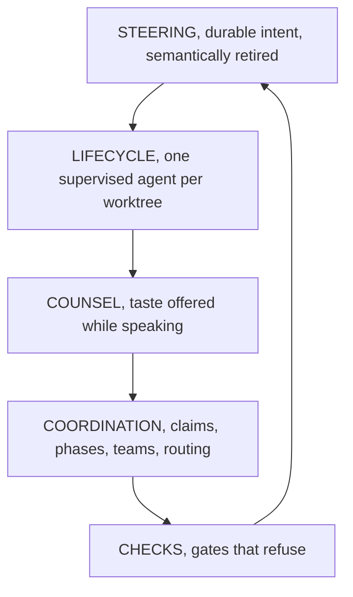
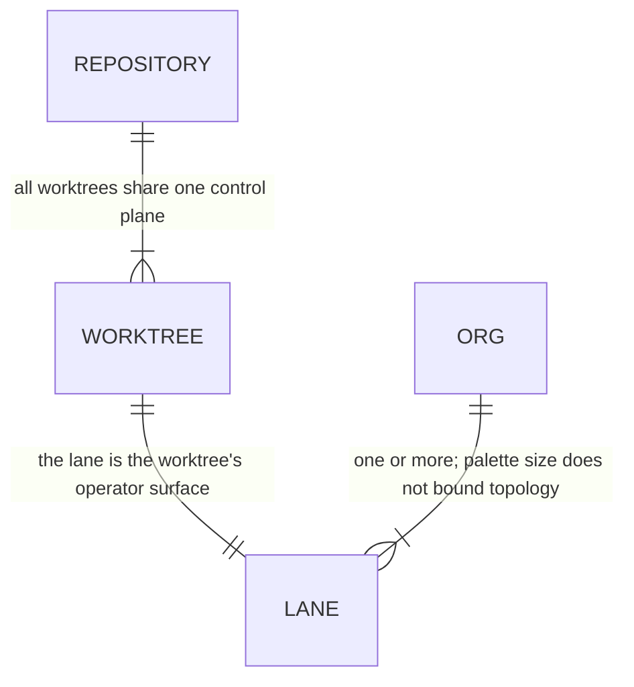
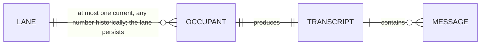
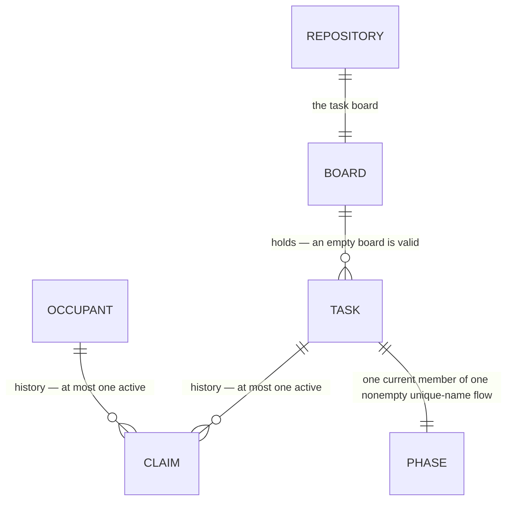
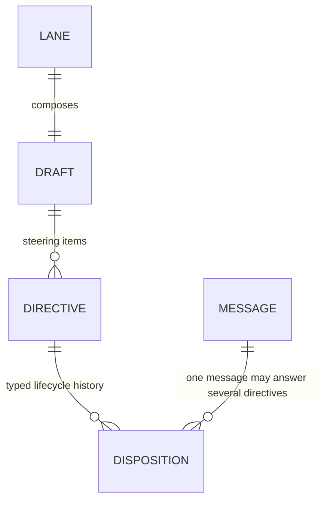
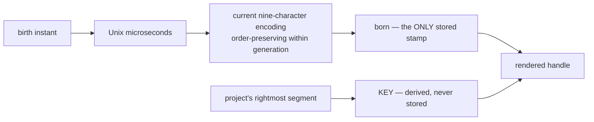
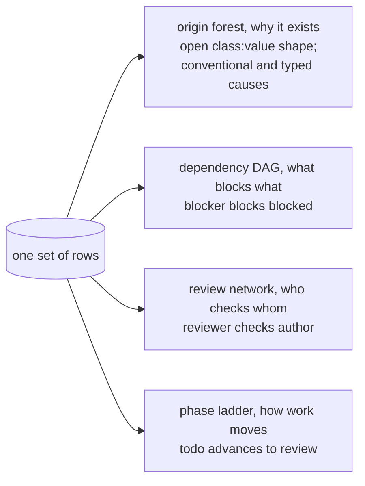
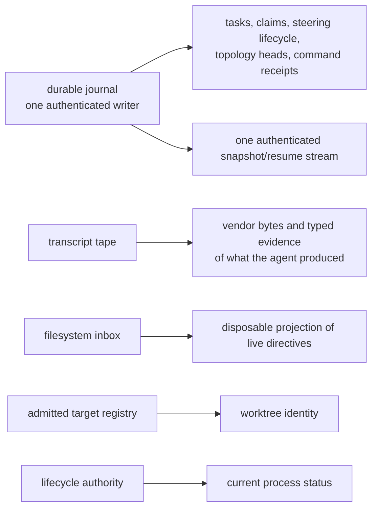
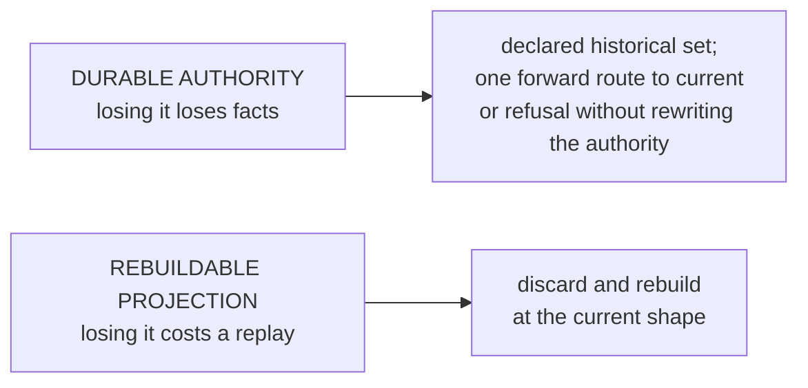

# Product model — core — Orientation and domain

[Product model — core](../model.md) · [Spice product model](../README.md)
## Orientation

### What the product is

An **operations console for a fleet of coding agents**. One operator supervises
many agents, each inhabiting a real git worktree, by reading their transcripts and
writing durable steering through one journal authority. Transcripts are evidence
of what agents produced; the journal owns semantic facts and current heads; the
filesystem inbox is a disposable delivery projection. Supervision, coordination,
counsel, and repository checks preserve those authority boundaries.

### The planes

Each plane can be removed and the rest still runs — degraded, not broken. That
separability is a design property, and it is what makes the progressive
disclosure ladder in [First five minutes](failures.md#first-five-minutes) possible.

### Reading guide

| Label | Meaning |
| --- | --- |
| **Invariant** | must hold in any implementation |
| **Policy** | tunable, with reasoning given |
| **Incidental** | left open by the product model |
| **Closed loop** | reaches a fixed point |

---

## Domain model

### The entity map

The map is split by domain so cardinalities remain legible. `REPOSITORY`,
`LANE`, `OCCUPANT`, and `MESSAGE` repeat where they join the views.

The surface topology owns durable places:

Occupant history hangs from the durable lane and remains readable through its
transcripts:

The board owns work; claim history joins it to the occupants who did that work:

The lane owns forming intent; messages provide the evidence that retires it:

**Invariant —** A team of one is the degenerate case of a team of any size,
never a separate type. Every rule written for teams must hold for a team of one.

### Identity

**Invariant —** `born` is the sole stored identity. Everything else about a
task's name is derived.

**Invariant —** Re-homing a task to a different project changes its rendered
handle **for free**, because the key was never stored.

**Invariant —** Current stamps are sortable as plain strings into current birth
order. Retained eight-character and current nine-character stamps coexist as
deterministic identities; journal sequence and queue origin order them across
codec generations.

**Invariant —** A current minting collision advances the represented instant
rather than appending entropy, preserving strict current-generation string
order. The implementation profile fixes the concrete increment and codec.

**INC** — the alphabet, the width, the separator.

### Independent task graphs

One set of rows carries several *different* graphs. None is visible from a list.

**Invariant —** The origin forest and the dependency DAG are **deliberately
different shapes**. Lineage is *why a task exists*; dependency is *a plan
skeleton*. Collapsing them loses both.

**Invariant —** The review network is the only record of who checks whose work.
It is a graph, not a field.

**Invariant —** These views are *rendered*, not merely queryable. The product
emits diagram source for each one — the shape of work is meant to be looked at.

### The authority map

Every fact has exactly one owner. This is the single most important table in the
product.

**Invariant —** No fact has two authorities. A consumer that needs a fact asks
its owner; it never re-derives it from a cheaper nearby source.

**Invariant —** The resident exposes one ordered authenticated stream. Its
generation identifies the admitted application instance, its epoch identifies
the resident lifetime, and its sequence is monotone within that epoch. Consumers
resume from a cursor or reconnect for an authoritative snapshot.

### Storage classes

**Invariant —** Durable facts and heads remain semantically and
capability-distinct from rebuildable index rows. A concrete profile may
co-locate a derived index in the authority store and update or rebuild it in an
authority transaction, but rebuilding that projection must not mutate immutable
facts or heads.

**Invariant —** A projection family must answer all of these or it does not
belong in the projection store: *where do its facts come from, what records how
far it got, how far back can that source be replayed, what refills it, what
can it still say when the source no longer reaches back far enough.*

**Invariant —** Each durable authority declares a finite supported historical set
and one unambiguous forward route from every admitted shape to current. A route
may be sequential or direct; an unknown or inconsistent authority is never
migrated or rewritten, and no historical runtime remains parallel. Independent,
explicitly admitted pre-read maintenance is outside that authority-migration
guarantee and may mutate only the stale temporary state it owns.

The journal's schema-26-to-27 crossing retires `gate::findings` receipts into
non-executable historical receipt authority. It preserves every receipt column
and payload byte, leaves `gate::filed` facts and current receipts untouched, and
reserves historical command identities against live reuse. Historical receipts
remain part of verification counts and authenticated backup/restore: their
closed historical kind, canonical request, identity, epoch, evaluated witnesses,
response and fact positions must agree. Unknown kinds or malformed evidence
refuse the transactional crossing; neither rows nor schema markers partially
advance. This does not restore the retired command to the executable registry.

---
