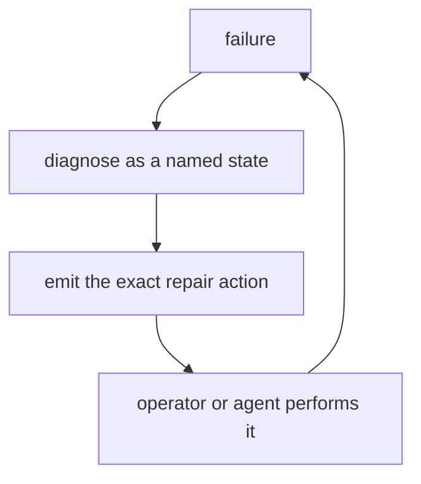
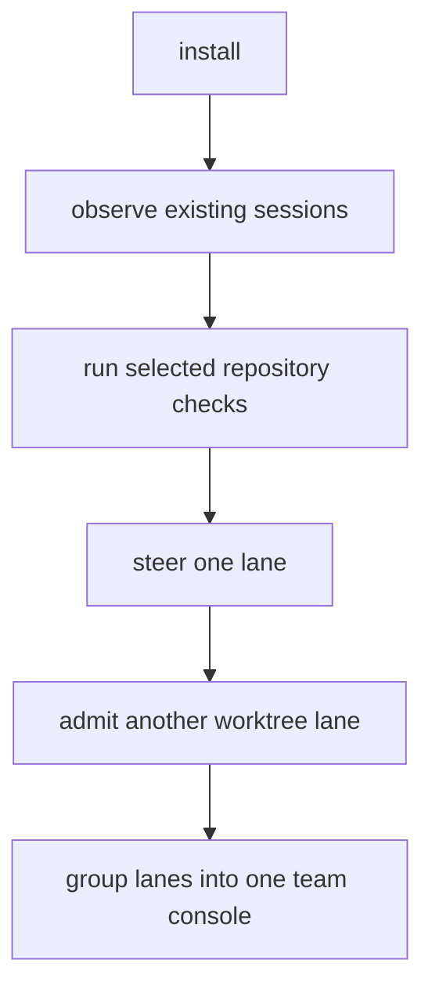
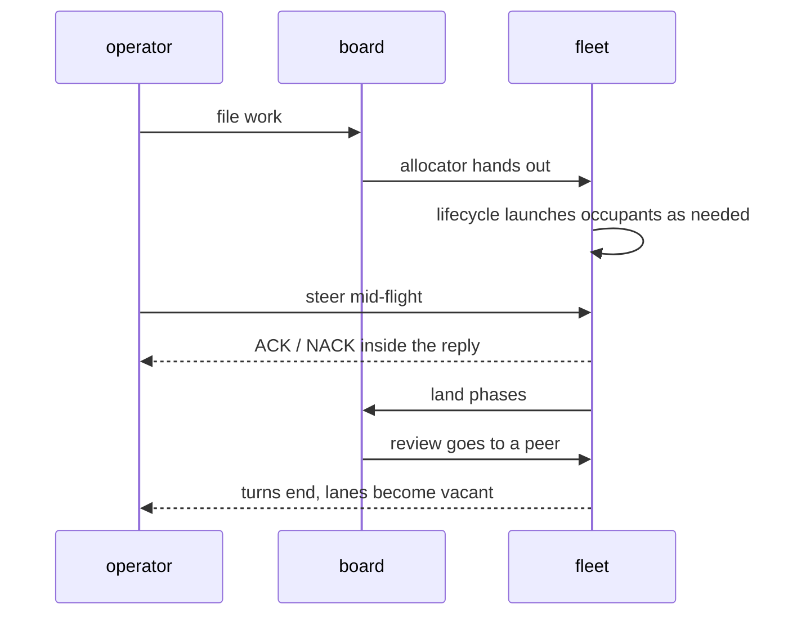
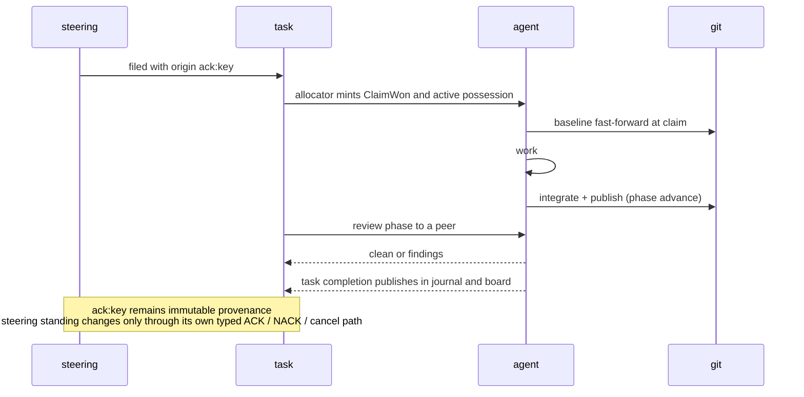
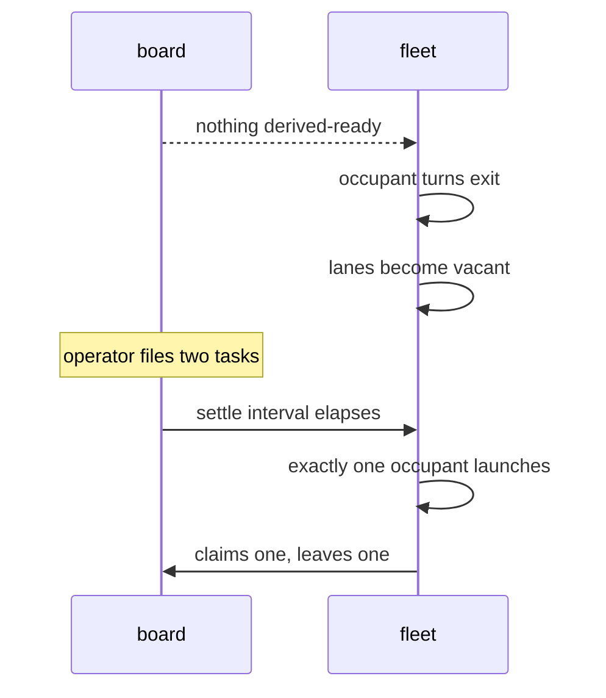

# Product model — core — Failure, journeys, and ontology

[Product model — core](../model.md) · [Spice product model](../README.md)
## Failure and degradation

### The failure-behavior table

| Failure | Behavior | Never |
| --- | --- | --- |
| transport drops | reconnect with bounded pacing; resume the authenticated stream or take a fresh snapshot, retaining same-mount browser predictions | lose journal-accepted steering; before a live key or accepted standing returns, browser death may still lose the ephemeral prediction |
| discovery fails transiently | **touch nothing**; report | destroy lanes |
| agent or turn exits mid-claim before lease expiry | the lane becomes vacant while the claim stays `active`; the held-claim arm launches a successor onto that exact possession | silently lapse or reassign |
| an active claim reaches its lease expiry | the independent timer submits one lapse transaction; accepted disposition becomes `lapsed`, after which readers derive readiness | infer lapse from process liveness |
| a `PendingInbox` automatic wake returns unstarted or a terminal-class start failure | that lane's pending directives move to recoverable `deadlettered` with recovery commands | generalize the transition to held-claim, capacity, operator, or nonterminal wake failures |
| remote unreachable at launch | start anyway with a skip note | lock the lane out |
| landing conflicts | complete recoverable merge + recipe | stranded markers |
| landing races | re-integrate against new baseline, bounded retries | clobber a peer |
| projection corrupt | discard, rebuild, replay | serve silent nulls |
| authority shape unsupported | refuse without migrating or rewriting that authority, naming the shape and supported migration range; independent admitted pre-read maintenance remains outside this guarantee | interpret or rewrite the unsupported authority |
| judging disabled | publish a configured trigger hit directly | require a judge |
| judging enabled but the process is unavailable, times out, errors, or exhausts ambiguity | abandon the candidate and emit nothing | fall back to direct publication |
| speech backend failure is detected | show nonblocking `Speech unavailable` state | block the transcript |
| working-state collection fails | silence | change the command's outcome |
| a recoverable configuration, journal, steering, board, or authority read fails | continue construction with a typed unknown naming the probe and error | report zero or clear |
| the whole session discovery-and-render deadline expires | refuse with action, inputs, and budget named; emit no partial report | present a partial briefing as complete |
| a release step is interrupted | re-running converges | unwind or duplicate |
| an install is interrupted | resume the canonical receipt; refuse an opposing or new operation until it completes | interleave two transactions |
| a lane's payload fails | that lane shows its own error | void the batch |
| surface unmeasurable | keep cards readable in base flow; defer lattice commit until measurable | guess committed geometry |

**Invariant —** **Absence of evidence is never evidence of absence.** A failed
enumeration is not a report that things are gone.

**Invariant —** Every degradation of authoritative observation, a durable fact,
or an already-visible primary operation is *loud*. Incomplete authority reads
must not look like complete reads, and silent success must not look like a
degraded result.

**Invariant —** Silent failure is confined to optional, non-authoritative work
that cannot fabricate or alter a fact. There are two exact shapes:

- A **decoration** laid over another operation — speech beside the transcript,
  the working-state line beside a command — may fail silently because the
  primary result remains intact.
- A **conservative pre-publication filter** may collapse every non-confirmation
  to no candidate. With judging enabled, a trigger hit has no public identity
  until the judge confirms it; absence, timeout, process error, a negative
  answer, and exhausted ambiguity therefore all publish nothing.

Neither shape may widen into fallback behavior. In particular, judge failure
cannot turn a speculative match into direct steering.

### Repair-first recovery



**Invariant —** A recovery recipe presented as a command must be executable **as
printed**, in the state that printed it. An interaction-only repair names the
exact action instead of inventing a command. A recipe naming a moving reference
(rather than the resolved one) is a defect.

---

## Journeys

### First five minutes



**Story.** *As a newcomer, I want the first thing I run to show me something
about work I already did, so that the tool proves itself before it asks for
setup.* — The observer tier requires no repository, no config, and no agent.

**Case.** An optional optimizer that is unavailable leaves native execution
available and reports degraded health. A selected gate that cannot run refuses
loudly; it never presents missing evidence as a pass.

### A day steering a fleet



### A task's whole life



### Renewal

```mermaid
sequenceDiagram
  participant L as lane
  participant P as predecessor
  participant N as successor
  L->>L: renewal requested, lane marked for replacement
  opt predecessor occupied
    L->>P: ordinary handoff steering
    P->>P: finishes its turn and exits
  end
  Note over L,N: the mark waits; renewal starts nothing
  L->>L: next start of this lane consumes the mark
  L->>N: launch fresh successor
  opt active claim retained
    L->>N: ClaimCarried fact, disposition remains active
  end
  N->>L: occupant swapped
  Note over L: lane history, drafts, and scroll survive
  Note over L,N: team unchanged, so its shared task policy remains
```

### The board goes empty



### Reading a fused team

**Story.** *As a reader, I want four agents' output in one stream, attributed,
newest first, without cards hopping sideways, and with my off-top reading
position preserved as new ones arrive.*

**Cases** — a new member joins mid-read (the changed geometry replays
deterministically, and a reader more than 80px from the top stays anchored); a
member is renewed (its old messages keep their lane-derived accent); composers
are reordered (neither colours nor message order change); retained history is
bounded independently per lane, so one prolific member cannot evict every
other member's visible cards.

---

## Ontology

The vocabulary is deliberate. These words carry contracts.

| Term | Means | Not |
| --- | --- | --- |
| **lane** | independently steerable worktree seat | the agent or a team |
| **occupant** | the agent thread currently inhabiting a lane | the lane |
| **team** | server-side grouping of one or more lanes rendered in one console | a lane or client-only view |
| **watchband** | the per-agent status-and-compose strip | a toolbar |
| **mosaic** | the placed, newest-first message lattice | a feed |
| **shard** | one member's concrete send address | a broadcast |
| **lifetime** | autonomy policy: Steer, Drive, Drain | a filter |
| **steering** | durable operator intent requiring a typed answer — ACK or NACK/decline | a chat message |
| **ACK / NACK** | typed agent dispositions, `acked` or `declined` | a read receipt or operator cancellation |
| **claim** | exclusive, leased possession of a task | an assignment |
| **phase** | a slot in a task's flow; advancing publishes | a status field |
| **origin** | why a task exists, carried as open nonempty `class:value`; `ack:`, `task:`, `gate:`, and `doc:` are conventions, not a closed realm enum | who filed it |
| **footprint** | paths a task's own commits touched | the diff |
| **baseline** | the shared line a lane integrates with | an upstream |
| **battery** | the deterministic ordered selection of verifications admitted for one run | a mutable or implicit selection |
| **lineage** | one logical thing followed across copies | a log |
| **maxim** | a curated near-universal taste rule | a lint rule |
| **counsel** | taste offered while the agent writes, as steering it may answer either way | enforcement |
| **oops** | a cheap, private admission of a mistake | a bug report |
| **study** | a repo-wide analysis that can refuse a commit | a linter |

The vocabulary describes product contracts, not a ban list. Foreign mechanisms
may be named where a boundary must reason about them; product behavior is named
by the authority and state transition it actually uses.
