# Product model — core — Entity state machines

[Product model — core](../model.md) · [Spice product model](../README.md)
## Entity state machines

### Task

The stored workflow, the allocator's read-time projection, and Git publication
are three orthogonal layers. `ready`, `eligible`, `claimed`, and `landed` are not
values of `workflow.status`.

The durable workflow status has exactly three values:

```mermaid
stateDiagram-v2
  direction LR
  [*] --> pending: task&#58;&#58;added
  pending --> completed: accepted final phase
  pending --> deleted: task&#58;&#58;deleted
  completed --> [*]
  deleted --> [*]
```

Ordinary allocation derives readiness from current heads; it does not write
another workflow state. Active possession is another derived answer:

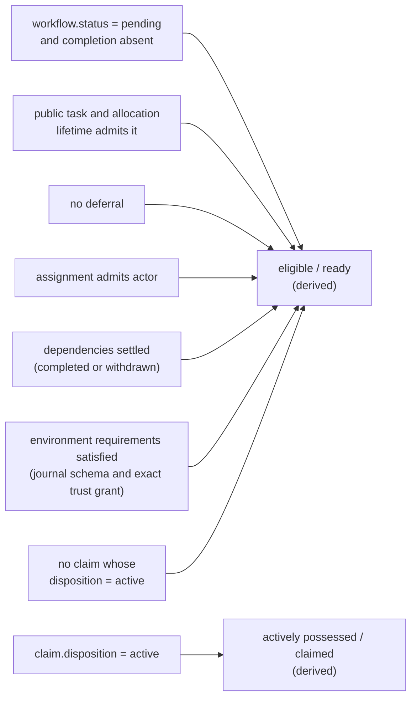

An accepted phase advance is always journal publication. Git publication is a
conditional consequence, not a task state:

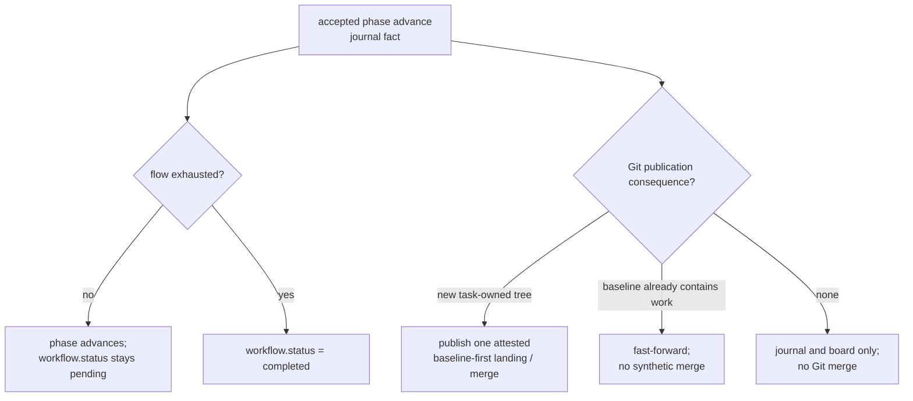

**Invariant —** Queue age has one durable origin, and unrelated modifications to
a row must not reset it. Starvation fairness depends on this.

**Invariant —** Dependency blocking is a read-time allocation predicate, not a
task transition. A pending task with an unsettled dependency stays pending but
is ineligible. Completing or withdrawing the dependency settles the edge and
can make the dependent eligible without writing its workflow fact.

**Invariant —** Environmental blocking is also a read-time allocation
predicate, distinct from dependency blocking and from workflow state. A
`journal-schema` requirement needs at least that admitted schema. A
`trust-grant` requirement needs the exact digest's current `granted` head with
recorded producer-worktree provenance; the producing worktree is evidence, not
lane or repository scope. Missing, pended, revoked, or unbound heads leave the
task pending but ineligible. A matching grant can make it eligible immediately
without editing, waking, freeing, or rescheduling the task.

An active holder that encounters an unmet trust grant keeps possession rather
than releasing work another lane would only block on again. One guarded
requirement edit moves the same lease's expiry and maximum to the repository's
canonical `2099-12-31T23:59:59.999Z` horizon. This is a representation inside
the existing lease state—not task deferral, a new claim disposition, or a
second parking machine. Actor, lane, occupant, epoch, start, renewal, and the
original win remain unchanged.

While that exact requirement is unsatisfied, a vacant owning lane suppresses
work-driven held-claim, drain, and available-work starts. Message-driven
pending-inbox wake remains available, so new operator direction can still
reach the lane. A matching provenance-bound grant or authorized requirement
removal makes the sentinel claim thaw-ready; the same-lane carry/rebound
seating transaction replaces sentinel renewal, expiry, and maximum with
ordinary bounded automatic values. Explicit holder free remains an escape.

**Invariant —** Deferral is a distinct durable fact and workflow-head field;
`workflow.status` remains `pending`. Its timestamp is advisory and wakeable, not
a self-clearing timer. Only an explicit wake clears the deferral, after which
ordinary eligibility is recomputed. Clearing a dependency never clears it.

**Invariant —** A phase advance is a publication, not a field write. It is
observable in journal history without a parallel event log. A landing is the
mutating Git subset of those publications, never a workflow status.

### Closed loop: The plan phase is prepended, not requested

A task captured with no acceptance criteria and no named flow is neither refused
nor filed vague. A **plan phase** is prepended to its flow, and that phase cannot
be closed until the missing acceptance exists somewhere.

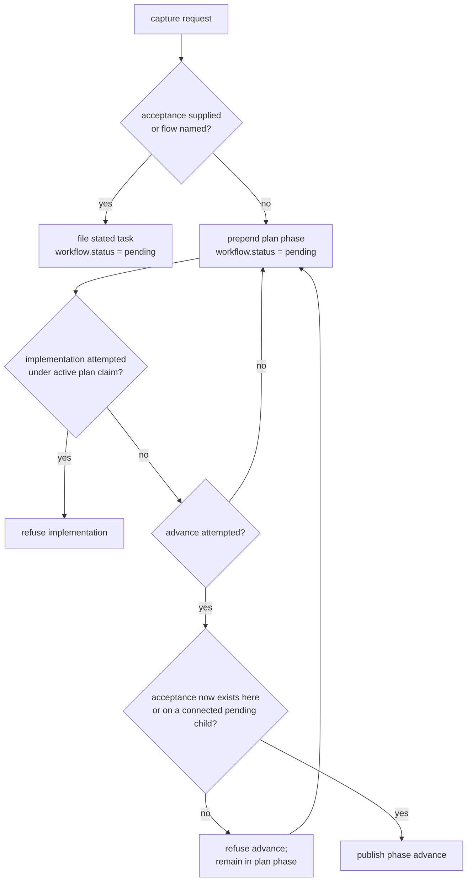

**Invariant —** Absence of acceptance is treated as **unfinished thinking, not
as an error**. The system prepends the step that produces the missing thing
rather than refusing the capture, because refusing at capture time discards the
request along with the ambiguity.

**Invariant —** The plan phase closes only when acceptance exists — on the task
itself, or on at least one connected pending child. A plan that produced no
statable outcome has not planned anything.

**Invariant —** A plan-only flow must connect a child with acceptance. Its
entire product is the board it leaves behind, so there is nothing else it could
be permitted to exit on.

**Invariant —** Implementation is refused while a plan-phase claim is held, and
a plan phase carrying local commits cannot advance. The refusal is what makes
the phase mean anything: an agent free to implement while planning will, and the
plan becomes a description of what was already built.

**Invariant —** The prepended step is visible as a **phase**, not as a flag. An
operator reading the board sees a task sitting in `plan` — a position in a flow
they already understand — rather than a hidden attribute explaining why the task
behaves unusually.

**Policy —** A task flow is a nonempty sequence of unique phase names; every
name is one nonempty lowercase ASCII word, and the current phase must be a
member of that declared flow. There is no global phase enumeration or slot
ceiling. The task-document station vocabulary is a separate interface, not the
board's phase grammar.

### Closed loop: Claim

The claim head's disposition has exactly three values:

```mermaid
stateDiagram-v2
  direction LR
  [*] --> active: claim&#58;&#58;won
  active --> freed: claim&#58;&#58;freed
  active --> lapsed: claim&#58;&#58;lapsed
  freed --> [*]
  lapsed --> [*]
```

Win, renew, carry, rebound, and steal name facts or guarded transitions around
that disposition; they are not additional disposition values:

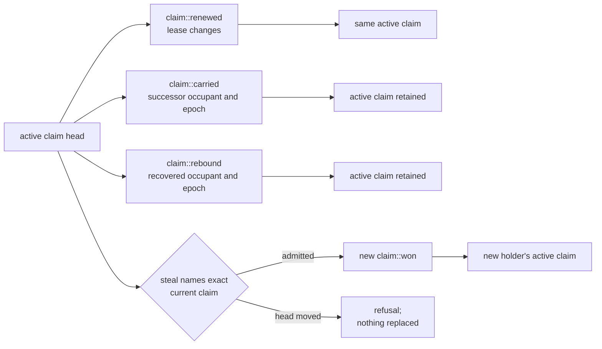

**Invariant —** Claiming is atomic: `claim::won`, the active claim head, its
owner, and its lease are committed together. A row can never project active
possession with no owner.

**Invariant —** Lapse is a typed journal transition, not an allocator inference.
It changes the exact disposition to `lapsed`; ordinary allocation then derives
readiness again from all current predicates. Explicit release analogously writes
`freed`.

**Invariant —** Steal is explicit and immediate. It replaces **exactly the claim
named by the command**, never whatever is current by the time the transaction
lands. A mismatch refuses cleanly.

**Invariant —** A displaced claimant is not sent fabricated steering. The next
operation against the old claim receives a typed ownership refusal naming the
current owner, so work is never silently accepted under displaced authority.

**Invariant —** `claim::renewed` extends the lease of the same active claim.
`claim::carried` moves active possession to a successor occupant while preserving
team and elapsed work; it is not a fresh win. `claim::rebound` repairs the
occupant and epoch after residency moves ahead, while retaining `active`.

**Invariant —** A witness record durably distinguishes *an intentional,
announced end* from *no history at all*.

**Policy —** A manual claim opens with a 3600s lease and a 7200s renewal maximum.
It records the lane's exact accounted source boundary; terminal evidence closes
the attempt at another exact boundary.

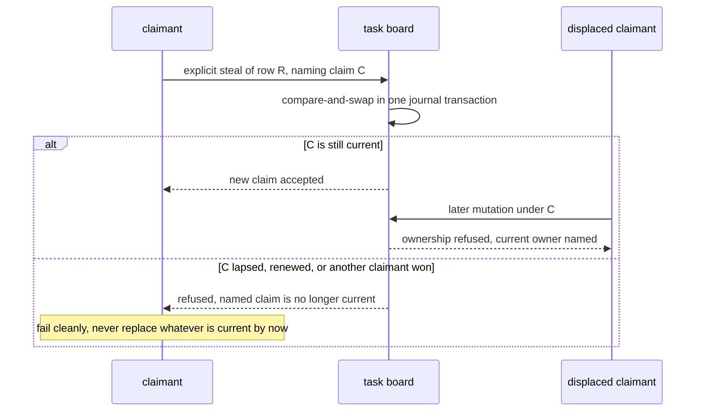

### Closed loop: Steering item

The journal-owned disposition, journal-owned presentation stage, and disposable
delivery projection are orthogonal. A vendor post-tool observation may advance
its locked durable hook-delivery record; a top-level shell read does not. Neither
becomes a directive-lifecycle transition.

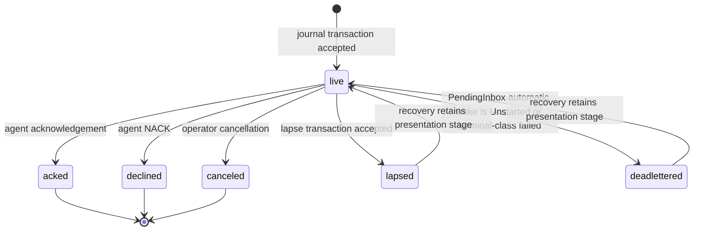

Here `live` means any retained presentation stage:

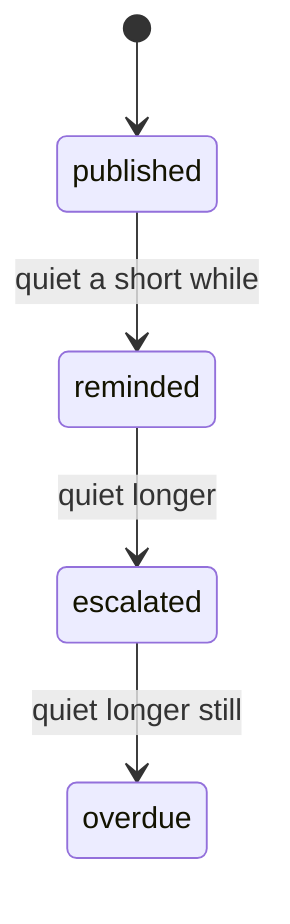

Delivery is a separate, rebuildable view of that live standing:

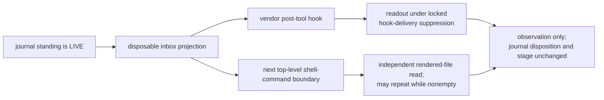

**Invariant —** Publish is one accepted journal transaction and is durable before
delivery is attempted. The filesystem inbox is a rebuildable projection of live
directives, published with a same-directory staged file, durable flushes, and an
atomic rename.

**Invariant —** Reads never change disposition. At every live presentation stage,
`acked`, `declined`, `canceled`, `lapsed`, and `deadlettered` are the same
available typed exits.

**Invariant —** The escalation ladder is time-since-publication, not
retry-count. Escalation changes *presentation urgency*, never identity.

**Invariant —** Only a `PendingInbox` automatic wake that returns `Unstarted` or
a terminal-class start failure deadletters: it moves every pending directive on
that lane from its retained live presentation stage to `deadlettered`. Held-claim,
capacity, operator-start, nonterminal-error, and arbitrary delivery-failure paths
do not. Recovery returns `lapsed` or `deadlettered` to live while retaining the
directive's identity, lineage, presentation stage, and presentation history.

**Policy —** reminded 60s, escalated 30m, overdue 1h, lapse threshold 24h,
and nine-character current steering keys. The mint advances the monotone
indexed Unix-microsecond high-water to the first unused value. Retained
eight-character keys remain readable but are never minted.

### Closed loop: Agent process

Supervisor phase, UI lane presentation, and durable resident lifecycle have
different owners and purposes. They are not one shared state machine.

The detached supervisor owns one process turn and records exactly four phases:

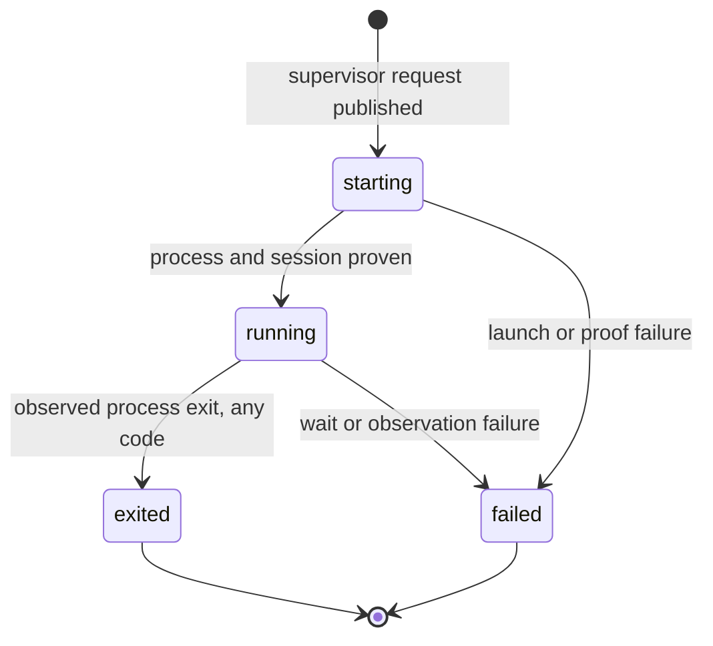

The UI independently derives one of five lane presentations. Pending steering
outranks liveness; these labels are not supervisor transitions:

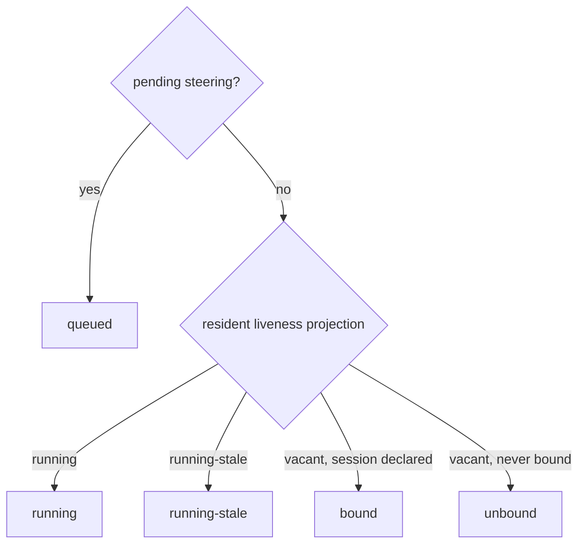

The durable resident authority uses a separate seven-value vocabulary. Its
bounded shutdown order is explicit; resident replacement may release authority
directly to `dark` while detached lane supervisors remain live:

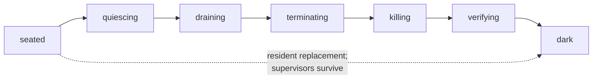

**Invariant —** Only lifecycle authority may decide to launch, restart, or renew
an occupant or to advance resident lifecycle. The supervisor records process
phase, and the UI derives presentation; rendering, snapshotting, and querying
cause neither.

**Invariant —** Every agent turn or process exit, including exit code zero, ends
that occupant and vacates the lane. A successful exit never becomes a persistent
`idle` state. A detached job continues; an ending left unheard through its
delivery grace requests a lane wake, and the successor receives the completion
during startup catch-up. Working and waiting describe activity only inside one
supervisor's `running` turn.

**Invariant —** Ambient thread ids are refused at launch. A lane binds to the
thread the launch answer names, never to one inherited from the environment.

**Invariant —** The launch prompt is **neutral**. The real ask is recovered from
live control-plane state, not baked into startup.

### Lane and team

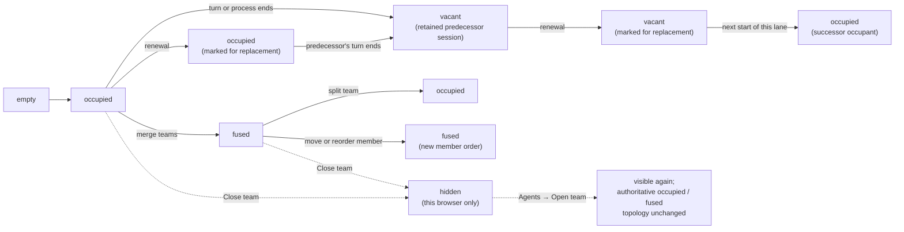

**Invariant —** Renewal marks a lane; it never starts an occupant. A live
predecessor is additionally asked to hand off. The mark survives until the next
start of that lane consumes it, launching a fresh successor, or until the
operator withdraws it.

**Invariant —** Fusing is a *team merge*, splitting a *team split*. There is no
client-only grouping.

**Invariant —** `Close team` is a browser-local presentation action. It hides
the team in that mounted browser reducer; it sends no command, changes no
topology, and does not hide the team in another browser. A closed grouped
team remains restorable during that mount through **Agents → Open team**.

**Invariant —** Browser-local close neither inspects nor erases drafts. Unsafe
draft or submission state instead installs the page-leave confirmation guard.

### Closed loop: Submission (a draft becoming evidence)

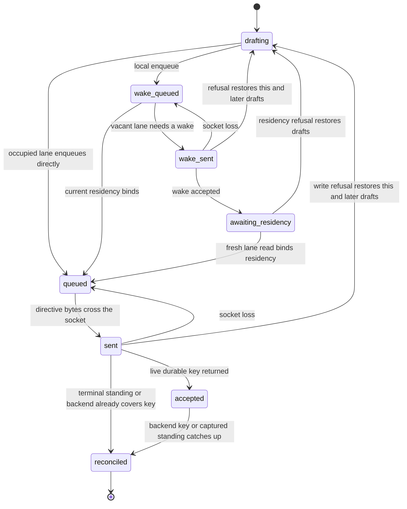

**Invariant —** The browser queue is an ephemeral ordered prediction, not
directive authority. A refused wake, residency bind, or write restores the
affected draft and every later draft from that lane in original order.

**Invariant —** A live accepted prediction remains only until a backend key or
captured standing covers the same directive and key. Pending presentation is
backend truth plus uncovered predictions, so reconciliation neither drops nor
double-counts an item.

**Invariant —** Acceptance crosses into the separate journal-owned steering
lifecycle (`live`, `acked`, `declined`, `lapsed`, `deadlettered`, or `canceled`).
Agent prose is evidence from which ACK or NACK may be recognized and committed;
retained messages are never the sole semantic authority.

### Message card

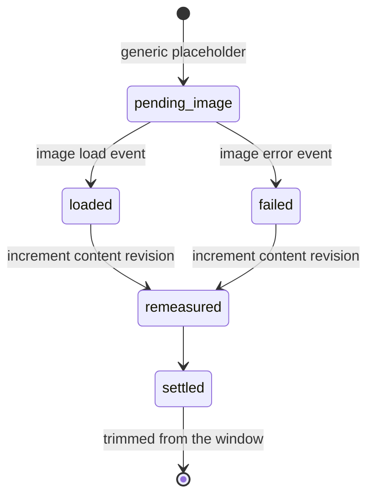

**Invariant —** Image load and failure are distinct from still loading. Either
outcome remeasures the complete card at its already-latched horizontal span;
vertical placement may settle when the measured height changes.

### Closed loop: Maxim reminder

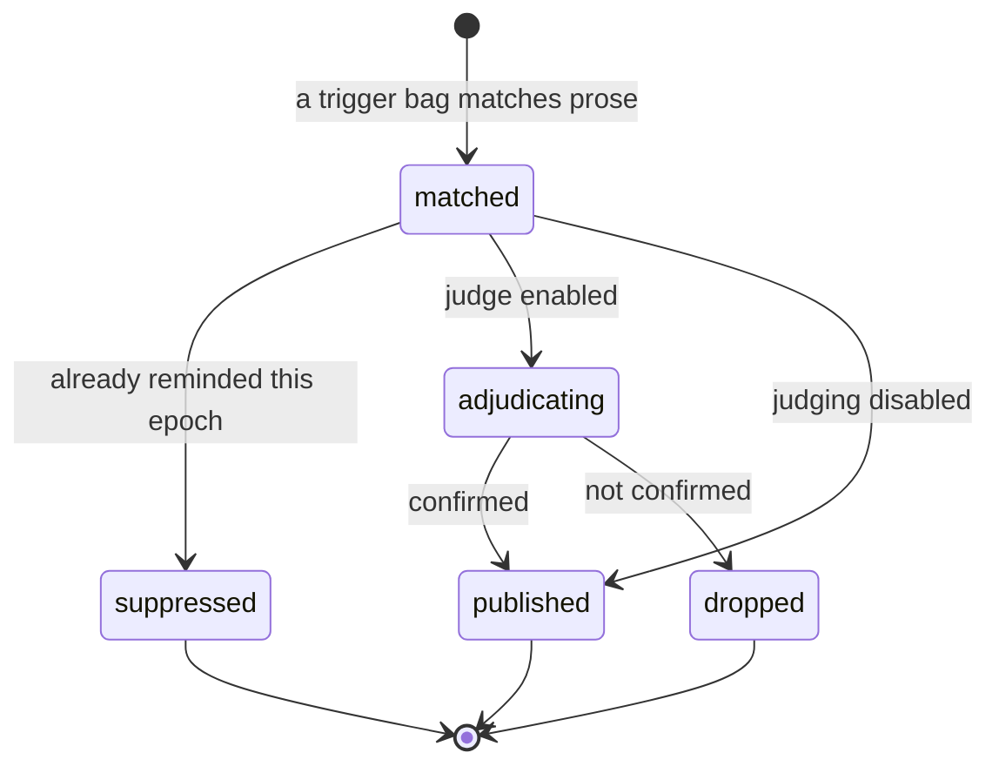

**Invariant —** At most one reminder per content-derived key per compaction
epoch. Compaction may make the same reminder eligible again — because the agent
may have lost the earlier steering — but it never changes the reminder text.

**Invariant —** Self-echo is suppressed. The system must never judge itself for
quoting itself.

**Policy —** Adjudication is optional. With `judge.enabled` absent or false,
configured trigger rules publish directly. When enabled, equivalent framings
are deterministically shuffled, then each is attempted sequentially through a
fresh bounded judge child; absence, timeout, process error, or exhausted
ambiguity drops the candidate.

#### The bag, and how it matches

A **bag** is a stable name, one message, and a set of triggers. Every trigger
resolves the same bag, so a bag is one opinion with several ways of being
provoked.

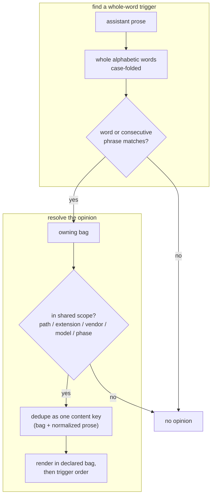

**Invariant —** Matching is over **whole words**, never substrings, and there is
no stemming at match time. A bag enumerates its own variations; the matcher
never mutates the prose to find a hit. This keeps the set of things that can
fire a bag readable in the bag itself, rather than emergent from a
transformation nobody can see.

**Invariant —** A trigger is an alphabetic word or phrase, and anything else is
refused when the configuration loads. A trigger that can never match a word is a
silently dead opinion.

**Invariant —** One statement selects a bag at most once, however many of its
triggers hit, and candidates order by declared bag order then trigger. The same
prose always produces the same candidate sequence; runtime publication still
suppresses a repeated content-derived key within one compaction epoch.

**Invariant —** Applicability is expressed in the same path, extension, vendor,
model, and phase selector grammar used by gate policies and studies, so a bag
can apply to one vendor and not another without inventing a second scoping
language.

**Invariant —** A bag is disabled by **name**, in a tracked record, so every
clone sees the same set of opinions in force. A disabled bag is enumerable — an
opinion the repository has decided against, rather than one that quietly stopped
firing.

**Invariant —** Adjudication asks the same question in several equivalent
framings and shuffles them deterministically from the content-derived evidence
key. The same evidence repeats the same order; different evidence may produce a
different order. A reply that does not collapse to a single yes or no is retried
a bounded number of times and then abandoned rather than interpreted.

### Closed loop: Projection family

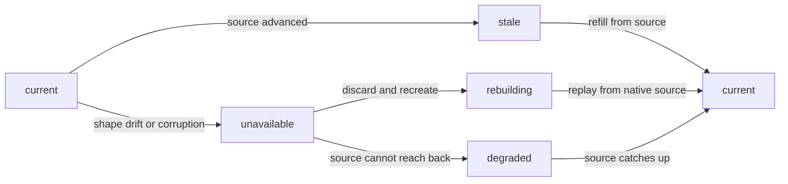

**Invariant —** `unavailable` must be **loud**. A projection that read nothing
must never present the same answer as one that read everything.

---
