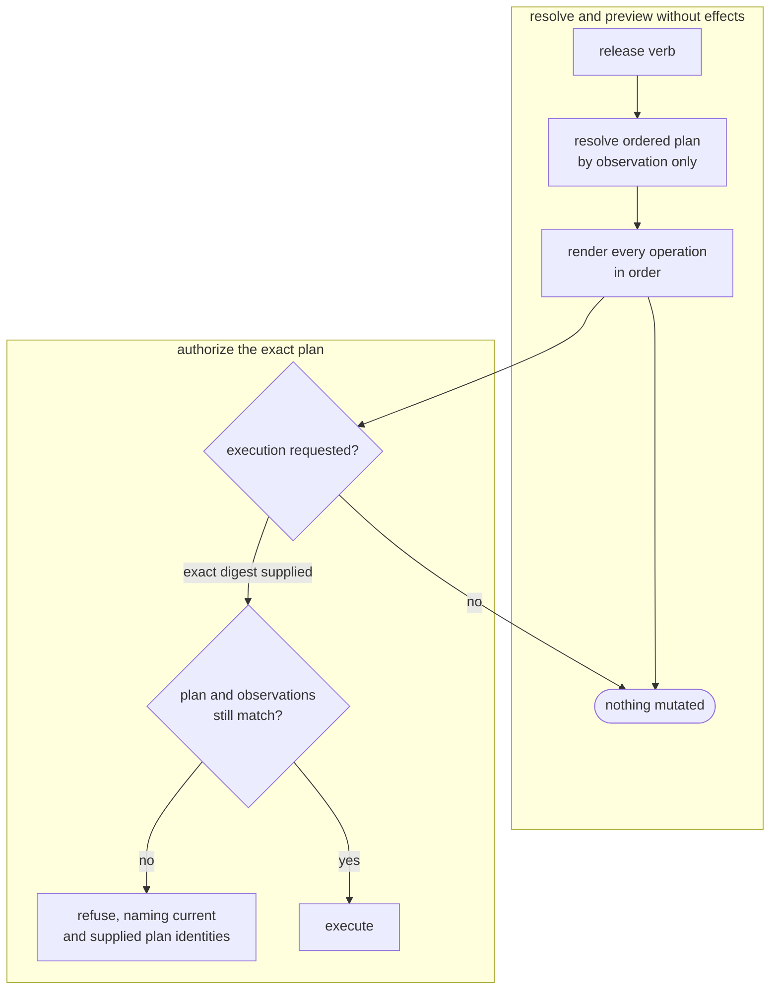
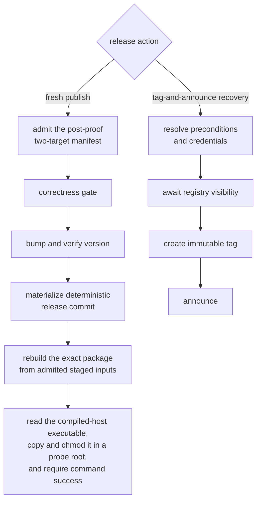
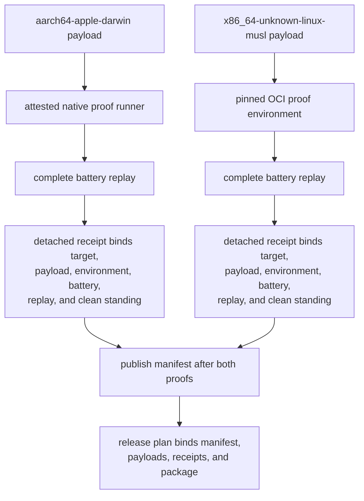
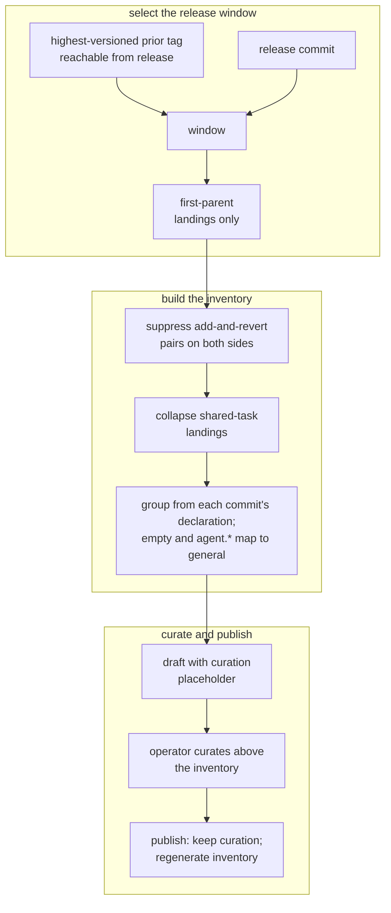
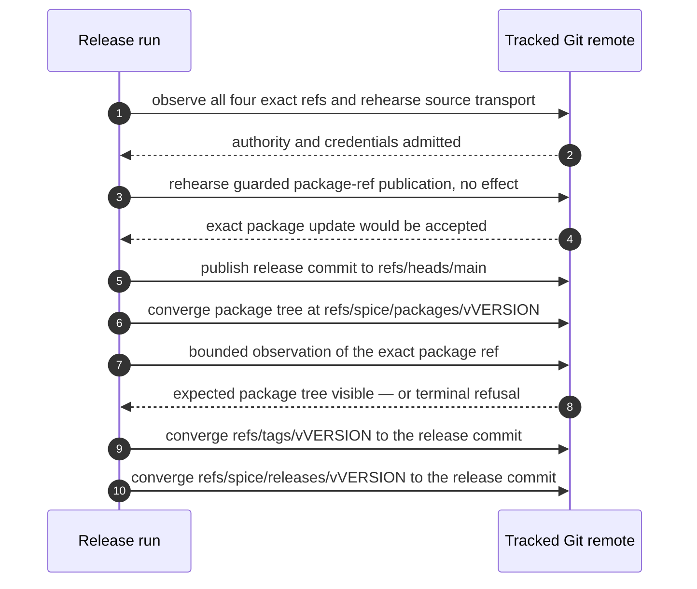
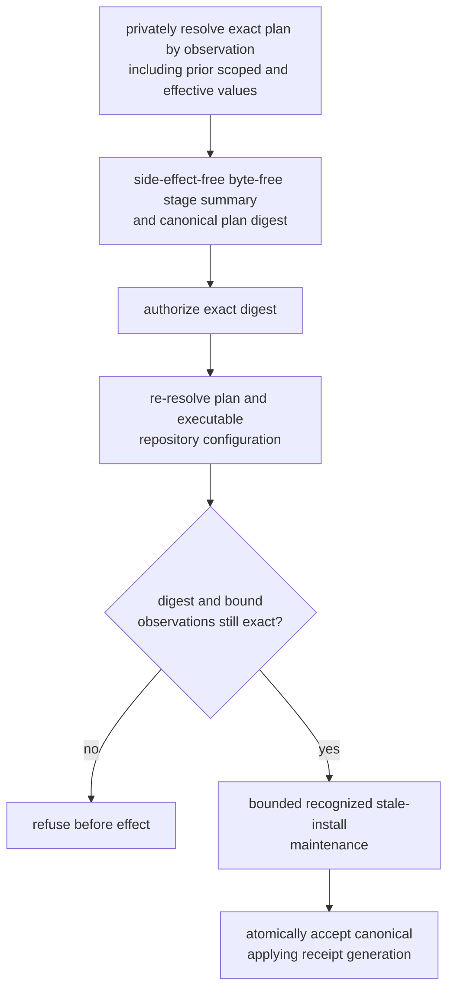
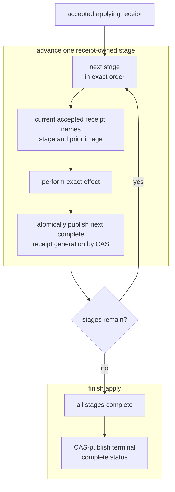
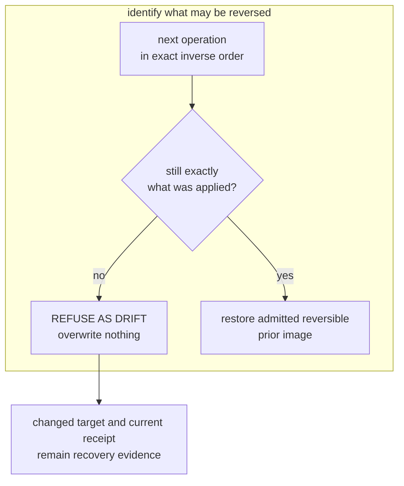
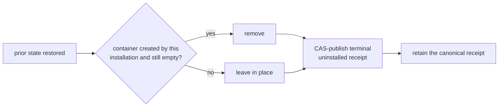
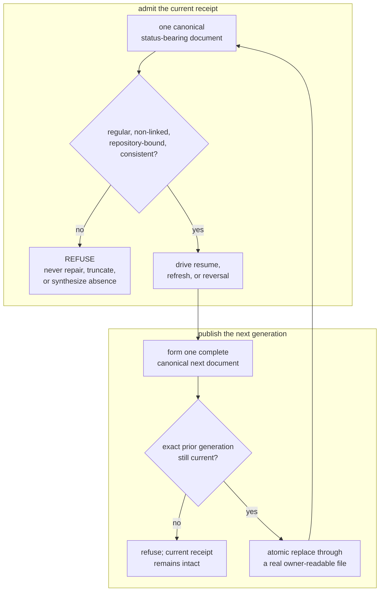

# Product model — supporting planes — Distribution

[Product model — supporting planes](../planes.md) · [Spice product model](../README.md)
## Distribution

Distribution crosses authorities the appliance does not own outright: one
tracked Git release authority and an operator's repository. Immutable release
refs cannot be repaired by pretending an earlier effect did not happen, and
repository installation must preserve state the operator already owns. Exact
plans, durable receipts, convergence, and identity-aware reversal answer those
boundaries.

### External publication is a plan, not a verb

**Invariant —** Every release verb with externally visible publication effects
renders its **complete ordered plan** and performs none of those effects until
execution is explicitly requested. An irreversible step described only after it
runs gives the operator no chance to stop it. Local mutations remain governed by
their own transactional contracts.

**Invariant —** Execution requires the digest of the complete plan that was
read. An absent or moved digest refuses before effects. Exact-plan execution is
the only publication path.

**Invariant —** Plan identity covers the repository, action, version, source and
resolved release commits, exact target matrix, ordered operations, notes
content, artifacts, proof receipts, sealed manifest, and captured preconditions.
The correctness operation has one intrinsic meaning — the complete canonical
strict battery — rather than a mutable subset outside the plan. A digest over
step names alone would let a publication input change after approval and still
satisfy the check.

**Invariant —** Step order is part of what the plan commits to, because the
ordering is the safety property, not an implementation detail.

**Invariant —** Preconditions that can be evaluated without effect are evaluated
while the plan is built. A cheap check deferred past the gates strands the
operator after the push with a failure that was knowable up front.

**Invariant —** Inspection is free of consequence. Checking the gates, drafting
the notes, and previewing the range never bump, commit, tag, push, or publish —
so "what would the next release contain?" is a safe question.

**Invariant —** One executor owns the ordered operation vocabulary. It records an
operation's exact prior state before crossing the effect boundary and a typed
receipt after convergence. Resumption admits only that same plan and receipt
prefix.

### The fresh-publish gate order, and the one seam in it

The fresh-publish bump sits between two gates, and both neighbours are
load-bearing. Tag-and-announce recovery takes a separate four-operation path.

**Invariant —** The fresh-publish bump lands **after** correctness, so a red
source never authorizes a version transition. Fresh-publish resumption may admit
the exact version-only intermediate state after correctness has already been
receipted; that resumable state cannot move the bump ahead of the gate.

**Invariant —** For fresh publish, the correctness gate selects the exact source
commit named by the accepted plan and executes the complete canonical strict
battery over that immutable tree. Every arm must admit before the bump. This
host-side battery is distinct from the sealed target proof replay completed
before the manifest and publication plan are accepted. Tag-and-announce
recovery instead resolves preconditions and credentials, awaits registry
visibility, creates the immutable tag, and announces; it does not rerun the
correctness battery.

**Invariant —** The fresh-publish bump lands **before** the artifact gate, so
the package ref names the exact sealed package rebuilt for that version and
release commit.

**Invariant —** The artifact gate proves both composition and use. A persistent
release target directory may contribute reusable build output; the rebuilt
package must nevertheless equal the planned package and Git-tree identities.
The compiled-host staged executable is read, matched to the plan's artifact
digest, copied to a plan-keyed probe root, made executable there, and required
to return success from `--json version`. The probe does not require the staged
source itself to be regular or executable, and it does not interpret the
command's output as a structured identity.

**Invariant —** Preview, execution, and recovery use one plan and receipt grammar.
A parallel verification or publication body would be a second release authority.

**Invariant —** Local release progress has three exact admitted shapes. Publish
may begin at the clean source commit carrying the source version, resume at that
same commit with `dist/VERSION` as the only tracked change and already equal to
the requested version, or resume at the clean deterministic release commit.
Tag-and-announce requires that clean deterministic release commit at HEAD.
Every other tracked change, commit, version, or HEAD shape refuses. Release
preparation does not infer task ownership from the board.

### Proof is sealed per target and composed last

A release has exactly two target payloads, in canonical order: the native
`aarch64-apple-darwin` Apple Silicon appliance and the static
`x86_64-unknown-linux-musl` appliance. Each receipt-free payload binds its schema,
target, source identity, complete Canvas generation, native executable, complete
build pins, and ordered artifact inventory. The detached receipt separately binds
the environment that actually ran proof: the Linux receipt's OCI identity must
match the payload's proof-container pin, while the Darwin receipt binds the
attested native runner digest.

The two payloads must bind the source digest carried by their manifest. The
publication plan separately admits its source and release commits and the
manifest, package, target, notes, and installed-artifact identities. Current
admission does not compare the manifest's source digest with the plan's source
commit.

**Invariant —** Proof executes the complete current battery against the current
candidate checkout: Linux mounts that checkout read-only in the admitted OCI
environment, while Darwin passes it to the attested native runner. Replay is
bound to the admitted payload, environment, and battery, but it does not prove
that the workspace commit equals the payload's source digest. Unsupported hosts,
target drift, environment drift, infrastructure failure, or a non-clean replay
publish no receipt.

**Invariant —** A proof receipt is detached from the payload and canonical. Only
a clean replay publishes a receipt, and admission requires target, payload
digest, environment, battery digest, replay digest, and clean standing to form
one identity chain. A refused replay remains a typed refusal, not a refused
receipt.

**Invariant —** The release manifest is post-proof. Both canonical targets and
their exact receipts must be present, clean, and mutually consistent before the
manifest pointer is published; partial or mixed-target evidence never becomes a
release.

**Invariant —** Content-addressed payload, receipt, and manifest objects are
published before the sole manifest pointer. A reader therefore sees either the
prior complete seal or the new complete seal, never a pointer to missing proof.

**Invariant —** The independent executable probe reads the compiled-host staged
path, recomputes its artifact digest, and refuses disagreement with the plan. A
readable symlink or other readable source is followed by that read; the probe
then atomically copies the bytes to a plan-keyed regular file, applies executable
permissions to the copy, and requires the copied process to exit successfully
for `--json version`. It does not validate the source file's type or mode or
decode stdout as a version identity.

### Notes are read out of the ledger

**Invariant —** Notes derive from the ledger. There is no maintained changelog to
drift, and a release's own bump commit is excluded from the notes it generates.

**Invariant —** Only **first-parent** landings are counted, so one merged unit of
work contributes one entry rather than one per internal commit.

**Invariant —** Work added and reverted inside one window is suppressed on both
sides. Otherwise the release advertises a feature that is not in the artifact.

**Invariant —** A revert pairs with the landing whose history *contains* the
reverted commit, not with one whose identifier equals it. The reverted commit
almost always arrived on a side branch and never appears in the first-parent
list at all.

**Invariant —** Landings sharing a task identity collapse into one entry at the
position where that task first landed. The most recent landing supplies both the
entry's subject and its declared project. A task that lands once per phase would
otherwise appear once per phase, described and grouped by stale declarations.

**Invariant —** Every entry carries at least one reference back into history.
Rendering groups the collapsed entries by the project supplied by each task's
latest landing, emits project buckets in the order those projects first appear
in that collapsed entry sequence, and preserves entry order within a bucket.
Equal edited descriptions merge only within the same project bucket, retaining
every contributing reference; project grouping does not preserve one global
landing order or raw-history project order.

**Invariant —** Each collapsed entry groups from the project its latest landing
declares — the author's own statement of what the change belongs to — never by
inference from touched paths. An empty declaration and every declared `agent.*`
project map to `general`; every other declared project retains its own first-seen
bucket in the collapsed entry sequence.

**Invariant —** A trailing handle is stripped from a description only when it
matches that commit's own recorded identifier. Guessing from shape truncates
descriptions that merely end in a hyphenated token.

**Invariant —** The prior tag must be **reachable** from the release commit, and
tags are addressed through their fully qualified ref namespace. A branch sharing
a tag's name would otherwise silently redefine the range, and the result would
look entirely plausible.

**Invariant —** With no reachable prior tag, the canonical range is a bounded
window of recent landings and names that basis explicitly.

**Invariant —** Curation owns the region above the generated inventory;
everything from the inventory down is regenerated at publication against the real
release commit. Curation necessarily happens before the release commit exists, so
a frozen copy would name the wrong commit and the wrong range.

**Invariant —** Notes are refused when untouched, when they still carry the
placeholder, or when the curated region holds nothing but banner and headings.
Any of those publishes a page that opens straight into a machine-generated
inventory.

### The publication sequence

One tracked Git authority owns four release refs on one remote. The source branch
is published first; the package, tag, and announcement refs converge only to
their exact planned objects. The order is the design.

**Invariant —** The only external release provider is the tracked Git authority:
remote `origin`, source `refs/heads/main`, versioned package
`refs/spice/packages/vVERSION`, tag `refs/tags/vVERSION`, and announcement
`refs/spice/releases/vVERSION`. Runtime configuration cannot redirect one release
step to another provider.

**Invariant —** The release commit reaches the source ref **before** its package
tree reaches the immutable package ref. The reverse order exposes a package whose
source is not present at the same authority.

**Invariant —** Only source publication and guarded package-ref publication have
explicit no-effect rehearsal operations. Tag and announcement publication run
their convergent Git mutations directly; the current plan neither rehearses
those effects nor marks them as unrehearsable.

**Invariant —** Tag and announcement wait until bounded observation sees the
exact package object at the package ref. Exhausting that observation is a loud
terminal refusal, not permission to advertise unobservable content.

**Invariant —** Every step **converges** rather than duplicating, so a release
interrupted partway through is completed by re-running it rather than unwound.
The accepted-operation journal and typed receipts make each restart resume the
same plan at the first incomplete boundary.

**Invariant —** `spice release publish --action tag-and-announce` previews a
plan that resolves recovery preconditions and credentials, observes registry
visibility, then performs only the tag and announcement publication effects;
repeating that same action command with `--apply=<digest>` finishes a release
whose package ref is already visible without rebuilding or republishing the
package tree.

**Invariant —** A version names exactly one package object and one release commit.
An existing package, tag, or announcement ref pointing elsewhere refuses rather
than moving. A matching ref is already converged and is left untouched.

**Invariant —** Rebuild reads the release worktree, so the deterministic release
commit must be its head and the tree must be clean. Otherwise the package ref
would name bytes from one tree while the tag and notes describe another.

**Invariant —** An operator interruption terminates with a status distinct from a
gate failure. Collapsing the two sends the reader hunting for a defect that does
not exist.

### Installing into a repository the product does not own

The same discipline, pointed inward. Installing hooks means writing into someone
else’s repository, so one canonical status-bearing receipt owns the exact plan,
first-captured prior-image evidence, durable progress, and reversal outcomes.

The accepted receipt is the transaction authority. It exists durably before the
first receipt-owned installation effect and governs one serial compare-and-swap
loop.

**Invariant —** What the operator reviews is produced purely by observation.
Application requires that plan's exact digest and executes the same resolved
receipt-owned operations; a moved digest refuses before mutation.

**Invariant —** Preview never invokes maintenance. After apply admits the exact
digest and bound observations, it may run one bounded pass that reclaims only
recognized stale install-record publications and unreferenced rollback blobs.
Explicit reversal admits the same pass through its `--unapply` direction. This
Spice-owned pre-plan-effect maintenance is not a receipt-owned plan operation and
never imports, repairs, or deletes foreign state.

**Invariant —** Before the first receipt-owned repository effect, apply
atomically accepts one canonical `applying` receipt containing the exact plan,
repository identity, and zero progress. It records exact install-owned reversible
prior images directly or authenticates them through digest-bound rollback
evidence. Immutable content-addressed rollback material may be staged earlier,
but is inert and reclaimable until that receipt authenticates it. Every later
progress or terminal receipt is a complete canonical generation compare-and-swap
published from the exact prior generation. A stale or concurrent writer refuses
and leaves the current receipt unchanged.

**Invariant —** No receipt-owned plan change is made until the accepted receipt
already describes its exact operation and prior image, and the operation's
completion is durably published before the next operation begins. A plan
mutation whose receipt was lost is an untracked modification of someone else's
repository that no reversal can reliably identify.

**Invariant —** The receipt records directly, or authenticates through
digest-bound rollback evidence, the exact install-owned reversible prior image:
regular-file bytes, ordinary `0o777` mode bits, and absence; exact prior
configuration values or absence; and whether the installation introduced a
parent directory. Ownership, ACLs, extended attributes, and special mode bits are
outside this contract. Recording only the new state makes absence unrecoverable,
so an uninstall leaves an empty file where the operator originally had nothing.

**Invariant —** Prior state is captured once, at first application. A repeat run
must never re-derive it from state the installation itself produced, or a later
reversal restores the installer's own output as though it were the operator's.

**Invariant —** Terminal `complete` status is compare-and-swap published only
after every authorized stage completes. An interruption leaves a nonterminal
`applying` receipt with exact durable progress; only that same plan may resume.

**Invariant —** Generated artifacts live in a directory the product owns, and are
activated by **redirecting** the host tool there — never by writing into the
location the repository already uses for the same purpose. Installing into the
conventional location silently overwrites what the repository itself ships.

**Invariant —** Every generated artifact carries an ownership digest, so an
untouched installation is distinguishable both from a locally modified one and
from a newer generated shape.

### Reversal is a claim about identity

An uninstall that reverts by *name* destroys operator edits. Reversal restores
only what it can still recognize as its own.

Identity disagreement is a refusal, not a successful partial outcome. Once
identity permits restoration, cleanup of installation-created containers is a
separate decision.

**Invariant —** The receipt stores operations in canonical application order.
Reversal derives and runs their exact inverse. A noncanonical application
inventory refuses at admission. Application enables a capability before using it
and writes files before pointing configuration at them; any other order leaves
the repository pointing at things that no longer exist.

**Invariant —** After the admitted bounded maintenance pass and before the first
receipt-owned reversal effect, the exact `complete` receipt is compare-and-swap
advanced to `unapplying`. Each later progress generation is published from the
exact generation it replaces, and terminal `uninstalled` status is published
only after every operation has a recorded outcome.

**Invariant —** Identity drift returns a typed refusal, preserves the changed
target and current receipt, and publishes no terminal `uninstalled` status.
Repair or deliberate reconciliation is a separate operation; retry resumes the
same receipt instead of inventing a successful partial reversal.

**Invariant —** An interrupted reversal blocks a new installation until it is
resumed. Re-installing over a half-reversed repository would let two plans
contend for one receipt and make the first-captured prior state ambiguous.

**Invariant —** Both receipt-owned directions are resumable and idempotent: a
re-run performs only plan operations not yet recorded complete, and a plan
already satisfied against unchanged state performs no receipt-owned effect and
leaves its receipt intact. The independently bounded maintenance pass may still
reclaim newly eligible stale installation publications.

**Invariant —** `--unapply` is the explicit reversal direction; it has no
separate preview digest. It reads and validates the canonical receipt, then
conditions the first `unapplying` publication and every later progress
replacement on that receipt's exact native generation. A moved generation
refuses and preserves the current receipt.

### The canonical receipt

The canonical receipt is the sole installation-status and transaction
authority, so its integrity is load-bearing. A digest-bound rollback blob is
subordinate authenticated evidence, not a second status authority, and may be
required to reverse an admitted migrated installation.

**Invariant —** Every receipt generation is canonical. It is published
atomically through a real non-symbolic file and only when the exact prior native
generation and complete receipt image still match. A version-7 migration
receipt may authenticate a separately stored digest-bound rollback blob.

**Invariant —** An unreadable, truncated, noncanonical, linked, or internally
inconsistent receipt **refuses**. Reading damaged provenance as "not installed"
strands real, still-active modifications with no owner and no path to removal.

**Invariant —** Every receipt is bound to the repository it describes. A
nonterminal receipt refuses when it names another Git-common owner, as does a
terminal copy while its original owner still exists. A `complete` or
`uninstalled` receipt may rebase only after the old owner no longer exists;
repository, plan, activation, and rollback bindings all move together.

**Invariant —** The canonical receipt remains after ordinary clean terminal
directions. A `complete` receipt retains the plan and directly records, or
authenticates through digest-bound rollback evidence, the original install-owned
reversible prior images needed for reversal; an `uninstalled` receipt retains its
terminal status and complete progress. Absence is never synthesized by deleting
provenance.

**Invariant —** Digest-bound rollback material is subordinate evidence
authenticated by the canonical receipt. Its identity and exact relationship to
that receipt are validated before it can drive reversal or migration.

**Invariant —** Install support is bounded by receipt schema, not product semantic
version. The current `dist/VERSION` value `0.0.0` emits schema 14 and directly
migrates complete schemas 7, 8, 9, and 13; no intermediate package executes.
Historical schemas 1–6 and 10–12 refuse before receipt-owned mutation and name
the release change whose executable can unapply them:

| Receipt schema | Current disposition | Retired owner, when unsupported |
| --- | --- | --- |
| 1 | Refuse | `SURFACE-1kJQkpFs` |
| 2 | Refuse | `SURFACE-1kJRGpf2` |
| 3 | Refuse | `HOOKS-1kJQnmG8` |
| 4 | Refuse | `INSTALL-1kKQTfBp` |
| 5 | Refuse | `INSTALL-1kLW2GVN` |
| 6 | Refuse | `HOOKS-1kMFzkkc` |
| 7, 8, 9 | Direct migration to 14 | — |
| 10, 11 | Refuse | `WRAPPER-1kNYClbf` |
| 12 | Refuse | `RETIREM-1kSR91Zl` |
| 13 | Direct migration to 14 | — |
| 14 | Current | — |

Moving a directly migratable schema into the retired set requires adding its
immutable owner in the same release landing. Release notes derive from that
landing history, so support cannot disappear as an undocumented execution-arm
deletion. Malformed, internally inconsistent, and future receipts remain store
failures rather than being mistaken for retired state. An ordinary in-place
refresh retains the original pre-first-install images rather than creating a
receipt rollback snapshot. Only the admitted version-7 migration refresh
authenticates a snapshot that restores the exact pre-migration assets and receipt
during unapply; that is reversal of the whole migration.

---
