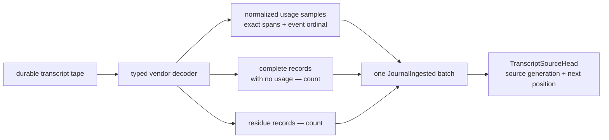
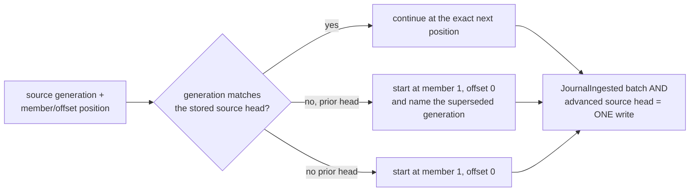
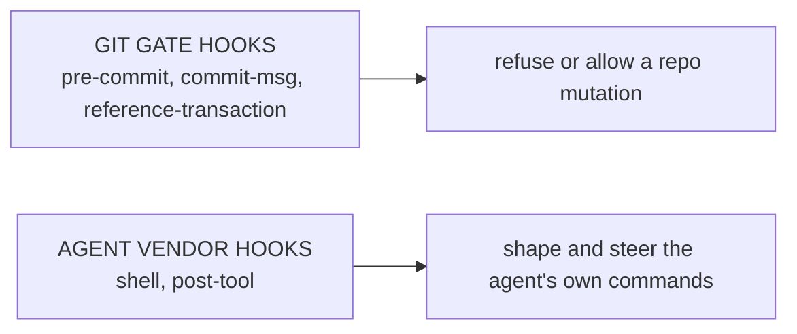
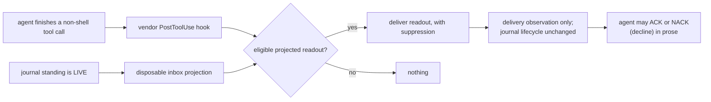
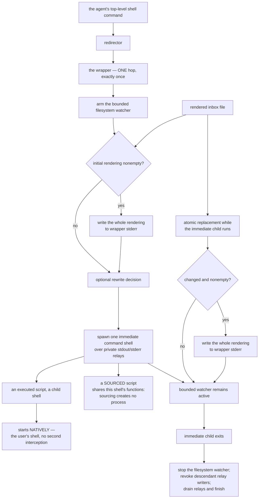
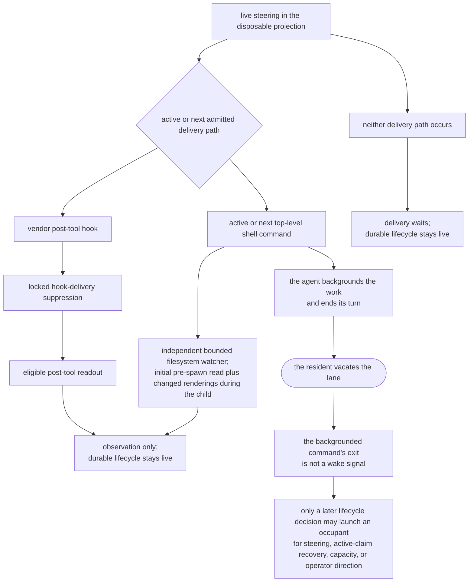
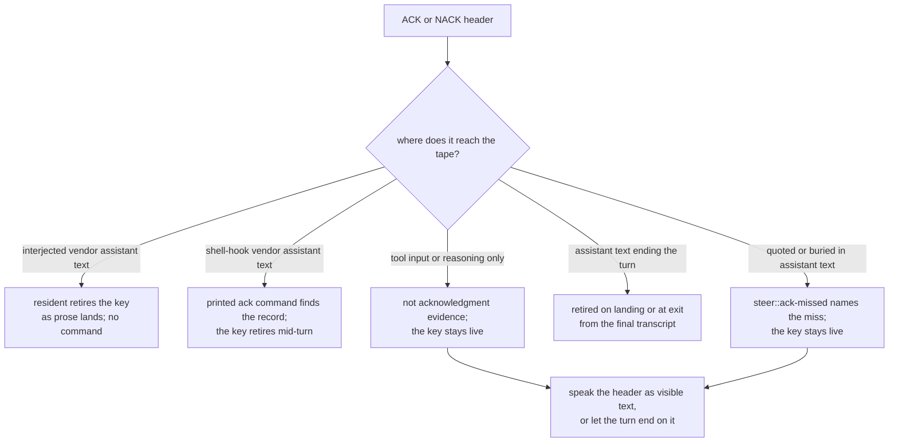
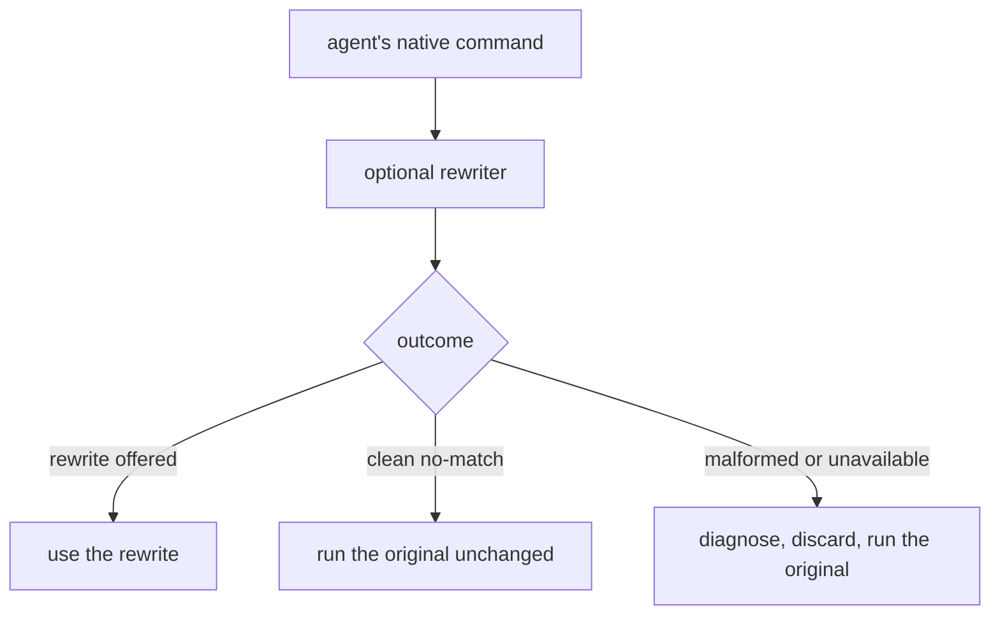
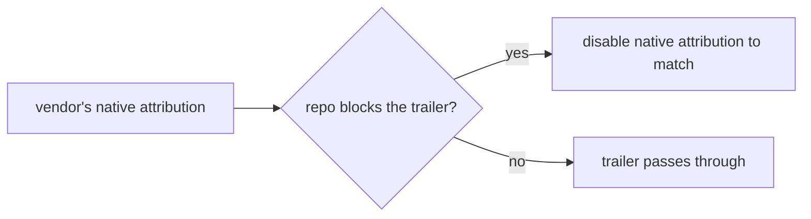

# Product model — supporting planes — Metrics and hooks

[Product model — supporting planes](../planes.md) · [Spice product model](../README.md)
## Metrics

### Accounted transcript usage

**Invariant —** Accounting retains each normalized usage sample beside the
exact ordered byte spans and event ordinal it was decoded from. A complete
record carrying no usage and a residue record remain visible as separate
counts; neither is promoted into an invented activity fact.

**Invariant —** Accounting consumes the typed vendor decoder's records and
events. It does not maintain a second private interpretation of vendor JSON.

**Invariant —** One accounted batch names its lane, vendor, logical stream,
source generation, starting position, and ending position. Its usage samples,
non-usage count, and residue count account for every record boundary the batch
crossed.

### Exactly-once source accounting

**Invariant —** Resumption is an exact source-generation and position
checkpoint, not a path and not an offset alone. A replacement under the same
path restarts from that generation's origin and explicitly names the generation
it supersedes.

**Invariant —** The accounted batch and the source head it advances commit in
one guarded journal transaction. A pass that does not commit leaves neither;
the continuation guard refuses gaps, stale heads, and implicit generation
changes before either value crosses.

## Hooks

### Two hook systems, deliberately distinct

**Invariant —** These are different systems with different owners and different
failure semantics, and the product says so out loud. Conflating them is a known
confusion the design specifically resolves.

### Steering delivery through the post-tool hook

**Invariant —** Delivery becomes eligible after a non-shell tool call, at its
vendor `PostToolUse` boundary, not only at shell boundaries. No individual tool
invocation is interrupted; an agent doing a long edit sequence remains reachable
between calls.

**Invariant —** Vendor post-tool invocations serialize through one durable hook
delivery record. Already-delivered key and content identities suppress a repeat
within the same occupant and compaction epoch; a new key remains deliverable
even when its text was already shown. Advancing this hook-local record changes
neither the directive's disposition nor its presentation stage.

**Invariant —** The hot path must not query the task database. Steering delivery
cannot be allowed to cost what a board read costs.

### The instrumented command boundary

Steering has to reach an agent while it is running shell commands, so something
must sit between the agent and its shell. Exactly where that something sits is
the whole design.

**Invariant —** Instrumentation is **one-shot, at the agent's own command
boundary**. The wrapper runs exactly once per agent command, and nothing beneath
it is instrumented again.

**Invariant —** The gate that guarantees "exactly once" is **structural, not a
counter**: the outer and inner stages are distinct packaged environments, so
there is no marker to read, forge, or lose. Descendants go uninstrumented
because they are pointed at the user's own startup files, not because they were
told to skip a step.

**Invariant —** A descendant process therefore gets the user's shell,
unmodified. A script that assumed a plain shell behaves exactly as it would
outside the agent, which is what makes leaving the instrumentation on safe.

**Invariant —** A *sourced* script is not a descendant, and shares the immediate
shell's functions and options. The boundary being drawn is the **process**
boundary, and sourcing does not cross it.

**Invariant —** Shell-boundary steering is bounded by the immediate child. The
wrapper arms a bounded filesystem watcher, writes the initial nonempty
disposable rendered inbox before spawn, and writes each changed nonempty whole
rendering while the child remains active. Identical bytes are suppressed within
that command. The watcher never reads the journal and ends before relay cleanup
begins.

**Invariant —** The wrapper waits on that one immediate process identity while
private relays carry its output. The wait survives the child forking, waiting,
or replacing itself; when that identity exits, the wrapper revokes inherited
relay writers, drains committed output, and finishes even if a background
descendant remains alive.

**Invariant —** Steering is written to the **wrapper's own error stream**, so a
redirection performed inside a descendant cannot capture or silence it.
Redirecting the wrapper itself does, which is the one place an operator would
expect that to work.

**Invariant —** The complete top-level command string is handed to the wrapper
exactly once. That is what makes rewriting possible at all: it is the last point
at which the command still exists as one string rather than as a running
process.

#### Cadence is reachability

A live directive may be rendered through whichever admitted delivery path is
active or occurs next. Vendor post-tool hooks keep non-shell tool sequences
reachable between calls; the one-shot wrapper covers its top-level shell
command throughout the immediate child's lifetime. Only a stretch that crosses
neither path offers no delivery opportunity.

**Invariant —** Admitted-path cadence is delivery cadence, not command cadence
alone. Non-shell work remains reachable between calls at vendor post-tool
boundaries. If neither a post-tool hook nor an active or next top-level shell
command offers a delivery span, the directive remains live and its delivery
waits without fabricating a lifecycle transition.

**Invariant —** The two paths share the same live directive content, not one
suppression decision. Post-tool delivery consults its locked durable hook
record; every top-level shell command independently streams changed bytes from
the current rendered inbox, so it may repeat live content seen by another
command while suppressing identical bytes during its own child lifetime.

**Invariant —** Every turn exit vacates the lane, including exit code zero, and
a backgrounded command's later exit is **not** a wake signal. Long work runs in
the foreground so its own completion returns control; an already-backgrounded
wait is brought forward with a blocking wait rather than ended on.

**Invariant —** This reaches the agent as a **capability, not a prohibition**:
continuing to cross admitted tool or shell boundaries is what keeps the operator
able to reach it. The framing matters here more than anywhere else, because the
rule costs the agent something immediate and buys something it cannot observe
from inside.

#### Acknowledgment evidence

The transcript tape is the one place an acknowledgment is read from. A header
is credited when the tape holds it as assistant text; nothing the ack command
carries about itself can stand in for that text, because a command that
witnessed its own key would retire direction nobody answered where the
operator can read it.

**Invariant —** Assistant text on the lane tape is the sole acknowledgment
evidence. The tool call that runs the ack command, its arguments, and reasoning
blocks never retire a key, even when they spell the header exactly.

**Invariant —** Delivery determines who retires the key. For interjected
steering, including OMP, the resident recognizes the visible assistant header
as prose lands; no acknowledgment command is required. Shell-hook vendors
retain their printed command path for mid-turn retirement. At occupant exit,
the resident also retires keys answered in the final transcript under the same
recognition rules, with no successor woken to cite them. Visible commentary
counts when persisted as assistant text; reasoning does not, regardless of how
the harness labels or displays it.

**Invariant —** Within one assistant prose the placed header decides its key.
A later citation of the same key in backticks or mid-sentence is the prose
talking about the header, not a retraction of it. A prose that only quotes or
buries a live key is refused as `steer::ack-missed` naming that miss and the
repair, leading a new line with the header; the live witness the lane cited has
not moved, so the refusal never sends it to reread a snapshot that shows the
same key.

### Command rewriting

The rewriter is an **optional companion tool**, not part of the harness. The
selection logic lives on its side; what follows is the contract spice depends on
and the guarantees spice itself provides around it.

**Invariant —** The rewriter can only ever *help*. Any malformed or unexpected
outcome falls through to the native command unchanged, with a bounded
diagnostic. *(The outcome shape that distinguishes these cases belongs to the companion.)*

**Invariant —** Health reporting is **non-blocking**. An unusable rewriter
degrades loudly and the agent keeps working.

**Invariant —** One trusted executable identity resolves once; every probe and
rewrite invokes exactly that identity. Resolution does no availability lookup.

### Attribution

**Invariant —** Trailer policy is the repository's. The harness makes the vendor
agree with it up front rather than contradicting it at commit time.

---
