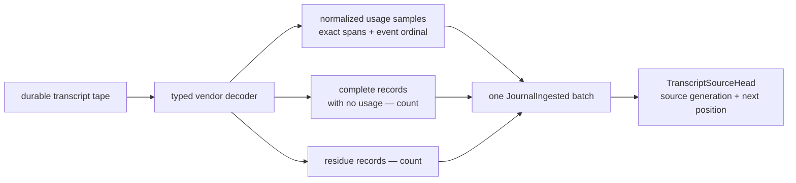
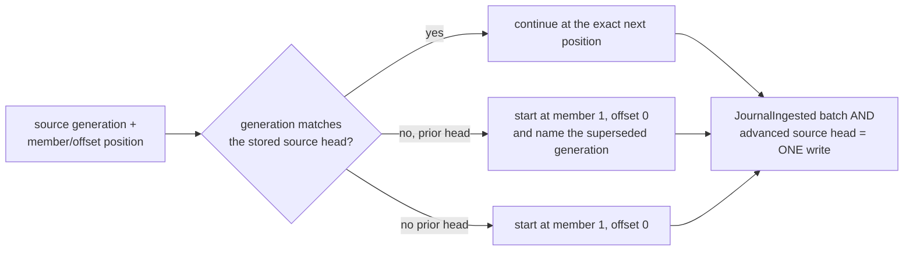
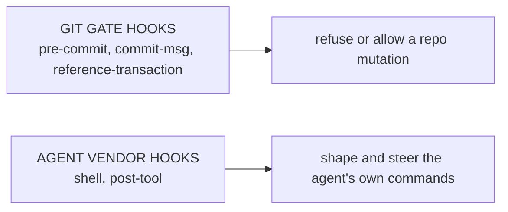
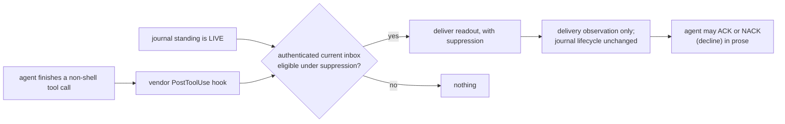
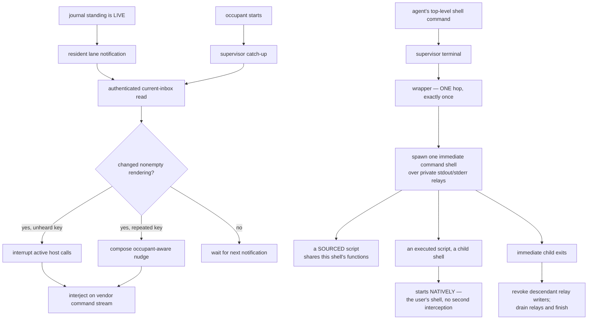
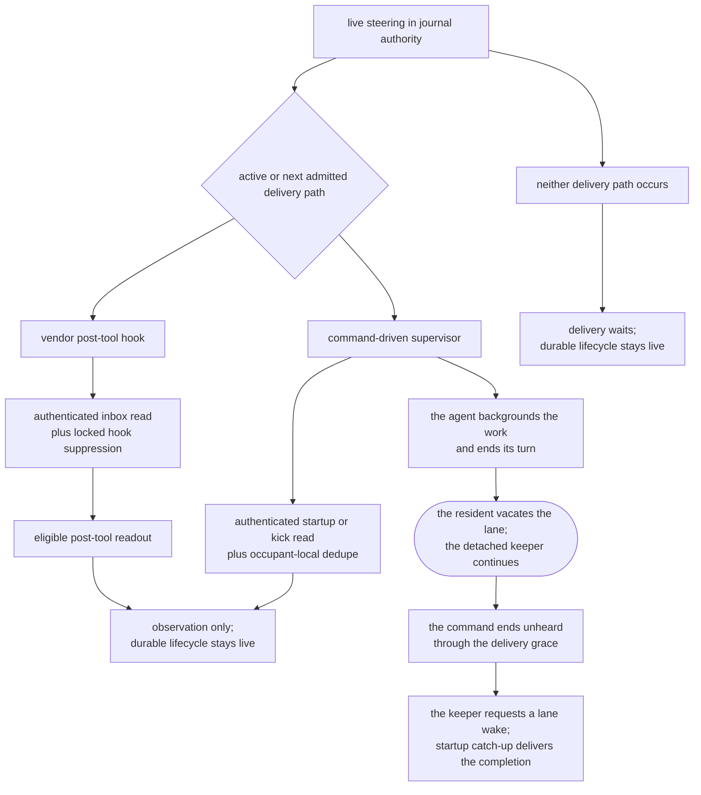
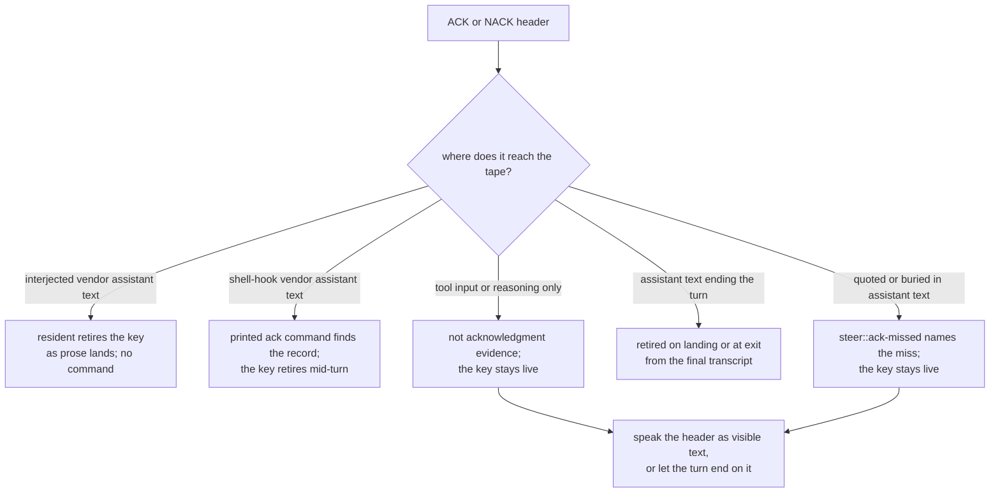
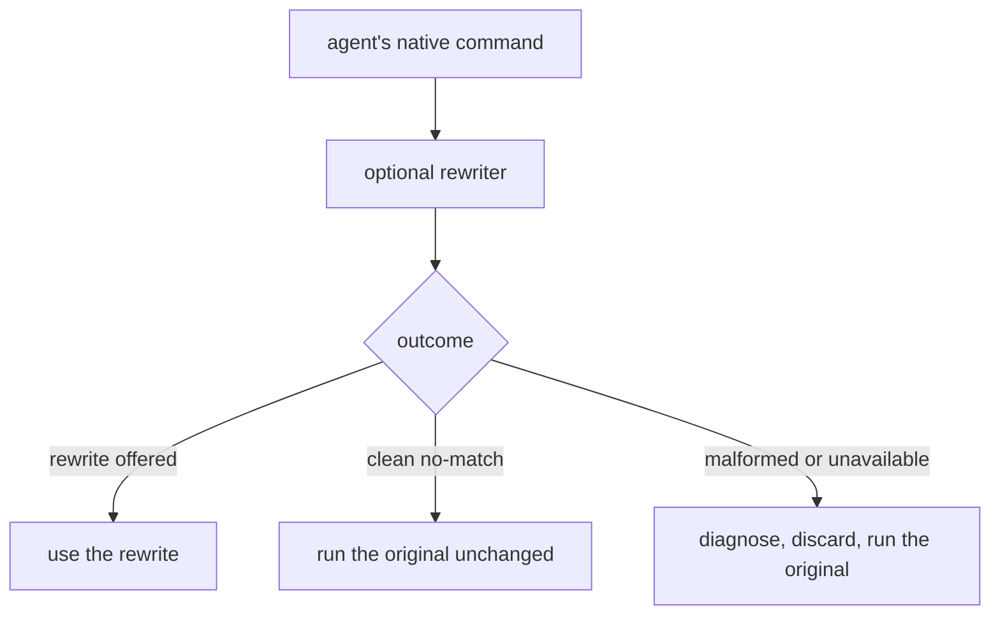
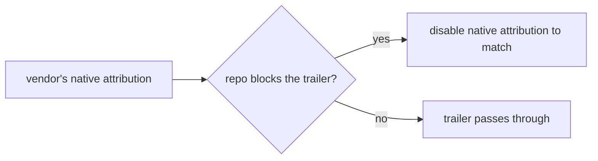

# Product model — supporting planes — Metrics and hooks

[Product model — supporting planes](../planes.md) · [Spice product model](../README.md)
## Metrics

### Accounted transcript usage

**Invariant —** Accounting retains each normalized usage sample beside the
exact ordered byte spans and event ordinal it was decoded from. A complete
record carrying no usage and a residue record remain visible as separate
counts; neither is promoted into an invented activity fact.

**Invariant —** Accounting consumes the typed vendor decoder's records and
events. It does not maintain a second private interpretation of vendor JSON.

**Invariant —** One accounted batch names its lane, vendor, logical stream,
source generation, starting position, and ending position. Its usage samples,
non-usage count, and residue count account for every record boundary the batch
crossed.

### Exactly-once source accounting

**Invariant —** Resumption is an exact source-generation and position
checkpoint, not a path and not an offset alone. A replacement under the same
path restarts from that generation's origin and explicitly names the generation
it supersedes.

**Invariant —** The accounted batch and the source head it advances commit in
one guarded journal transaction. A pass that does not commit leaves neither;
the continuation guard refuses gaps, stale heads, and implicit generation
changes before either value crosses.

## Hooks

### Two hook systems, deliberately distinct

**Invariant —** These are different systems with different owners and different
failure semantics, and the product says so out loud. Conflating them is a known
confusion the design specifically resolves.

### Steering delivery through the post-tool hook

**Invariant —** Delivery becomes eligible after a non-shell tool call, at its
vendor `PostToolUse` boundary, not only at shell boundaries. No individual tool
invocation is interrupted; an agent doing a long edit sequence remains reachable
between calls.

**Invariant —** Vendor post-tool invocations serialize through one durable hook
delivery record. Already-delivered key and content identities suppress a repeat
within the same occupant and compaction epoch; a new key remains deliverable
even when its text was already shown. Advancing this hook-local record changes
neither the directive's disposition nor its presentation stage.

**Invariant —** The hot path must not query the task database. Steering delivery
cannot be allowed to cost what a board read costs.

### The command-driven supervisor and instrumented command boundary

The resident-owned supervisor sits between the vendor command stream and the
lane terminal. Steering reaches that stream from journal authority; shell
instrumentation remains responsible only for one-shot command execution and
private output relays.

**Invariant —** Instrumentation is **one-shot, at the agent's own command
boundary**. The wrapper runs exactly once per agent command, and nothing beneath
it is instrumented again.

**Invariant —** The gate that guarantees "exactly once" is **structural, not a
counter**: the outer and inner stages are distinct packaged environments, so
there is no marker to read, forge, or lose. Descendants go uninstrumented
because they are pointed at the user's own startup files, not because they were
told to skip a step.

**Invariant —** A descendant process therefore gets the user's shell,
unmodified. A script that assumed a plain shell behaves exactly as it would
outside the agent, which is what makes leaving the instrumentation on safe.

**Invariant —** A *sourced* script is not a descendant, and shares the immediate
shell's functions and options. The boundary being drawn is the **process**
boundary, and sourcing does not cross it.

**Invariant —** Supervisor delivery reads journal authority. Startup performs a
catch-up read; each resident notification prompts another authenticated read.
Changed nonempty renderings are interjected on the vendor command stream,
identical bytes are suppressed, repeated keys receive occupant-aware nudges,
unheard keys interrupt in-flight commands, and compaction resets the
occupant-local telling state.

**Invariant —** The wrapper waits on that one immediate process identity while
private relays carry its output. The wait survives the child forking, waiting,
or replacing itself; when that identity exits, the wrapper revokes inherited
relay writers, drains committed output, and finishes even if a background
descendant remains alive.

**Invariant —** The complete top-level command string is handed to the wrapper
exactly once. That is what makes rewriting possible at all: it is the last point
at which the command still exists as one string rather than as a running
process.

#### Shell-command advice

Leading `cd [--] ABSOLUTE_PATH` followed by `&&`, `;`, or a newline receives
succinct advice when the literal path already equals the command's admitted
pre-execution working directory. Quoting and escaped spaces are understood;
relative paths, expansions, redirections, pipelines, directory-changing options,
and unknown or overridden hook working directories remain silent. Symlinks are
not resolved to equate different logical directory spellings.

Claude and Codex inspect authored Bash input at `PreToolUse`, before any
vendor-generated shell envelope; advice uses `additionalContext`. OMP attaches
the same advice only to the initial host-shell response seen by the agent.
It is not stored in job notices, replayed by completion or log reads, or sent as
an operator notification. Advice never changes
the command, permission decision, child output, or exit status. Independently
configured Codex RTK rewriting retains its existing behavior; Claude's pre-tool
advice does not invoke RTK.

A final `head` or `tail` pipeline stage receives a gentle hint that it is
probably unnecessary: rely on the tool's native output wrapping instead of
arbitrarily pre-truncating unknown output. The hint names whichever of the two
ends the pipeline. This advice has no native-capability, flag, or
working-directory gate. A standalone `head` or `tail`, an intermediate pipeline
stage, and quoted or escaped pipe characters do not trigger it. Both hints can
appear together; neither rewrites the pipeline or claims an equivalent
transformation.

Each hint appears once on every matching command invocation. Neither session
identity nor compaction suppresses later matching commands; no delivery receipts
or repository state are needed. Nonmatches remain silent. These are
command-attached suggestions, not narration prods: OMP's progress prod uses a
separate injected system notice and can interrupt a pending tool call, while
shell advice accompanies that call's initial response. No ACK, escalation, or
periodic reminder is attached to either hint.

Spice's OMP shell and job results show at most 16 KiB of log text, preserving
UTF-8 character boundaries. When bytes are omitted, the native wrapper includes
the path to the complete keeper-owned log. Use `read` on that path with a line
range to recover earlier output or inspect the end. Foreground results,
background snapshots, completion delivery, and later job reads share this
preview. Small output has no additional recovery metadata. The complete log is
not an OMP artifact of an already-truncated payload: it retains the command's
original captured bytes.

#### Active-work narration

The resident owns one narration streak per current occupant. The configured
`lane.narration` bound remains 24 tool calls by default. A monotonic deadline
also makes the first reminder due after three minutes without visible assistant
prose, and the second reminder due by five minutes. Calls and elapsed time share
the prod ordinal: reaching both thresholds does not send the same reminder
twice. Further call-count bounds retain their existing repeat behavior.

Turn start, assistant prose, reasoning, or a tool call establishes active work.
Prose resets its clock and call count; explicit turn completion stops the clock.
Tool results, an outstanding shell command, and `job.wait` do not reset it.
The resident sleeps until the next exact deadline in its existing event loop;
there is no periodic narration poll. A moved or exited occupant cannot receive
a successor's reminder.

Each due reminder commits an occupant-guarded `narration::prodded` fact. OMP's
existing supervisor command channel then interjects a progress notice and
interrupts outstanding tool waits, **not their underlying commands**. The
second prod asks for progress as overdue. No ACK key is minted or required.
Shell/hook meters retain the durable reminder for their next delivery boundary;
hook-only vendors cannot be interrupted in the middle of an arbitrary tool.

The guarantee is deadline-driven recording and an immediate best-effort local
notification attempt while the resident is serving, subject to event-loop and
OS scheduling. An unavailable supervisor channel, a blocked hook-only vendor,
or a hung model can delay receipt or prose. The three/five-minute targets do
not claim the ability to force a model to speak or justify cancelling healthy
work.

#### Cadence is reachability

A live directive may be rendered through whichever admitted delivery path is
active or occurs next. Vendor post-tool hooks keep non-shell tool sequences
reachable between calls; the command-driven supervisor catches up at occupant
startup and reacts to resident notifications while the turn is active. Only a
stretch crossing neither path offers no delivery opportunity.

**Invariant —** Admitted-path cadence is delivery cadence, not shell-command
cadence alone. Non-shell work remains reachable between calls at vendor
post-tool boundaries. If neither a post-tool hook nor a running supervisor
offers a delivery opportunity, the directive remains live without fabricating a
lifecycle transition.

**Invariant —** The two paths share the same authenticated journal inbox, not
one suppression decision. Post-tool delivery consults its locked durable hook
record; the supervisor independently deduplicates within the occupant and
compaction epoch.

**Invariant —** Every turn exit vacates the lane, including exit code zero. A
backgrounded command survives under its detached keeper. If a non-stopped
ending remains unheard through the delivery grace, the keeper requests a lane
wake; a successor receives the completion during startup catch-up.

**Invariant —** This is lifecycle behavior, not an instruction to keep a turn
open. An agent uses `job wait` when the result blocks current work; ending the
turn neither cancels the job nor loses its completion.

#### Acknowledgment evidence

The transcript tape is the one place an acknowledgment is read from. A header
is credited when the tape holds it as assistant text; nothing the ack command
carries about itself can stand in for that text, because a command that
witnessed its own key would retire direction nobody answered where the
operator can read it.

**Invariant —** Assistant text on the lane tape is the sole acknowledgment
evidence. The tool call that runs the ack command, its arguments, and reasoning
blocks never retire a key, even when they spell the header exactly.

**Invariant —** Delivery determines who retires the key. For interjected
steering, including OMP, the resident recognizes the visible assistant header
as prose lands; no acknowledgment command is required. Shell-hook vendors
retain their printed command path for mid-turn retirement. At occupant exit,
the resident also retires keys answered in the final transcript under the same
recognition rules, with no successor woken to cite them. Visible commentary
counts when persisted as assistant text; reasoning does not, regardless of how
the harness labels or displays it.

**Invariant —** Within one assistant prose the placed header decides its key.
A later citation of the same key in backticks or mid-sentence is the prose
talking about the header, not a retraction of it. A prose that only quotes or
buries a live key is refused as `steer::ack-missed` naming that miss and the
repair, leading a new line with the header; the live witness the lane cited has
not moved, so the refusal never sends it to reread a snapshot that shows the
same key.

### Command rewriting

The rewriter is an **optional companion tool**, not part of the harness. The
selection logic lives on its side; what follows is the contract spice depends on
and the guarantees spice itself provides around it.

**Invariant —** The rewriter can only ever *help*. Any malformed or unexpected
outcome falls through to the native command unchanged, with a bounded
diagnostic. *(The outcome shape that distinguishes these cases belongs to the companion.)*

**Invariant —** Health reporting is **non-blocking**. An unusable rewriter
degrades loudly and the agent keeps working.

**Invariant —** One trusted executable identity resolves once; every probe and
rewrite invokes exactly that identity. Resolution does no availability lookup.

### Attribution

**Invariant —** Trailer policy is the repository's. The harness makes the vendor
agree with it up front rather than contradicting it at commit time.

---
