# Product model — supporting planes — Session forensics

[Product model — supporting planes](../planes.md) · [Spice product model](../README.md)
## Session forensics

Compaction is the defining constraint. An agent's context is finite and its
history is not, so everything an agent knows about its own past is a *derived*
artifact — and the quality of that derivation is the difference between an agent
that resumes and one that restarts.

### The briefing

Answers, mechanically, the four questions a freshly compacted or freshly renewed
agent must not guess at.

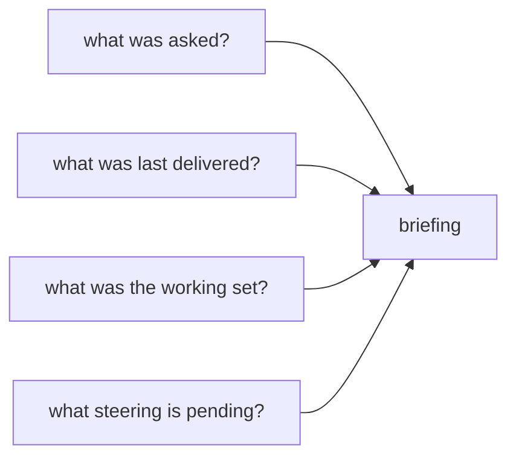

**Invariant —** Asks are sourced from the **steering plane**, not from
transcript user messages. Transcript evidence contributes only the
what-happened class; it never supplies or backfills the ask, and no cutoff is
inferred from directive recovery or publication.

**Invariant —** Recovery shows the *recovered ask*, parsed from compaction
intent — never continuation boilerplate, never an assistant-text fallback
rendered as if the user said it.

**Invariant —** The asks section is **omitted when empty**. A briefing with
nothing to say says nothing rather than emitting a mantra.

### Which plane owns which answer

The transcript is the richest source available, and it is authoritative about
exactly one class of fact: what happened. It is authoritative about nothing that
is *wanted*.

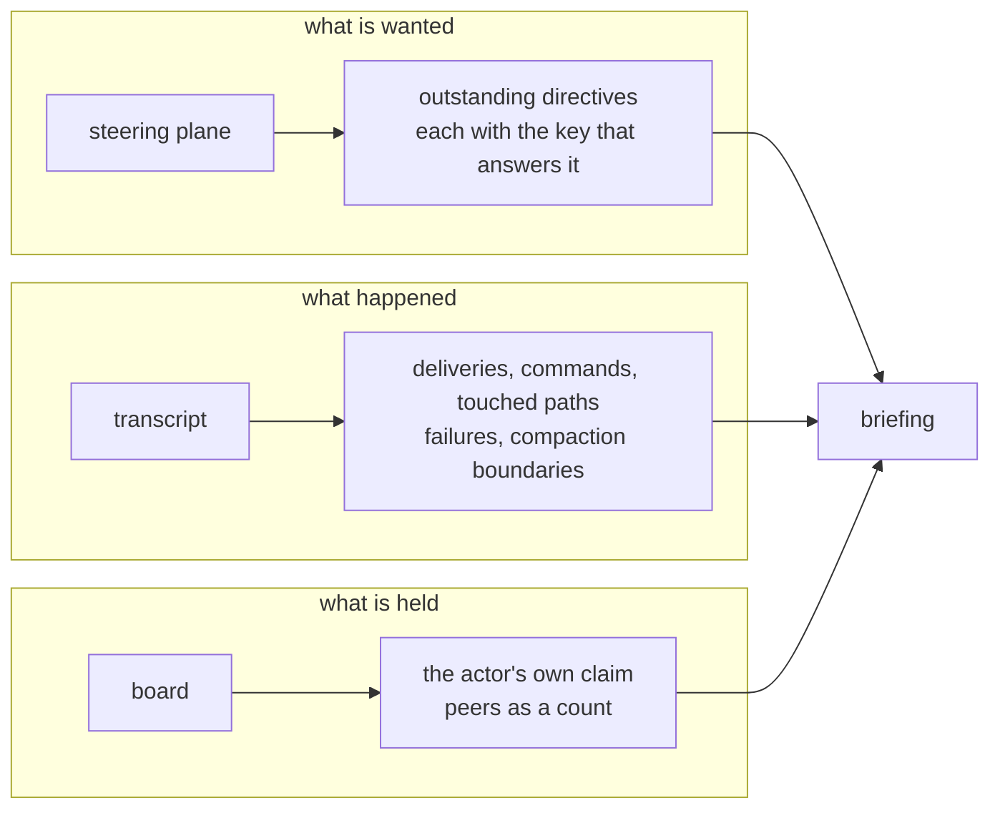

**Invariant —** The transcript never supplies the ask. Reconstructing intent
from prose reads the agent's own restatement of a directive back to it as if it
were the directive.

**Invariant —** A directive is shown only for the thread being briefed, and
carries the key needed to answer it. A directive an agent cannot retire is a
reminder rather than a request.

**Invariant —** A pending directive uses the publication instant recorded in its
authoritative steering head. If the authoritative head set is invalid, the
steering probe is unknown; the briefing does not silently drop or restamp one
directive.

**Invariant —** Only the actor's own claim is enumerated; peers' active work is
a count. The briefing orients one agent, and another agent's task is not this
agent's business.

### Task creation deep links

A task retains the transcript boundary at which it was created. For a
lane-authored task, admission binds the authenticated lane to its current
occupant, causal vendor session, and exactly one accounted lane/vendor source
head. The immutable context carries session identity, lane, vendor, logical
stream, source-generation UUID, and the next complete-record member/offset.
`task show` renders those values as a shell-executable `spice session context`
command; operator- and Spice-authored tasks instead render a stable unavailable
reason.

**Invariant —** Creation context is written on `TaskAdded` and copied to every
statement projection. Edits, workflow transitions, claims, reviews, completion,
and later source-head movement cannot rewrite it.

**Invariant —** Rehydration reads only the current repository's retained
lane/vendor tape, verifies the exact source generation and complete-record
boundary, and returns a bounded surrounding window. A missing, replaced,
truncated, undecodable, or mid-record source refuses by name rather than
searching another transcript.

**Invariant —** Schema-12 migration is one-way. It derives context only from
immutable facts ordered before each `TaskAdded`: occupant lifecycle, causal
session declaration, and valid source-head continuations. Current heads,
timestamps, configured windows, filesystem state, and predecessor code are not
evidence. Operator and Spice actors receive explicit reasons; a legacy lane
whose retained facts do not prove one boundary receives
`legacy-evidence-missing`. Once migrated, no legacy execution arm remains.

### Task lifecycle recovery links

An active task also retains the exact `ClaimWon` fact that opened its current
attempt. `task show` renders that fact's lane, occupant, epoch, accounted source
boundary, and registered vendor session as a second shell-executable
`spice session context` command. Claim carry and transcript continuation do not
move this opening boundary. If the source is incomplete, the registered stream
is absent or ambiguous, or no matching session declaration exists, the task
renders the specific unavailability reason instead of inventing a lookup.

The same compact view points to `spice doc ledger HANDLE` for current authored
rationale and append-only notes. When a claim, completion, or review records a
Git boundary, the task renders its fact identity and a shell-executable
`git show` command for the recorded claim head or integrated object. Git and
transcript content remain in their native authorities; task rows carry only
provenance and recovery coordinates.

### The window

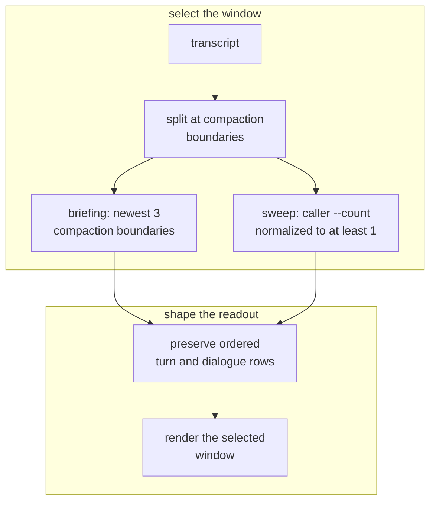

**Invariant —** A briefing asks for the three most recent compaction boundaries
and reports that fixed request beside the number actually selected. A sweep has
a different contract: a syntactically valid nonpositive `--count` normalizes to
one, and any larger process-representable count is accepted. Rust imposes and
reports no upper clamp.

**Invariant —** The briefing declares which rule set its window, where the
window starts, and how many boundaries were requested versus selected. A reader
who cannot tell what was examined cannot tell what the absence of a fact means.

**Invariant —** Recency is measured against the newest activity actually
observed in the material, not against wall-clock now. A transcript examined a
day later has the same shape it had when it was written.

**Invariant —** An explicit `--start` supplies the horizon start and takes
precedence over the count-derived start, even when it reaches farther back.
`--end` filters the boundary set before the newest requested count is selected.
The remaining content filters apply within those temporal bounds.

**Invariant —** Windows **tile contiguously** through the selected horizon, so
matching activity inside that horizon falls in a window. An exchange straddling
a boundary belongs to both adjacent windows; a session that never compacted
still yields exactly one window respecting explicit bounds, labelled with why
it has no compaction anchor.

**Invariant —** Only a compaction that actually severed context is a boundary.

**Invariant —** Material read only to establish what preceded a window's start
is excluded from that window's contents. A window holds the same records however
much surrounding material the reader had to consult to place it.

**Invariant —** An uncompressed seekable transcript discovers boundaries
**backward from the end** and stops as soon as it has enough, so its discovery
cost scales with the window asked for. A gzip transcript cannot reverse-seek;
its admitted path scans forward and retains only the newest requested markers.

**Invariant —** Selected turns retain canonical time/source order, and dialogue
inside each turn retains the decoder-admitted transcript order and text. The
session report adds no occurrence fold after the decoder has canonicalized
display and final-answer echoes.

**Invariant —** Unknowns are **loud**. A window the engine could not read must
not look like a window with nothing in it.

### The budget

A briefing is read by something with a context limit, so Rust offers estimated
line and byte thresholds for pruning transcript turns.

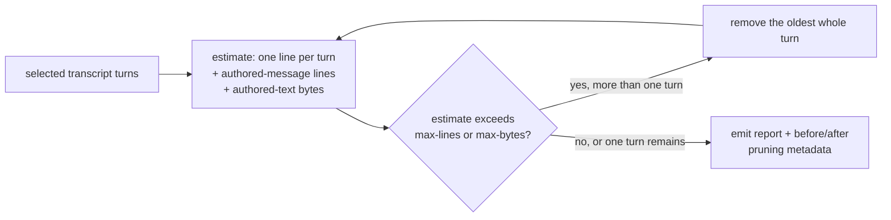

**Invariant —** Pruning preserves authority sections and report metadata and
removes only the oldest whole transcript turns while more than one remains.

**Invariant —** `--max-lines` and `--max-bytes` are transcript-turn pruning
thresholds, not hard serialized-output limits. The estimate counts one line per
turn, one per authored message, and authored-message bytes; it does not charge
sources, authorities, report metadata, serialization overhead, or the optional
explanation. At least one selected turn is retained even when that turn alone
exceeds the estimate. The report always carries the requested thresholds and
turn counts before and after pruning; `--explain-pruning` adds the explanation.

**Invariant —** Only `authorities.asks` and `authorities.unknowns` omit when
empty. The Recall envelope — sources, window, held work, pruning, residues, and
their nested arrays — remains serialized even when its contents are empty or
zero.

**Rust profile —** `authorities.priority.order` includes the declarative label
`ambient-posture`, but the report performs no posture observation and
emits no posture section. The label alone is not evidence that a probe ran.

**Invariant —** An unavailable authority value remains absent, distinct from
numeric zero. Its typed unknown names the authority, probe, and error detail;
Rust does not invent a clean measurement for an unavailable read.

**Invariant —** A briefing or sweep accepts only a positive finite whole-action
deadline shared by source discovery and report construction. Recoverable
authority-read, configuration, journal, and board errors become typed visible
unknowns and construction continues. If any work hangs past the deadline, the
action refuses with `session::deadline-exceeded`, names the action, requested or
resolved inputs, and budget, and returns no partial report.

### The unit of the record

Forensics needs an atom. The atom is one operator ask, and everything observed
is attributed to whichever ask was open when it happened.

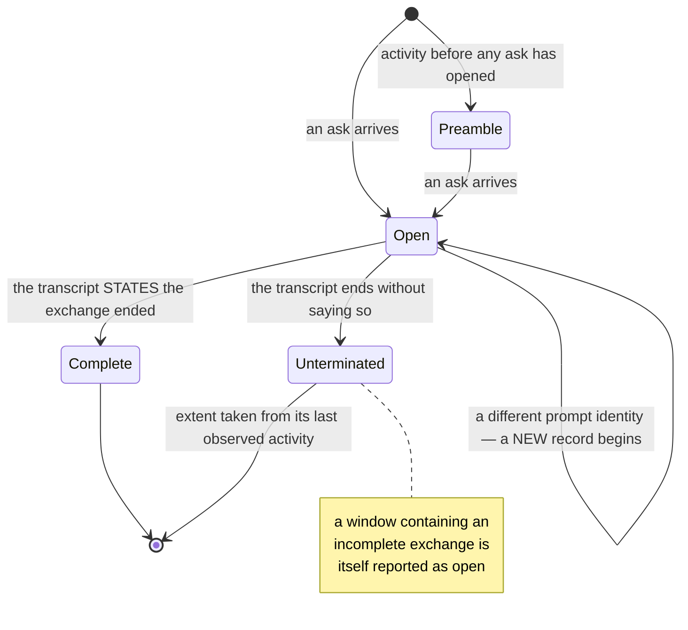

**Invariant —** Activity observed before any ask has opened gets a record of its
own rather than being discarded. Startup work is work.

**Invariant —** An exchange is complete only when the transcript **states** that
it ended. Inferring completion from the end of the file makes every truncated
transcript look finished.

**Invariant —** A record preserves the original interleaving of operator
messages, assistant commentary, and final answers — not just separate buckets.
Order is most of the meaning.

**Invariant —** Records merged from several transcripts order by time with
source identity breaking ties, and the differing timestamp spellings of
different vendors compare as the same instant. Identical inputs always yield an
identical sequence.

**Invariant —** Recorded text is exactly what the transcript held; only
explicitly derived fields are reformatted. A transcript's display echo of a
message is not a second occurrence of it, and a final answer restated at close
is recorded once.

**Invariant —** An invocation and its outcome are **separate facts**. A command
whose outcome was never observed is neither successful nor failed, and an
outcome attaches to the invocation it names rather than to whichever one ran
most recently.

**Invariant —** A fact whose classification disagrees with the evidence backing
it **aborts the projection**. A degraded record is worse than no record, because
it is indistinguishable from a good one.

**Invariant —** Requesting `--turn-id` against a nonempty dataset whose turns
uniformly lack identities is capability-refused, naming `--start`, `--end`, and
`--contains` as workable alternatives. Ordinary nonmatching filters return an
empty selection.

### Message-shape classification

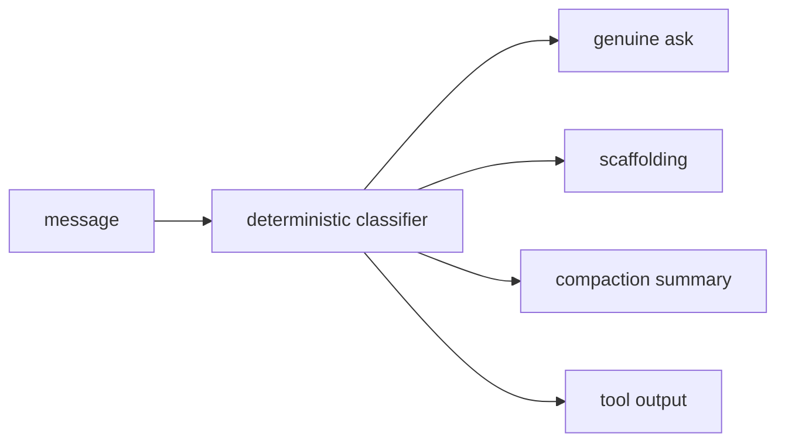

**Invariant —** Classification is deterministic and structural, never a prefix
sniff. Everything downstream — briefing, maxims, and metrics — depends on
telling authored prose from generated text.

**Invariant —** Every operator-role message gets **exactly one** shape, decided
from that message's own text alone, so the same text always classifies the same
way regardless of where it appears.

**Invariant —** Rehydration summaries, harness retry nudges, session scaffolding,
background-task notices, and bootstrap prompts are generated text, never
authored prose. Text consisting wholly of one machine envelope is generated even
when the envelope's tag is unrecognized — the shape is the evidence, not the
vocabulary.

**Invariant —** An intent that cannot be recovered from a rehydration summary is
represented by an explicit marker, distinguishable from a genuinely empty
intent.

**Invariant —** Judge text and maxim scanning **exclude** generated diff, patch,
and tool-output bodies. The system judges what the agent wrote, not what it read.

### Resolving the subject

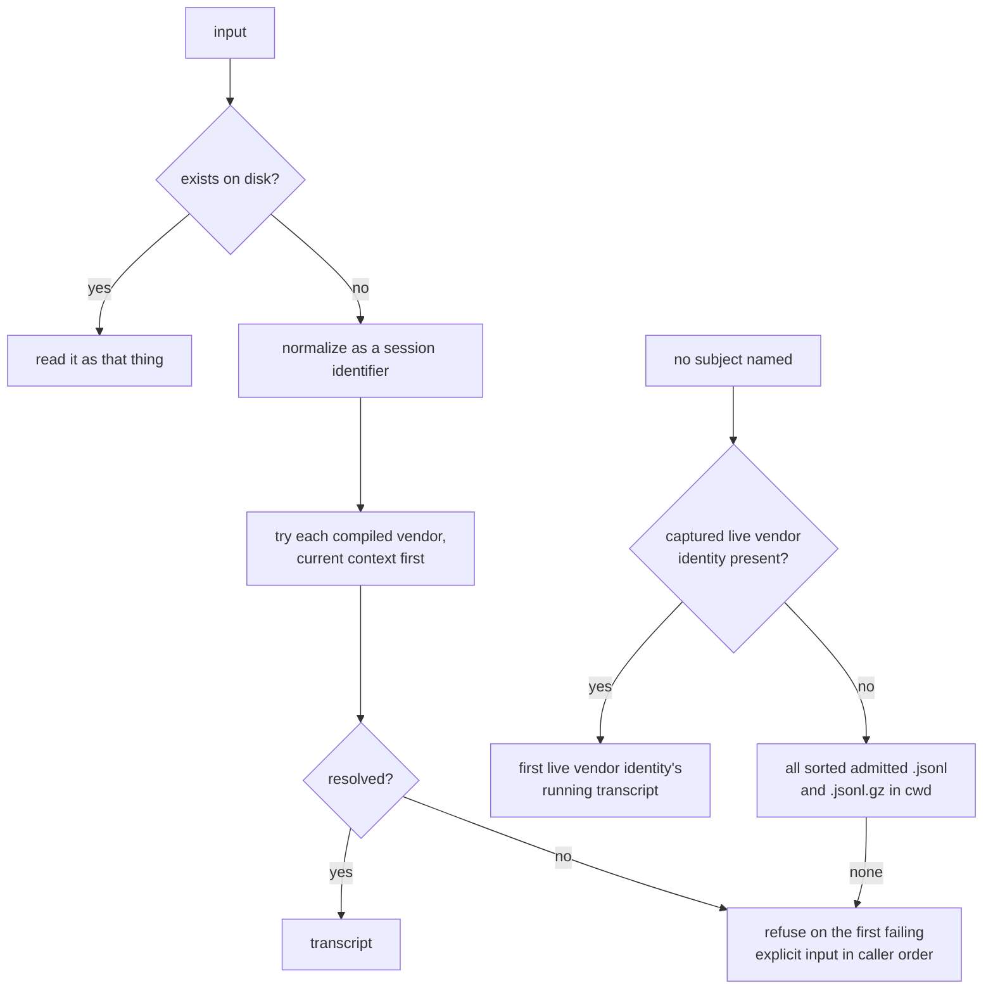

**Invariant —** Explicit subjects resolve in caller order. The first failing
input refuses the request rather than producing an empty report; successfully
resolved canonical paths contribute once even when named repeatedly.

**Invariant —** With no subject, resolution uses the first captured live vendor
identity when present. Otherwise it admits every sorted `.jsonl` and
`.jsonl.gz` in the current directory, refusing only when no admitted source
resolves.

**Invariant —** An agent identity counts as current only while it is in the
running process's environment. An identity merely persisted in the tree from an
earlier session is history, not context.

**Invariant —** Every spelling of an identifier normalizes to one canonical
form, and a transcript named more than once contributes exactly once.

### The working-state meter

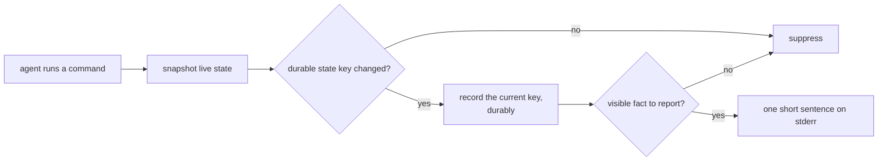

**Invariant —** One line, high signal, repeat-suppressed, on the agent's own
command stderr. It rides a channel the agent already reads.

**Invariant —** It reflects **actual state**. A constant encouragement is worse
than silence: it trains the reader to skip the channel.

**Invariant —** The record of the last reduced state survives process exit, so
identical state remains silent across short commands until its durable key
changes. A quiet renewal is still recorded, allowing a later countdown cycle to
announce its boundaries once.

**Invariant —** The countdown band of an expiring claim is **part of the
identity** of what was displayed. Command-start evaluation speaks when elapsed
time has moved the claim across the 599-, 299-, or 59-second boundary, and a
cancellable timer targets only the next boundary while the supervised command
remains active. The final band schedules no further refresh; the timer stops
with the command and never launches one.

**Invariant —** When the record of the last reduced state is missing, unusable,
or timestamped later than now, the meter reports any visible fact. Suppression
is a claim about what the reader already knows, and an unusable record supports
no such claim.

**Invariant —** Failing to collect working state degrades to silence and never
changes the outcome of the command being decorated. A status line that can break
a command is not a status line.

**Invariant —** A meter with nothing true to report emits nothing, rather than an
empty frame.

### One turn through the plane

The live path persists intent before attempting delivery, then the
command-driven supervisor interjects it into the agent's command stream.

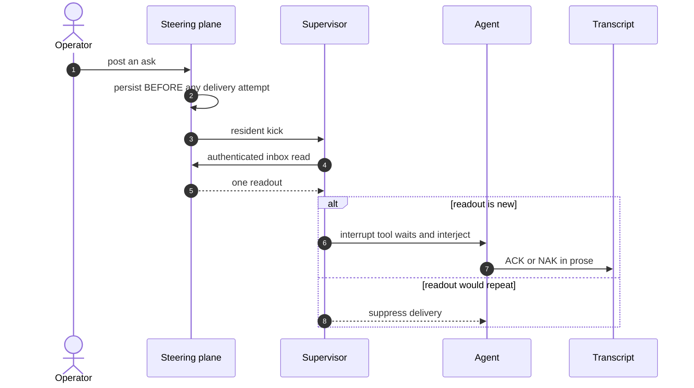

Renewal reconstructs the briefing from durable asks and transcript evidence.

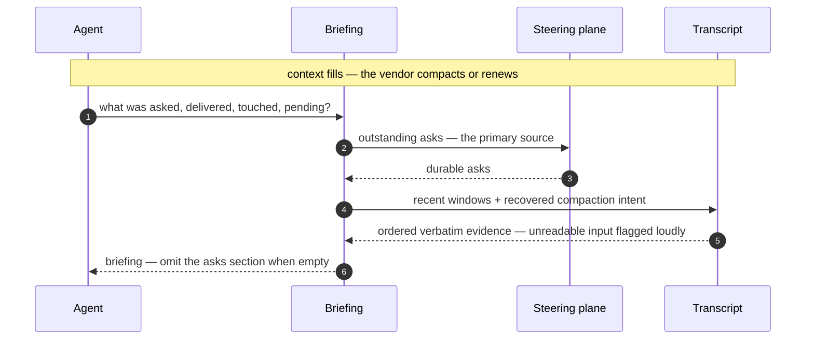

Ordinary command feedback is repeat-suppressed and observational.

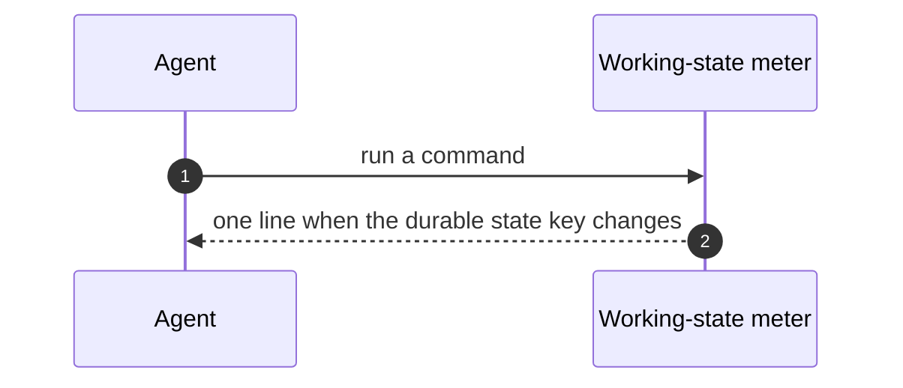

---
