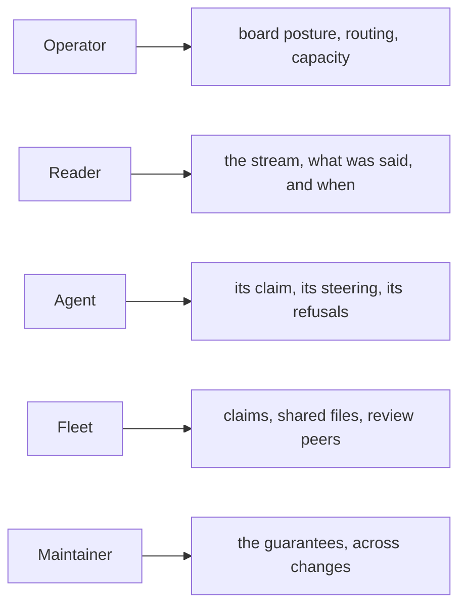
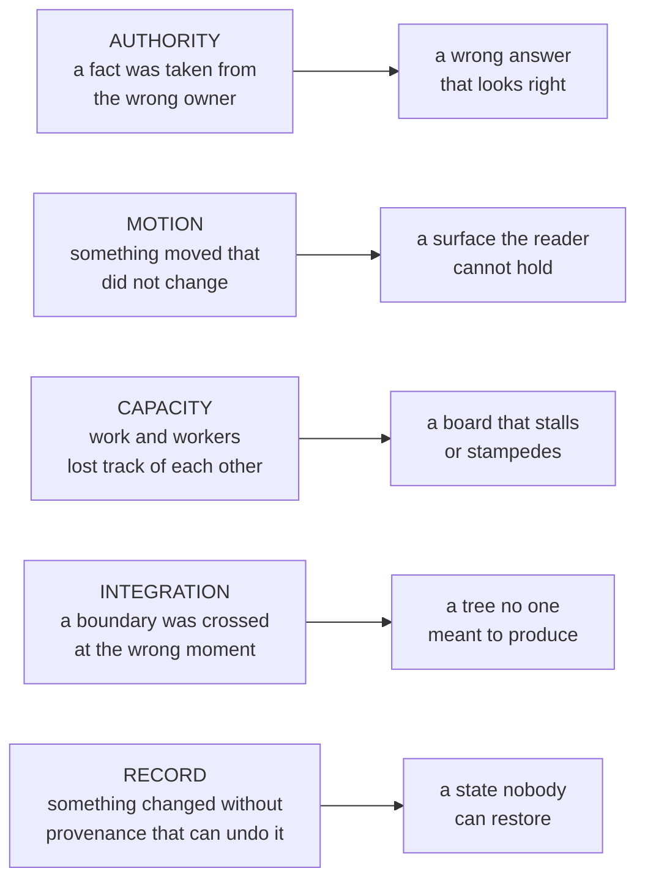

# Stories and failure modes

Who each guarantee serves, and the failure mode each one answers.

---

## Cast

**The Operator** — runs a fleet from one console and never types in a lane.
*A lane is an operator-owned container over one worktree; an agent is an
occupant of the lane, not the lane itself.*

**The Reader** — the same person in reading mode, and a distinct role because
the motion rules exist for them specifically. Every rule about what may move,
when, and by how much serves the reader's ability to hold their place.

**The Agent** — a supervised coding process in a worktree, and a first-class
user with its own surface: a briefing on arrival, a live state line on its own
command output, reminders while it works, refusals that tell it what to run
next. That surface has a required tone — capability, not restriction.

**The Fleet** — emergent rather than personal: teams, allocation, cross-worktree
claims, coordinated pressure on shared files. Its stories are about agents not
colliding.

**The Maintainer** — whoever must keep the guarantees true while the code
changes underneath them.

Each role's attention rests on a different surface, and the surfaces are
deliberately separate so that one role's noise is not another's signal.

---

## Stories

### Steering

*As the operator, I want to know exactly when my message becomes durable.* — A
queued or sent browser prediction remains ephemeral until a live key or covering
backend standing returns. After that boundary, journal publication is atomic,
precedes delivery, and survives a crash on either side.

*As the operator, I want an item retired only by a typed disposition, so
"delivered" and "decided" stay different facts.* — A read never retires;
`acked`, `declined`, and `canceled` remain distinct.

*As the agent, I want decline to be as reachable as acknowledgement, so I am not
forced to fake agreement.* — A reasoned NAK is recorded as the first-class
terminal `declined` disposition and surfaced wherever ACK is.

*As the operator, I want silence to escalate rather than pass as consent.* —
Escalation is time-since-publication on a stable lineage key, so a resend reads
as one intent insisting rather than a pile of duplicates.

*As the operator, I want sending to stay fast no matter how deep the backlog
is.* — Journal allocation never reads queued bodies, so submit cost does not grow
with backlog depth.

*As the agent, I want to remain reachable during tool work without instrumenting
descendants twice.* — Pending intent reaches the agent through the
command-driven supervisor, which reads the authenticated journal inbox directly,
catches up at occupant start, reacts to resident kicks by interrupting tool
waits, and deduplicates within the occupant. Descendant shells remain unmodified.

### Work

*As the fleet, I want at most one agent on any task.* — A task has at most one
live claimant, an actor has at most one active claim, and both facts change in
one atomic transition.

*As the fleet, I want a claim's lease to bound stale ownership without an
operator sweep.* — At the lease expiry, the independent timer submits a lapse
transaction. Once accepted it writes disposition `lapsed`; ordinary readers
then derive readiness from the remaining predicates. A peer may claim it when
they all admit; an explicit steal remains a separate exact operation, and any
displaced claimant learns through a typed ownership refusal rather than
fabricated steering.

*As the fleet, I want a vacant lane whose claim is still active to recover its
work.* — An actively possessed row is not available work, so ordinary capacity
cannot see it. The claim stays put; a successor occupant decides whether to
continue or free it.

*As the operator, I want a critical task not to wait behind its own trivial
blocker.* — A prerequisite inherits the highest priority it transitively
unblocks.

*As the operator, I want review by someone other than the author, without ever
deadlocking on it.* — Self-authored review ranks last, never excluded.

*As the agent, I want admitting a mistake to be cheap.* — Hidden channels take
the admission without putting it on the public board.

*As the agent, I want an empty board to read as success.* — A dry allocator
reports what is parked and why, and states that a populated board is the
expected answer here rather than work that was missed.

### Place

*As the operator, I want the lane to be mine, so replacing the agent costs me
nothing.* — Renewal swaps the occupant; lane history, drafts, and scroll
survive, while the team's shared task policy remains because the team is
unchanged.

*As the operator, I want to compose lanes into one surface by direct
manipulation.* — Fusing lanes merges teams; every message retains its exact
occupant author and stable lane attribution while every member remains its own
send address.

*As the operator, I want two browsers to agree.* — Membership, ordering, and
topology revision are server truth. `Close team` removes every member from
that team, so every browser sees them as independent agents.

### Reading

*As the reader, I want to watch several agents at once without chasing the
board.* — New content preserves existing columns and spans; more than 80px from
the top, same-frame compensation preserves the visible anchor.

*As the reader, I want to know what was asked without leaving the answer.* —
Steering renders as a quote inside the reply that answers it through ACK or
NAK/decline.

*As the reader, I want to hear what arrives while I am looking elsewhere.* —
Speech is a third channel, best-effort, and never blocks the record.

### Memory

*As the agent, I want to come back from a compaction knowing what was asked, not
what I said about it.* — Directives come from the steering plane; the transcript
supplies only what happened.

*As the agent, I want to be told when the briefing could not see something.* — A
window that could not be read is loud, a recoverable authority-read failure
leaves a visible unknown, and an absent fact renders as unknown rather than
zero. Discovery and rendering share one deadline; exceeding it refuses without
passing off a partial briefing as complete.

*As the agent, I want briefing pruning to preserve authority.* — Outstanding
asks, held work, and report metadata are never budget-pruned. The line and byte
thresholds estimate transcript-turn material, remove the oldest whole turns
first, and retain at least one turn even when that turn exceeds the estimate.

*As the agent, I want the state line to mean something.* — It speaks when its
state key changes to a visible fact, including when a claim lease crosses a
countdown boundary, stays silent while the durable state is identical, and can
never alter the outcome of the command it decorates.

### Shipping

*As the maintainer, I want to read every externally visible publication effect
before it happens.* — Each release publication verb previews its complete
ordered plan, and execution accepts only the digest of the plan that was read.
Ordinary local mutations rely on their typed transactional contracts.

*As the maintainer, I want proof evidence to state exactly what it binds.* — Each
canonical target replays the current candidate checkout in its admitted
environment and binds the resulting battery and replay identities to the target
payload identity. Proof does not compare that checkout with the payload's source
digest or inspect the staged executable bytes. Only a clean replay publishes a
detached receipt, and the release manifest exists only after both clean receipts
are complete.

*As the maintainer, I want an interrupted release to be finishable.* — Every
publication step converges. `spice release publish --action tag-and-announce`
previews the recovery-only plan; repeating that same action command with
`--apply=<digest>` finishes a release whose package already shipped without
rebuilding anything.

*As someone reading a release, I want to know what changed, not how it was
built.* — Notes come from first-parent landings, with reverted work suppressed
and repeated landings collapsed to one entry.

*As the operator, I want uninstall never to overwrite evidence that moved.* —
Every receipt-owned installation mutation records directly, or authenticates
through digest-bound rollback evidence, its exact reversible prior image:
regular-file bytes and ordinary `0o777` mode, prior absence or configuration
value, and introduced-parent existence. Ownership, ACLs, extended attributes,
and special mode bits are outside that image. Reversal restores only the exact
installed identity; drift refuses with the changed target and current receipt
preserved for repair and resumption.

---

## Failure modes

Each is a real way the system can be wrong, the mechanism behind it, and the
rule that answers it. They are ordered by how quietly they fail.

Nearly all of them fall into a few families, and knowing the family is usually
enough to find the mechanism.

| Failure the operator sees | Mechanism | Rule |
| --- | --- | --- |
| A proof receipt is read as evidence about payload source or executable bytes | payload identity binding was mistaken for proof of material the replay never inspects | each detached receipt binds payload identity, environment, battery, and replay; package materialization separately checks staged executable bytes, and no proof-time payload-source equality is claimed |
| An uninstall restores the installer's own output | a repeat install re-derived prior state from what it had already written | prior state is captured once, at first application |
| A refresh launches an occupant in every vacant lane | a read path was allowed to run lifecycle | only lifecycle authority launches or renews occupants |
| Cards jitter sideways as content resolves | still-settling cards re-chose their column | columns and spans stay latched until a geometry replay; content resolution settles only vertically |
| A whole batch of cards is removed and reinserted | the container was rebuilt rather than reconciled | retain every still-admitted keyed node and reconcile it in place; content and changed placement properties may still update, while a card trimmed from the visible window may leave |
| Cards flash one by one when an agent joins | member count entered per-card identity and forced individual remeasurement | member count stays out of card identity and style; a changed team weight may instead settle a new host width and trigger one full geometry replay |
| A card is buried under its neighbours | a reservation counted a placeholder without the body around it | measure the whole card, placeholder included |
| A failed image remains indistinguishable from loading | the load/error observer did not publish its outcome | image error is a distinct state and remeasures the whole card |
| The board slides in by its own height on open | a fresh surface animated from a synthetic origin | first paint writes the real target with motion suppressed |
| The board rewrites itself whenever a pane flaps | reveal discarded the deferred base flow | an unmeasurable surface stays readable without committing a plane; reveal is a correction |
| A wide card is jammed into a narrow slot | measurement mutated nodes the position memo could not see | compare admitted placement properties and skip every unchanged style write |
| Live lanes vanish on a transient error | an empty enumeration was read as absence | a failed enumeration is not evidence |
| Messages arrive minutes late under load | interactive replies queued behind bulk work | interactive and bulk paths never share a queue |
| One client starves another | a cursor was shared across connections | per-connection read state |
| Orgs explode into singletons | topology was mutated from the interface | topology is a server transition the interface renders |
| A render aborts mid-board | an index grew past a fixed palette | reduce indices into range at their source |
| An active claim sits forever after its occupant exits | no wake arm could see a possessed but ineligible row | launch a successor onto the task already possessed |
| An agent hunts for work that is not there | a dry allocator pointed at a populated board | report the board, and name a populated board as expected |
| Git advances mid-session | a replayed path performed a launch-time advance | agent-lane integration touches the lane's worktree at exactly three boundaries |
| An agent resumes from its own summary of the ask | intent was reconstructed from transcript prose | directives come from the steering plane; the transcript never supplies the ask |
| A briefing looks clean because nothing could be read | an unreadable window rendered as an empty one | a window that could not be read is loud |
| An uninstall leaves an empty file where nothing had been | the record kept the new state and not the absence | the record or its authenticated rollback evidence retains whether the thing existed at all |
| Release notes credit a feature nobody can find | an add-and-revert pair was counted as one shipped change | pairs inside one window are suppressed on both sides |
| A published version points at source no one can fetch | the immutable package ref was published before its source commit | the source ref reaches the tracked Git authority first |

---

## Anti-stories

Requirements stated as refusals. Satisfying these by other means changes the
product.

**No polling or sleeps where an authoritative event exists.** Block on the event,
watch it, or accept its callback. At an external consistency seam with no event,
bounded observation is an explicit release step with a deadline and a terminal
refusal, never an unbounded retry loop.

**No silent or unadmitted compatibility fallbacks.** Commit to one current
contract and let violated assumptions fail loudly. Declared defaults and
explicit optional-degradation or fail-closed branches are intentional parts of
that contract, not alternate compatibility behavior.

**No parallel user-facing shims, aliases, or legacy product paths.** One tested,
visible, current path may admit named compatibility solely at explicit wire and
migration boundaries. Each durable authority gives every admitted historical
shape one unambiguous direct or sequential route into current; no historical
runtime remains parallel.

**Not an IDE.** Something the operator overhears and steers.

**Not driven by an upfront specification.** The product model is the loop's
fixed point, read from transcript and steering rather than authored ahead of
the work.

**The interface never owns or commits topology locally.** Drag gestures derive
complete topology requests, but the resident validates and publishes them.
Local storage holds only bounded narration cursors; in-memory reducers hold
view preferences, and neither is topology authority.

**No test-only public symbols.** A symbol referenced only by tests is not part
of the interface.

**Prefer present identities and equalities.** Compare produced outputs, bound
receipts to payloads, and assert exact state. Absence is asserted only when
absence itself is the contract and the test also proves the complete surrounding
before-and-after state.

**Never weaken a gate to pass it.** File the admission and fix the source.

**Never make the agent's surface scary or nagging.** The tone is a requirement,
not a preference.
