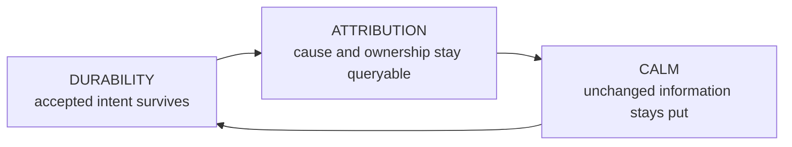

# Why Spice is valuable

Spice turns a fleet of coding agents into one operable system. The operator
steers work, reads many agents, and audits what landed without becoming the
memory, scheduler, or integration mechanism for the fleet.

## Three properties

### Durability

Durability makes supervision asynchronous. Once authority accepts intent, the
operator can leave, a browser can disappear, or an agent can be replaced
without turning an instruction into recollection. Task ownership, recovery, and
integration likewise cross explicit durable boundaries instead of depending on
one process staying alive.

The exact contracts live in [identity, steering, and
work](invariants/identity.md), [integration and
lifecycle](invariants/lifecycle.md), and [session
forensics](planes/session.md).

### Attribution

Attribution makes *who changed what, and why* answerable from durable evidence.
Tasks retain their cause, claims retain their owner, messages retain their
speaker and destination, and integrated work retains its task boundary. The
operator can review or ship work without reconstructing provenance from chat.

The authority rules live in [the invariant
register](invariants.md); the concrete appliance bindings live in [the
implementation profile](implementation.md).

### Calm

Calm preserves the reader's place as live streams change. Stable identity,
reserved geometry, and explicit attribution make several streams readable at
once instead of multiplying attention cost with fleet size.

The complete surface rule is [the jitter contract](loops.md#the-jitter-contract).

## Why the properties compose

Durability without attribution produces state that cannot be trusted.
Attribution without durability produces an audit trail with missing intent.
Both without calm still cap the fleet at what one person can continuously
re-find on screen.

Together they let capacity follow work, make agents replaceable while lanes and
worktrees retain continuity, prefer independent review without deadlocking a
solo fleet, and keep optional capabilities from stranding primary work. The
canonical degradation rule is [Prefer the good property, never block on
it](planes/principles.md#cross-cutting-principles).

That combination is the product: strict durable authority where loss,
duplication, or ambiguity would corrupt work; graceful degradation where an
optional advantage is unavailable.
