# Why this is valuable

Not the code constraints — the *workflow* guarantees and the *interface
vocabulary* that make supervising a fleet of coding agents tractable for one
person.

---

## The thesis

Running one coding agent is a chat problem. Running a fleet is an **operations**
problem, and operations needs three things chat does not have.

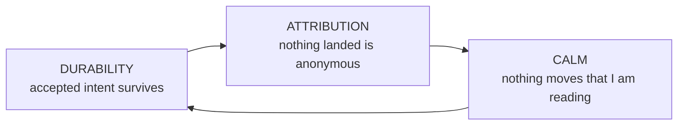

**Durability** begins when authority returns a live key or covering standing;
the browser's pre-acceptance queue is only an ephemeral prediction. Beyond that
boundary it turns *"I told it to"* from a memory exercise into a fact the
system holds. **Attribution** turns *"who did this and why"* from a reading
exercise into a query. **Calm** turns many live streams into something one pair
of eyes can actually track. Remove any one and the other two stop paying: an
un-attributed fleet can't be trusted, an un-durable one can't be steered, and a
jittering one caps throughput at the operator's ability to re-find their place.

Every model in this document serves exactly one of these three.

---

## Workflow invariants

The invariant register owns every cross-document label; the headings here carry
their own meaning.

### Steering is durable and has a typed lifecycle

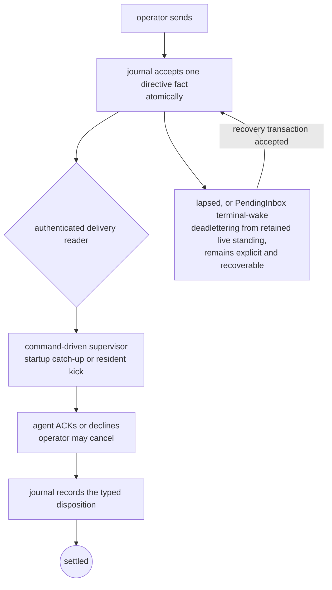

The directive is accepted in the journal before any delivery reader is
notified. Delivery runs through the command-driven supervisor, which obtains the
current authenticated journal inbox directly, not a filesystem copy. It catches up at occupant start and reads
again on resident kicks, with occupant-local deduplication, nudge, interruption,
and compaction behavior. A *read* never changes disposition. `acked`, `declined`,
`canceled`, `lapsed`, `deadlettered`, and recovery are distinct durable facts,
and a `PendingInbox` automatic wake that returns `Unstarted` or a terminal-class
start failure deadletters every pending directive on that lane from its retained
live stage without requiring prior delivery. No other wake or arbitrary delivery
failure does. That asymmetry makes supervision auditable: "delivered" and
"taken" are separate facts, and the gap between them remains visible.
Both operators and seated agents can read the current lane IDs, seating state,
and active claim handles with `spice lane list`; a peer-message refusal points
back to that discovery command when its target is not seated.

**Value:** you can walk away mid-instruction. **Without it:** steering becomes
fire-and-hope, and the operator becomes the durable store.

### Decline is a first-class answer

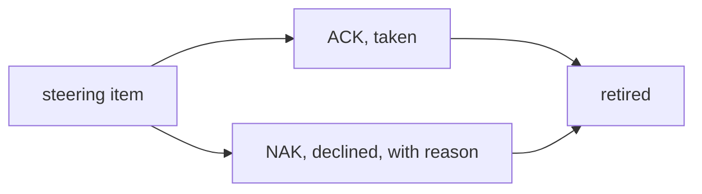

Both dispositions retire the item; NAK records `declined`. Decline is
taught beside ACK in the agent-facing readouts and worktree skill. In Canvas,
the resident consumes the marker before publication and the message carries no
disposition styling, so both render as ordinary Markdown with the lane accent.

**Value:** an agent that disagrees says so instead of complying badly. **Without
it:** the only cheap path is fake agreement, and the transcript stops being
evidence.

### Silence is not consent

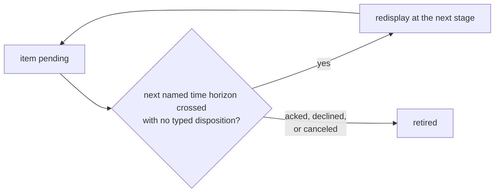

Unanswered steering re-surfaces through the supervisor when a named horizon from its publication time has elapsed. Every
unanswered directive follows the same horizons and cadence. Escalation retains
one stable lineage key, so a resend reads as one thread of insistence rather
than a pile of duplicates.

**Value:** the failure mode of a busy agent is *delay*, not *loss*.

### One actor, one claim, bounded

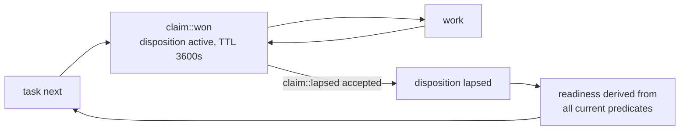

An actor holds at most one active claim. An elapsed lease returns the task to
eligibility only through an accepted typed lapse transaction, without rewriting
claim history. An explicit steal is a separate typed operation: it replaces the
exact claim named by the command, and a displaced occupant learns through an
ownership refusal rather than a fabricated inbox message. Claim context remains
reconstructible through the claim's bounded lease and exact opening and closing
source boundaries.

**Value:** two agents never hold the same task at once, and the board
self-heals from crashes without an operator sweep. Independent tasks can still
meet at an explicit, recoverable baseline conflict.

### Each task declares its own phase flow

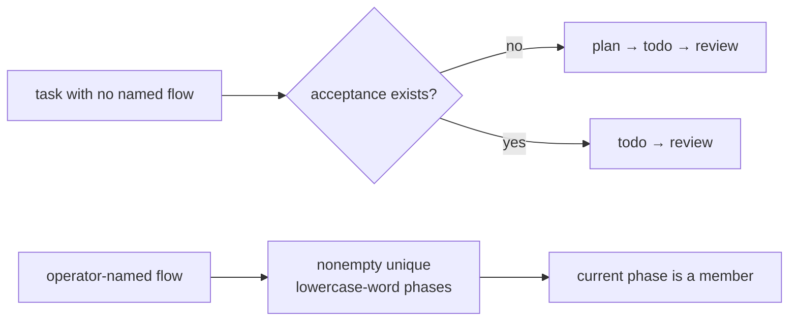

A task's *flow* is its ordered phase vocabulary. It is any nonempty sequence of
unique, nonempty lowercase ASCII words; there is no global phase enumeration or
slot ceiling, and the current phase must be a member. When no flow is named, a
task without acceptance receives `plan` to `todo` to `review`; every other task
receives `todo` to `review`, independent of visibility. A hidden `.oops` row is
parked in `plan` but retains the complete `plan` to `todo` to `review` flow and
requires explicit promotion.

Every accepted phase transition is a durable journal fact projected by the
board. A new task-owned tree additionally produces one attested synthesized
baseline-first landing; when the baseline already contains the work, integration
instead advances or fast-forwards without a synthetic merge. The complete phase
history is therefore the journal sequence, not the merge sequence. In particular,
a review that finds nothing advances the phase without producing a commit, so it
lands no merge and leaves no trace in a first-parent walk.

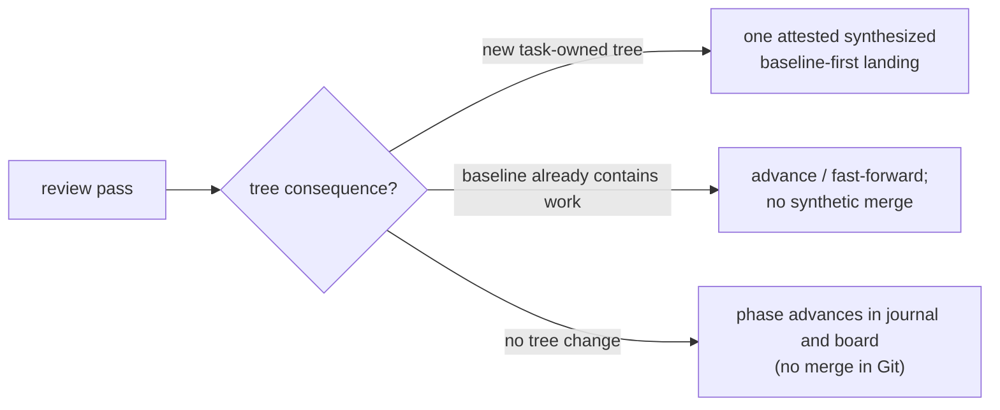

What Git first-parent history measures is therefore the review **change** rate,
not review coverage. Counting merges understates the work by every clean review;
the journal and board do not.

### Cross-review is preferred, never required

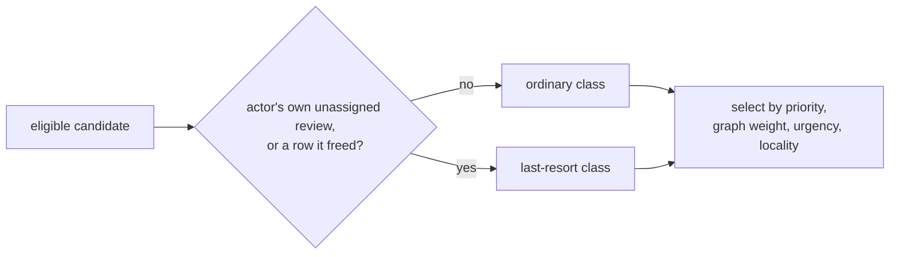

This is a **soft** guarantee with a strict selection class, not a refusal or a
numeric priority adjustment. Any eligible candidate that is not the actor's own
unassigned review outranks every such self-review before priority, graph weight,
urgency, and locality are compared. Only when no other eligible work exists does
the self-review class become selectable, so a truly quiet solo board never
deadlocks. The claim reply names such a win as the last resort and asks for a
verdict. A row the lane explicitly freed joins the same class: the lane drains
its other work first, and when the row returns the reply reminds it to record
what the row waits on (`task depends`, `task require`, or `task defer`) rather
than free it again.

**Value:** the fleet gets independent review whenever it *can*, and degrades to
progress rather than stalling when it can't. This is the sharpest example of the
system's general posture: prefer the good property, never let it stop the work.

### New task-owned work lands as one attested merge

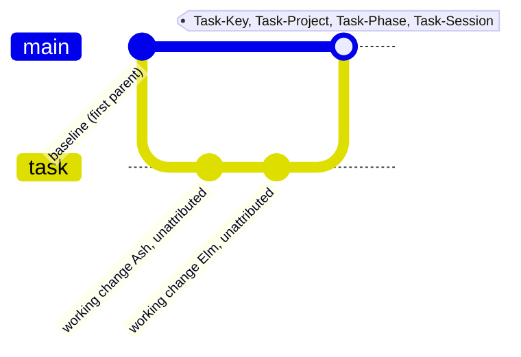

Mutating Git integration happens only at task phase boundaries. When new
task-owned work requires a synthesized landing, that merge is computed before
the checked-out repo is mutated, so the visible terminal state is either the
untouched pre-merge tree or a recoverable merge — never stranded conflict
markers. The trailers ride the merge, not the working commits. When the
baseline already contains the work, integration advances or fast-forwards with
no synthetic merge.

**Value:** `--first-parent` is the ledger of synthesized mutating landings.
Every such landing carries its task, project, phase, and the agent session that
did it, while the journal and board retain every transition whether it produced
a merge or only advanced to an already-containing baseline. That division makes
release notes and fleet forensics queries instead of
archaeology without pretending a clean review changed Git.

### Every task says where it came from

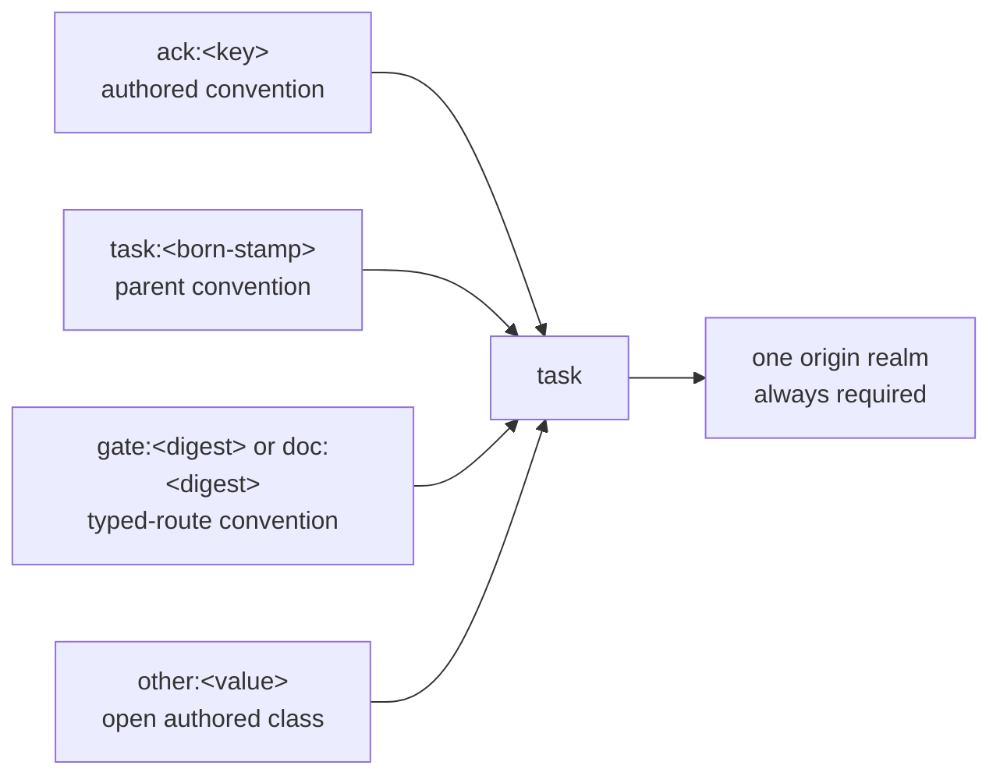

Every task carries one origin realm. The wire contract validates only a
nonempty class, a colon, and a nonempty value. Ordinary authored creation
conventionally names a steering directive or parent work; when the actor holds
one active claim, the server may derive that `task:` realm. A typed system route
may instead supply a proved `gate:` or `doc:` cause. Other authored classes are
accepted and preserved, so these routes are conventions rather than a closed
realm enumeration.

**Value:** you can always answer *"why does this task exist?"* without reading a
transcript. In a fleet that files its own follow-ups, this is the difference
between a board and a landfill.

### The lane outlives the agent

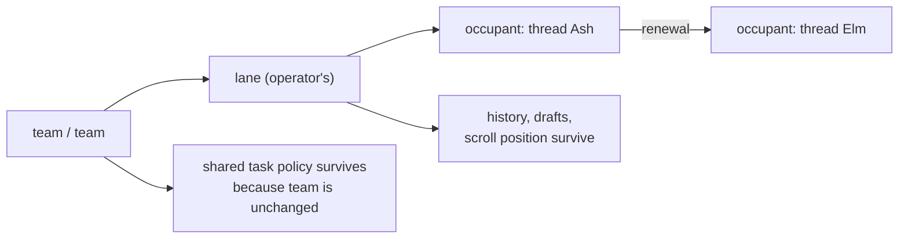

A lane is an operator-owned container over a worktree; the agent is a tenant.
Renewal is ordinary steering, not a forced termination, and hands the lane to a
new thread while the message stream stays readable.

**Value:** agents become *disposable*. If the agent were the lane, every renewal
would cost the operator their context, and the rational move would be to hoard
long-lived agents — exactly the thing that makes context rot.

### Taste changes begin as evidence-backed proposals

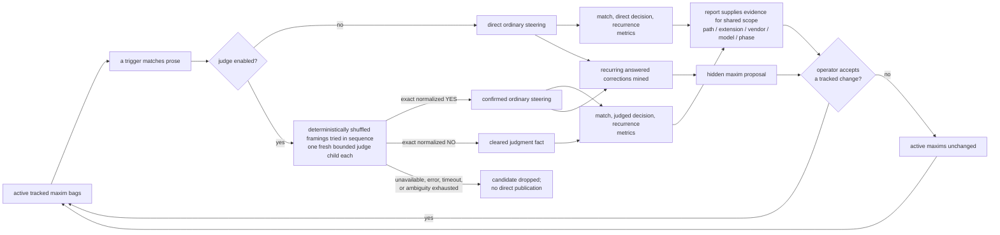

Two loops close here. Maxim *effectiveness* is measured per bag per vendor and
the report supplies evidence for scoping changes; separately, recurring
corrections answered by ACK or decline are clustered into a proposed new maxim
filed on a hidden board.
Neither path edits the tracked set. Only operator acceptance of the resulting
tracked change can add, remove, or rescope an active maxim; a proposal that is
discarded or deferred leaves the active set unchanged.

**Value:** taste arrives early — while the agent is still speaking, not at
review — and the taste set is evidence-driven rather than accumulated by
opinion. **Without it:** a maxim list only ever grows, and false positives
quietly train agents to ignore it.

### An agent's past is derived, never assumed

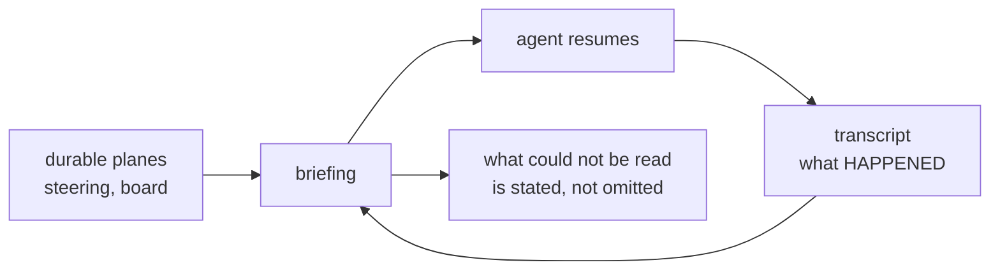

Context is finite and history is not, so everything an agent knows about its own
past after a compaction is reconstructed. The reconstruction reads intent from
the durable planes and evidence from the transcript, and never lets one stand in
for the other — a transcript is authoritative about what happened and about
nothing that is wanted.

**Value:** an agent resumes instead of restarting, and renewal costs nothing,
which is what makes disposable agents affordable in practice. **Without it:** the agent's own
restatement of a directive becomes the directive, and every compaction is a
small game of telephone with the operator.

### External publication follows the exact plan the operator read

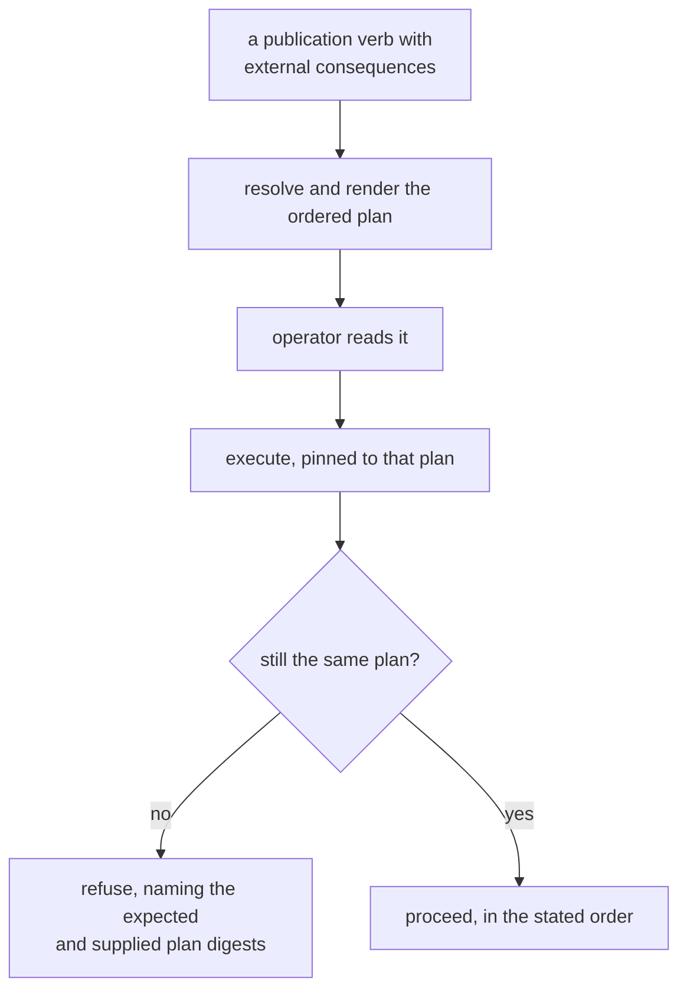

Externally visible release publication is executed from a resolved, sealed plan.
*Moving* a tag is not a plan option because the system refuses to do it at all
([A version names
exactly one commit](invariants/distribution.md#distribution-a-version-names-exactly-one-commit)) — a
published version names one commit forever. Each effect is expressed as a plan
first, rendered in full, and executed only against the digest the operator
authorized; any changed input requires a new preview.

This is the durable-steering guarantee pointed at decisions rather than
instructions: the operator's
approval is made durable and binding in exactly the way their steering is.

**Value:** approval covers a specific set of operations rather than an
intention, so the gap between reading and authorizing carries no risk.
**Without it:** consent is given for a summary while something else runs, and
the discovery happens after the one step that cannot be undone.

---

## UI components

### The Canvas view rail

Dash, Work, and Chat are the sole global and team panel names. Their canonical
global routes are `#/dash`, `#/work`, and `#/chat`; browser history, reload,
and copied URLs restore the selected destination. A missing fragment, bare
`#`, or `#/` opens Chat and is replaced in place with `#/chat`. Missing leading
slashes and trailing or repeated slashes around a known destination are also
replaced with its canonical route without adding a history entry. An unknown
fragment or stray URL query opens Chat with working navigation, replaces the
address with `#/chat`, and names the refused route in a toast.
An authenticated remote opening captures its one-time fragment into tab-local
session storage before routing starts, then makes the same `#/chat`
replacement. Bootstrap and speech requests reuse only that captured token;
route fragments are never credentials.
Existing team, speech, and narration state keeps its current format. Following
a quote link to its quoted message is a history step: Back returns the card
that held the link to where the reader left it. A card link opened in a fresh
page brings its card into view and focus once Chat hydrates, holding it there as
older history loads around it until the reader scrolls.

### The Spice menu quota well

The Spice button divides global weekly capacity into provider bands. Each
account's opaque layer height is its available contribution to global capacity,
so total stack height shows global remaining capacity and each provider band
sums to that provider's global contribution. A layer's color intensity reports
the fraction remaining within that account. Provider and account order is stable
by total allocated capacity rather than remaining capacity: the largest
provider sits at the bottom, and within it the largest account sits below
smaller accounts. Missing, blank, and unrecognized plan tiers count as 20×
capacity unless an explicit Free (0.2×), named $20 (1×), or 5× tier (including
OpenAI Pro Lite, the $100 Pro plan) says otherwise. Provider hues follow the
green, blue, gold, red, teal, and plum accent order used for agents. The outer
button edge uses a crisp two-pixel ring and a restrained shadow in that same
color: neutral with neither status, gold for Fast mode, blue for an available
Canvas update, and red when both apply. Quota colors remain unchanged.

Action-delivery refusals and best-effort speech failures use the shared root
toast. It appears above every Canvas destination without entering page flow and
clears after its fixed dwell. Validation that needs an edited field, failures
with an explicit retry, and durable degraded state stay beside the control or
data they qualify instead of disappearing as transient feedback.

### The global Dash page

Resident topology presents each team in canonical order from left to right:
member zero, the team's main agent, starts at the far-left control-flow origin,
and later members proceed rightward before wrapping in the same order. Chat
intentionally presents that order from its right-side controls instead; neither
projection changes member identity, accent, keyboard order, or attribution.

The first Dash section pairs a compact operator identity row with the
resident it controls. The avatar already carries the operator badge, so the card
does not repeat badge, name-source, or email-source metadata. Beside it, three
fixed resident fields show connection state, appliance version, and a compact
epoch identity; their loading and reconnect values retain the same geometry as
settled data.

Provider quota account cards keep each reset credit on its existing compact
line. A credit with an expiration shows a live relative countdown there; hover
retains the exact provider timestamp, and long credit prose truncates rather
than increasing the card footprint.

### The global Work page

One board shows all open work in ready, in-flight, blocked, and deferred rows.
Those lifecycle categories stay fixed while cards fill each row in allocator
order and scroll horizontally at overflow, so task churn changes a row's
contents rather than growing the board or moving status labels. Creation order
and project/phase clusters are alternate arrangements of the same keyed cards.
Every lane permanently reserves a label gutter above its card track; an active
cluster names itself at the top-left of its first card, while an unclustered or
empty lane leaves the same space blank. Arrangement changes therefore reorder
cards and replace labels without moving any card vertically. Empty rows remain
visible, status is textual as well as colored, and narrow layouts retain the
labeled rows with narrower card tracks. Task detail and relationship views
preserve the same identity and evidence.

Tasks created from a retained transcript expose the same **Creator context**
link on their Work card, Chat quick view, and full detail drawer. The link
returns to the newest retained message card at or before the task's recorded
creation boundary and pages older lane history when that card is outside the
loaded window. Canvas requires the retained lane to prove the exact recorded
transcript generation; tasks without that authority or another unambiguous
transcript boundary omit the action rather than presenting a dead link.

Task descriptions and acceptance criteria render as authored Markdown through
one sanitized contract renderer, shared by the Chat quick view (description)
and the full detail drawer (description and every criterion). Paragraphs,
line breaks, lists, emphasis, code, and safe links keep their shape; raw HTML
stays literal text and unsafe link schemes lose their destination. A handle the
admitted board holds becomes the same task chip Chat uses. Activating one moves
the quick view, or the drawer, to that task, and closing the drawer still
returns focus to its launching card. A handle the board does not hold, and any
handle inside code or link text, stays literal, so no chip leads nowhere.

Deep task detail also treats admitted ownership facts as navigation rather than
decoration. Its project action opens the matching visibility-qualified Work
scope without dropping the selected task. Assignment, active-claim, and creator
team facts open the exact current team member in Chat only when the admitted
topology proves that destination; independent, stale, or unknown identities
remain readable facts instead of dead links.

The project-stem pills above Canvas begin with one label-less aggregate pill
whenever open work exists. Its badge carries the same ready, active, and
unavailable counts across every stem; selecting it opens Work and clears a
stem scope, so the global board remains reachable directly from every Canvas
destination.

The global board and each team Work pane render the same task-card identity,
status, ownership, and selection contract. Team panes use the compact density;
activating either card opens the one shared detail layer, whose close returns
focus to the card that launched it.

### The team Work pane

Each team projects its open work into three stable lanes: Up next follows the
resident's offer order, In flight shows work claimed by a member with that
member's name and accent, and Waiting collects blocked, deferred, and review
work. Empty lanes remain visible. The same keyed cards move between lanes
without disturbing unchanged cards, and opening one uses the shared task detail
layer with focus returned to its launching card.

Below those lanes, one directive ledger joins the team's browser-owned
submissions to the resident inbox by stable directive or fanout identity. A
fanout remains one row with per-member delivery state as it moves from queued
through delivery to acknowledgment, decline, lapse, cancellation, or terminal
delivery failure; recent retirements therefore replace state in place instead
of making the row jump.
Any work whose origin names one of the row's steering keys appears on that row
as the same compact, accent-backed task reference used in Chat, and opens the
same shared task detail layer.
Retained history connects Work back to Chat without inventing destinations. A
task card links to the newest retained team message that mentions its handle,
and a directive row links to a retained acknowledgement or decline carrying
that steering target. If no matching card is retained, no link is shown.
Following a link shows that team's Chat pane and focuses the message; Back
restores the originating Work row and scroll position, Forward returns to the
message, and modified clicks open the card route without changing this tab's
team mode.

A full-width Settled history below the three open-work lanes shows the work the
team finished most recently: tasks it created or whose last winning claim a
current member held, newest first. Search and Completed-by narrow that same
team-scoped history; its range and Newer/Older controls replace one bounded
page at a time, matching the global Work archive without mixing other teams.
The team pane's own width governs that history's controls: Search, Completed
by, and Apply/Clear share one row when the pane can hold them, then stack
without clipping when the pane narrows. Its total stays beside the Settled
heading rather than drifting to the remote edge of the full-width lane.
The history read runs only while that team's Work
pane is on screen, and runs again only once an open-board refresh shows work
leaving the open board or the connection resumes. Settled cards are the same
shared cards and open the same detail layer.
Below the lanes, a Kept jobs table lists every command a member keeps beyond
the call that started it, across the whole team and oldest first. Wide panes
keep one compact table row per job. Lane-shaped panes preserve the same table
headers for assistive technology while presenting each job as a labeled,
accented row: member and standing first, then up to two command lines and the
started age. The full command remains available on hover. A standing change
updates its row in place; with nothing kept, the table holds one fixed-height
empty line.

### The team console

Chat tiles one console per live team. Its ordered surface exposes team identity
and liveness, the Dash/Work/Chat rail, pane-specific member standing, and the
lane-attributed message stream. Each member lane remains the concrete address
of one worktree; the team is never a broadcast identity. Dash gives every
member exactly one presence row — working, working on its claim, idle in its
seat, starting before first output, or genuinely vacant — plus the age of that
state.

Seat and import share one panel, including for an empty fleet. Moving one member
to a new team preserves its siblings and allocation policy. Leaving all teams
moves only that member to its lane identity and preserves its seat.

### The team Dash

Dash keeps one member box per lane in canonical team order. Every box reserves
the same geometry for the member accent, name, provider glyph, and presence, so
live state changes do not resize or reorder the roster. Agent channel, occupant,
worktree, residency policy, and session identifiers remain available through a
per-member seat-details disclosure that scrolls inside its own box.

Recognized provider glyphs are unbadged for ordinary launches and carry a
small flame only while their current occupant is a recorded Fast mode launch.
That per-lane mark follows the occupant's launch identity, not the current
global Fast mode setting. A model with no recognized provider uses the
standalone omp π identity instead.

The same disclosure carries the member's lane controls. Wake is offered only
on a vacant seat the resident can seat, Drain only on an occupied one, and
Remove only on a vacant seat that holds no claim. Renewal and the next-launch
model sit beside them, and the model editor reports the seat's pinned model
rather than the running one. Drain, Remove, and a renewal request confirm
before anything is sent. The member shows its command in flight until the
lane answer lands, and a refusal stays on that member with its reason. A
control whose command the principal's authority does not admit is absent,
not disabled.

Below presence, every member keeps fixed Task, Latest activity, and Waiting
direction rows. Live values replace text inside those slots rather than changing
card geometry. Opening a task adds a same-URL history step; closing it or using
browser Back returns focus to its Dash row without turning transient detail into
a copied route. Activity and direction links enter the exact Chat message or
composer. Back restores that team's Dash, its Flow scroll position, and the row
that launched the jump.

A separate Flow frame below the roster merges task transitions, lane lifecycle
boundaries, and delivered directions into one newest-first chronology. Task
entries open the same history-backed task detail; lifecycle and direction
entries link to their source cards in Chat and return to the originating Flow
row.
Older task events page in at the bottom without moving the row under the reader,
while newly arriving events appear at the top
and preserve an existing scroll position. The resident-backed feed rehydrates
after reload, so Dash remains useful as both live status and workflow history.

The Flow header carries the team's attention band: what needs the operator
now, and nothing else. Consent requests queued by a member lane come first,
each allowed or denied in place under operator authority with the witnesses of
the queue it was drawn from; the ruling lands and the request leaves. Then come
member-held tasks only a human can move: a claim iced on unmet requirements,
unclaimed work blocked on those requirements, and finished work waiting in
review. Work waiting on a sibling dependency needs nobody and does not appear.
Last come leases within two minutes of expiry and direction waiting longer
than five minutes. Tasks open the detail layer; direction jumps to the member's
composer. With nothing due the band is absent, and because it shares the
fixed-height Flow header, items entering or clearing never move the Flow.

### The team Work direction mosaic

Directions read newest first as message-familiar cards rather than as a
history table. Each card retains its durable fanout identity, presents the
available authored body through the same sanitized rich Markdown surface as
Chat, and names the operator or peer lane that authored it. A bounded retired
record that retains only a preview says that it is an excerpt instead of
inventing unavailable body text. Responsive columns repack the cards without
changing their order, identity, or source data.

Recipient badges keep their lane accent and independent delivery state. An
acknowledged or declined badge links to that recipient's exact retained Chat
card; task chips open the shared task detail. In the opposite direction, the
relative time on a retained Chat quote of an operator direction links through
a durable team-and-fanout route to the exact Work card. Each crossing records
its origin so browser Back restores the prior team tab, card, and reading
position.

### Lane, team, occupant

Three objects that are easy to conflate and expensive to conflate. The thing
that separates them is not what they contain — it is **how long each one
lives**.

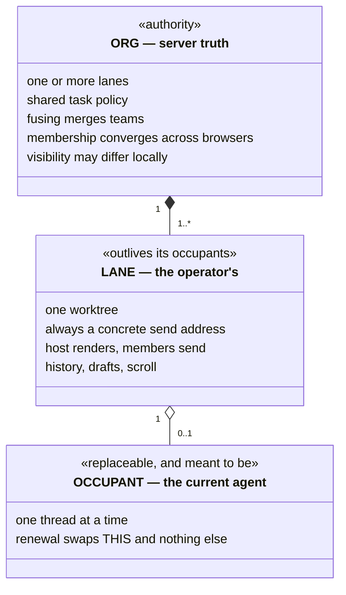

Read the two relationships as lifetimes. A lane belongs to exactly one team at
a time and may move between teams; `Close team` ends a team by making every
member independent. The team owns the task policy shared by its members: renewal
leaves that policy in place because the team is unchanged, while a lane moved
to another team takes the destination policy rather than carrying one with
it. An occupant is held loosely and may be absent entirely —
that absence makes the lane vacant, while the UI independently presents it as
`bound` or `unbound` (unless queued steering outranks liveness). A fused host
renders one merged newest-first stream while every member stays its own concrete
send address.

**Value:** the operator manipulates topology directly — drag a team onto
another team's edge to fuse — and the server remains authority for membership,
ordering, and revision. Browsers can intentionally differ in which teams they
hide without disagreeing about that topology. Because the occupant is the only
replaceable part, replacing it is cheap enough to do casually, which is the
entire point of the separation.

### Closed loop: The fused composer

A team presents as one control surface: an ordered **strip of composer
columns**, one per member. Canonical member zero is the main agent at the right
control edge; later members extend left with east/west overflow when needed.
The strip is not a set of tabs the operator switches between.

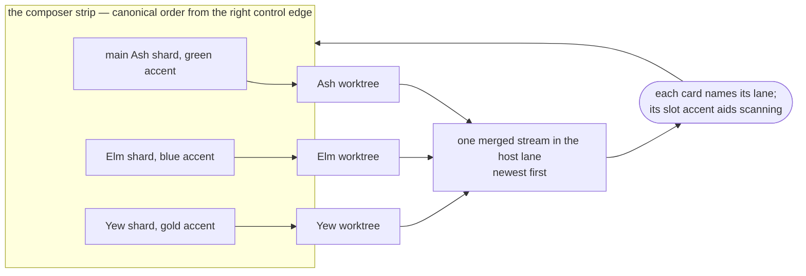

The loop is the point. Member order lays out the shards from the right control
edge and assigns their palette slots; it does not order messages or assign
identity. The finite palette may repeat, therefore cards carry explicit lane and
worktree attribution and colour is only presentation. Drag a shard to reorder
within the team; drag it out to move that lane to another. A member that
momentarily fails to resolve keeps its seat rather than being dropped from the
stack.

**Value:** addressing three agents is one surface instead of three, and nothing
is broadcast — every message still goes to exactly one worktree, through that
member's own concrete address. The merged stream is a reading convenience laid
over unchanged addressing, never a shared mailbox.

**Without it:** a team is either three separate surfaces the operator switches
between, or one surface that broadcasts. The first does not scale past a couple
of agents; the second makes every message everyone's problem.

### The autonomy dial

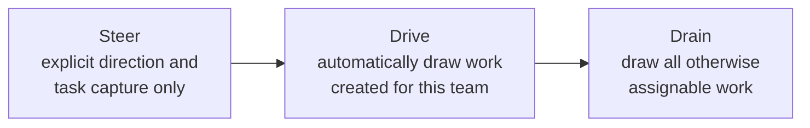

Three values, no more. The accepted value is a **server-side task-allocation
lifetime** and the client never re-derives task eligibility. Drive uses the
creator team captured when a task is added; later membership changes do not
move old work, and project names are not allocation filters. On request, however,
the browser immediately presents the requested value as pending and retains it
across ordinary reads until the command settles. The same optimistic control
labels the submit button, so the operator sees the autonomy currently being
requested as well as the eventual authoritative value.

**Value:** this is the product's most important control — the knob between "I
approve each thing" and "go find work". The pending presentation makes the
operator's request immediate without pretending it has already settled.

### The team mode rail and its scroll ownership

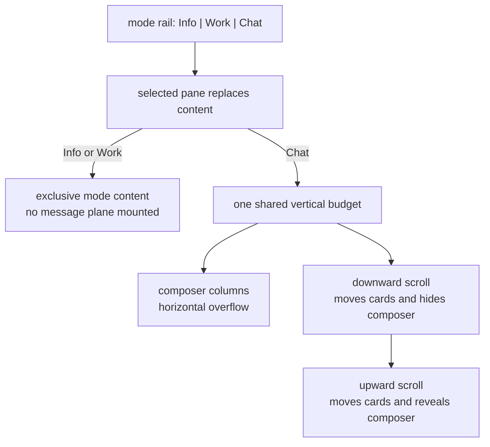

Three views per live team appear on one rail, with the selected mode retained per
team. Selecting a mode directly replaces pane content; there is no slide
transition. Info and Work replace Chat completely and do not mount the message
plane. Chat's member columns own horizontal overflow. The browser retains native
ownership of every vertical wheel, touch, and keyboard gesture. The composer
overlays the top of the message plane, whose content starts below a spacer of
the composer's height, and moves exactly as far as the cards scroll until it is
fully hidden or revealed. It reads as part of the stream, never cancels the
event, and never writes the plane's scroll position. Home and End set the
corresponding composer exposure while reaching the native stream edge in one
command. The team toolbar and ticker remain fixed above both.

**Value:** the operator can turn the whole console into a reading surface
without a toggle, threshold, or animation. The composer remains mounted, so
drafts and controls return exactly as they were when the gesture reverses.

### The reading contract

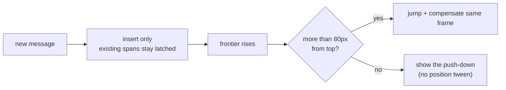

Newest-first masonry where a card that did not change gets **no style write at
all**. New content places by insert, never by repacking; a reader more than 80px
from the top is compensated in the same frame so the shift is invisible. The
0–80px near-top zone sees the push-down snap because there it is the signal.

**Value:** this is what "calm" actually costs, and it is the most exacting
requirement in the product. Reading many live agents at once is impossible if
the board reflows, so every reading-contract rule is load-bearing on its own.

### Status carries both tone and count

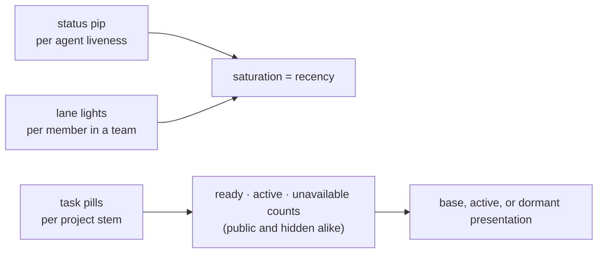

Lane indicators use saturation for recency. Task pills never ask colour to
carry exact work state: their three-slot string spells ready, active or
in-flight, and blocked or deferred counts. A hidden-system stem sorts after
the public ones and reads the same breakdown, because a stem the allocator
skips is exactly the one an operator has to triage by eye.

**Value:** the operator gets fast peripheral liveness and exact work counts at
the same time. The three semantic slots are always present, but the unpadded,
content-driven pill may resize as digit widths change.

### Steering rendered inside the reply

```mermaid
flowchart TD
  A["assistant message"] --> Q["ACK / NAK quote block<br/>(what was asked)"]
  Q --> B["the response to it"]
  B --> NextQuote["next ACK / NAK quote"]
  NextQuote --> NextResponse["its response"]
```

Messages lay out in the agent's own order: leading prose, then each recognized
ACK or NAK as its steering quote followed by that attempt's response. The
resident consumes the marker before publication, and the browser message DTO
carries no disposition; both paths therefore render as ordinary Markdown with
the lane accent rather than a distinct decline colour.

**Value:** you never have to hold "what did I ask?" in your head while reading
the answer. In a fleet where you sent that instruction twenty minutes and four
lanes ago, this is the difference between reading and re-deriving.

### Three attention channels

```mermaid
flowchart LR
  E["EYE, the board<br/>pips, pills, mosaic"] --> OP["operator"]
  A["EAR, speech<br/>quiet | speak | narrate"] --> OP
  G["GLANCE, badges<br/>pending counts, mode rail"] --> OP
```

Deliberately three, with different bandwidth. Card speech reads the selected
message's exact full text; topbar speech reads the trimmed visible main-content
text, up to 32 KiB. Narration reads the full text of each newly cursor-admitted
message. Nothing present at first materialization auto-plays.

**Value:** the ear is the only channel that works while you are looking
somewhere else, which is what lets one operator hold more lanes than they can
watch. It is best-effort by contract — audio never blocks the stream, because
the transcript remains the record.

---

## Why it composes

Each guarantee is cheap alone and compounding together.

```mermaid
flowchart LR
  DurableSteering["durable steering"] --> WalkAway["walk away mid-instruction"]
  Claims["claims + TTL"] --> AddAgent["add an agent without a conversation"]
  AttestedMerges["attested merges"] --> TrustOutput["attribute landed output without<br/>rereading working commits"]
  DisposableAgents["disposable agents"] --> Renew["renew instead of hoarding context"]
  DerivedMemory["derived memory"] --> Renew
  CalmBoard["calm board"] --> WatchFleet["watch a fleet at once"]
  WalkAway --> S["supervision scales past<br/>what one person can read"]
  AddAgent --> S
  TrustOutput --> S
  Renew --> S
  WatchFleet --> S
```

The result of that composition is a supervision rate one person cannot reach by
reading: many tasks a day, independently reviewed whenever an eligible peer
exists, across a fleet whose ordinary capacity follows work without a
hand-managed agent count. Explicit operator-authorized lane wake remains
available when direct intervention is wanted.

---

## The posture

One disposition recurs everywhere, and it is the easiest thing to lose.

Cross-review is preferred but never required. Launch-time advancement is
attempted but never raises. Optional command optimization leaves the native path
intact when unavailable. Adjudication is optional at configuration time:
disabled judging publishes a configured trigger hit directly, while enabled
judging fails closed and publishes only a confirmed candidate.

Each of these is a good property the system reaches for and declines to depend
on. The natural implementation of every one of them is a hard rule — "no agent
reviews its own work", "refuse to start on a stale tree", "require the
optimizer" — and each hard version deadlocks something. A solo agent cannot
review. A lane with an unreachable remote still has local work to do. An
optional optimizer cannot become a prerequisite for native execution. An
unavailable configured judge withholds only the speculative counsel candidate;
it never blocks the agent's primary work and never widens into direct
publication.

**Prefer the good property; never let it stop the work.** Where that reads as
laxity, it is the opposite: it is what lets the strict properties elsewhere —
durability, exclusivity, atomic landing — be strict without ever stranding
anyone.
