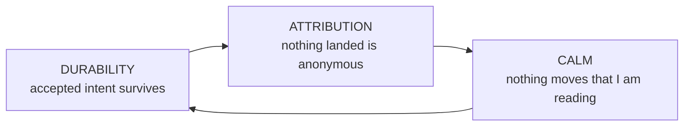
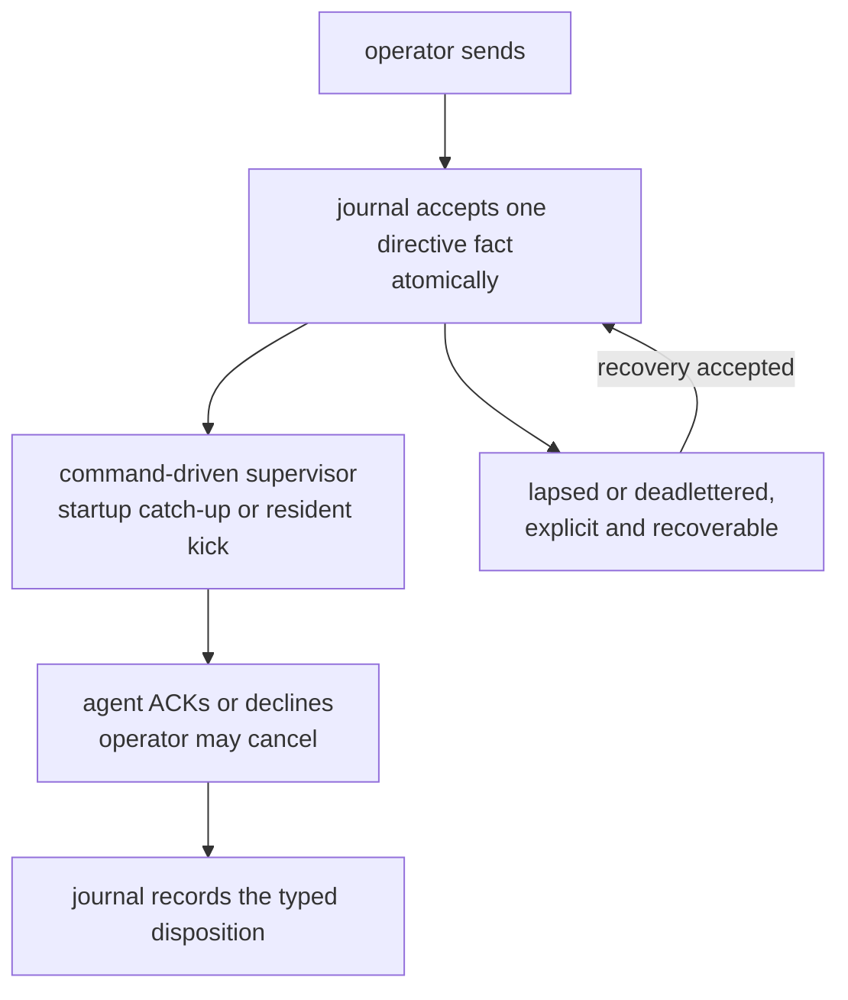
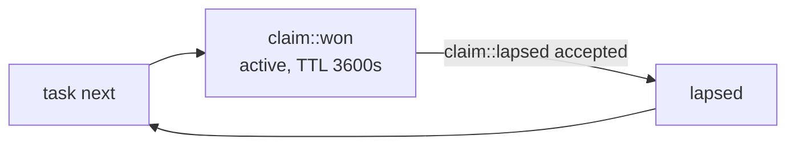
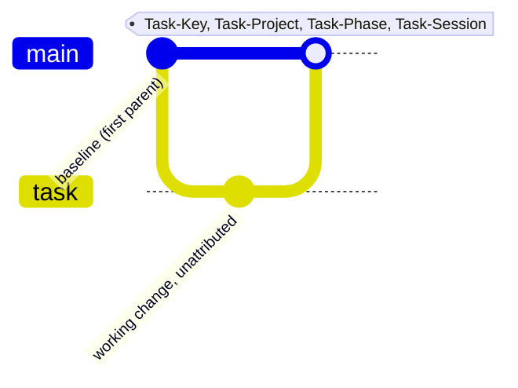
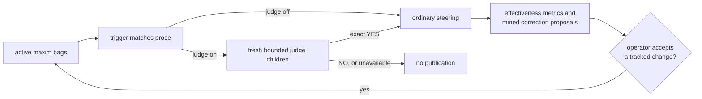
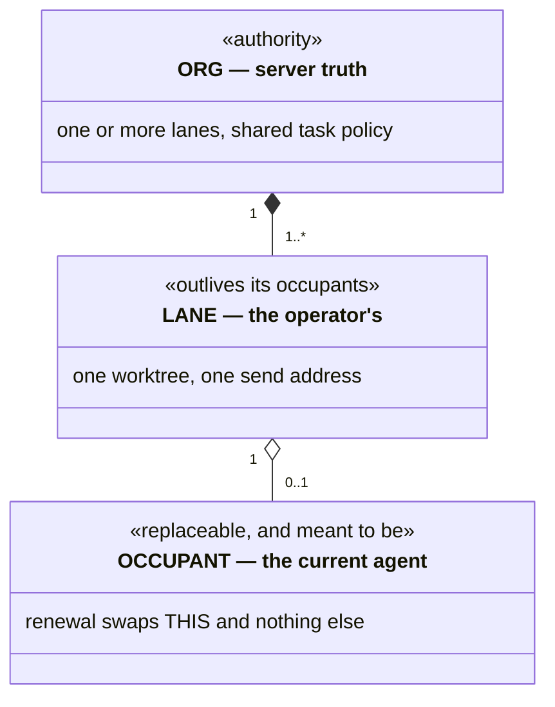
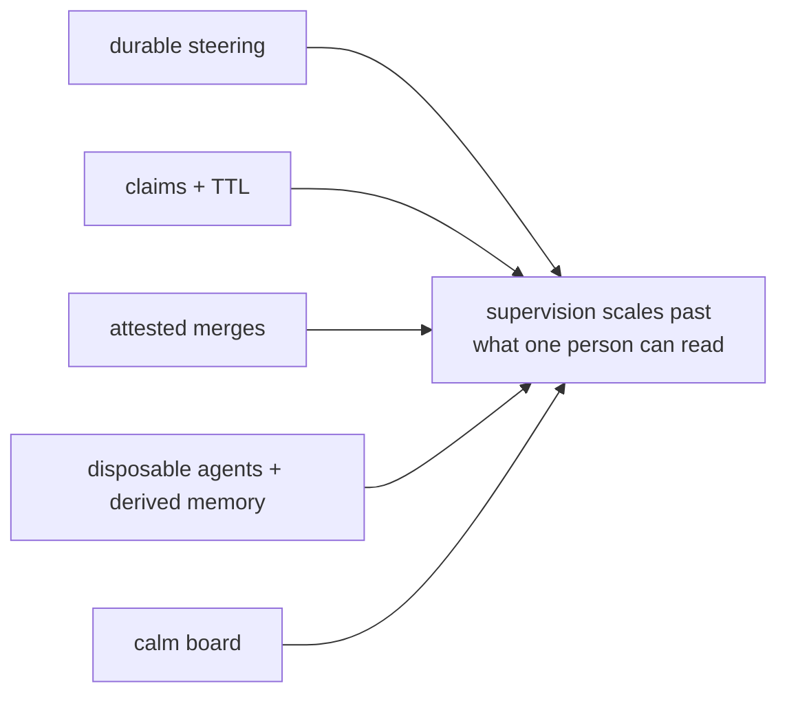

# Why this is valuable

Not the code constraints — the *workflow* guarantees and the *interface
vocabulary* that make supervising a fleet of coding agents tractable for one
person.

---

## The thesis

Running one coding agent is a chat problem. Running a fleet is an **operations**
problem, and operations needs three things chat does not have.

**Durability** begins when authority returns a live key or covering standing;
the browser's pre-acceptance queue is only a prediction. Past that boundary,
*"I told it to"* is a fact the system holds. **Attribution** makes *"who did
this and why"* a query. **Calm** makes many live streams trackable by one pair
of eyes. Remove any one and the others stop paying: an un-attributed fleet
can't be trusted, an un-durable one can't be steered, and a jittering one caps
throughput at the operator's ability to re-find their place.

Every model in this document serves exactly one of these three.

---

## Workflow invariants

The invariant register owns every cross-document label; the headings here carry
their own meaning.

### Steering is durable and has a typed lifecycle

The journal accepts a directive before any delivery reader is notified. The
command-driven supervisor reads the authenticated journal inbox directly — never
a filesystem copy — at occupant start and on resident kicks, with
occupant-local deduplication, nudge, interruption, and compaction behavior. A
*read* never changes disposition. `acked`, `declined`, `canceled`, `lapsed`,
`deadlettered`, and recovery are distinct durable facts. Only a `PendingInbox`
automatic wake that returns `Unstarted` or a terminal-class start failure
deadletters every pending directive on that lane from its retained live stage,
delivered or not; no other failure does. "Delivered" and "taken" stay separate,
visible facts. Operators and seated agents read lane IDs, seating, and active
claims with `spice lane list`; a peer-message refusal for an unseated target
points back to it.

**Value:** you can walk away mid-instruction. **Without it:** steering becomes
fire-and-hope, and the operator becomes the durable store.

### Decline is a first-class answer

Both ACK and NAK retire the item; NAK records `declined`, and decline is taught
beside ACK in the agent readouts and worktree skill. In Canvas the resident
consumes the marker before publication, so both render as ordinary Markdown
with the lane accent.

**Value:** an agent that disagrees says so instead of complying badly. **Without
it:** the only cheap path is fake agreement, and the transcript stops being
evidence.

### Silence is not consent

Unanswered steering re-surfaces through the supervisor each time a named
horizon from its publication elapses without an ACK, decline, or cancel. Every
directive follows the same horizons, and escalation keeps one lineage key, so a
resend reads as one thread of insistence rather than duplicates.

**Value:** the failure mode of a busy agent is *delay*, not *loss*.

### One actor, one claim, bounded

An actor holds at most one active claim. An elapsed lease returns the task to
eligibility only through an accepted typed lapse transaction, without rewriting
claim history. A steal is a separate typed operation replacing the exact named
claim; the displaced occupant learns through an ownership refusal, not a
fabricated inbox message. The lease and its exact opening and closing source
boundaries keep claim context reconstructible.

**Value:** two agents never hold the same task, and the board self-heals from
crashes without an operator sweep. Independent tasks can still meet at an
explicit, recoverable baseline conflict.

### Each task declares its own phase flow

A task's *flow* is any nonempty sequence of unique lowercase ASCII words; there
is no global phase enumeration, and the current phase must be a member. Unnamed,
a task without acceptance receives `plan` → `todo` → `review` and every other
task `todo` → `review`, regardless of visibility. A hidden `.oops` row parks in
`plan` with the full three-phase flow and requires explicit promotion.

Every accepted transition is a durable journal fact projected by the board. A
new task-owned tree also produces one attested baseline-first landing; a
baseline that already contains the work advances or fast-forwards without a
synthetic merge, and a clean review lands nothing in Git. First-parent history
therefore measures the review **change** rate, not review coverage; the journal
and board count every pass.

### Cross-review is preferred, never required

This is a **soft** guarantee with a strict selection class. Any eligible
candidate that is not the actor's own unassigned review outranks every such
self-review before priority, graph weight, urgency, and locality are compared.
Only when nothing else is eligible does self-review become selectable, so a
quiet solo board never deadlocks; the claim reply names that last resort and
asks for a verdict. A row the lane explicitly freed joins the same class, and
when it returns the reply asks the lane to record what it waits on (`task
depends`, `task require`, or `task defer`) rather than free it again.

**Value:** the fleet gets independent review whenever it *can* and degrades to
progress when it can't — prefer the good property, never let it stop the work.

### New task-owned work lands as one attested merge

Mutating integration happens only at phase boundaries. A synthesized landing is
computed before the checkout is mutated, so the visible end state is the
untouched tree or a recoverable merge — never stranded conflict markers. The
trailers ride the merge, not the working commits.

**Value:** `--first-parent` is the ledger of synthesized landings, each naming
its task, project, phase, and session, while the journal keeps every
transition. Release notes and fleet forensics become queries, and a clean review
never pretends to have changed Git.

### Every task says where it came from

Every task carries one origin realm; the wire validates only a nonempty class,
a colon, and a nonempty value. Authored creation conventionally names a
steering directive (`ack:`) or parent work (`task:`, which the server may
derive from the actor's one active claim). A typed system route may supply a
proved `gate:` or `doc:` cause. Other classes are preserved, so these are
conventions, not a closed enumeration.

**Value:** you can always answer *"why does this task exist?"* without reading a
transcript — the difference between a board and a landfill.

### The lane outlives the agent

A lane is an operator-owned container over a worktree; the agent is a tenant.
Renewal is ordinary steering, not termination: it hands the lane to a new
thread while history, drafts, scroll position, and the team's task policy
survive.

**Value:** agents become *disposable*. If the agent were the lane, every renewal
would cost the operator their context, and hoarding long-lived agents — the
thing that makes context rot — would be rational.

### Taste changes begin as evidence-backed proposals

Two loops close here. Maxim *effectiveness* is measured per bag per vendor, and
the report supplies evidence for path, extension, vendor, model, or phase
scoping. Separately, recurring corrections answered by ACK or decline cluster
into a proposed maxim filed on a hidden board. A judge tries deterministically
shuffled framings, one fresh bounded child each; an exact NO records a cleared
judgment, and unavailability, error, timeout, or exhausted ambiguity drops the
candidate. Neither loop edits the tracked set: only operator acceptance of a
tracked change adds, removes, or rescopes a maxim.

**Value:** taste arrives while the agent is still speaking, not at review, and
the set follows evidence rather than opinion. **Without it:** a maxim list only
grows, and false positives train agents to ignore it.

### An agent's past is derived, never assumed

After a compaction, everything an agent knows about its past is reconstructed:
intent from the durable planes (steering, board), evidence from the transcript,
and never one standing in for the other. A transcript is authoritative about
what happened and about nothing that is wanted; what could not be read is
stated, not omitted.

**Value:** an agent resumes instead of restarting, which makes disposable agents
affordable. **Without it:** the agent's restatement of a directive becomes the
directive, and every compaction is a game of telephone.

### External publication follows the exact plan the operator read

Release publication executes from a resolved, sealed plan: each effect is
rendered in full, and execution is pinned to the digest the operator read. A
changed input refuses, naming the expected and supplied digests, and requires a
new preview. Moving a tag is not an option at all ([A version names exactly one
commit](invariants/distribution.md#distribution-a-version-names-exactly-one-commit)).
This is durable steering pointed at decisions: approval is as binding as
instruction.

**Value:** approval covers a specific set of operations, not an intention.
**Without it:** consent is given for a summary while something else runs.

---

## UI components

### The Canvas view rail

Dash, Work, and Chat are the sole global and team panel names, routed as
`#/dash`, `#/work`, and `#/chat`; history, reload, and copied URLs restore the
addressed view. Work may add a scope, `/public/{stem}` or `/hidden/{stem}`, then
`/task/{stamp}`; Chat may add `/card/{target}` or `/direction/{team}/{id}`. A
stem or target is one segment with letters, digits, `-._~` literal and every
other byte as uppercase `%XX`; any other spelling is refused. A missing or
empty fragment, or stray slashes around a route, is replaced in place with the
canonical route. An unknown route or stray query opens Chat, replaces the
address with `#/chat`, and names the refused route in a toast. An authenticated
remote opening first captures its one-time fragment into tab-local session
storage, then makes the same `#/chat` replacement; bootstrap and speech reuse
only that token, and route fragments are never credentials.

Changing destination, opening a Work task, and following a card or direction
link each push one history entry; changing scope keeps the open task and, like
switching tasks, replaces the entry. Closing a task this page opened consumes
its entry; closing a loaded one replaces the address with its scope. Back and
Forward only restore. A route naming something the resident proves absent is
replaced with its container and a toast naming it: a missing stem opens All
open work, an unknown task closes, and a card outside retained Chat history
opens Chat; a transient failure keeps the route and its Retry. The team
activity surface is a retained Chat card at `team-stream-{team}` while that
team remains current and teamed; an unknown or independent lane is unavailable.
Pane modes, team menus, Work arrangement, and a task opened over Dash or Chat
are browser-local; team, speech, and narration state keeps its format. Following
a quote link is a history step, and Back returns the linking card where the
reader left it. A fresh card link brings its card into view and focus once
Chat hydrates, holding it as older history loads until the reader scrolls.

### The Spice menu quota well

The Spice button divides global weekly capacity into provider bands. Each
account's layer height is its available contribution, so the stack shows global
remaining capacity; color intensity is the fraction remaining within that
account. Order is by total allocated capacity: the largest provider at the
bottom, and within it the largest account lowest. Missing, blank, and
unrecognized tiers count as 20× unless an explicit Free (0.2×), named $20 (1×),
or 5× tier (including OpenAI Pro Lite, the $100 Pro plan) says otherwise.
Provider hues follow the agent accent order. The button's two-pixel ring and
shadow are neutral, gold for Fast mode, blue for an available Canvas update, and
red for both; quota colors never change.

Action-delivery refusals and best-effort speech failures use the shared root
toast, above every destination and outside page flow, clearing after a fixed
dwell. Validation, failures with an explicit retry, and durable degraded state
stay beside what they qualify.

### The global Dash page

Topology presents each team left to right in canonical order: member zero, the
main agent, at the far-left origin, later members rightward. Chat presents that
order from its right-side controls; neither changes identity, accent, keyboard
order, or attribution.

The first section pairs a compact operator identity row — the avatar already
carries the badge — with three fixed resident fields: connection, appliance
version, and epoch, whose loading values keep settled geometry. Quota account
cards keep each reset credit on its compact line, with a live countdown to any
expiration, the exact timestamp on hover, and long prose truncated.

### The global Work page

One board shows open work in fixed ready, in-flight, blocked, and deferred
rows. Cards fill each row in allocator order and scroll horizontally, so churn
changes contents, not board size or labels. Creation order and project/phase
clusters rearrange the same keyed cards; each lane reserves a label gutter, so
rearranging never moves a card vertically. Empty rows remain, status is textual
as well as colored, and narrow layouts keep labeled rows.

Tasks created from a retained transcript expose one creator-context link on
their card, Chat quick view, and detail. Its visible label is the live relative
age of the task's creation; its accessible name says it opens the creator
context in Chat. It opens the newest retained message at or before the recorded
creation boundary, paging older history as needed, and appears only when the
lane proves the recorded transcript generation.

Descriptions, acceptance criteria, and observations render as authored Markdown
through one sanitized task-text renderer shared by the Chat quick view
(description and recent observations) and the detail drawer (everything);
observation author, time, order, and the recent window are unchanged. Wide code
and tables scroll in their own box, raw HTML stays literal, and unsafe link
schemes lose their destination. A handle the board holds becomes the Chat task
chip and moves the quick view or drawer to that task; any other handle, and
anything inside code or link text, stays literal.

Task detail treats admitted ownership facts as navigation. Its project action
opens the matching Work scope and keeps the task open. Assignment, claim, and
creator facts open the exact team member in Chat only when topology proves that
destination; otherwise they stay readable facts.

The project pills begin with a label-less aggregate pill whose badge sums every
stem; selecting it opens unscoped Work from any destination. The global board
and team Work panes share one card identity, status, ownership, and selection
contract; either opens the one shared detail layer, whose close returns focus
to the launching card.

Below the board, **Directions** pages the resident's operator-authored history
newest first, one card per fanout. Search text, agent and team chips, lifecycle
state chips, and an authored-before date filter the resident read before
paging; Apply returns to the newest matching page and Clear removes every
filter. Newer and Older replace one bounded page through durable journal
cursors, while loading, no-match, refusal, and retry states retain the same
controls and card grid.

Each is the team Work ledger's direction card: the resident's first unquoted
line in sanitized rich Markdown, marked as a retained excerpt. Recipient badges
group by current team, keep unknown recipients visible without inventing a link,
open caused work in the shared task detail layer, and link an acknowledged or
declined badge only when retiring history evidence and a retained authenticated
reply resolve to that exact team-local Chat card; Back returns to that card.
The mosaic holds three columns wide, two at intermediate width, and one on a
narrow screen without changing newest-first order.

### The team Work pane

Each team projects open work into three stable lanes: Up next in offer order,
In flight with the claiming member's name and accent, and Waiting for blocked,
deferred, and review work. Empty lanes remain, and keyed cards move without
disturbing unchanged ones.

A directive ledger joins browser-owned submissions to the resident inbox by
directive or fanout identity. A fanout stays one row with per-member state
through delivery, acknowledgment, decline, lapse, cancellation, or failure, so
retirements update in place. Work whose origin names a row's steering key
appears on it as the Chat task reference. A task card links to the newest
retained team message mentioning its handle, and a directive row to a retained
acknowledgement or decline; with no retained card, no link. Following one shows
that team's Chat and focuses the message; Back restores the Work row and scroll,
Forward returns to the message, and modified clicks open the card route without
changing this tab's team mode.

A full-width Settled history shows tasks the team created or whose last winning
claim a current member held, newest first. Search and Completed-by narrow it,
and range and Newer/Older replace one bounded page at a time without mixing
teams. Its controls share one row when the pane can hold them and stack without
clipping when it cannot; its total stays beside the heading. It reads only
while that pane is on screen, again when work leaves the open board or the
connection resumes.

A Kept jobs table lists every command a member keeps beyond its call, team-wide
and oldest first: one row per job when wide; in lane-shaped panes, a labeled,
accented row with member, standing, up to two command lines, and age, keeping
the headers for assistive technology. The full command shows on hover, standing
changes update in place, and an empty table holds one fixed-height line.

### The team console

Chat tiles one console per live team: identity and liveness, the Dash/Work/Chat
rail, member standing, and the lane-attributed stream. Each member lane stays
the concrete address of one worktree; a team is never a broadcast identity.
Seat and import share one panel, even for an empty fleet. Moving a member to a
new team preserves its siblings and allocation policy; leaving all teams moves
only that member to its lane identity, keeping its seat.

### The team Dash

Dash keeps one fixed-geometry box per member in canonical order, with accent,
name, provider glyph, and one presence row — working, working on its claim,
idle, starting, or vacant — plus that state's age. A provider glyph carries a
small flame only while the occupant is a recorded Fast mode launch; an
unrecognized provider shows the omp π identity. A per-member seat-details
disclosure, scrolling inside its box, holds channel, occupant, worktree,
residency, and session identifiers and the lane controls: Wake only on a
seatable vacant seat, Drain only on an occupied one, Remove only on a vacant
seat holding no claim, plus renewal and the next-launch model, which reports the
pinned model. Drain, Remove, and renewal confirm first; the command shows in
flight until answered, and a refusal stays with its reason. A control the
principal's authority does not admit is absent, not disabled.

Fixed Task, Latest activity, and Waiting direction rows update text in place.
A task opens its detail over Dash without a history entry, and closing returns
focus to the row. Activity and direction links enter the exact Chat message or
composer; Back restores that team's Dash, Flow scroll, and launching row.

The Flow frame merges task transitions, lifecycle boundaries, and delivered
directions newest first. Task entries open the detail; the others link to their
Chat cards and return to the Flow row. Older events page in at the bottom
without moving the row being read, new ones arrive at the top preserving scroll,
and the feed rehydrates after reload.

The Flow header carries the attention band: what needs the operator now. First,
consent requests queued by a member, allowed or denied in place under operator
authority against the witnesses of their queue. Then member-held tasks only a
human can move — a claim iced on unmet requirements, unclaimed work blocked on
them, finished work in review; sibling dependencies are not shown. Last, leases
within two minutes of expiry and direction waiting over five minutes. A ruling
lands and its request leaves; tasks open the detail layer, and direction jumps
to the member's composer. With nothing due the band is absent, and sharing the
fixed-height header, it never moves the Flow.

### The team Work direction mosaic

Directions read newest first as message-familiar cards rather than as a
history table. Each card retains its durable fanout identity, presents the
available authored body through the same sanitized rich Markdown surface as
Chat, and names the operator or peer lane that authored it. A bounded retired
record that retains only a preview says that it is an excerpt instead of
inventing unavailable body text. Responsive columns repack the cards without
changing their order, identity, or source data.

Recipient badges keep their lane accent and independent delivery state. An
acknowledged or declined badge links to that recipient's exact retained Chat
card; task chips open the shared task detail. In the opposite direction, the
relative time on a retained Chat quote of an operator direction links through
a durable team-and-fanout route to the exact Work card. Each crossing records
its origin so browser Back restores the prior team tab, card, and reading
position.

### Lane, team, occupant

Three objects that are expensive to conflate, separated by **how long each
lives**.

A lane belongs to one team at a time and may move; `Close team` makes every
member independent. The team owns the shared task policy: renewal keeps it, and
a moved lane takes its destination's. An absent occupant makes the lane vacant,
while the UI separately shows `bound` or `unbound` unless queued steering
outranks liveness. A fused host renders one merged stream while each member
keeps its own send address.

**Value:** the operator manipulates topology directly — drag a team onto
another's edge to fuse — while the server owns membership, ordering, and
revision; browsers may hide different teams without disagreeing about topology.
Replacing the occupant is cheap enough to do casually, which is the point.

### Closed loop: The fused composer

A team presents as one ordered **strip of composer columns**, one per member:
member zero, the main agent, at the right control edge, later members leftward
with overflow — not tabs. Every message goes to exactly one member's worktree,
and the host shows one merged newest-first stream whose cards name their lane.
Member order places shards and palette slots but never orders messages or
assigns identity; the palette may repeat, so attribution is explicit and colour
is presentation. Drag a shard to reorder, or out to move its lane; a member that
briefly fails to resolve keeps its seat.

**Value:** three agents are one surface, and nothing is broadcast; the merged
stream is a reading convenience over unchanged addressing. **Without it:** the
operator switches between surfaces, which stops scaling, or broadcasts, which
makes every message everyone's problem.

### The autonomy dial

Steer (explicit direction and task capture only), Drive (draw work created for
this team), Drain (draw all otherwise assignable work): three values, a
**server-side allocation lifetime** whose eligibility the client never
re-derives. Drive uses the creator team captured at task creation; later
membership changes do not move old work, and project names are not filters. A
request shows as pending, also on the submit label, until the command settles.

**Value:** the knob between "I approve each thing" and "go find work", immediate
to use without pretending to have settled.

### The team mode rail and its scroll ownership

Each live team's rail keeps its selected mode per team, and selection replaces
the pane without transition. Info and Work never mount the message plane. In
Chat, member columns own horizontal overflow and the browser keeps native
ownership of every vertical gesture. The composer overlays the plane, whose
content starts below a composer-height spacer, and moves exactly as far as the
cards scroll until hidden or revealed; it never cancels an event or writes the
scroll position. Home and End also set composer exposure. The toolbar and ticker
stay fixed.

**Value:** the console becomes a reading surface without a toggle, threshold, or
animation, and the mounted composer keeps drafts and controls intact.

### The reading contract

Newest-first masonry where an unchanged card gets **no style write at all**.
New content places by insert, never by repacking; a reader more than 80px from
the top is compensated in the same frame, and within 80px the push-down snaps
because there it is the signal.

**Value:** this is what "calm" costs and the most exacting requirement in the
product: reading many live agents is impossible if the board reflows.

### Status carries both tone and count

Lane indicators use saturation for recency. Task pills spell ready, active, and
blocked-or-deferred counts rather than asking colour to carry them; hidden
stems sort after public ones with the same breakdown, because a stem the
allocator skips is the one an operator triages by eye. The unpadded pill may
resize as digit widths change.

**Value:** peripheral liveness and exact counts at once.

### Steering rendered inside the reply

Messages keep the agent's order: leading prose, then each recognized ACK or NAK
as its steering quote followed by that response, as ordinary Markdown with the
lane accent.

**Value:** you never hold "what did I ask?" in your head — across twenty minutes
and four lanes, the difference between reading and re-deriving.

### Three attention channels

Eye (the board), ear (speech: quiet, speak, narrate), and glance (badges and the
mode rail), each with different bandwidth. Card speech reads the selected
message's full text; topbar speech reads visible main content up to 32 KiB;
narration reads each newly cursor-admitted message. Nothing present at first
materialization auto-plays.

**Value:** the ear works while you look elsewhere, letting one operator hold
more lanes than they can watch. It is best-effort: audio never blocks the
stream, because the transcript remains the record.

---

## Why it composes

Each guarantee is cheap alone and compounding together.

Walk away mid-instruction, add an agent without a conversation, attribute
landed output without rereading commits, renew instead of hoarding context, and
watch a fleet at once: many tasks a day, independently reviewed whenever a peer
exists, with capacity following work rather than a hand-managed agent count.
Explicit operator-authorized lane wake remains available.

---

## The posture

One disposition recurs everywhere, and it is the easiest thing to lose.

Cross-review is preferred but never required. Launch-time advancement is
attempted but never raises. Optional command optimization leaves the native path
intact. Disabled judging publishes a configured trigger hit directly, while
enabled judging fails closed and publishes only a confirmed candidate.

The natural implementation of each is a hard rule — "no agent reviews its own
work", "refuse to start on a stale tree", "require the optimizer" — and each
hard version deadlocks something. A solo agent cannot review; a lane with an
unreachable remote still has local work; an optimizer cannot become a
prerequisite; an unavailable judge withholds only its speculative candidate,
never the agent's primary work.

**Prefer the good property; never let it stop the work.** That is not laxity: it
lets durability, exclusivity, and atomic landing be strict without ever
stranding anyone.
