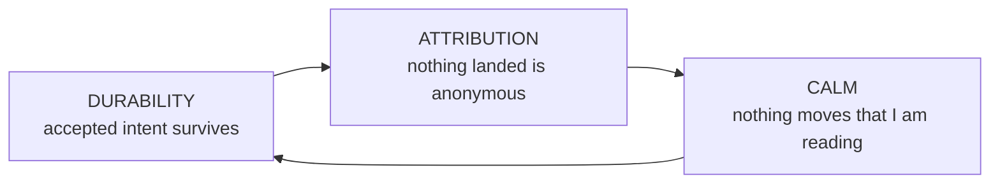
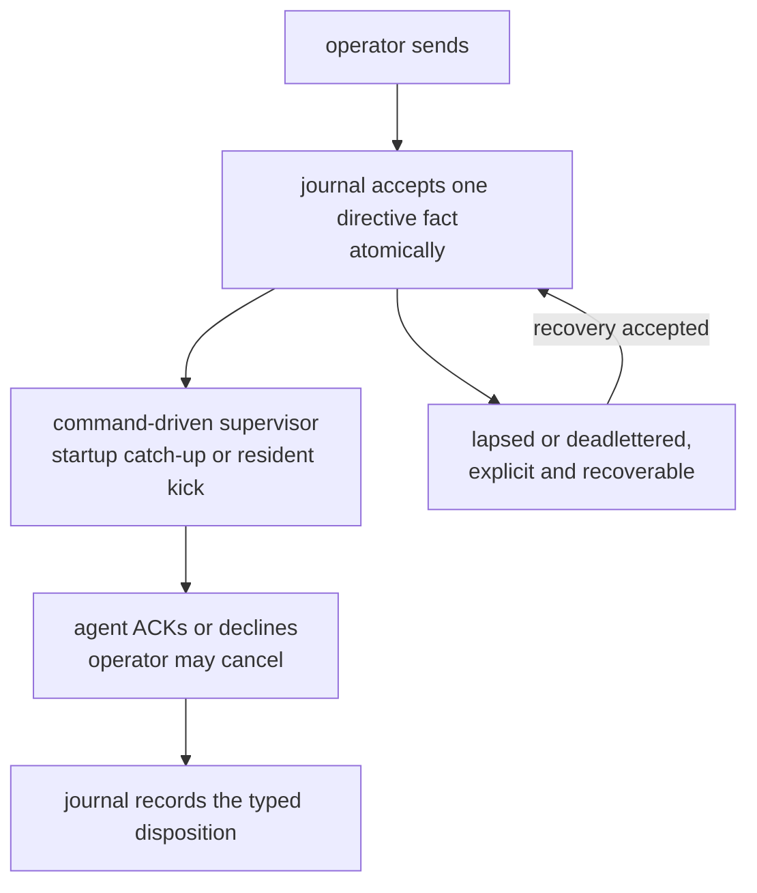
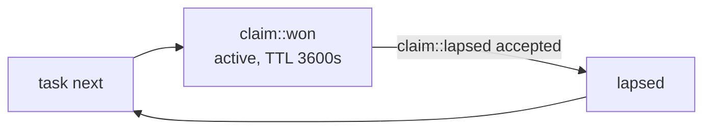
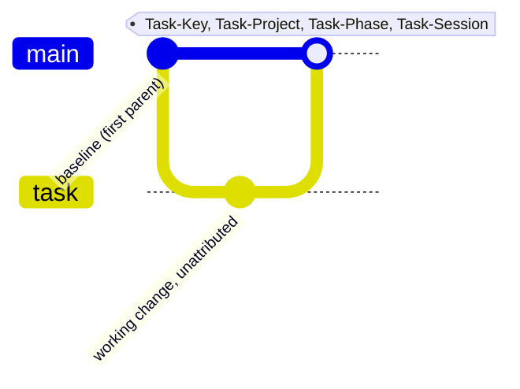
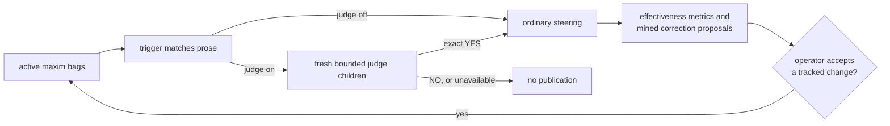
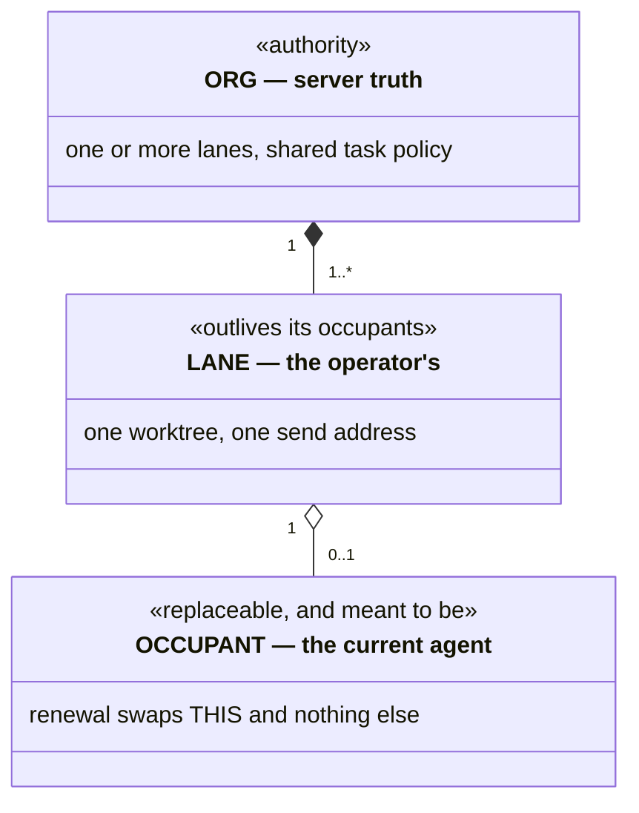
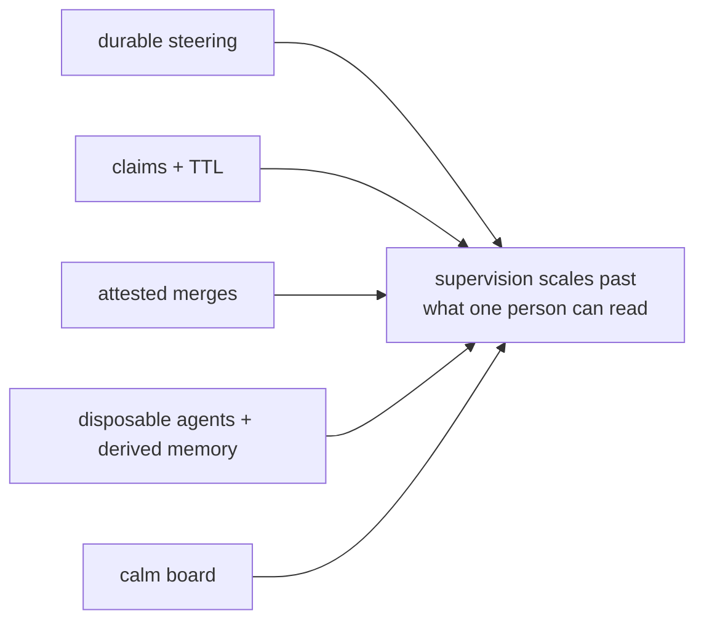

# Why this is valuable

Not the code constraints — the *workflow* guarantees and the *interface
vocabulary* that make supervising a fleet of coding agents tractable for one
person.

---

## The thesis

Running one coding agent is a chat problem. Running a fleet is an **operations**
problem, and operations needs three things chat does not have.

**Durability** begins when authority returns a live key or covering standing;
the browser's pre-acceptance queue is only a prediction. Past that boundary,
*"I told it to"* is a fact the system holds. **Attribution** makes *"who did
this and why"* a query. **Calm** makes many live streams trackable by one pair
of eyes. Remove any one and the others stop paying: an un-attributed fleet
can't be trusted, an un-durable one can't be steered, and a jittering one caps
throughput at the operator's ability to re-find their place.

Every model in this document serves exactly one of these three.

---

## Workflow invariants

The invariant register owns every cross-document label; the headings here carry
their own meaning.

### Steering is durable and has a typed lifecycle

The journal accepts a directive before any delivery reader is notified. The
command-driven supervisor reads the authenticated journal inbox directly — never
a filesystem copy — at occupant start and on resident kicks, with
occupant-local deduplication, nudge, interruption, and compaction behavior. A
*read* never changes disposition. `acked`, `declined`, `canceled`, `lapsed`,
`deadlettered`, and recovery are distinct durable facts. Only a `PendingInbox`
automatic wake that returns `Unstarted` or a terminal-class start failure
deadletters every pending directive on that lane from its retained live stage,
delivered or not; no other failure does. "Delivered" and "taken" stay separate,
visible facts. Operators and seated agents read lane IDs, seating, and active
claims with `spice lane list`; a peer-message refusal for an unseated target
points back to it.

**Value:** you can walk away mid-instruction. **Without it:** steering becomes
fire-and-hope, and the operator becomes the durable store.

### Decline is a first-class answer

Both ACK and NAK retire the item; NAK records `declined`, and decline is taught
beside ACK in the agent readouts and worktree skill. In the app the resident
consumes the marker before publication, so both render as ordinary Markdown
with the lane accent.

**Value:** an agent that disagrees says so instead of complying badly. **Without
it:** the only cheap path is fake agreement, and the transcript stops being
evidence.

### Silence is not consent

Unanswered steering re-surfaces through the supervisor each time a named
horizon from its publication elapses without an ACK, decline, or cancel. Every
directive follows the same horizons, and escalation keeps one lineage key, so a
resend reads as one thread of insistence rather than duplicates.

**Value:** the failure mode of a busy agent is *delay*, not *loss*.

### One actor, one claim, bounded

An actor holds at most one active claim. An elapsed lease returns the task to
eligibility only through an accepted typed lapse transaction, without rewriting
claim history. A steal is a separate typed operation replacing the exact named
claim; the displaced occupant learns through an ownership refusal, not a
fabricated inbox message. The lease and its exact opening and closing source
boundaries keep claim context reconstructible.

**Value:** two agents never hold the same task, and the board self-heals from
crashes without an operator sweep. Independent tasks can still meet at an
explicit, recoverable baseline conflict.

### Each task declares its own phase flow

A task's *flow* is any nonempty sequence of unique lowercase ASCII words; there
is no global phase enumeration, and the current phase must be a member. Unnamed,
a task without acceptance receives `plan` → `todo` → `review` and every other
task `todo` → `review`, regardless of visibility. A hidden `.oops` row parks in
`plan` with the full three-phase flow and leaves `.oops` only through an
explicit wake, which lands in `--into`, else the public project the row
recommends, else the derived `task` project.

Every accepted transition is a durable journal fact projected by the board. A
new task-owned tree also produces one attested baseline-first landing; a
baseline that already contains the work advances or fast-forwards without a
synthetic merge, and a clean review lands nothing in Git. First-parent history
therefore measures the review **change** rate, not review coverage; the journal
and board count every pass.

### Cross-review is preferred, never required

This is a **soft** guarantee with a strict selection class. Any eligible
candidate that is not the actor's own unassigned review outranks every such
self-review before priority, graph weight, urgency, and locality are compared.
Only when nothing else is eligible does self-review become selectable, so a
quiet solo board never deadlocks; the claim reply names that last resort and
asks for a verdict. The allocator assignment is both the actor's sole authority
to self-review and an obligation to finish that review: an actor never selects
its own review, but once `spice task next` returns it, authorship is not a
reason to free or defer it. A row the lane explicitly freed joins the same
class; when it returns, the reply asks the lane to record what it waits on
(`task depends`, `task require`, or `task defer`) rather than free it again.

**Value:** the fleet gets independent review whenever it *can* and degrades to
progress when it can't — prefer the good property, never let it stop the work.

### New task-owned work lands as one attested merge

Mutating integration happens only at phase boundaries. A synthesized landing is
computed before the checkout is mutated, so the visible end state is the
untouched tree or a recoverable merge — never stranded conflict markers. The
trailers ride the merge, not the working commits.

**Value:** `--first-parent` is the ledger of synthesized landings, each naming
its task, project, phase, and session, while the journal keeps every
transition. Release notes and fleet forensics become queries, and a clean review
never pretends to have changed Git.

### Every task says where it came from

Every task carries one origin realm; the wire validates only a nonempty class,
a colon, and a nonempty value. Authored creation conventionally names a
steering directive (`ack:`) or parent work (`task:`, which the server may
derive from the actor's one active claim). A typed system route may supply a
proved `gate:` or `doc:` cause. Other classes are preserved, so these are
conventions, not a closed enumeration.

**Value:** you can always answer *"why does this task exist?"* without reading a
transcript — the difference between a board and a landfill.

### The lane outlives the agent

A lane is an operator-owned container over a worktree; the agent is a tenant.
Renewal is ordinary steering, not termination: it hands the lane to a new
thread while history, drafts, scroll position, and the team's task policy
survive.

**Value:** agents become *disposable*. If the agent were the lane, every renewal
would cost the operator their context, and hoarding long-lived agents — the
thing that makes context rot — would be rational.

### Taste changes begin as evidence-backed proposals

Two loops close here. Maxim *effectiveness* is measured per bag per vendor, and
the report supplies evidence for path, extension, vendor, model, or phase
scoping. Separately, recurring corrections answered by ACK or decline cluster
into a proposed maxim filed on a hidden board. A judge tries deterministically
shuffled framings, one fresh bounded child each; an exact NO records a cleared
judgment, and unavailability, error, timeout, or exhausted ambiguity drops the
candidate. Neither loop edits the tracked set: only operator acceptance of a
tracked change adds, removes, or rescopes a maxim.

**Value:** taste arrives while the agent is still speaking, not at review, and
the set follows evidence rather than opinion. **Without it:** a maxim list only
grows, and false positives train agents to ignore it.

### An agent's past is derived, never assumed

After a compaction, everything an agent knows about its past is reconstructed:
intent from the durable planes (steering, board), evidence from the transcript,
and never one standing in for the other. A transcript is authoritative about
what happened and about nothing that is wanted; what could not be read is
stated, not omitted.

**Value:** an agent resumes instead of restarting, which makes disposable agents
affordable. **Without it:** the agent's restatement of a directive becomes the
directive, and every compaction is a game of telephone.

### External publication follows the exact plan the operator read

Release publication executes from a resolved, sealed plan: each effect is
rendered in full, and execution is pinned to the digest the operator read. A
changed input refuses, naming the expected and supplied digests, and requires a
new preview. Moving a tag is not an option at all ([A version names exactly one
commit](invariants/distribution.md#distribution-a-version-names-exactly-one-commit)).
This is durable steering pointed at decisions: approval is as binding as
instruction.

**Value:** approval covers a specific set of operations, not an intention.
**Without it:** consent is given for a summary while something else runs.

---

## UI components

### The view rail

Dash, Work, and Chat are the sole global panel names, routed as `#/dash`,
`#/work`, and `#/chat`; every team console is an always-mounted Chat surface,
not another destination or mode. Its hamburger links to the canonical global
team views instead: `#/work/team/{team}` and
`#/work/directions/team/{team}`. History, reload, and copied URLs restore the
addressed global view. Work may add a scope, `/public/{stem}`,
`/hidden/{stem}`, or `/team/{team}`, then `/task/{stamp}`, or name Directions
as `/directions`, `/directions/team/{team}`, or
`/direction/{directive, fanout, or key}`. Chat may add only
`/card/{target}`.

A stem or target is one segment with letters, digits, `-._~` literal and every
other byte as uppercase `%XX`; any other spelling is refused. A missing or
empty fragment, or stray slashes around a route, is replaced in place with the
canonical route. An unknown route or stray query opens Chat, replaces the
address with `#/chat`, and names the refused route in a toast. An authenticated
remote opening first captures its one-time fragment into tab-local session
storage, then makes the same `#/chat` replacement; bootstrap and speech reuse
only that token, and route fragments are never credentials.

Changing global destination, opening a Work task, and following a card or
direction link each push one history entry; changing scope keeps the open task
and, like switching tasks, replaces the entry. Closing a task this page opened
consumes its entry; closing a loaded one replaces the address with its scope.
Back and Forward only restore. A route naming something the resident proves
absent is replaced with its container and a toast naming it: a missing stem
opens All open work, an unknown task closes, and a card outside retained Chat
history opens Chat; a transient failure keeps the route and its Retry. The team
activity surface is a retained Chat card at `team-stream-{team}` while that
team remains current and teamed; an unknown or independent lane is unavailable.
Team menus, global Work arrangement, and an open task detail layer are
browser-local; team, speech, and narration state keeps its format. Following a
quote link is a history step, and Back returns the linking card where the
reader left it. A fresh card link brings its card into view and focus once Chat
hydrates, holding it as older history loads until the reader scrolls.

### The Spice menu quota well

The Spice button divides global weekly capacity into account layers. Each
account's layer height is its available contribution, so the stack shows global
remaining capacity. Colors follow total allocated capacity: the largest
provider first, and within it the largest account first. Missing, blank, and
unrecognized tiers count as 20× unless an explicit Free (0.2×), named $20 (1×),
or 5× tier (including OpenAI Pro Lite, the $100 Pro plan) says otherwise.
Each account takes the next agent accent in that order, unshaded. Layers stack
by remaining capacity: the account with the most left at the bottom and the one
nearest to running out at the top, with equal amounts kept in capacity order.
Usage therefore moves layer surfaces and positions, never colors; a failed
refresh desaturates them. The
button's two-pixel ring and shadow are neutral, gold for Fast mode, blue for an
available app update, and red for both; quota colors never change.

Inside the open menu, each open team shows every member row, so a team of one
is one row tall and a team of three shows all three; membership is content,
not a placeholder to hold. "No open teams" holds one team of one agent, "No
unassigned agents" and an import menu's "No available agents" hold one agent
row, the team sections stand inert saying what they await until agent state
arrives, and the operator section stands as its disabled identity form while
settings load. Agent rows stay one row however long their names, so the first
team of one opening, the first agent, and the identity's arrival move no later
section ([a changing
region holds its largest
footprint](invariants/lifecycle.md#surface-a-changing-region-holds-its-largest-footprint)).

Action-delivery refusals, composer refusals (image intake, a restored wake, an
unreserved renewal), best-effort speech failures, and transient conditions (a
Work board held at its last snapshot while reconnecting, an open task that has
left the active scope) use the shared root toast, above every destination and
outside page flow, clearing after a fixed dwell. A condition toasts when it
begins, not on every reconnect attempt. Validation, failures with an explicit
retry, empty or unavailable page content, and durable degraded state stay
beside what they qualify.

### The global Dash page

Topology presents each team left to right in canonical order: member zero, the
main agent, at the far-left origin, later members rightward. Chat presents that
order from its right-side controls; neither changes identity, accent, keyboard
order, or attribution.

The first section pairs a compact operator identity row — the avatar carries the
badge, which a Gravatar shows in a band across its lower third at the same size —
with three fixed resident fields: connection, appliance version, and epoch,
whose loading values keep settled geometry. Quota account cards keep each reset
credit on its compact line, with a live countdown to any expiration, the exact
timestamp on hover, and long prose truncated. "No account usage reports" holds
one single-limit card, and each "None." holds one list row; list rows stay one
line, the full row in their title, so a first account moves nothing below.

### The global Work page

**Running jobs** precedes the board with every command every resident lane
still keeps, regardless of the selected Work scope. Rows are oldest first and
name the agent, live started age, full command on hover, and the resident's
reported standing. Five jobs show in full; more scroll in a keyboard-reachable
region under pinned headings with the sixth peeking. An empty table reserves
one row, so the first job does not move the board.

One board shows open work in fixed ready, in-flight, blocked, and deferred
rows. Cards fill each row in allocator order and scroll horizontally, so churn
changes contents, not board size or labels. Creation order and project/phase
clusters rearrange the same keyed cards; each lane reserves a label gutter, so
rearranging never moves a card vertically. Rows keep the card cap's height even
when empty and stand with no open task at all, and an open History holds one
date of entries at the card cap while it loads, is empty, or holds its first
entry, so Directions below never moves ([a changing region holds its largest
footprint](invariants/lifecycle.md#surface-a-changing-region-holds-its-largest-footprint)).
Status is textual as well as colored, and narrow layouts keep labeled rows.

The canonical team scope is `#/work/team/{team}`. Its open board admits each
task created by that current roster team or last claimed by one of the team's
current member lanes, exactly once and across every open lifecycle. History
uses the resident's same team filter and restarts at the newest page whenever
the scope changes, so pages from different teams or All open work never mix.
A team the loaded roster lacks is replaced by `#/work` with a notice naming
it; until the roster loads, a cold-loaded team link keeps its scope. Task
detail retains the team scope; its project action still selects the task's
project stem.

Tasks created from a retained transcript expose one creator-context link on
their card and in detail. Its visible label is the live relative age of the
task's creation; its accessible name says it opens the creator context in Chat.
It opens the newest retained message at or before the recorded creation
boundary, paging older history as needed, and appears only when the lane proves
the recorded transcript generation.

Descriptions, acceptance criteria, and observations render as authored Markdown
through the sanitized task-text renderer in the detail drawer; observation
author, time, order, and the recent window are unchanged. Wide code and tables
scroll in their own box, raw HTML stays literal, and unsafe link schemes lose
their destination. A handle the board holds becomes a Chat task chip; clicking
or activating that chip opens the task in the shared detail drawer and returns
focus to the chip when the drawer closes. Any other handle, and anything inside
code or link text, stays literal.

The observation composer mirrors the Chat composer: the draft on the left and
its submit controls on the right, a column of equal pills holding **Add** and,
for an operator, **Close**, which submits the draft as the closure's validation.
Closing a task a lane still holds names that holder in the button's description.

In the task observation composer, Enter inserts a newline and Command or
Control + Enter adds an observation. Holding Shift with that chord instead
closes the task using the draft as its reason, through the same permissions
and validation as Close. If Close is unavailable, the chord does not add an
observation and the draft remains.

Task detail treats admitted ownership facts as navigation. Its project action
opens the matching Work scope and keeps the task open. Assignment, claim, and
creator facts open the exact team member in Chat only when topology proves that
destination; otherwise they stay readable facts.

The project pills begin with a label-less aggregate pill whose badge sums every
open task; selecting it opens unscoped Work from any destination. The global
board and Chat task references share one card identity, status, ownership, and
selection contract; either opens the one shared detail layer, whose close
returns focus to the launching card.

An open task actively claimed by a member of a remaining team rides that team's
rail; otherwise a task created by a remaining team rides its creator team's
rail. The claimant team wins when both identities match different teams. Every
open task appears on exactly one rail: work with neither live team association,
including work held by an unteamed agent, appears in the global strip. Until
the roster loads, potentially team-associated work waits off both strips
instead of flashing globally.

Each team rail overflows the team's top edge a little, its pills starting where
the global strip's do, while the team's status line sits on the lower pip row
below it. A strip of the fleet's top edge is reserved for the rail's outside
part, so the commandbar never paints over it; the overlay does not increase
the team header or displace Chat. Its aggregate pill opens
`#/work/team/{team}`, and each team stem pill opens
`#/work/team/{team}/{public|hidden}/{stem}`, narrowing the same team's work to
that stem.

Below the board, **Directions** pages the resident's operator-authored history
newest first, one card per fanout. Search text, agent and team chips, lifecycle
state chips, and an authored-before date filter the resident read before
paging; Apply returns to the newest matching page and Clear removes every
filter. Newer and Older replace one bounded page through durable journal
cursors, while loading, no-match, refusal, and retry states retain the same
controls and card grid. Every card holds at least one fixed entry footprint,
its linked-task row reserved before a task links, and the empty line holds that
same footprint, so the section keeps its height as the first direction arrives
or a direction gains or loses its first task. A direction route clears the
filters and reads the page that starts at its card, with a Newer directions
edge above it, then marks and focuses that card. A team route selects that
team's chip. An unknown or malformed direction or team leaves the route for
`#/work/directions` and names it. Each team's Directions header links to its
team route, lane-menu direction attention opens its oldest waiting direction,
and the relative time on a retained Chat quote of an operator-authored
direction links to its route: by directive or fanout identity when the team's
inbox holds it, otherwise by key. Resident- and lane-authored steering remains
readable context without a link because it is not part of global Directions
history.

Each global Directions entry is a message-familiar card: the resident's first
unquoted line in sanitized rich Markdown, marked as a retained excerpt and
signed by the operator's badge, the initials quote bylines use, without
restating its section. Recipient badges group by current team without a visible
team label, since the badges already name its members; each group carries the
team name as its accessible name. They keep unknown recipients visible without
inventing a link, open caused work in the shared task detail layer, and link an
acknowledged or declined badge only when retiring history evidence and a
retained authenticated reply resolve to that exact team-local Chat card; Back
returns to that card. The mosaic holds three columns wide, two at intermediate
width, and one on a narrow screen without changing newest-first order.

### The team console

Chat tiles one always-mounted console per live team: identity, liveness, member
standing, composer, and the lane-attributed stream. Each member lane stays the
concrete address of one worktree; a team is never a broadcast identity. The
header orders its compact lane-light stack, the complete live status ticker,
and the hamburger. The ticker keeps its relative age, lane standing,
agent/tool/command prefix and accent, truncated detail, accessible label, and
live-region behavior in that middle slot rather than consuming a separate row.
The hamburger links to canonical team-scoped global Work and Directions; no
local analytical pane or team-local route duplicates them.

The composer, speech and allocation controls, and send action retain their
geometry and remain mounted. The former standalone ticker row becomes message
stream height instead of resizing those controls. Empty, narrow, and
short-height consoles keep the same usable header, composer, and stream
boundaries; an empty fleet reserves the ticker's middle slot without inventing
status.

Seat and import share one panel, even for an empty fleet. Moving a member to a
new team preserves its siblings and allocation policy; leaving all teams moves
only that member to its lane identity, keeping its seat.

### The lane menu

Each Chat lane's menu swaps that lane's composer for its seat panel, scrolling
inside the lane; it is the only home of per-agent controls and details.

It leads with what that agent needs from the operator now. First, consent
requests the member queued, allowed or denied in place under operator authority
against the witnesses of their queue. Then member-held tasks only a human can
move — a claim iced on unmet requirements, unclaimed work blocked on them,
finished work in review; sibling dependencies are not shown. Last, a lease
within two minutes of expiry and direction waiting over five minutes. A ruling
lands and its request leaves; tasks open the detail layer, and direction opens
its oldest waiting direction in global Directions. With nothing due the list is absent.

The lane controls follow: Wake only on a seatable vacant seat, Drain only on an
occupied one, Remove only on a vacant seat holding no claim, plus renewal on any
seat (a vacant one is marked for its next start) and the next-launch model,
which reports the pinned model. Drain and Remove confirm first; renewal submits
immediately. The command shows in flight until answered, and a refusal stays
with its reason. A control the principal's authority does not admit is absent,
not disabled.

Task, Latest activity, and Waiting direction rows update in place: a task opens
its detail, and activity and direction links enter the exact Chat message or
composer. Presence and its age, and the copyable channel, occupant, session, and
worktree identifiers, complete the panel beside Create new team and Leave all
teams.

The panel is among the smallest controls in spice, so it spends no pixel twice.
Its head is one line: label, presence state, and age. The held handle and
lease countdown live in the Task row. Every control is a bounded one-line
button, and buttons grow to share their row; the model field takes its own row
when its buttons cannot fit beside it. Rows stay single-line behind one key
column sized to the longest key, truncating values that keep copy on click.

### Lane, team, occupant

Three objects that are expensive to conflate, separated by **how long each
lives**.

A lane belongs to one team at a time and may move; `Close team` makes every
member independent. The team owns the shared task policy: renewal keeps it, and
a moved lane takes its destination's. An absent occupant makes the lane vacant,
while the UI separately shows `bound` or `unbound` unless queued operator
steering outranks liveness. A fused host renders one merged stream while each
member keeps its own send address.

**Value:** the operator manipulates topology directly — drag a team onto
another's edge to fuse — while the server owns membership, ordering, and
revision; browsers may hide different teams without disagreeing about topology.
Replacing the occupant is cheap enough to do casually, which is the point.

### Closed loop: The fused composer

A team presents as one ordered **strip of composer columns**, one per member:
member zero, the main agent, at the right control edge, later members leftward
with overflow — not tabs. Every message goes to exactly one member's worktree,
and the host shows one merged newest-first stream whose cards name their lane.
Member order places shards and palette slots but never orders messages or
assigns identity; the palette may repeat, so attribution is explicit and colour
is presentation. Drag a shard to reorder, or out to move its lane; a member that
briefly fails to resolve keeps its seat.

**Value:** three agents are one surface, and nothing is broadcast; the merged
stream is a reading convenience over unchanged addressing. **Without it:** the
operator switches between surfaces, which stops scaling, or broadcasts, which
makes every message everyone's problem.

### The autonomy dial

Steer (explicit direction and task capture only), Drive (draw work created for
this team), Drain (draw all otherwise assignable work): three values, a
**server-side allocation lifetime** whose eligibility the client never
re-derives. Drive uses the creator team captured at task creation; later
membership changes do not move old work, and project names are not filters. A
request shows as pending, also on the submit label, until the command settles.
Beside the draft, one compact framed control holds the quiet/speak/narrate
speech dial and the lifetime dial in two upper columns of vertical ranges, the
current values set above the frame as one phrase, speech ending and lifetime
starting at the center divider. Minimum remains at the bottom and maximum
at the top. One divider-separated, full-width send action below them names the
current lifetime; the frame uses the same restrained corners as the adjacent
draft rather than pill geometry.

**Value:** the knob between "I approve each thing" and "go find work", immediate
to use without pretending to have settled.

### The always-mounted team Chat surface

Each live team mounts one Chat surface; there is no team-local mode or hidden
alternate pane. Member columns own horizontal overflow and the browser keeps
native ownership of every vertical gesture. The composer overlays the plane,
whose content starts below a composer-height spacer, and moves exactly as far
as the cards scroll until hidden or revealed; it never cancels an event or
writes the plane's scroll position. Home and End also set composer exposure.
The toolbar remains fixed, with the status ticker between the lane-light stack
and hamburger, and the message stream owns the row the standalone ticker once
occupied.

Task-detail and global Directions links enter the exact Chat card or composer.
Return anchors retain card identity and scroll offset only; Back and Forward do
not restore hidden layout state. With no team at all the surface keeps the same
toolbar and an empty middle status slot, so the first team to form, or the last
to dissolve, moves no header control ([a changing region holds its largest
footprint](invariants/lifecycle.md#surface-a-changing-region-holds-its-largest-footprint)).

**Value:** the console is continuously both a writing and reading surface,
without a toggle, threshold, or remount that could lose drafts or controls.

### The reading contract

Newest-first masonry where an unchanged card gets **no style write at all**.
New content places by insert, never by repacking; a reader more than 80px from
the top is compensated in the same frame, and within 80px the push-down snaps
because there it is the signal.

**Value:** this is what "calm" costs and the most exacting requirement in the
product: reading many live agents is impossible if the board reflows.

### Status carries both tone and count

Lane indicators use saturation for recency. Task pills spell ready, active, and
blocked-or-deferred counts rather than asking colour to carry them; hidden
stems sort after public ones with the same breakdown, because a stem the
allocator skips is the one an operator triages by eye. The unpadded pill may
resize as digit widths change.

**Value:** peripheral liveness and exact counts at once.

### Steering rendered inside the reply

Messages keep the agent's order: leading prose, then each recognized ACK or NAK
as its steering quote followed by that response, as ordinary Markdown with the
lane accent.

**Value:** you never hold "what did I ask?" in your head — across twenty minutes
and four lanes, the difference between reading and re-deriving.

### Three attention channels

Eye (the board), ear (speech: quiet, speak, narrate), and glance (badges and the
live status ticker), each with different bandwidth. Quiet is the default and
refuses every automatic utterance for that team, including classified final
answers and broader narration; it still permits explicit playback of a selected
card. Speak admits resident-classified utterances, while Narrate reads each
newly cursor-admitted message. Card speech reads the selected message's full
text; topbar speech reads visible main content up to 32 KiB. Nothing present at
first materialization auto-plays, and enabling speech does not replay messages
whose cursors advanced while Quiet.

**Value:** the ear works while you look elsewhere, letting one operator hold
more lanes than they can watch. It is best-effort: audio never blocks the
stream, because the transcript remains the record.

---

## Why it composes

Each guarantee is cheap alone and compounding together.

Walk away mid-instruction, add an agent without a conversation, attribute
landed output without rereading commits, renew instead of hoarding context, and
watch a fleet at once: many tasks a day, independently reviewed whenever a peer
exists, with capacity following work rather than a hand-managed agent count.
Explicit operator-authorized lane wake remains available.

---

## The posture

One disposition recurs everywhere, and it is the easiest thing to lose.

Cross-review is preferred but never required. Launch-time advancement is
attempted but never raises. Optional command optimization leaves the native path
intact. Disabled judging publishes a configured trigger hit directly, while
enabled judging fails closed and publishes only a confirmed candidate.

The natural implementation of each is a hard rule — "no agent reviews its own
work", "refuse to start on a stale tree", "require the optimizer" — and each
hard version deadlocks something. A solo agent cannot review; a lane with an
unreachable remote still has local work; an optimizer cannot become a
prerequisite; an unavailable judge withholds only its speculative candidate,
never the agent's primary work.

**Prefer the good property; never let it stop the work.** That is not laxity: it
lets durability, exclusivity, and atomic landing be strict without ever
stranding anyone.
