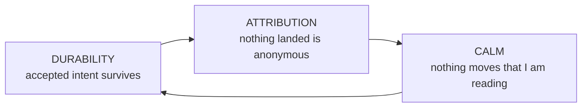
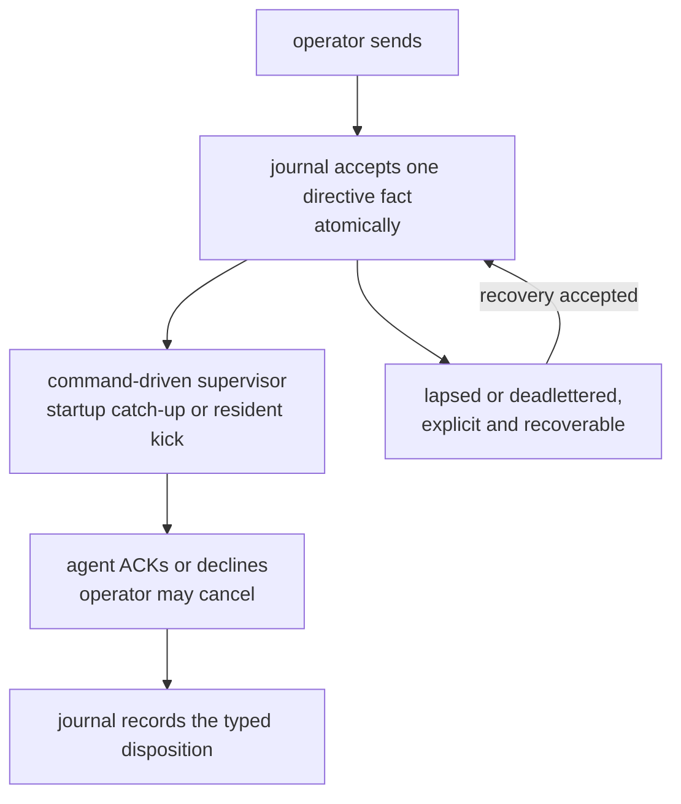
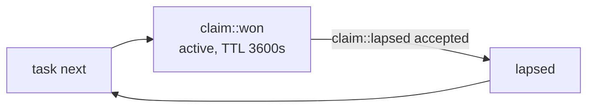
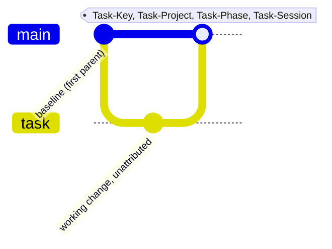
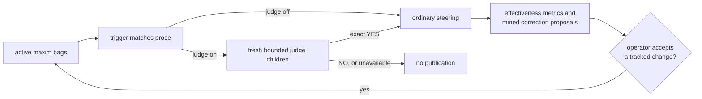
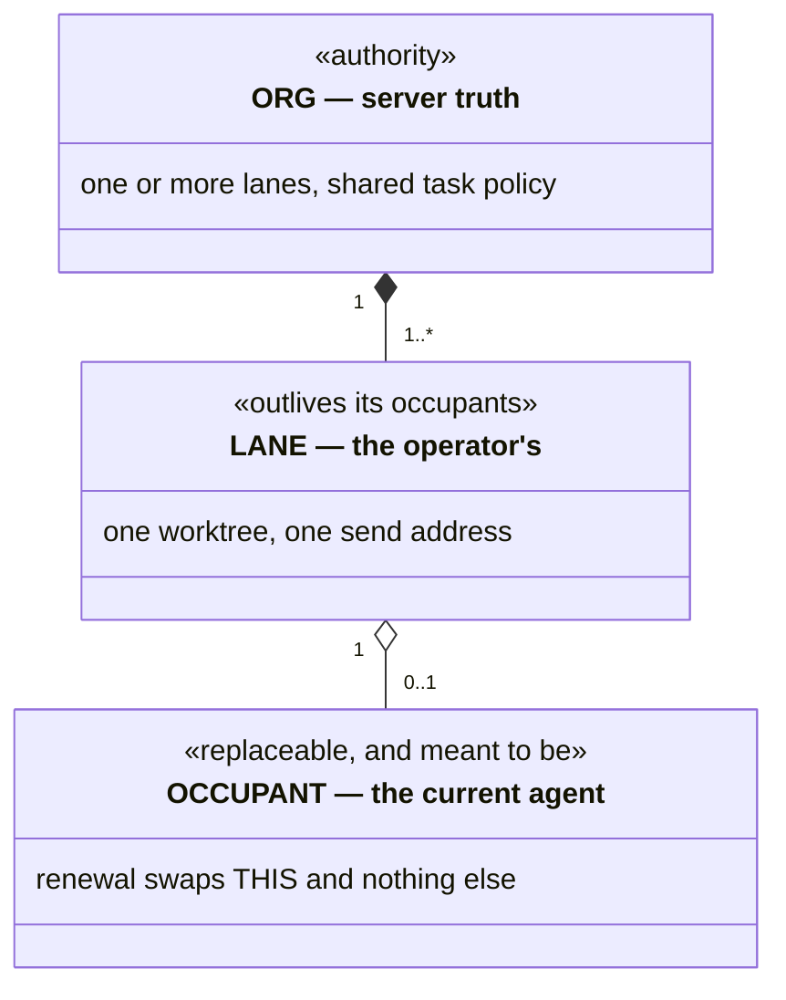
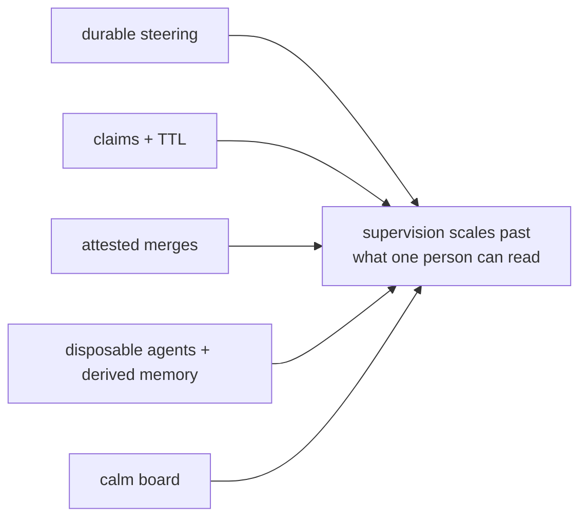

# Why this is valuable

Not the code constraints — the *workflow* guarantees and the *interface
vocabulary* that make supervising a fleet of coding agents tractable for one
person.

---

## The thesis

Running one coding agent is a chat problem. Running a fleet is an **operations**
problem, and operations needs three things chat does not have.

**Durability** begins when authority returns a live key or covering standing;
the browser's pre-acceptance queue is only a prediction. Past that boundary,
*"I told it to"* is a fact the system holds. **Attribution** makes *"who did
this and why"* a query. **Calm** makes many live streams trackable by one pair
of eyes. Remove any one and the others stop paying: an un-attributed fleet
can't be trusted, an un-durable one can't be steered, and a jittering one caps
throughput at the operator's ability to re-find their place.

Every model in this document serves exactly one of these three.

---

## Workflow invariants

The invariant register owns every cross-document label; the headings here carry
their own meaning.

### Steering is durable and has a typed lifecycle

The journal accepts a directive before any delivery reader is notified. The
command-driven supervisor reads the authenticated journal inbox directly — never
a filesystem copy — at occupant start and on resident kicks, with
occupant-local deduplication, nudge, interruption, and compaction behavior. A
*read* never changes disposition. `acked`, `declined`, `canceled`, `lapsed`,
`deadlettered`, and recovery are distinct durable facts. Only a `PendingInbox`
automatic wake that returns `Unstarted` or a terminal-class start failure
deadletters every pending directive on that lane from its retained live stage,
delivered or not; no other failure does. "Delivered" and "taken" stay separate,
visible facts. Operators and seated agents read lane IDs, seating, and active
claims with `spice lane list`; a peer-message refusal for an unseated target
points back to it.

**Value:** you can walk away mid-instruction. **Without it:** steering becomes
fire-and-hope, and the operator becomes the durable store.

### Decline is a first-class answer

Both ACK and NAK retire the item; NAK records `declined`, and decline is taught
beside ACK in the agent readouts and worktree skill. In the app the resident
consumes the marker before publication, so both render as ordinary Markdown
with the lane accent.

**Value:** an agent that disagrees says so instead of complying badly. **Without
it:** the only cheap path is fake agreement, and the transcript stops being
evidence.

### Silence is not consent

Unanswered steering re-surfaces through the supervisor each time a named
horizon from its publication elapses without an ACK, decline, or cancel. Every
directive follows the same horizons, and escalation keeps one lineage key, so a
resend reads as one thread of insistence rather than duplicates.

**Value:** the failure mode of a busy agent is *delay*, not *loss*.

### One actor, one claim, bounded

An actor holds at most one active claim. An elapsed lease returns the task to
eligibility only through an accepted typed lapse transaction, without rewriting
claim history. A steal is a separate typed operation replacing the exact named
claim; the displaced occupant learns through an ownership refusal, not a
fabricated inbox message. The lease and its exact opening and closing source
boundaries keep claim context reconstructible.

Asking for work while already holding a claim is an idempotent read: `task next`
returns that handle, phase, and phase-specific continuation before consulting the
allocator. When the resident creates an automatic claim, the exact occupant also
receives a compact live assignment notice; repeated observations of the same
claim do not repeat it, and the notice does not enter the steering inbox.

**Value:** two agents never hold the same task, and the board self-heals from
crashes without an operator sweep. Independent tasks can still meet at an
explicit, recoverable baseline conflict.

### Each task declares its own phase flow

A task's *flow* is any nonempty sequence of unique lowercase ASCII words; there
is no global phase enumeration, and the current phase must be a member. Unnamed,
a task without acceptance receives `plan` → `todo` → `review` and every other
task `todo` → `review`, regardless of visibility. A hidden `.oops` row parks in
`plan` with the full three-phase flow and leaves `.oops` only through an
explicit wake, which lands in `--into`, else the public project the row
recommends, else the derived `task` project.

Every accepted transition is a durable journal fact projected by the board. A
new task-owned tree also produces one attested baseline-first landing; a
baseline that already contains the work advances or fast-forwards without a
synthetic merge, and a clean review lands nothing in Git. First-parent history
therefore measures the review **change** rate, not review coverage; the journal
and board count every pass.

### Cross-review is preferred, never required

This is a **soft** guarantee with a strict selection class. Any eligible
candidate that is not the actor's own unassigned review outranks every such
self-review before priority, graph weight, urgency, and locality are compared.
Only when nothing else is eligible does self-review become selectable, so a
quiet solo board never deadlocks; the claim reply names that last resort and
asks for a verdict. The allocator assignment is both the actor's sole authority
to self-review and an obligation to finish that review: an actor never selects
its own review, but once `spice task next` returns it, authorship is not a
reason to free or defer it. A row the lane explicitly freed joins the same
class; when it returns, the reply asks the lane to record what it waits on
(`task depends`, `task require`, or `task defer`) rather than free it again.

**Value:** the fleet gets independent review whenever it *can* and degrades to
progress when it can't — prefer the good property, never let it stop the work.

### New task-owned work lands as one attested merge

Mutating integration happens only at phase boundaries. A synthesized landing is
computed before the checkout is mutated, so the visible end state is the
untouched tree or a recoverable merge — never stranded conflict markers. The
trailers ride the merge, not the working commits.

**Value:** `--first-parent` is the ledger of synthesized landings, each naming
its task, project, phase, and session, while the journal keeps every
transition. Release notes and fleet forensics become queries, and a clean review
never pretends to have changed Git.

### Every task says where it came from

Every task carries one origin realm; the wire validates only a nonempty class,
a colon, and a nonempty value. Authored creation conventionally names a
steering directive (`ack:`) or parent work (`task:`, which the server may
derive from the actor's one active claim). A typed system route may supply a
proved `gate:` or `doc:` cause. Other classes are preserved, so these are
conventions, not a closed enumeration.

**Value:** you can always answer *"why does this task exist?"* without reading a
transcript — the difference between a board and a landfill.

### The lane outlives the agent

A lane is an operator-owned container over a worktree; the agent is a tenant.
Renewal is ordinary steering, not termination: it hands the lane to a new
thread while history, drafts, scroll position, and the team's task policy
survive.

**Value:** agents become *disposable*. If the agent were the lane, every renewal
would cost the operator their context, and hoarding long-lived agents — the
thing that makes context rot — would be rational.

### Taste changes begin as evidence-backed proposals

Two loops close here. Maxim *effectiveness* is measured per bag per vendor, and
the report supplies evidence for path, extension, vendor, model, or phase
scoping. Separately, recurring corrections answered by ACK or decline cluster
into a proposed maxim filed on a hidden board. A judge tries deterministically
shuffled framings, one fresh bounded child each; an exact NO records a cleared
judgment, and unavailability, error, timeout, or exhausted ambiguity drops the
candidate. Neither loop edits the tracked set: only operator acceptance of a
tracked change adds, removes, or rescopes a maxim.

**Value:** taste arrives while the agent is still speaking, not at review, and
the set follows evidence rather than opinion. **Without it:** a maxim list only
grows, and false positives train agents to ignore it.

### An agent's past is derived, never assumed

After a compaction, everything an agent knows about its past is reconstructed:
intent from the durable planes (steering, board), evidence from the transcript,
and never one standing in for the other. A transcript is authoritative about
what happened and about nothing that is wanted; what could not be read is
stated, not omitted.

**Value:** an agent resumes instead of restarting, which makes disposable agents
affordable. **Without it:** the agent's restatement of a directive becomes the
directive, and every compaction is a game of telephone.

### External publication follows the exact plan the operator read

Release publication executes from a resolved, sealed plan: each effect is
rendered in full, and execution is pinned to the digest the operator read. A
changed input refuses, naming the expected and supplied digests, and requires a
new preview. Moving a tag is not an option at all ([A version names exactly one
commit](invariants/distribution.md#distribution-a-version-names-exactly-one-commit)).
This is durable steering pointed at decisions: approval is as binding as
instruction.

**Value:** approval covers a specific set of operations, not an intention.
**Without it:** consent is given for a summary while something else runs.

---

## UI components

### Chat locations

Chat is the only durable surface, routed as `#/chat`. Work remains a visible
action, not a destination: it opens the browser-local task overview over Chat.
Global and team task controls derive an exact task set from the admitted board;
opening or closing that overview does not write browser history.

Retained Chat cards add `/card/{target}`. A target is one segment with letters,
digits, and `-`; any other spelling is refused. A missing or empty fragment, or
stray slashes around Chat, is replaced in place with the canonical route. An
unknown route, a retired Dash or Work fragment, or a stray query opens Chat,
replaces the address with `#/chat`, and names the refused location in a toast.
An authenticated remote opening first captures its one-time fragment into
tab-local session storage, then makes the same `#/chat` replacement; bootstrap
and speech reuse only that token, and route fragments are never credentials.

Following a Chat card pushes one history entry. Back and Forward restore Chat
and retained-card locations. A card outside retained Chat history is replaced
with plain Chat and a toast names it; a transient read failure keeps the card
location and its Retry. The team activity surface is a retained Chat card at
`team-stream-{team}` while that team remains current and teamed; an unknown or
independent lane is unavailable.

Task overview selection, controls, map viewport, drafts, team arrangement, the
Spice sidebar, speech, and narration are browser-local. Task overview and Spice
content share one sidebar surface and swap without creating history. A card
route closes task overview. Closing either sidebar content directly restores
focus to its surviving launcher.
Following a retained Chat quote is a history step, and Back returns to the
linking card where the reader left it. A fresh card link brings its card into
view and focus once Chat hydrates, holding it as older history loads until the
reader scrolls.

### The Spice button quota well

The Spice button divides global weekly capacity into account layers. Each
account's layer height is its available contribution, so the stack shows global
remaining capacity. Colors follow total allocated capacity: the largest
provider first, and within it the largest account first. Missing, blank, and
unrecognized tiers count as 20× unless an explicit Free (0.2×), named $20 (1×),
or 5× tier (including OpenAI Pro Lite, the $100 Pro plan) says otherwise.
Each account takes the next agent accent in that order, unshaded. Layers stack
by remaining capacity: the account with the most left at the bottom and the one
nearest to running out at the top, with equal amounts kept in capacity order.
Usage therefore moves layer surfaces and positions, never colors; a failed
refresh desaturates them. Spent capacity above the layers is a faint neutral
hatch rather than bare page, so the well never reads as a hole in the button,
and its texture stays distinct from any desaturated layer. The button's
Flush-glass face and inset shadow stay neutral. Its two-pixel ring is neutral
by default, reddish for Fast mode whether or not an app update is available,
and blue for an update alone; quota colors never change. Hover preserves that
admitted ring, face, and shadow instead of
adding an accent. Pointer contact depresses the button by 1.5 pixels with the
same inset pressure shadow as the composer controls, then release restores its
anchor before the open view persists.
Every sidebar is one side view in a standard width: the Spice sidebar takes
the small width and task overview the large one. A side view and its frosted
veil simply fade in on open and fade out on close, with no movement or
scaling, and appear and leave at once when reduced motion is requested.
Pressing the Spice button opens that view
around the button: the fixed 34-pixel square trigger stays circular with its
inline center over the shared 80-pixel pip and composer-control column, and its
block center halfway between the global and team task-tab rows. One pip
therefore sits exactly beneath it while larger pip sets spread around the same
axis. The trigger remains unmoved and unfaded above the sheet, beneath the quota
percentage, while the view fades in behind it. Pressing the button again, Escape,
or the backdrop closes it and restores focus to the button.

Routine background work is silent and still. Connection lives in the button:
starting, connecting, and reconnecting grey and slowly pulse its pepper, and the
tab title and icon say `Loading` or `Disconnected`; the closed command bar adds
no prose beside it and nothing in the bar moves. A quota sample in flight
changes no word, row, or layer; only a finished attempt changes what quota
shows.

The open sidebar stacks the cumulative plan-weighted weekly percentage
directly above the Spice button, with the light/system/dark theme selector
beside that button in the header. After a failed refresh the percentage mutes
while retaining the last good value; before any retained weekly figure exists,
the same fixed-width place shows a loading or unavailable mark.

Provider quota detail rows preserve each provider's authoritative remaining
quantity. Percent limits label that capacity `N% full`; their filled segment
starts at the left edge, so consumption exposes the track from the right.
Counted limits retain their explicit remaining and total units. A
provider-reported raw credit balance appears on its account card in whole,
locale-grouped credits, beside the reset credits when the account has them and
on its own **Credits** line otherwise, separate from time-window quota and
banked reset grants; balances are never inferred, combined across accounts, or
treated as API-dollar credit. A balance is OMP's normalized `balance`-scoped
windowless limit whose `credits` amount reports what remains and no total;
windowed, differently scoped, or capped credit allowances stay meters. OpenAI
Codex balances reach that shape through Spice's one maintained OMP extension,
which the appliance carries and the resident pins in its runtime directory and
names by exact path on every sample: it delegates to OMP's built-in Codex usage
provider once, keeps a balance the provider already normalizes, leaves a
missing balance missing, and fails the account's report on a balance that is
not a finite decimal. Every Codex report it returns carries its stamp, and a
sample with an unstamped Codex report fails, because OMP serves its built-in
provider without a word when it cannot load a named extension. Each limit row
keeps its amount and compact reset cadence beside the meter at ordinary and
narrow sidebar widths; a long limit name wraps rather than forcing horizontal
overflow.

Inside the Spice sidebar, each open team shows every member row, so a team of one
is one row tall and a team of three shows all three; membership is content,
not a placeholder to hold. "No open teams" holds one team of one agent, "No
unassigned agents" and an import menu's "No available agents" hold one agent
row, the team sections stand inert saying what they await until agent state
arrives, and the operator section stands as its disabled identity form while
settings load. Agent rows stay one row however long their names, so the first
team of one opening, the first agent, and the identity's arrival move no later
section ([a changing
region holds its largest
footprint](invariants/lifecycle.md#surface-a-changing-region-holds-its-largest-footprint)).

Action-delivery refusals, composer refusals (image intake, a restored wake,
unreserved renewal), best-effort speech failures, and overview problems
(unavailable task detail or relationship enrichment, a capability without
enrichment) use the shared root toast above Chat and outside
page flow, clearing after a fixed dwell. A condition toasts when it begins,
not on every reconnect attempt. Replacing a retained read is routine and
shows, toasts, and announces nothing; a first read holds its footprint with a
prose-free placeholder. An in-place retry stands only where content is absent,
inside that reserved footprint. Validation, empty local content, and durable
degraded state stay beside what they qualify.

### Sidebar topology and account detail

The Spice sidebar presents each team left to right in canonical order: member
zero, the main agent, at the far-left origin, later members rightward. Chat
projects that order from its right-side controls; neither changes identity,
accent, keyboard order, or attribution.

The first section pairs a compact operator identity row — the avatar carries the
badge, which a Gravatar shows in a band across its lower third at the same size —
with three fixed resident fields: connection, appliance version, and epoch,
whose loading values keep settled geometry. Weekly quota account cards carry
the same capacity-order accent as their layers in the stable Spice-button fill.
Every account card keeps each reset credit on its compact line, with provider
detail followed by a live relative grant age, a live expiration countdown, and
exact timestamps on hover. Long provider prose truncates. "No account usage
reports" holds one single-limit card, and each "None." holds one list row; list
rows stay one line, the full row in their title, so a first account moves nothing
below.

### The task overview

The global task total and global stem controls open one browser-local overview
over Chat. The total selects every current open task; a stem selects every open
task under that exact public or hidden stem. Team totals and team stems select
the corresponding team-wide or team-and-stem set. A task handle selects exactly
that task, a project fact selects its exact full dotted project, and a
relationship control extends the current set with its target.

Selection is an explicit, deduplicated vector in the resident's admitted offer
order. It has no hidden current task, page, or sibling set. A valid context may
produce an empty selection and still opens the same overview with an explicit
empty state. Team membership follows the strongest current association: the
team of the lane actively claiming the task, no team when that lane is
unteamed, otherwise the current creator team, otherwise the last claimant's
team. Until topology loads, the client does not invent a team association.

The overview is graph-first, at the same reading width as a task sheet. Its
heading names the selection context and exact count, then the graph appears
before jobs and details. A diagram never draws above its natural size until the
operator zooms. The overview reserves geometry: the graph frame, relationship
list, and jobs table each hold one fixed footprint and scroll within it, and a
first detail read holds a full sheet height, so reads answering, other lanes
changing the board, and jobs coming and going move nothing below them. Every
selected task is a root in the immediate graph built from the admitted board
snapshot; direct dependencies outside the set and missing durable identities
remain explicit. Dependency edges point from each prerequisite to the dependent
it **blocks**. Typed relationship reads enrich Dependency, Lineage, Review, and
Lifecycle lenses within their protocol root and node bounds, but those bounds
never remove a selected root. Lens, direction, depth, and enrichment expansion
controls qualify only the typed read they change. The graph has no
zoom, pan, or reset rail: wheel, touch, pointer drag, pinch, and keyboard input
manipulate its viewport directly, with fit as the lower bound. A plain vertical
wheel event consumes the graph range available in its direction and transfers
only the remainder to the overview sheet; at fit or an existing boundary the
whole delta advances the sheet, including later deltas in the same wheel
transaction. Relationship lists, code blocks, and tables likewise hand
vertical input to the overview sheet whenever they have no range left to
consume. Loading, refusal,
retry, and truncation remain explicit. A streamed task fact re-reads a cached
lens only when it changes
a displayed task or can add an edge into that graph; unrelated task activity
does not refresh it. A response that advances only the journal snapshot does
not publish another browser render.

**Running jobs** follows the graph and represents every command the admitted
lane table reports as running or awaiting delivery, independent of the task
selection. Rows name the agent, live started age, full command on hover, and
reported standing. Five jobs show in full; more scroll in a
keyboard-reachable region under pinned headings with the sixth peeking. The
table holds that height with fewer jobs, so no job moves the detail region.

All selected task details are mounted together below the graph and jobs in the
same order as the selection. There are no Details/Map tabs, task pagination,
next/previous controls, or table of singular task pages. A graph or
relationship control for an already selected task scrolls and focuses its
article; an external related task extends the set. Each article carries its
contract, attachments, state, ownership, blockers, relationships, provenance,
closure evidence, observations, and composer. Loading or unavailable evidence
occupies that task's own article and does not hide its siblings.

Descriptions, acceptance criteria, observations, and closure evidence render in
the same sanitized Markdown dialect as Chat messages: math, Mermaid diagrams
with their source toggle and full-size view, footnotes, tables, and image
previews. Headings nest under the article's own. Wide code and tables scroll in
their own box, raw HTML stays literal, and unsafe link schemes lose their
destination. A handle already selected, in prose or as a whole code span,
becomes a task chip that focuses its article; unrelated handles, code blocks,
and link text remain literal. A task chip's bounded hover text uses the
task-specific prose rendered with that handle instead of a generic inspection
label; an isolated handle says `Open task HANDLE`. A retained creator-context
link opens the newest retained Chat message at or before the recorded creation
boundary and appears only when the lane proves the recorded transcript
generation.

The observation composer mirrors Chat: the draft is on the left and equal
action pills on the right hold **Add** and, for an operator, **Close**. Enter
inserts a newline; Command or Control + Enter adds an observation. Holding
Shift with that chord closes through the same permissions and validation. If
Close is unavailable, the chord does not add an observation and the draft
remains. Closing a task a lane still holds names that holder in the action's
description.

The overview is one modal sheet. It opens focus on Close, Escape and the
backdrop dismiss it, reduced motion removes its transitions, and close returns
focus to the surviving control that launched it. Narrow screens use the same
graph-first and whole-set reading order without introducing another task
browser.

The global task strip and each team's task band retain their horned-tab
presentation and visible Work terminology. Global and team totals use thick
outer rails, as does each team's permanent pip tab; global stems and team stem
containers use the thinner ordinary rails. The global total and stems hang from
the command bar; a team's total, stems, and handles stand above its status band.
Their count badges remain lifecycle-neutral, ownership accents remain on task
handles, and overflow scrolls within the strip. These controls open the local
overview and never create a Work URL.

Operator Directions no longer have a global archive page or route. Lane-menu
direction attention opens the complete current task set for that lane's team;
an unteamed or taskless context opens the explicit empty overview. Retained
Chat cards remain the durable source for linkable conversation. No paged
direction ledger, direction finder, route anchor, or compatibility alias is
kept behind the overview.

### The team console

Chat tiles one always-mounted console per live team: identity, liveness, member
standing, composer, and the lane-attributed stream. Each member lane stays the
concrete address of one worktree; a team is never a broadcast identity. The
header's first row fixes the team total at the left when work exists and the
ordered lane-light stack in an 80-pixel rising tab at the right, aligned with
the composer controls. Task tabs scroll between those edges and fade beneath
both fixed tabs. The complete live status ticker owns the second header row,
using all of its inline width for relative age, lane standing,
agent/tool/command prefix and accent, truncated detail, accessible label, and
live-region behavior. A `job` call's detail reads as its typed intent, the
purpose the agent declared for it, followed by the operation and job id it
names for correlation, as in
`job: Waiting for the gate (wait dVW6Zkf0h)`; updates and the result keep that
line and append their state, and a call that declares no intent shows the
operation and id alone. The task pill opens the browser-local overview with the
canonical complete team task set; no local analytical pane or route duplicates
it.

The composer, speech and allocation controls, and send action retain their
geometry and remain mounted. The former standalone ticker row becomes message
stream height instead of resizing those controls. Empty, narrow, and
short-height consoles keep the same usable header, composer, and stream
boundaries; an empty fleet reserves the ticker's middle slot without inventing
status.

The stream carves its card lattice's 9px perimeter and shared row and column
seams from the admitted console rectangle. That seam equals each card's content
inset and appears once between neighbors, never once per card edge. Text cards
and edge-to-edge image covers both shrink inside their existing cells; the
lattice does not grow, reorder, overlap, or open a page-level overflow to make
room.

An assistant can reuse an exact image path it previously read without making
that path browser authority. The resident correlates one successful typed read
and provider image inside the same lane, occupant, and transcript source, then
reacquires the content-addressed provider blob for display. Unknown, stale,
cross-source, or conflicting paths stay ordinary authored Markdown and trigger
no local-file or network lookup; alt text, titles, quotes, and classifications
remain the authored message.

Seat and import share one panel, even for an empty fleet. Moving a member to a
new team preserves its siblings and allocation policy; leaving all teams moves
only that member to its lane identity, keeping its seat.

### The lane menu

Each Chat lane's menu swaps that lane's composer for its seat panel, scrolling
inside the lane; it is the only home of per-agent controls and details.

It leads with what that agent needs from the operator now. First, consent
requests the member queued, allowed or denied in place under operator authority
against the witnesses of their queue. Then member-held tasks only a human can
move — a claim iced on unmet requirements, unclaimed work blocked on them,
finished work in review; sibling dependencies are not shown. Last, a lease
within two minutes of expiry and direction waiting over five minutes. A ruling
lands and its request leaves; task attention opens the exact task overview,
while direction attention opens that lane's complete team task set. With
nothing due the list is absent.

The lane controls follow: Wake only on a seatable vacant seat, Drain only on an
occupied one, Remove only on a vacant seat holding no claim, plus renewal on any
seat (a vacant one is marked for its next start) and the next-launch model,
which reports the pinned model. Drain and Remove confirm first; renewal submits
immediately. The command shows in flight until answered, and a refusal stays
with its reason. A control the principal's authority does not admit is absent,
not disabled.

Task, Latest activity, and Waiting direction rows update in place: tasks and
waiting directions open their exact overview sets, while activity links enter
the exact Chat message or composer. Presence and its age, and the copyable
channel, occupant, session, and worktree identifiers, complete the panel beside
Create new team and Leave all teams.

The panel is among the smallest controls in spice, so it spends no pixel twice.
Its head is one line: label, presence state, and age. The held handle and
lease countdown live in the Task row. Every control is a bounded one-line
button, and buttons grow to share their row; the model field takes its own row
when its buttons cannot fit beside it. Rows stay single-line behind one key
column sized to the longest key, truncating values that keep copy on click.

### Lane, team, occupant

Three objects that are expensive to conflate, separated by **how long each
lives**.

A lane belongs to one team at a time and may move; `Leave all teams` makes one
member independent. The team owns the shared task policy: renewal keeps it, and
a moved lane takes its destination's. An absent occupant makes the lane vacant,
while the UI separately shows `bound` or `unbound` unless queued operator
steering outranks liveness. A fused host renders one merged stream while each
member keeps its own send address.

**Value:** the operator manipulates topology directly — drag a team onto
another's edge to fuse — while the server owns membership, ordering, and
revision; browsers may hide different teams without disagreeing about topology.
Replacing the occupant is cheap enough to do casually, which is the point.

### Closed loop: The fused composer

A team presents as one ordered **strip of composer columns**, one per member:
member zero, the main agent, at the right control edge, later members leftward
with overflow — not tabs. Every message goes to exactly one member's worktree,
and the host shows one merged newest-first stream whose cards name their lane.
Member order places shards and palette slots but never orders messages or
assigns identity; the palette may repeat, so attribution is explicit and colour
is presentation. Drag a shard to reorder, or out to move its lane; a member that
briefly fails to resolve keeps its seat.

The columns and the shared send controls form one continuous field. Adjacent
members meet without a gutter, vertical separator, or structural corner; their
placeholder and entered content distinguish the recipient areas while heading
accents change directly at ownership boundaries. Focus encloses exactly one
member without moving its neighbors. This structural joining does not flatten
self-contained buttons, pips, range thumbs, or other controls whose shape
communicates their role.

**Value:** three agents are one surface, and nothing is broadcast; the merged
stream is a reading convenience over unchanged addressing. **Without it:** the
operator switches between surfaces, which stops scaling, or broadcasts, which
makes every message everyone's problem.

### The autonomy dial

Steer (explicit direction and task capture only), Drive (draw work created for
this team), Drain (draw all otherwise assignable work): three values, a
**server-side allocation lifetime** whose eligibility the client never
re-derives. Drive uses the creator team captured at task creation; later
membership changes do not move old work, and project names are not filters. A
request shows as pending on the lifetime control until the command settles.
Beside the draft, one fixed 80 × 160 control panel begins with a three-pixel
top inset and has four rows separated by three three-pixel gaps: a 34-pixel
two-slot button row, a 56-pixel `Send` row, then two equal 29-pixel range rows
because $(160 - 3 - 34 - 56 - 3 \times 3) / 2 = 29$. `TURBO` occupies the
upper-left slot at the same diameter as the global `Spice` control, giving it
equal three-pixel top and left clearance. A same-diameter hamburger in the
upper-right slot opens the team's swap/join arrangement menu. Both utility
buttons use the primary panel's Flush etched-glass surface.
Each range runs left to right, minimum to maximum, as a 46 × 22 labeled thumb in
a 74 × 26 pill groove: two pixels of clearance above and below, and three
pixels of panel inset at each end. Every current-value word fills the same
32 × 9 label box, centered with seven pixels of horizontal and six-and-a-half
pixels of vertical thumb clearance; the box clips overscan before it reaches
the rounded edge. One current-value word remains continuously visible and
travels with its flyer; no label crossfade or replacement gap occurs. Both
ranges use the same continuous backplane light map: the left stop remains
neutral, the middle stop glows green, and the right stop glows amber. Each
active groove is uniformly lit through its center with no visible point
emitter. `Send`, team `TURBO`/`BASIC`, the menu button, and both flyers share
one Flush etched-glass material. Colored light originates in the groove. The
flyer's nearly clear center transmits it while opposing inset bevels, curved
edge caustics, and slight backdrop diffusion gather it into a thick lens
perimeter. No broad state-color stripe is painted across the flyer; it retains
one fine optical edge and never becomes an opaque state fill, raised dome, or
nested ridge.

`Send` lights only when a press would submit something. One two-pixel perimeter
rim divides into an equal arc per agent that would receive the message, in that
agent's accent and in mathematical order: the first agent opens at the right
edge and the rest follow counterclockwise. A darker seam separates neighboring
arcs so two agents sharing an accent remain distinct. The button title names
how many agents a press reaches. The face remains neutral. Pointer, touch, and
keyboard contact move it down one-and-a-half pixels, deepen its upper contact
shadow, and quiet the rim; release restores the flat face without moving the
grid. A running team with no sendable draft has no rim. A
vacant member with a sendable draft joins the ordinary rim because that press
wakes and delivers to it; an empty vacant member contributes no arc. With no
running agent and no draft, the controls dim and `Send` is disabled.
For a team with more than one member, `FULL SEND` appears as a single compact
lockup only when the pending submission reaches every member. `FULL` uses the
focus color, while both words compress into the ordinary `SEND` label's width.
Ordinary submission qualifies when every member is reachable and holds sendable
content, including a wakeable non-running member; a partial set never qualifies.
The command-modifier `Send` ring shares the lane accents' two-pixel width;
focus rings remain visible around admitted actions.

While the keyboard broadcast preview is held from an eligible primary composer,
`Send` replaces the ordinary recipient rim with that of every occupied member
the broadcast would reach, whatever the drafts hold. Its command ring takes no
single accent: the recipients' light combines into the theme's ink
signal, near white on dark glass and near black on light. Releasing the
modifiers restores the ordinary face. During that preview, `FULL` instead
follows the actual broadcast recipients and appears only when they cover every
member, so broadcast mode is not itself a full send. Single-member teams always
retain the plain `SEND` label. Team `TURBO` keeps its lettering in both states,
muted when off and brighter with a neutral glass wash when on, without a colored
edge; the range flyers keep neutral edges at every stop. Pressing the composer's
`TURBO` flips that team flag, which the resident keeps across restarts. The
button shows the requested state at once and holds it until the resident answers
that request. A reply older than lane authority the app already holds settles to
that authority: silently when it shows the requested state, and with the team
issue when it replaces that state. A refusal, a fault, or a reply that carries no
lane authority for this session restores the resident's flag and reports the
team issue.

Settings is the first section of the Spice side view. Its separately admitted
global `TURBO` control stands at the right end of the heading row, with the
same neutral 34px Flush etched-glass face and on/off lettering as team TURBO.
The control remains disabled until settings have loaded and the resident offers
that command. In the identity section below it, the Save action sits under the
operator avatar and stays the form's submit action, so Enter in either field
saves as well.
Fast mode is additive: a member launches in fast mode exactly when its own flag,
its team's flag, or the global setting is on, so turning one level off never
slows a member another level still enables. Running OMP agents whose effective
value changes take it at once. The draft field is one glass
thickness. One inherited depth parameter drives the shared control-glass paint:
headers use its default two thicknesses, while the control frame overrides it
to three. Each surface receives that paint once, so the moving page stays
visible through it. The controls continuation has neither a top divider nor an
attached perpendicular rule; soft lateral shadows separate sibling composers,
the sibling seam starts only below the continuation, and the adjacent
member-header rules remain visible. The frame uses the
same restrained corners as the adjacent draft rather than pill geometry.

**Value:** the knob between "I approve each thing" and "go find work", immediate
to use without pretending to have settled.

### The always-mounted team Chat surface

Each live team mounts one Chat surface; there is no team-local mode or hidden
alternate pane. Member columns own horizontal overflow and the browser keeps
native ownership of every vertical gesture. The composer overlays the plane,
whose content starts below a composer-height spacer, and moves exactly as far
as the cards scroll until hidden or revealed; it never cancels an event or
writes the plane's scroll position. The plane is one lower paint context, so no
card or nested control crosses the still-visible composer while its transform
catches up to scrolling. Home and End also set composer exposure.
The toolbar remains fixed, with the lane-light stack in the right task tab and
the status ticker owning the full row below it. The message stream owns the row
the standalone ticker once occupied.

Creator-context and actor links enter the exact Chat card or composer. Return
anchors retain card identity and scroll offset only; Back and Forward do not
restore browser-local overview or layout state. With no team at all the surface
keeps the same toolbar and an empty middle status slot, so the first team to
form, or the last to dissolve, moves no header control ([a changing region
holds its largest
footprint](invariants/lifecycle.md#surface-a-changing-region-holds-its-largest-footprint)).

**Value:** the console is continuously both a writing and reading surface,
without a toggle, threshold, or remount that could lose drafts or controls.

### The reading contract

Newest-first masonry where an unchanged card gets **no style write at all**.
New content places by insert, never by repacking; a reader more than 80px from
the top is compensated in the same frame, and within 80px the push-down snaps
because there it is the signal.

**Value:** this is what "calm" costs and the most exacting requirement in the
product: reading many live agents is impossible if the board reflows.

### Status carries both tone and count

Lane indicators use saturation for recency. Global task pills spell ready,
active, and blocked-or-deferred counts rather than asking colour to carry them;
hidden stems sort after public ones with the same breakdown, because a stem the
allocator skips is the one an operator triages by eye. The unpadded pill may
resize as digit widths change. A team header's per-task pills carry no counts:
each is one task, and its tone carries in-flight or dormant state.

**Value:** peripheral liveness and exact counts at once.

### Steering rendered inside the reply

Messages keep the agent's order: leading prose, then each recognized ACK or NAK
as its steering quote followed by that response, as ordinary Markdown with the
lane accent. A speaker row returning after a quote chain keeps the same minimum
gap from that chain as adjacent nested quote rows keep from each other.

**Value:** you never hold "what did I ask?" in your head — across twenty minutes
and four lanes, the difference between reading and re-deriving.

### Three attention channels

Eye (the board), ear (speech: quiet, speak, narrate), and glance (badges and the
live status ticker), each with different bandwidth. Quiet is the default and
refuses every automatic utterance for that team, including classified final
answers and broader narration; it still permits explicit playback of a selected
card. Speak admits resident-classified utterances, while Narrate reads each
newly cursor-admitted message. Card speech reads the selected message's full
text; topbar speech reads visible main content up to 32 KiB. Nothing present at
first materialization auto-plays, and enabling speech does not replay messages
whose cursors advanced while Quiet.

**Value:** the ear works while you look elsewhere, letting one operator hold
more lanes than they can watch. It is best-effort: audio never blocks the
stream, because the transcript remains the record.

---

## Why it composes

Each guarantee is cheap alone and compounding together.

Walk away mid-instruction, add an agent without a conversation, attribute
landed output without rereading commits, renew instead of hoarding context, and
watch a fleet at once: many tasks a day, independently reviewed whenever a peer
exists, with capacity following work rather than a hand-managed agent count.
Explicit operator-authorized lane wake remains available.

---

## The posture

One disposition recurs everywhere, and it is the easiest thing to lose.

Cross-review is preferred but never required. Launch-time advancement is
attempted but never raises. Optional command optimization leaves the native path
intact. Disabled judging publishes a configured trigger hit directly, while
enabled judging fails closed and publishes only a confirmed candidate.

The natural implementation of each is a hard rule — "no agent reviews its own
work", "refuse to start on a stale tree", "require the optimizer" — and each
hard version deadlocks something. A solo agent cannot review; a lane with an
unreachable remote still has local work; an optimizer cannot become a
prerequisite; an unavailable judge withholds only its speculative candidate,
never the agent's primary work.

**Prefer the good property; never let it stop the work.** That is not laxity: it
lets durability, exclusivity, and atomic landing be strict without ever
stranding anyone.
